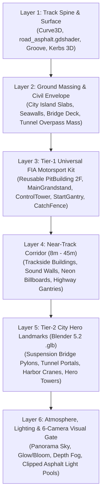

# Panduan Resmi Arsitektur & Komponen Sirkuit 3D (Circuit-Environment-Component-Guide)

> **Dokumen Pendamping:** [`Full-Car-Component-Guide.md`](file:///D:/Occupation/Porto/genex/La_Voiture/Full-Car-Component-Guide.md) · [`DESIGN.md`](file:///D:/Occupation/Porto/genex/La_Voiture/DESIGN.md) · [`ROADMAP.md`](file:///D:/Occupation/Porto/genex/La_Voiture/ROADMAP.md)

Dokumen ini adalah standar baku (*Single Source of Truth*) untuk perancangan, pemodelan aset 3D, perakitan scene, dan verifikasi visual seluruh **12 Sirkuit Kejuaraan Resmi** di *La Voiture*. Setiap sirkuit baru maupun perombakan sirkuit wajib mematuhi arsitektur **6-Layer** dan **6-Camera Visual Gate** di bawah ini.

---

## 1. Prinsip Utama: Mengapa Dilarang Menggunakan *Whitebox / Floating Primitives*

Sebuah sirkuit balap di *La Voiture* **bukan** sekadar pita jalan yang melayang di ruang kosong dengan kotak-kotak `BoxMesh` di kejauhan. Setiap sirkuit wajib memenuhi 3 hukum realisme spasial:

1. **Hukum Kontinuitas Sipil (*No Floating Ribbon*):**
   - Setiap meter jalan wajib memiliki penopang sipil yang logis: daratan pulau/plaza beton dengan dinding dermaga (*seawall*), struktur jembatan gantung lengkap dengan pylon dan kabel, atau terowongan yang benar-benar menembus massa bukit/overpass plaza gedung di atasnya.
2. **Hukum Kepadatan Koridor Kamera (*Near-Track Enclosure*):**
   - Kamera utama pemain adalah **Chase Cam** dan **Trackside TV Cam**. Jika objek terdekat berada di radius 200+ meter, layar akan terlihat kosong. Oleh karena itu, **koridor dekat (lateral 8 m – 45 m dari sumbu jalan)** wajib terisi oleh infrastruktur lintasan, tribun, pagar pengaman (*catch fence*), dinding akustik/retaining wall, fasad bangunan dekat, dan jembatan gantry.
3. **Hukum Konsistensi Gaya Visual (*Cel-Shaded Anime × Streetwear Brutalism*):**
   - Seluruh aset menggunakan material cel-shaded (`ToonMaterials` / shader khusus) dengan siluet arsitektur tegas, marka jalan kontras, dan aksen pencahayaan neon/emissive yang bersih.

---

## 2. Arsitektur Standar 6-Layer Sirkuit (Godot 4 + Blender 5.2)

### Layer 1: Track Spine & Road Surface
* **Spline `Curve3D` (`TrackRibbon`):** Menjadi sumbu tunggal untuk geometri jalan, simulasi fisika `GtRace`, AI driving line, dan minimap 2D.
* **Permukaan Jalan:** Wajib menggunakan `shaders/road_asphalt.gdshader` dengan *rubberized racing groove* (`EnhancedTrackGeometry`), garis tepi jalan putih tegas, marka lajur/sektor, dan *3D sawtooth kerbs* (+0,03 m untuk jalan raya, +0,05 m untuk sirkuit GP).

### Layer 2: Ground Massing & Civil Envelope
* **Daratan Sirkuit (*Ground Slab & Seawall*):** Area darat di sekitar lintasan wajib memiliki mesh daratan/pulau beton berbingkai dinding dermaga (*quay wall*) yang turun hingga permukaan air/dasar (`BASE_Y`), sehingga jalan dan gedung berdiri di atas tanah, bukan mengapung di air.
* **Sektor Jembatan (*Bridge Viaduct*):** Wajib memiliki parapet samping, balok *box-girder* di bawah jalan, dan pilar beton ganda yang menancap ke air.
* **Sektor Terowongan (*Underpass Cut & Cover*):** Jalan yang turun ke bawah tanah wajib diapit dinding penahan (*retaining wall* miring/vertikal) dan **di atas atap terowongan wajib berdiri massa plaza kota / jalan raya silang / blok gedung**.

### Layer 3: Tier-1 Universal FIA Motorsport Kit (100% Reusable)
Seluruh sirkuit wajib menggunakan komponen standar FIA di `scenes/race_world/paddock/` dan `scripts/world/` yang diparameterisasi (panjang, jumlah stall, dan offset lateral mengikuti `pit_layout` sirkuit):
1. **`PitBuilding` (2 Lantai + VIP Lounge):** Pintu *roll-up shutter* beraksen warna tim, garasi terbuka berisi perlengkapan kru, lantai 2 kaca VIP Paddock Club, teras observasi, kanopi kantilever, dan bendera tim di atap.
2. **`MainGrandstand` (Tribun Utama 3 Tingkat):** Di seberang pit straight; memiliki atap kantilever melengkung bertruss baja, 1.400+ penonton `MultiMesh`, papan iklan LED, dan layar **Jumbotron Live Leaderboard**.
3. **`RaceControlTower` (Menara Pengawas 4 Lantai):** Berdiri di dekat Pit Exit / Turn 1 dengan kaca observasi miring dan menara antena.
4. **`StartGantry` & `CatchFence`:** Gantry truss ganda menaungi lintasan utama + 5 pasang lampu merah FIA, serta pagar kawat pengaman (*catch fence* 3,6 m) di belakang dinding barrier.
5. **Papan Jarak Pengereman (`150` / `100` / `50` m) & Peredam Tecpro:** Dipasang otomatis sebelum tikungan tajam.

### Layer 4: Near-Track Corridor (Koridor Dekat 8 m – 45 m)
* **Sirkuit Jalan Raya (Street Circuit):** Di belakang *catch fence* (lateral 12 m – 40 m) wajib berdiri deretan blok gedung perkotaan (*street-front podiums*), papan reklame neon menghadap lintasan, jembatan penyeberangan/gantry rambu, dan lampu jalan yang cahayanya jatuh **tepat di tengah aspal** (tidak bocor keluar sisi jembatan).
* **Sirkuit Permanen (GP Circuit):** Di belakang *runoff* & *gravel trap* wajib terisi tribun sekunder, pos marshal, deretan pohon (`FoliageScatter`), dan bukit kontur.

### Layer 5: Tier-2 City Hero Landmarks (Blender 5.2 `.glb` Pipeline)
* Aset ikonik khas kota dibangun melalui script otomatis Blender 5.2 (`tools/build_<slug>_assets.py`) menghasilkan file `.glb` modular di `assets/world/circuits/<slug>/`:
  - Memiliki siluet arsitektur nyata (menara jembatan gantung berkabel, variasi gedung dengan *setback*/helipad/spire/billboard frame, derek kontainer bertruss rangka, portal terowongan berventilasi).
  - Di-instance ke dalam scene dengan `MultiMeshInstance3D` atau `MeshBatch` untuk menjaga anggaran performa.

### Layer 6: Atmosphere, Lighting & Post-Processing
* Menggunakan `WorldEnvironment` dengan langit bergradasi kaya + siluet horizon, **Glow / Bloom aktif** untuk memendarkan lampu neon, lampu jalan, dan lampu rem GT3, serta **Depth Fog** untuk memberi kedalaman jarak antar-layer gedung.

---

## 3. Gerbang Verifikasi Wajib: 6-Camera Visual Gate & Performance Gate

Sebelum sebuah sirkuit dinyatakan selesai, eksekutor wajib menangkap **6 screenshot verifikasi 1920×1080** dan memenuhi anggaran performa:

| Gate | Sudut Kamera | Yang Wajib Terlihat Jelas (Kriteria Lulus) |
| :--- | :--- | :--- |
| **Cam 1** | **Start / Pit Straight Wide** | `MainGrandstand` + Jumbotron di kiri, `StartGantry` 5 lampu FIA di tengah, `PitBuilding` 2 lantai + 10 garasi + `RaceControlTower` di kanan, `CatchFence` utuh. |
| **Cam 2** | **Sector 1 Hero Landmark** | Landmark utama Sektor 1 (mis. *Shuto Suspension Bridge* dengan menara pylon tinggi, kabel gantung bercahaya, parapet jembatan, dan air teluk di bawahnya). |
| **Cam 3** | **Sector 2 Hero Landmark** | Landmark utama Sektor 2 (mis. *Underpass Tunnel Portal* dengan massa overpass/plaza gedung di atasnya, dinding retaining wall, dan koridor gedung chicane + neon billboards). |
| **Cam 4** | **Sector 3 Hero Landmark & Pit-In** | Landmark utama Sektor 3 (mis. *Harbor Hairpin* di atas dermaga beton, crane rangka truss, tumpukan kontainer detail, kerb, dan jalur pisah Pit Entry dengan crash cushion). |
| **Cam 5** | **Helicopter Overview (Aerial)** | Pandangan udara seluruh sirkuit: **0 jalan melayang di ruang kosong**, pulau daratan/dermaga menyatu rapi dengan jembatan dan gedung. |
| **Cam 6** | **Player Chase Cam (In-Race)** | Pandangan kamera balap di belakang mobil: koridor kiri-kanan terasa padat oleh gedung dekat, pagar, lampu jalan, dan papan neon. |

### Anggaran Performa Wajib:
* **Draw Calls Sirkuit:** $\le 160$ draw calls.
* **Segitiga Lingkungan:** $\le 320.000$ triangles.
* **Frame Time:** Rata-rata $\le 16,66\text{ ms}$ (60 FPS locked pada 1080p High dengan 20 mobil).
* **Zero Regression:** Seluruh test suite headless proyek wajib **100% PASS (0 FAIL)** dan **0 orphan node**.
