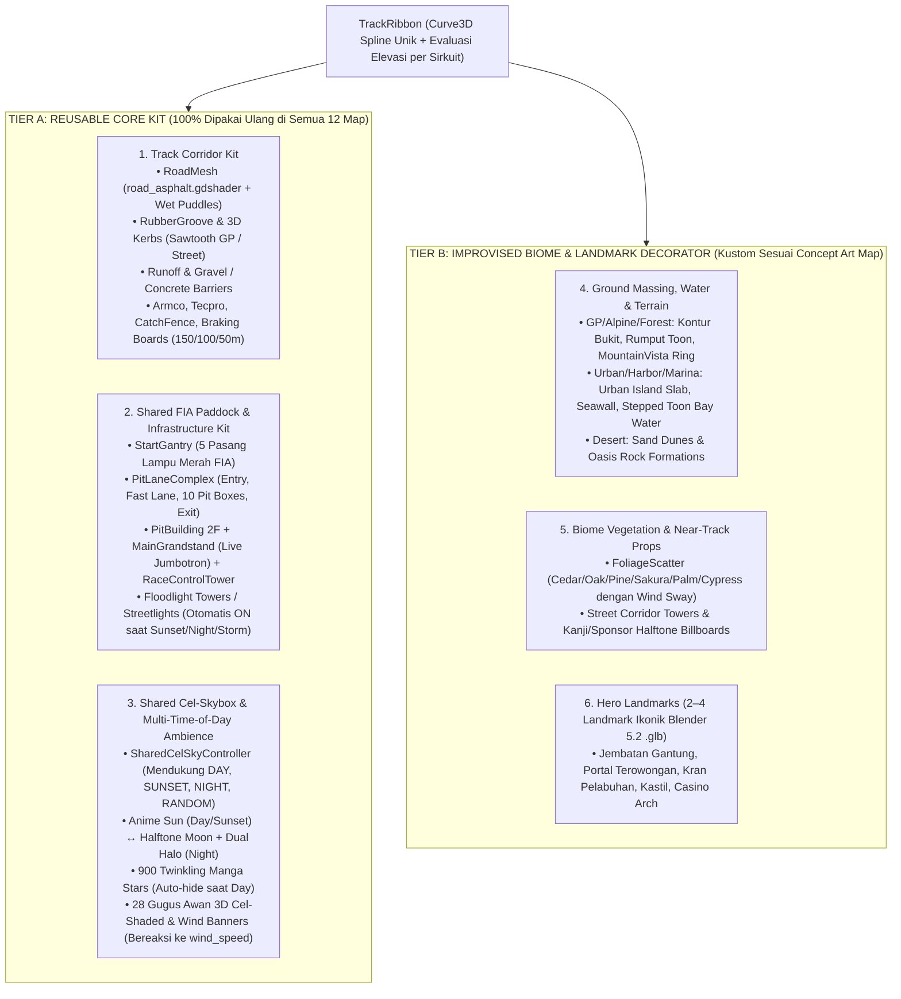

# Panduan Resmi Arsitektur & Alur Kerja Sirkuit 3D (`Circuit-Environment-Component-Guide` v2.0)

> **Dokumen Pendamping:** [`Full-Car-Component-Guide.md`](file:///D:/Occupation/Porto/genex/La_Voiture/Full-Car-Component-Guide.md) · [`DESIGN.md`](file:///D:/Occupation/Porto/genex/La_Voiture/DESIGN.md) · [`ROADMAP.md`](file:///D:/Occupation/Porto/genex/La_Voiture/ROADMAP.md)

Dokumen ini adalah standar baku (*Single Source of Truth*) untuk perancangan, pemodelan aset 3D, perakitan scene, gaya visual **Cel-Shaded / Toon Anime**, dan verifikasi visual seluruh **12 Sirkuit Kejuaraan Resmi** di *La Voiture*.

---

## 1. Filosofi Utama: Arsitektur 2-Tier (**Reusable Core Kit** vs **Improvised Biome Decorator**)

Agar pembangunan 12 sirkuit berjalan cepat, konsisten, dan bebas duplikasi kode ribuan baris, setiap map sirkuit dibagi secara tegas menjadi **2 Tier**:

### Aturan Emas Pembagian Tier A vs Tier B:
1. **Jangan Pernah Menulis Ulang Tier A per Sirkuit:**
   - Area lintasan (`RoadMesh`, `Kerbs`, `Barriers`, `CatchFence`, `BrakingMarkers`), infrastruktur paddock FIA (`PitBuilding`, `MainGrandstand`, `RaceControlTower`, `StartGantry`), dan langit (`SharedCelSkyController`) **wajib menggunakan komponen bersama (reusable)** yang otomatis membentuk dirinya mengikuti bentuk spline `TrackRibbon` sirkuit tersebut.
2. **Improvisasi Kreatif Difokuskan 100% pada Tier B:**
   - Saat membangun map baru dari gambar referensi (`reference-assets/tracks/<slug>/concept_key_visual.png`), pembuat map cukup mengimprovisasi **Terrain/Air**, **Vegetasi Biome**, dan **2–4 Hero Landmarks** unik yang memberi jiwa pada sirkuit tersebut.
3. **Semua Sirkuit Wajib Mendukung 3 Segmen Waktu (`DAY`, `SUNSET`, `NIGHT`, + `RANDOM`):**
   - Melalui `SharedCelSkyController` dan parameter `time_of_day` dari `GtWeather`, setiap map wajib tampil hidup dan koheren baik saat Siang (`DAY`), Senja Keemasan (`SUNSET`), maupun Malam (`NIGHT`).

---

## 2. Standar Wajib Gaya Visual: **Cel-Shaded Anime × Manga Inking × Halftone**

Seluruh elemen lingkungan (baik Tier A maupun Tier B) **wajib lulus pemeriksaan gaya visual Cel-Shaded Anime** berikut dan dilarang menggunakan material PBR mentah yang menghasilkan kilap plastik/realistis:

| Aspek Visual | Aturan Teknis Wajib di Godot 4 | Larangan Keras (Anti-Patterns) |
| :--- | :--- | :--- |
| **Shading Permukaan** | Wajib menggunakan `render_mode diffuse_toon, specular_toon` atau pita warna bertingkat tegas (*stepped cel bands* 2–3 tone). | Dilarang memakai `StandardMaterial3D` PBR reflektif (`metallic > 0.5, roughness < 0.3`) pada air atau gedung yang memantulkan bola putih silau. |
| **Garis Tinta (*Manga Ink Outline*)** | Gedung koridor, menara skyline, dan landmark utama wajib memiliki `next_pass` outline tinta hitam (`inverted_hull_outline.gdshader` atau `neo_wangan_skyline_outline.gdshader` di ruang dunia). | Dilarang membiarkan massa bangunan jauh menyatu tanpa kontur siluet terhadap langit. |
| **Pola *Halftone Screentone*** | Jendela gedung menyala, papan reklame/billboard, dan bayangan kawah bulan wajib menyertakan pola titik *Ben-Day halftone* prosedural di shader. | Dilarang membuat papan reklame berupa kotak warna polos (`BoxMesh` rata tanpa grafis/tipografi/bingkai). |
| **Permukaan Air (*Toon Water*)** | Air teluk/marina/danau wajib menggunakan shader stepped-toon (`neo_wangan_water.gdshader`) dengan pita gelombang yang bergerak mengikuti `wind_dir` & `wind_speed_kph`, serta warna yang beradaptasi terhadap `DAY` (biru laut + buih putih-cyan), `SUNSET` (lembayung-emas), dan `NIGHT` (biru malam + garis puncak neon). | Dilarang menggunakan bidang air statis tanpa gerakan gelombang angin. |
| **Ambience Langit & Angin Hidup** | Langit wajib memiliki **Matahari Anime (Day/Sunset) ↔ Bulan Halftone (Night)**, **900 Bintang Berkedip** (otomatis tersembunyi saat Siang), **28 Awan 3D Cel-Shaded** yang berputar mengelilingi horizon sesuai `wind_speed`, serta **bendera/pohon** yang berkibar mengikuti angin cuaca. | Dilarang menampilkan bulan/bintang di siang hari atau menyalakan lampu jalan/jendela malam secara penuh pada mode `DAY`. |

---

## 3. Alur Kerja Standar Pembuatan Map Sirkuit Baru (Step-by-Step Workflow)

Setiap kali menambahkan atau merombak sirkuit di kalender 12 ronde, ikuti 5 tahapan baku berikut:

### Tahap 1: Concept Art & 4-View Visual Reference
1. Pastikan tersedia `concept_key_visual.png` dan 4 *View Gate References* (`view1_main_straight_pitstop`, `view2_sector1_landmark`, `view3_sector2_landmark`, `view4_sector3_pit_entry`) di `reference-assets/tracks/<slug>/`.
2. Identifikasi daftar aset **Tier B (Improvised Biome)**: jenis terrain/air, jenis pohon, dan 2–4 *Hero Landmarks* ikonik.

### Tahap 2: Track Spine (`Curve3D`) & Civil Ground Envelope
1. Bangun kurva tertutup `TrackRibbon` beserta profil elevasi (`Y`) dan daftar tikungan (`turns`).
2. Bangun penopang sipil kontinu (**Hukum Kontinuitas Sipil — 0 Floating Road**):
   - Daratan/pulau beton berbingkai *seawall* atau kontur bukit,
   - Dek jembatan + pilar hingga dasar air (`BASE_Y`),
   - Dinding *cut-and-cover* + massa plaza/bukit di atas atap terowongan.
3. Pada track berelevasi, uji segitiga mesh terrain yang benar-benar dirender: sampel jalan tiap maksimum 6 m pada lateral kiri, tengah, dan kanan, serta lebar pit dan apron. Permukaan tanah harus berada di bawah jalan; uji juga jarak verge ke ruas jalan lain dan platform penopang pit.

### Tahap 3: Pemasangan Otomatis **Tier A (Reusable Core Kit)**
1. Pasang **Track Corridor Kit** di sepanjang `TrackRibbon`: aspal (`road_asphalt.gdshader`), `RubberGroove`, `Kerbs`, `Barriers` (dengan celah otomatis di Pit Entry–Exit), `CatchFence`, dan `BrakingMarkers` (`150/100/50m`).
2. Pasang **Shared FIA Paddock Kit**: `PitLaneComplex`, `StartGantry`, `PitBuilding`, `MainGrandstand` (terhubung ke live standings `Jumbotron`), dan `RaceControlTower`.
3. Pasang **Shared Cel-Skybox (`SharedCelSkyController`)**: otomatis menyediakan Matahari/Bulan, 900 bintang berkedip, 28 awan 3D cel-shaded yang terdorong angin, serta respons pencahayaan `DAY / SUNSET / NIGHT`.
4. **Layout-Driven Reuse:** kirim `pit_layout` milik sirkuit ke komponen bersama; hindari konstanta sirkuit lain. Bentuk dan posisi mengikuti spline, kelengkungan, elevasi, dan jarak ke ruas lain. Komponen bersama boleh diperbaiki dengan regresi Apex dan Neo Wangan tetap hijau.
5. **Kontrak Tim–Box:** setiap balapan hanya 10 dari 13 tim yang berlomba (`GtRace.active_teams`). Box, garasi, kru, dan shutter dipetakan lewat `stall_index_for_team(team)` (-1 bila tidak punya box) dan `assign_teams(active_teams)`, bukan lewat id tim. Kompleks pit sirkuit baru wajib lulus `tests/test_pit_team_assignment_contract.gd`.

### Tahap 4: Perakitan **Tier B (Improvised Biome & Hero Landmarks)** & Shaders Cel-Shaded
1. Cetak 2–4 model `.glb` landmark khusus map via skrip Blender 5.2 (`tools/build_<slug>_assets.py`) ke `assets/tracks/<slug>/models/`.
2. Tempatkan landmark, vegetasi (`FoliageScatter`), atau koridor gedung + billboard Kanji/sponsor menggunakan `MultiMeshInstance3D` (per-distrik untuk frustum culling).
3. Pastikan seluruh shader bangunan, air, dan lampu jalan merespons parameter waktu `tod` (`DAY`, `SUNSET`, `NIGHT`) dan kecepatan angin `race.weather.wind_speed`.

### Tahap 5: Verifikasi 6-Camera Visual Gate, Multi-Time Gate & Performance Gate
Tambahkan flythrough setinggi chase camera setiap 150 m sepanjang lap dalam kedua arah, ditambah aerial pit/paddock dan entry/exit. Uji jalur pit sepanjang lane dengan clearance mobil terhadap armco, dinding, dan benda padat; inspeksi hasil pada `DAY`, `SUNSET`, dan `NIGHT`.
Sebelum sirkuit dinyatakan selesai, jalankan:
1. **Headless Test Suite:** Seluruh test suite di `tests/test_*.gd` wajib **100% PASS (0 FAIL)**.
2. **6-Camera Visual Gate + Time-of-Day Check (`DAY`, `SUNSET`, `NIGHT`):**
   - **Cam 1 (Start / Pit Straight):** Paddock FIA lengkap (`MainGrandstand`, `StartGantry`, `PitBuilding`, `RaceControlTower`, `CatchFence`).
   - **Cam 2 (Sector 1 Landmark):** Landmark utama Sektor 1 + air/terrain cel-shaded.
   - **Cam 3 (Sector 2 Landmark):** Landmark utama Sektor 2 (terowongan/overpass/chicane).
   - **Cam 4 (Sector 3 Landmark & Pit Entry):** Landmark Sektor 3 + jalur pisah Pit Entry.
   - **Cam 5 (Sky & Horizon Overview):** Memperlihatkan langit hidup (Matahari/Bulan, Awan 3D Cel-Shaded, Bintang saat malam, 0 jalan melayang).
   - **Cam 6 (Player Chase Cam Action):** Koridor dekat (8 m – 45 m) padat, cel-shading & outline tegas.
   - **Day / Sunset / Night Verification:** Pastikan tangkapan layar pada mode `DAY`, `SUNSET`, dan `NIGHT` menampilkan transisi langit, awan, air, dan lampu bangunan yang akurat.
3. **Performance Budget Gate:**
   - **Draw Calls Sirkuit:** $\le 160$ draw calls per kamera (dan $< 180$ total scene).
   - **Triangles Lingkungan:** $\le 320.000$ triangles.
   - **Frame Time:** $\le 16,66\text{ ms}$ (60 FPS locked pada 1080p High dengan 20 mobil GT3).
