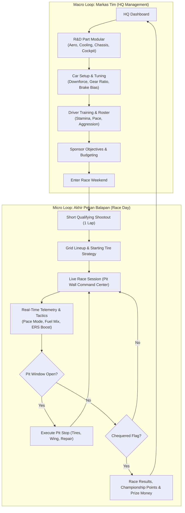
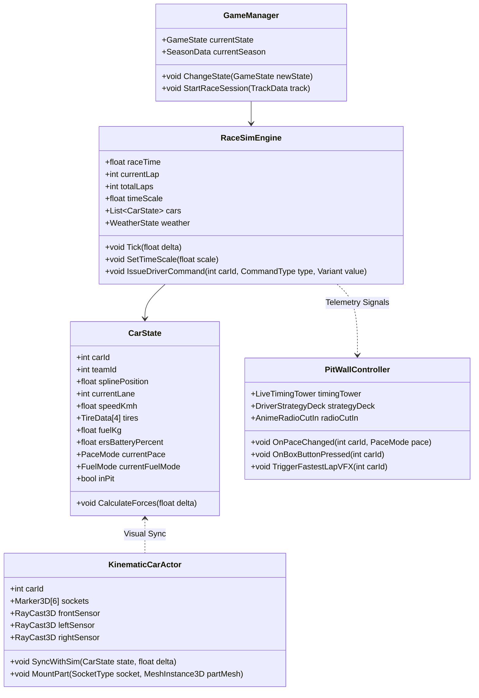

# PRD 00: Master Overview & System Architecture
**Dokumen:** Master Concept & High-Level Architecture  
**Fase:** Global Foundation  
**Target:** Game Designer, Lead Engineer, Art Director  

---

## 1. Visi Produk & Game Identity

*La Voiture* adalah game balap strategi motorsport (*GT Strategy & Team Management*) yang menempatkan pemain sebagai **Head of Race Strategy & Team Principal** di dinding pit (*Pit Wall*). Game ini menggabungkan kedalaman taktik real-time balap ketahanan GT (*Grand Touring*) dengan estetika visual **Cel-Shaded Manga Anime $\times$ Streetwear Brutalism (NFS Unbound)**.

### Karakteristik Inti:
* **Fokus Penuh pada Genre 3D Motorsport Simulation:** Game berfokus pada presentasi 3D siaran langsung (*broadcast-grade 3D presentation*) dengan kamera aksi (Chase, Cockpit, Heli, Trackside TV, dan Close-Up Pitstop Cam) di atas lingkungan sirkuit low-poly bertekstur anime (kerbs, guardrails, gantry, grandstand, dan 10 garasi pit).
* **Fisika Balap Adaptif & Match Collider Realistis:** Lintasan tidak berbasis slot kaku melainkan menghitung kelengkungan kurva spline $\kappa(s)$ untuk *dynamic apex clipping* (memotong apex tikungan), pengereman adaptif berbasis grip ban, serta deteksi tabrakan fisik 190 pasang mobil (*cyclic match collider*) dengan gaya repulsi lateral tanpa tembus bodi (*zero ghosting*).
* **Bukan Game Balap Arcade:** Pemain tidak mengemudikan setir langsung dengan tombol panah/stick, melainkan mengendalikan taktik balap (pace agresivitas, konservasi ban, manajemen bensin, mapping ERS, dan timing pit-stop).
* **20 Mobil di Grid (10 Tim Pabrikan):** Setiap tim menurunkan 2 mobil GT3 dengan livery, pembalap, dan karakteristik sasis yang unik.
* **Gaya Visual Tegas (Zero Softness):** Mengikuti [DESIGN.md](file:///D:/Occupation/Porto/genex/La_Voiture/DESIGN.md), semua visual berbasis garis tinta hitam tebal, bayangan offset tajam (*hard offset shadow*), tekstur titik manga (*Ben-Day halftone*), dan partikel grafiti gaya *NFS Unbound*.

---

## 2. Core Game Loop

Game terbagi menjadi dua siklus gameplay utama: **Macro Loop (HQ Season Management)** dan **Micro Loop (Live Race Day)**.



---

## 3. High-Level Architecture

Sistem *La Voiture* di Godot 4 dibangun dengan pemisahan tegas antara logika simulasi matematika (*Headless-capable*) dan lapisan presentasi 3D/2D (*View Layer*):

```mermaid
flowchart TD
    subgraph CoreLayer["1. Core Simulation Layer (Pure Logic & State)"]
        Sim["GtRace / RaceSimEngine (20Hz Deterministic Tick)"]
        TireSys["TireModel (5 Compounds, 75% Cliff, Punctures)"]
        FuelSys["FuelModel (5 Stages: Optimal -> Flameout DNF)"]
        AeroSys["Aero & DRS Model (Slipstream & Wake Tow)"]
        ColliderSys["190-Pair Corner-Aware SAT Contact Resolver"]
        Sim --> TireSys
        Sim --> FuelSys
        Sim --> AeroSys
        Sim --> ColliderSys
    end

    subgraph View3D["2. 3D Viewport Layer (Godot 3D World)"]
        Ribbon["TrackRibbon (4159m Spline, Low-Poly Kerbs & Barriers)"]
        CarActor["GtCarActor (Front Steer, Body Roll/Dive/Squat, ease2)"]
        ModularRoot["Modular Base Chassis (Porsche 911 + BBS FI-R Wheels)"]
        VFX["RaceVfx (3D Rain, Road Spray, Smoke, Slipstream, Flames)"]
        Graffiti["GraffitiTag (Anime Billboard Paint Slabs & Status)"]
        Ribbon --> CarActor
        CarActor --> ModularRoot
        CarActor --> Graffiti
        CarActor --> VFX
    end

    subgraph View2D["3. 2D Presentation Layer (Fused Master HUD 1920x1080)"]
        HudRoot["RaceHud (Zone A: Header Ribbon & Radar)"]
        TimingUI["LiveTimingTowerUI (20 Rows, INT/GAP/LAST via Tab)"]
        TacticalDeck["TacticalDeck (Wide Strip 1888x140px, Pace/Fuel/ERS/Box)"]
        TelemetryDrawer["TelemetryDrawer (Digital Instruments, G-Box, 4-Tyre Matrix)"]
        CutIn["AnimeRadioCutIn & Suggestion Cards"]
        HudRoot --> TimingUI
        HudRoot --> TacticalDeck
        HudRoot --> TelemetryDrawer
        HudRoot --> CutIn
    end

    Sim -->|State Updates @ 20Hz (Interpolated @ 60fps)| CarActor
    Sim -->|Telemetry Events & Suggestions| HudRoot
    TacticalDeck -->|Player Tactical Commands| Sim
```

---

## 4. Global Class Diagram



---

## 5. Ringkasan 4 Pilar Sistem

### Pilar 1: Core Simulation & Race Logic
* **Kinematic-Dynamic Ribbon Physics:** Tidak menggunakan simulasi tabrakan rigid-body yang rapuh, melainkan koridor multi-lajur dengan kalkulasi gaya sentrifugal, cengkeraman ban, dan batas pengereman.
* **Fast-Forward (1x, 2x, 4x, 8x, 16x):** Sub-stepping tick deterministik sehingga saat dipercepat 16x, kalkulasi ban dan posisi mobil tidak mengalami lompatan (glitch/teleportasi).

### Pilar 2: UI Topology & Manga Aesthetics ([DESIGN.md](file:///D:/Occupation/Porto/genex/La_Voiture/DESIGN.md))
* **Zero Softness:** Sudut tajam $90^\circ$, outline tinta `#050505` setebal $2.5\text{px}$, hard-offset shadow $5\text{px}$, tanpa blur.
* **Halftone Screentone:** Pola titik *Ben-Day dots* manga pada panel data dan tombol aksi.
* **Snap-Invert:** Reaksi instan baris tabel menjadi latar putih terang (`#F4F5F7`) dan teks hitam (`#050505`) saat aktif.

### Pilar 3: Modular 3D Car Pipeline ([Full-Car-Component-Guide.md](file:///D:/Occupation/Porto/genex/La_Voiture/Full-Car-Component-Guide.md))
* **10 Tim Pabrikan GT:** Aston Martin, Audi, BMW, Chevrolet, Honda, Lamborghini, Lexus, McLaren, Nissan, Porsche.
* **Universal Socket System:** Sasis dasar terstandarisasi dengan titik koordinat *Marker3D* untuk pemasangan part modular (*Front Splitter, Swan-Neck Wing, Diffuser, Wheels, Cockpit DDU*).
* **Blender Quality Gate:** Menjamin 0% tumpang tindih geometri (*zero overlap*) melalui pemotongan garis nat bodi alami dan shared origin coordinates `(0,0,0)`.

### Pilar 4: Rendering Toon Shading, Streetwear VFX & Audio Soundscape
* **Toon Shader:** Stepped light threshold (bayangan tajam tanpa gradasi) + pass kedua *Inverted-Hull* untuk garis outline tinta anime.
* **NFS Unbound VFX:** Efek asap ban 2D hand-drawn manga, tag grafiti billboard anime dinamis di atas mobil (`graffiti_tag.gd`), garis kecepatan (*speed lines*), road spray basah, letupan api knalpot, dan lampu sorot malam.
* **Acoustic Identity & Radio Soundscape (Fase 6):** Layout 5 bus audio Godot 4 (`Master`, `Music`, `SFX`, `UI`, `Radio` bandpass $1850\text{Hz}$ + distorsi), suara mesin GT3 3D modulasi pitch RPM ($1200 - 8500\text{ RPM}$), decit ban limit lateral $G > 1.8G$, getaran kerb, tembakan pit gun 3D, feedback klik taktil, musik synthwave dinamis dengan ducking ($-8\text{dB}$), dual anime radio overlay (Driver kiri, Engineer kanan), serta 64 baris suara radio neural TTS (Kokoro-82M).
* **Race Weekend Finale:** Rangkaian utuh dari start 5 lampu merah FIA, balapan adaptif, pit stop 3D, hingga selebrasi podium 3 tingkat beranimasi lengkap dengan pembagian poin resmi FIA GT3.

---

## 6. Technology Stack & Tools

* **Engine:** Godot Engine 4.x (Rendering Device: Forward+ atau Mobile).
* **3D Modeling & Quality Gate:** Blender 4.x (dikendalikan via `mcp-for-blender` port 9875).
* **Generative 3D Asset:** Meshy AI (dikendalikan via `@meshy-ai/meshy-mcp-server`) & Genex CLI (`npx genex model`).
* **Audio, Music & Voice:** Genex Audio CLI (`npx genex sfx`, `music`), Procedural Node.js Synthesis (`tools/audio/synth_audio.js`), dan Kokoro-82M Neural TTS lokal (`tools/audio/generate_radio_voices.mjs`).
* **Version Control:** Git repository standar.
