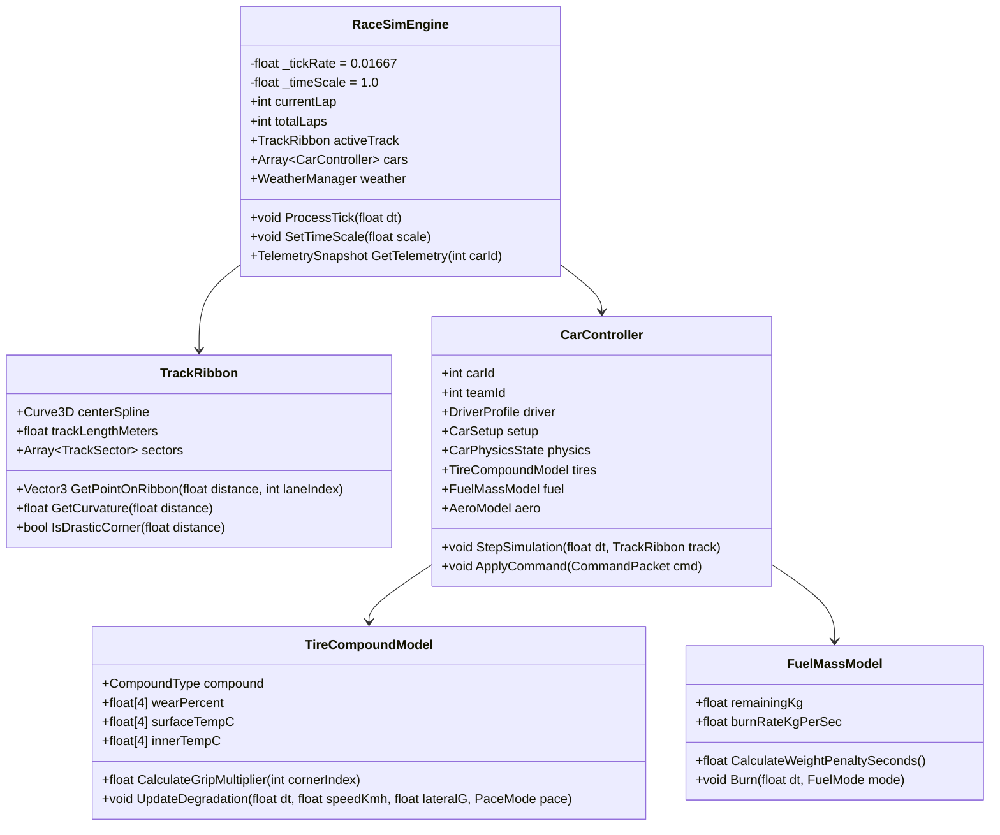
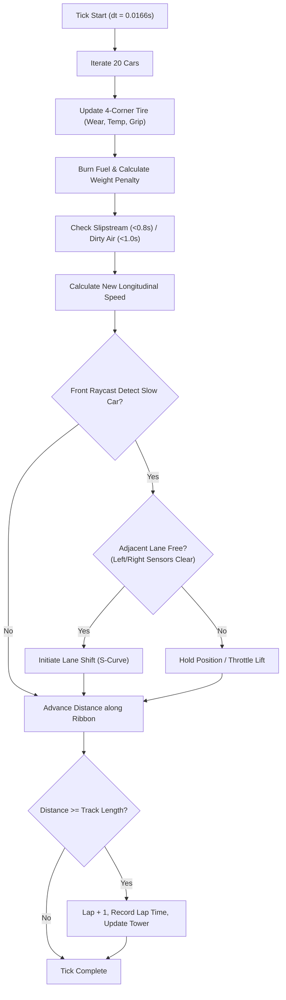

# PRD 01: Core Simulation Engine & Race Logic
**Fase:** 1 (Foundation Engine) & Fase 5.5 (Adaptive Physics)  
**Target:** Gameplay Programmer, Systems Architect  
**Referensi:** [DESIGN.md](file:///D:/Occupation/Porto/genex/La_Voiture/DESIGN.md) (Zone B: Timing Tower & Zone D: Strategy Deck)

---

## 1. Arsitektur Simulasi (System Architecture)

Mesin simulasi balap (*Race Simulation Engine*) beroperasi sebagai sistem **Tick-based Deterministic Model** yang terpisah dari framerate render grafis. Model ini mengadopsi prinsip arsitektur *F1 Manager* di mana mobil bergerak di atas koridor pita spline lintasan (*Track Ribbon Spline Corridor*), menjamin kalkulasi fisika tetap stabil dan bebas glitch tunneling hingga kecepatan Fast-Forward $16\times$.



---

## 2. Fitur & Persyaratan Fungsional (Features)

| ID | Fitur | Deskripsi | Kriteria Ketercapaian (Acceptance Criteria) |
| :--- | :--- | :--- | :--- |
| **SIM-01** | **Multi-Lane Ribbon Corridor** | Lintasan memiliki 3 lajur sejajar (*Inside, Racing Line, Outside*). | Mobil beralih lajur secara halus tanpa clipping saat menyalip. |
| **SIM-02** | **Deterministic Sub-Stepping** | Loop kalkulasi berjalan pada $60\text{ Hz}$ independen dari render frame. | Hasil lap time identik pada $1\times, 2\times, 4\times, 8\times, 16\times$ speed. |
| **SIM-03** | **4-Corner Tire Model** | Tiap ban (FL, FR, RL, RR) memiliki degradasi dan suhu independen. | Tikungan ke kanan menghabiskan ban kiri (FL/RL) lebih cepat. |
| **SIM-04** | **Fuel Mass Penalty** | Massa bensin mengurangi akselerasi dan deselerasi mobil. | Setiap $+10\text{ kg}$ bensin memperlambat lap time sebesar $+0.15\text{ detik}$. |
| **SIM-05** | **Slipstream & Dirty Air** | Turbulensi aerodinamika di belakang mobil lain. | Drag turun $30\%$ di trek lurus ($<0.8\text{s}$), Downforce turun $18\%$ di tikungan. |
| **SIM-06** | **Timing Tower Live Deltas** | Klasifikasi peringkat 20 mobil dengan delta interval. | Update delta instan di UI dengan warna ungu (rekor) dan hijau (personal best). |

---

## 3. Flowchart Eksekusi Tick Simulasi & Overtake AI



---

## 4. Gameplay Mechanics & Formulasi Matematika

### 4.1 Kecepatan Maksimum Tikungan (*Grip Limit Formula*)
Kecepatan tertinggi yang dapat ditempuh mobil pada radius tikungan $R$ (meter) ditentukan oleh koefisien gesek ban $\mu$ dan gaya tekan aerodinamika (*downforce*):

$$V_{\text{corner\_max}} = \sqrt{\frac{\mu_{\text{eff}} \cdot g \cdot R}{1 - \frac{\mu_{\text{eff}} \cdot \frac{1}{2} \rho C_L A}{m}}}$$

* $\mu_{\text{eff}} = \mu_{\text{compound}} \cdot \eta_{\text{wear}} \cdot \eta_{\text{temp}} \cdot \eta_{\text{weather}}$
* Jika mobil memasuki tikungan dengan $V > V_{\text{corner\_max}}$, mobil mengalami kehilangan kontrol mikro (*snap oversteer* / melebar) dan menderita penalti waktu $+0.4\text{s s.d. } +1.8\text{s}$.

### 4.2 Karakteristik Kompon Ban (Tire Matrix)

| Kompon | Base Grip ($\mu$) | Wear Rate per Lap | Suhu Optimal | Lap Cliff Threshold | Reaksi Hujan |
| :--- | :--- | :--- | :--- | :--- | :--- |
| **Soft (C3)** | $1.25$ | $3.5\% - 5.0\%$ | $95^\circ\text{C} - 110^\circ\text{C}$ | $< 25\%$ kondisi | Sangat Buruk (Aquaplaning) |
| **Medium (C2)** | $1.15$ | $2.0\% - 3.0\%$ | $85^\circ\text{C} - 100^\circ\text{C}$ | $< 20\%$ kondisi | Buruk |
| **Hard (C1)** | $1.05$ | $1.0\% - 1.8\%$ | $80^\circ\text{C} - 95^\circ\text{C}$ | $< 15\%$ kondisi | Sangat Buruk |
| **Wet** | $0.95$ (kering) / $1.20$ (hujan) | $1.5\%$ (basah) / $8.0\%$ (kering) | $60^\circ\text{C} - 75^\circ\text{C}$ | $< 20\%$ kondisi | Optimal saat air $> 1.0\text{mm}$ |

### 4.3 Dampak Pace Mode Driver
* **Conserve:** Throttle $80\%$, pengereman awal $-20\text{m}$, keausan ban $-40\%$, konsumsi bensin $-25\%$, waktu lap $+1.2\text{ detik}$.
* **Standard:** Throttle $95\%$, titik pengereman normal, keausan ban $100\%$, konsumsi bensin normal.
* **Attack / Push:** Throttle $105\%$, *late braking*, keausan ban $+60\%$, suhu ban $+15^\circ\text{C}$, konsumsi bensin $+35\%$, waktu lap $-0.8\text{ detik}$.

---

## 5. Asset Workflow & Game Visual Representation

### 5.1 Track Ribbon Assets
* Lintasan diimpor dari file Blender `.glb` yang memuat mesh aspal dan kurva bezier `Curve3D`.
* Di Godot, script membaca kurva spline dan secara otomatis men-generate **3 pita lajur (*Lanes 0, 1, 2*)** berjarak offset lateral $2.5\text{ meter}$.

### 5.2 2D Track Radar (Circuit Map di Layar Pit Wall)
* Representasi lintasan di UI menggunakan garis vektor 2D (`Line2D` atau custom shader) yang dinormalisasi ke koordinat layar $300 \times 200\text{ px}$.
* Setiap mobil digambarkan sebagai titik lingkaran kecil berdiameter $8\text{px}$ dengan nomor mobil, diberi warna sesuai livery tim.

---

## 6. Data Contracts (Struktur Data Kunci)

```gdscript
# CarState.gd
class_name CarState extends RefCounted

var car_id: int
var team_id: int
var driver_name: String
var spline_distance: float = 0.0 # Posisi meter dari garis start/finish
var current_lane: int = 1        # 0 = Inside, 1 = Optimal, 2 = Outside
var speed_mps: float = 0.0
var lap_number: int = 1
var sector_index: int = 0
var last_lap_time: float = 0.0
var best_lap_time: float = 0.0

var tire_compound: int          # Enum: SOFT, MEDIUM, HARD, WET
var tire_wear: Array[float]     # [FL, FR, RL, RR] (0.0 to 1.0)
var tire_temps: Array[float]    # [FL, FR, RL, RR] dalam Celcius
var fuel_remaining_kg: float = 65.0
var ers_battery_pct: float = 1.0

var pace_mode: int              # Enum: CONSERVE, BALANCED, ATTACK
var engine_mode: int            # Enum: ECO, STANDARD, PUSH
var is_in_pit: bool = false
var box_requested: bool = false
```

---

## 7. Adaptive Track Dynamics & Match Collider Physics (Spesifikasi Fase 5.5)

### 7.1 Adaptive Track Curvature & Dynamic Apex Clipping
Alih-alih terkunci pada 3 slot lajur statis kaku, posisi lateral mobil $d(s)$ beradaptasi secara dinamis terhadap kelengkungan spline lintasan $\kappa(s)$:
* **Signed 2D Curvature ($\kappa$):**
  $$\kappa(s) = \frac{(\mathbf{t}_1 \times \mathbf{t}_0) \cdot \hat{\mathbf{y}}}{\Delta s}$$
* **Continuous Lateral Offset Target ($d_{\text{target}}$):**
  $$d_{\text{target}}(s) = \text{clamp}\Big((0.4 \cdot \kappa(s) + 0.6 \cdot \kappa(s + 25\text{m})) \times 180,\; -3.2\text{m},\; +3.2\text{m}\Big)$$
  Mobil otomatis menempel ke apex tikungan (bibir kerb dalam) dan melebar ke luar saat keluar tikungan (*exit track-out*).
* **Grip-Adaptive Corner Speed Limit & Braking Points:**
  $$v_{\text{limit}}(s) = \sqrt{\frac{\mu_{\text{lateral}} \cdot g}{|\kappa(s)|}}$$
  Titik pengereman (*braking point*) beradaptasi secara otomatis mundur lebih awal saat kondisi ban aus atau sirkuit basah tersiram air hujan.

### 7.2 Multi-Car Cyclic Match Collider (190 Pasang per Tick)
Menghilangkan tembus pandang (*zero ghosting*) dan menghadirkan pertarungan sengit *wheel-to-wheel* yang realistis:
* **Matriks Kontak Siklis Bounding-Box:**
  Jarak longitudinal siklis modulo keliling sirkuit tertutup: $\Delta s_{\text{signed}} \in [-L/2, +L/2]$.
  Dua mobil dinyatakan bersentuhan jika:
  $$|\Delta s_{\text{signed}}| < 4.6\text{ meter} \quad \text{DAN} \quad |\Delta d_{\text{lateral}}| < 1.9\text{ meter}$$
* **Lateral Repulsion Impulse:**
  Gaya repulsi elastis mendorong kedua sasis mobil saling menjauh pada sumbu lateral proporsional terhadap kedalaman penetrasi benturan ($F_{\text{repulse}} \propto \text{penetration}$).
* **Regulasi Bertahan & Balapan FIA GT:**
  * **One-Move Defending:** Mobil yang bertahan hanya diizinkan satu kali menutup jalur dalam.
  * **Racing Room Obligation:** Jika mobil penyerang sudah menyejajarkan roda depan dengan roda belakang lawan ($|\Delta s| < 3.0\text{m}$), mobil bertahan wajib menyisakan ruang minimal $1.8\text{m}$ di sisi dalam/luar tikungan.
  * **Blue Flag Yielding:** Mobil yang tertinggal 1 lap (*lapped cars*) otomatis mengurangi gas $10\%$ dan bergeser ke sisi luar sirkuit saat pemimpin balapan mendekat dalam jarak $< 15\text{m}$.

---

## 8. Engine Simulasi GT Kontinu (Arsitektur Fase 5.6 - 5.8)

Pada Fase 5.6, sistem simulasi balap diporting penuh dari model matematis `race.ts` (`gt-manager`) ke GDScript murni (`scripts/gt/`), menggantikan sistem 3 lajur diskret dengan koordinat spasial kontinu:

### 8.1 Model Gerak Kontinu $s$ & Lateral ($20\text{ Hz}$ Deterministic)
* **Koordinat Kontinu:** Posisi mobil tidak lagi terkunci pada 3 lajur diskret ($0, 1, 2$), melainkan dinyatakan dalam jarak longitudinal kontinu $s \in [0, 4159\text{m})$ dan offset lateral kontinu $d \in [-5.4\text{m}, +5.4\text{m}]$.
* **Kecepatan & Waktu Lap Nyata:**
  - Panjang lap disinkronkan langsung dengan panjang ribbon 3D ($4159\text{ meter}$).
  - Kecepatan puncak balap mencapai **$287\text{ km/jam}$**, kecepatan rata-rata **$188\text{ km/jam}$**, dengan catatan lap terbaik **$79.6\text{s} \dots 88.0\text{s}$**.
* **AI Racecraft & Lateral Steering:**
  - AI menghitung `targetLateral` secara kontinu untuk menyerang, bertahan, memberi jalan, atau memotong apex tikungan.
  - Pasangan mobil berdampingan (*side-by-side*) dapat bertarung sengit hingga $2.5\text{ detik}$ dengan batas ruang balap $2.4\text{ meter}$ antar pusat mobil tanpa saling menumpuk.

### 8.2 Matriks 5 Senyawa Ban & Fisika Tebing (Tyre Physics)
1. **5 Pilihan Kompon:** `SOFT` (Merah), `MEDIUM` (Kuning), `HARD` (Putih), `INTERMEDIATE` (Hijau), dan `WET` (Cyan).
2. **Tyre Cliff ($75\%$ Keausan):** Penurunan cengkeraman dramatis saat keausan mencapai $75\%$, membuat mobil kehilangan waktu lap $2 - 4\text{ detik/lap}$.
3. **Catastrophic Puncture ($96\%$ / $130^\circ\text{C}$):** Ban meledak seketika jika keausan $\ge 96\%$ atau suhu melampaui $130^\circ\text{C}$, memicu status puncture, sasis miring, dan kecepatan dibatasi darurat $\le 65\text{ km/jam}$ menuju pit.

### 8.3 Matriks Hukuman Bahan Bakar (5 Tahap)
1. `OPTIMAL`: Performa mesin $100\%$.
2. `WARNING`: Sisa bahan bakar $< 1.5\text{ lap}$, lampu peringatan berkedip.
3. `SPUTTER`: Terjadi kavitasi pompa bensin di dasar tangki saat menikung kencang, tenaga mesin anjlok $50\%$.
4. `FLAMEOUT DNF`: Bahan bakar habis total, pembakaran ruang mesin mati, mobil berhenti di tepi sirkuit memicu bendera kuning/Safety Car.
5. `PIT REFUEL`: Bahan bakar diisi kembali saat mobil masuk pitstop.

### 8.4 Corner-Aware 190-Pair SAT Contact Resolver
Pemeriksaan kontak fisik 190 pasang mobil per tick dengan koreksi kelengkungan tikungan:
$$\text{Skala} = 1.0 - \kappa \times \text{lateral}, \quad \text{Lebar Envelope} = 2.08 + 2.225 \times (\sin(\kappa \times \Delta s) + \text{yaw}_{\text{extra}})$$
Menjamin **0 frame tumpang tindih (*zero box overlap*)** selama 5496 tick balapan padat.

