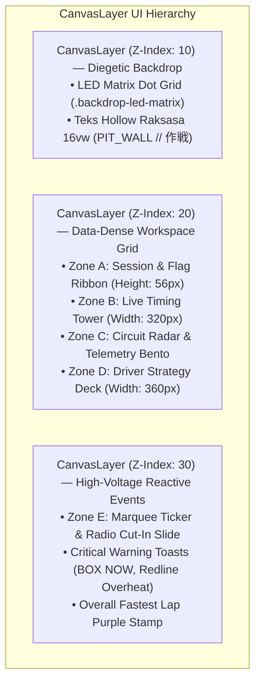
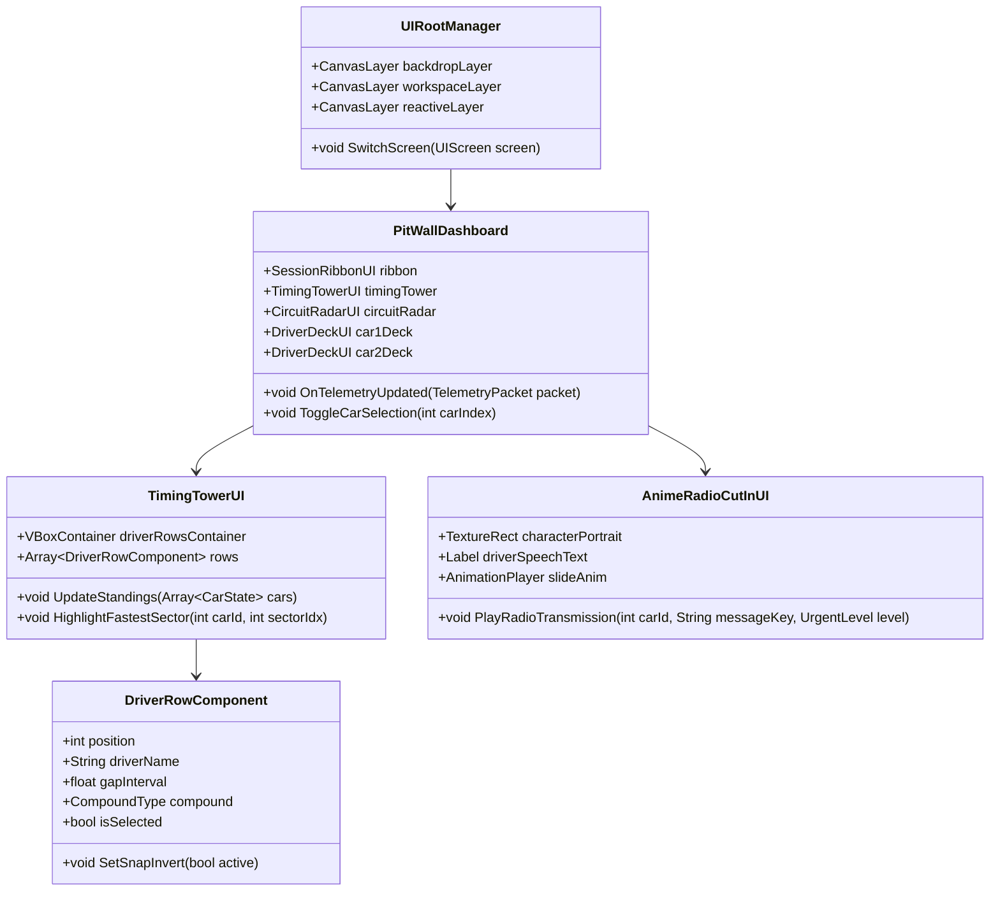
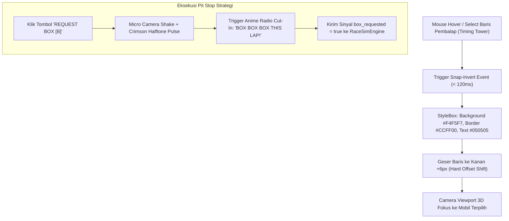

# PRD 02: UI/UX Topology & Manga Visual Systems
**Fase:** 2 (Presentation & Interface Layer)  
**Target:** UI/UX Engineer, Technical Artist  
**Referensi:** [DESIGN.md](file:///D:/Occupation/Porto/genex/La_Voiture/DESIGN.md) (Dokumen Desain Utama UI)

---

## 1. Arsitektur Komponen UI (Component Hierarchy)

Mengacu langsung pada [DESIGN.md Bab 1 & Bab 3](file:///D:/Occupation/Porto/genex/La_Voiture/DESIGN.md#L11-L146), arsitektur antarmuka pengguna dibagi menjadi **3 Lapisan Kedalaman Z-Index (*3-Tier Z-Index*)** di dalam Godot 4:



### Class Diagram Arsitektur UI di Godot



---

## 2. Fitur & Aturan Desain Mutlak (Features & Core Laws)

| ID | Aturan Desain | Penerapan Teknis di Godot 4 | Status |
| :--- | :--- | :--- | :--- |
| **UI-01** | **Zero Softness (No Blur)** | Dilarang menggunakan rounded corner halus atau blur. Semua node `PanelContainer` menggunakan *StyleBoxFlat* dengan corner radius $0\text{px}$, border tinta hitam $2.5\text{px}$ (`#050505`), dan hard shadow offset $5\text{px}$ tanpa blur. | Wajib |
| **UI-02** | **Manga Screentone** | Seluruh kontainer data gelap dilapis shader *Halftone Ben-Day dots* radial $6\text{px} \times 6\text{px}$ (opacity $7\%$). | Wajib |
| **UI-03** | **Snap-Invert Selection** | Baris atau kartu yang aktif langsung membalik warna instan: dari gelap (`#0E1118`) menjadi putih terang (`#F4F5F7`) dan teks hitam (`#050505`) dalam tempo $\le 120\text{ms}$. | Wajib |
| **UI-04** | **Counter-Skew ($\theta = -6^\circ$)** | Header panel, badge status, dan tombol aksi dimiringkan $-6^\circ$, sementara teks internal dinetralkan $+6^\circ$. Tabel data internal tetap lurus $0^\circ$ demi kenyamanan membaca angka. | Wajib |
| **UI-05** | **Chamfered 45° Header** | Sudut kanan atas panel dipotong $45^\circ$ setebal $14\text{px}$ menggunakan shader `clip-path` poligon. | Wajib |

---

## 3. Flowchart Navigasi UI & Event Snap-Invert



---

## 4. Topologi Spasial Layar (Spatial Layout Specifications)

### 4.1 Layar 1: Fused Master HUD (Topologi Race Day Fase 5.8)
* **Resolusi Acuan & Kanvas:** $1920 \times 1080$ fixed canvas berskala merata tanpa distorsi, mematuhi prinsip *Zero Softness* (corner radius $0\text{px}$, border tinta tebal, bayangan offset keras, screentone halftone, tanpa gauge bundar).
* **Zone A (Top Ribbon, Tinggi $56\text{px}$):**
  - Identitas `LA VOITURE`, `[LAP 01/50]`, status bendera dinamis (`GREEN FLAG`, `YELLOW FLAG // SAFETY CAR`, `LIGHTS ●●●●●`, `CHEQUERED FLAG`).
  - Widget radar cuaca `WeatherRadarWidget` (status cuaca, suhu, bar kebasahan, prakiraan 5 lap).
  - Tombol pengatur kecepatan simulasi (`1x, 2x, 4x, 8x, 16x`), indikator kamera siaran aktif, dan chip status DRS.
* **Zone B (Live Timing Tower Kiri, Lebar $320\text{px}$, Tinggi $780\text{px}$):**
  - 20 baris pembalap dalam urutan balapan real-time dengan snap-invert highlight.
  - Kolom adaptif dapat diganti dengan tombol **`Tab`**: `INT` (interval), `GAP` (jarak ke leader), atau `LAST` (lap time terakhir).
  - Badge kompon ban berwarna: `S` (Merah Soft), `M` (Kuning Medium), `H` (Putih Hard), `I` (Hijau Intermediate), `W` (Cyan Wet).
  - Status khusus: `PIT`, `DNF`, `DRS`, serta tanda bintang `*` untuk mobil tim pemain. Mengklik baris langsung menyorot mobil tersebut.
* **Zone C (Central 3D Viewport):**
  - Aksi balap 3D penuh dengan 5 sudut pandang siaran (Chase, Cockpit, Heli, Trackside TV, Close-Up Pitstop) yang dapat diputar dengan tombol **`C`**.
  - Peringatan bendera kuning/safety car memunculkan pita hazard diagonal (*caution tape*) bergerak di bawah ribbon.
* **Zone D (Sliding Telemetry Drawer Kanan, Lebar $312\text{px}$, Tinggi $496\text{px}$, Shortcut `T`):**
  - Format instrumen digital: Kotak gigi besar, deretan lampu shift RPM, bar kecepatan digital, chip DRS menyala cyan.
  - Jejak grafis pedal gas/rem 6 detik (*pedal trace*), kotak G-Force persegi dengan kursor jejak gaya lateral.
  - Matriks panas 4 ban (*4-wheel thermal & wear matrix*): suhu derajat, ketebalan tapak, piringan rem, dan indikator blister/puncture silang.
  - Bar bahan bakar dengan penanda bendera finis, meter ERS dengan chevron aliran daya, bar divergen stres vs percaya diri pembalap, jejak EKG detak jantung (BPM), serta bar kerusakan bodi.
* **Zone E (Fused Tactical Deck Bawah, Lebar $1888\text{px}$, Tinggi $140\text{px}$, Shortcut `M`):**
  - Satu strip horizontal penuh di bagian bawah layar (Layout A):
    * Tab ganda dua mobil tim pemain (`#01 RYU` & `#02 REN`) menampilkan posisi, kompon, sisa ban, dan baterai.
    * Baris Pace (5 tingkat): `CONSERVE`, `LIGHT`, `STANDARD`, `AGGRESSIVE`, `ATTACK` (Shortcut `[` / `]`).
    * Baris Fuel Mix (3 tingkat): `CONSERVE (Lean)`, `STANDARD`, `PUSH (Rich)`.
    * Baris ERS Mode (4 mode): `HARVEST`, `NEUTRAL`, `DEPLOY`, `OVERTAKE` (Shortcut `E`).
    * Pemilih kompon ban berikutnya (`AUTO`, `S`, `M`, `H`, `I`, `W`) dan tombol besar dua-state **`[REQUEST BOX [B]]`** yang berubah menjadi **`[CANCEL BOX [ESC] // COMPOUND]`** (crimson, tetap bisa diklik) selama panggilan box belum mencapai pit lane.
    * Tactic Desk selector: `[MANUAL]` (kartu saran menutup sendiri saat bar 10 detik habis, tidak ada eksekusi tanpa pemain) dan `[AUTO]` (kartu mengeksekusi saran saat bar habis), dengan tag status `MODE: ... `. Mode HYBRID dihapus.
    * Tombol lipat **`FOLD DECK [M]`**: Melipat deck menjadi baris tipis agar pandangan 3D sirkuit semakin luas.
    * Baris teks radio terakhir dan jumlah stop pit.
* **Zone F (Reactive Layers: Suggestion Cards, Dual Anime Radio Cut-Ins & Marquee):**
  - **Kartu Saran Taktis:** Muncul di mode MANUAL maupun AUTO ketika ada saran dari race engineer (jendela pit terbuka, cuaca, ban kritis; misal: *"RYU: BOX FOR HARD [ACCEPT] [DISMISS]"*), dengan bar api 10 detik dan label sisa waktu (`ENTER` terima, `ESC` tutup).
  - **Dual Manga Radio Cut-In Overlays (`RaceHud.RADIO_DOCK`):**
    * **Driver Overlay (Top-Left):** Muncul di sudut kiri atas panggung bebas ($x: 380, y: 116$) dengan potret manga helm pembalap, garis kecepatan miring, dan aksen *Acid Lime*.
    * **Engineer Overlay (Top-Right):** Muncul di sudut kanan atas panggung bebas ($x: 1064, y: 116$) dengan potret manga kepala teknisi berheadset, aksen *Electric Cyan* (atau *Crimson Red* bila urgent/BOX).
    * **Bebas Tabrakan UI (Zero Collisions):** Diposisikan melayang di area langit sirkuit yang bebas, sehingga tidak pernah menutupi Ribbon atas, Timing Tower P1-P20 di kiri, Telemetry Drawer di kanan, maupun Tactical Deck di bawah.
    * **Sinkronisasi Audio & Suara:** Banner bertahan selama durasi klip suara neural TTS (minimal $2.6\text{ detik}$) diiringi efek radio squelch dan music ducking otomatis. Keduanya dapat muncul bersamaan saat percakapan saling membalas.
  - **Race Control Marquee:** Baris pita pengumuman resmi balapan di batas paling bawah layar.
* **Zone G (Post-Race Podium Celebration Screen, `podium_screen.tscn`):**
  - Kanvas penuh $1920 \times 1080$ berarsir manga screentone yang muncul otomatis $2.5\text{ detik}$ setelah bendera finis dikibarkan.
  - **Tangga Podium 3 Tingkat Asimetris:** P1 di tengah (tertinggi), P2 di kiri, P3 di kanan dengan animasi staggered naik ($1.6\text{ detik}$) dihiasi confetti partikel emas/putih dan piala kemenangan emas.
  - **Kartu Hasil Pembalap:** Menampilkan nomor balap, nama, kode tim, total waktu finis, dan warna identitas pabrikan.
  - **Stempel Ungu Fastest Lap:** Stempel miring tebal `★ FASTEST LAP // +1 PT BONUS` untuk pembalap tercepat di posisi 10 besar.
  - **Klasemen FIA GT3:** Tabel ringkasan poin resmi pembalap dan konstruktor (25, 18, 15, 12, 10, 8, 6, 4, 2, 1).
  - **Aksi Navigasi:** Tombol taktil `[RESTART RACE]` dan `[EXIT TO HQ]`.

### 4.2 Layar 2: HQ Car Development & Engineering (Antara Balapan)
* Mengadopsi struktur **Asymmetric Bento Grid** ([DESIGN.md Bab 3.2](file:///D:/Occupation/Porto/genex/La_Voiture/DESIGN.md#L148-L178)):
  * **Navigasi Kiri (Lebar $300\text{px}$):** Menu vertikal `[01 AERO SETUP]`, `[02 SUSPENSION]`, `[03 POWERTRAIN]`, `[04 PIT CREW]`.
  * **Bento Grid Kanan:** Kartu-kartu modul R&D part modular dengan visual 3D mobil di tengah yang merotasi saat part dipilih.

---

## 5. Token Warna & Spesifikasi Shader

### 5.1 CSS / Color Constants
```gdscript
# UIThemeTokens.gd
const BG_CANVAS_DEEP = Color("#090A0F")
const SURFACE_PANEL_DARK = Color("#0E1118")
const SURFACE_PANEL_ELEVATED = Color("#161A24")
const SURFACE_SNAP_INVERT = Color("#F4F5F7")
const INK_BORDER_BLACK = Color("#050505")

# Aksen High-Voltage (NFS Unbound)
const ACCENT_ACID_LIME = Color("#CCFF00")     # Pace Attack, Optimal, Confirm
const ACCENT_ELECTRIC_CYAN = Color("#00F0FF") # Telemetri, Hujan, ERS
const ACCENT_CYBER_YELLOW = Color("#FFE600")  # Warning, Yellow Flag, Medium Tire
const ACCENT_ANIME_CRIMSON = Color("#FF1E56") # Critical Box Now, Overheat, Soft Tire
const ACCENT_PURPLE_SECTOR = Color("#D946EF") # Overall Fastest Lap
```

### 5.2 Shader Halftone Manga (Ben-Day Dots)
Setiap panel data menggunakan shader `halftone_screentone.gdshader`:
```glsl
shader_type canvas_item;
uniform vec4 dot_color : source_color = vec4(1.0, 1.0, 1.0, 0.07);
uniform float dot_spacing = 6.0;
uniform float dot_radius = 1.0;

void fragment() {
    vec2 pos = mod(FRAGCOORD.xy, vec2(dot_spacing));
    float dist = distance(pos, vec2(dot_spacing * 0.5));
    if (dist < dot_radius) {
        COLOR = mix(COLOR, dot_color, dot_color.a);
    }
}
```
