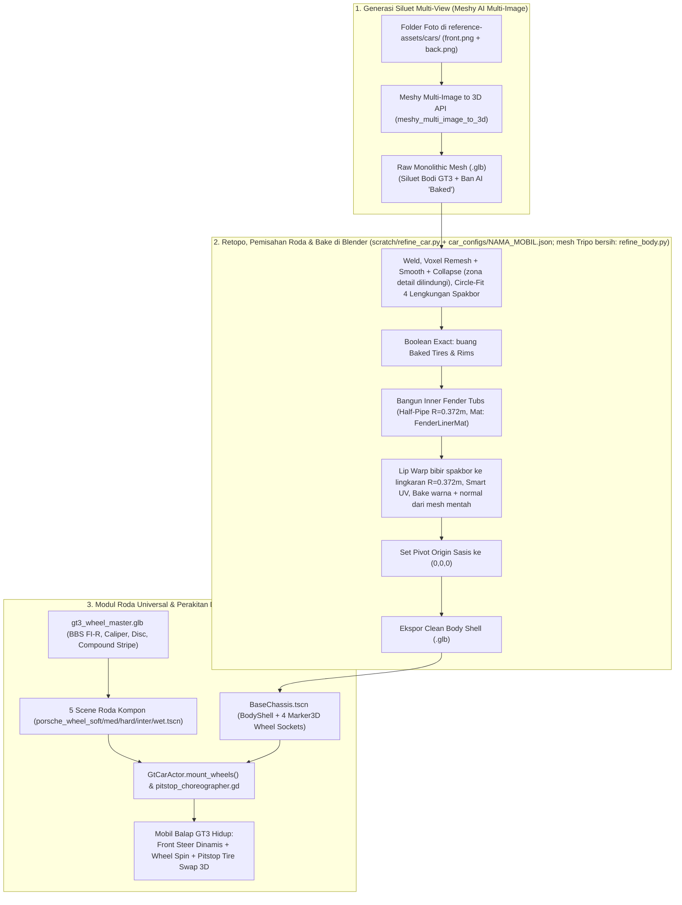
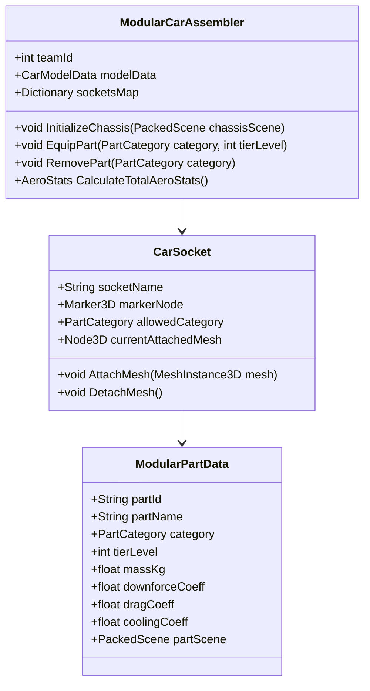
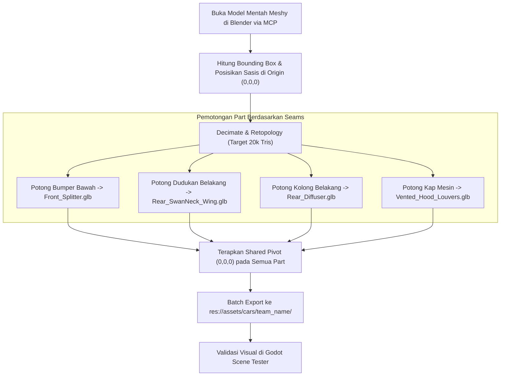

# PRD 03: Modular 3D Car & Asset Pipeline
**Fase:** 3 (3D Asset Pipeline & Modular Rigging)  
**Target:** 3D Artist, Technical Artist, Vehicle Systems Programmer  
**Referensi:** [Full-Car-Component-Guide.md](file:///D:/Occupation/Porto/genex/La_Voiture/Full-Car-Component-Guide.md) & [reference-assets/images](file:///D:/Occupation/Porto/genex/La_Voiture/reference-assets/images)

---

## 1. Arsitektur Pipeline 3D (Asset Production Architecture)

Pipeline pembuatan mobil modular menggabungkan kecepatan generasi AI (**Meshy AI**) dengan presisi topologi dan perakitan teknik di **Blender** (melalui Blender MCP) untuk menghasilkan aset yang **100% bebas overlap geometri (*zero-clipping*)** saat dirakit di Godot 4:



### Class Diagram Perakitan Modular di Godot



---

## 2. Fitur & Standar Kualitas (Quality Gates & Features)

| ID | Standar Kualitas | Spesifikasi Teknis | Kriteria Penerimaan |
| :--- | :--- | :--- | :--- |
| **MOD-01** | **Standarisasi Dimensi FIA GT3** | Panjang: $4600\text{mm} \pm 100\text{mm}$<br>Lebar: $2000\text{mm}$ (maksimal regulasi)<br>Wheelbase: $2650\text{mm} \pm 50\text{mm}$ | Semua 10 sasis mobil menggunakan jarak sumbu roda yang seragam sehingga roda modular dapat saling bertukar. |
| **MOD-02** | **Universal Sockets** | Setiap sasis memiliki 8 titik kaitan standar `Marker3D`. | Part modular dapat di-*snap* tanpa perlu penyesuaian rotasi manual. |
| **MOD-03** | **Zero Geometric Overlap** | Jarak toleransi celah nat panel (*panel gap*): $2\text{mm} - 3\text{mm}$. | Tidak ada permukaan poligon yang saling bertabrakan (*z-fighting* atau clipping). |
| **MOD-04** | **Budget Poligon per Mobil** | Bodi dasar: $\le 20.000$ tris.<br>Seluruh part modular: $\le 15.000$ tris.<br>**Total per mobil: $\le 35.000$ tris.** | 20 mobil di trek memiliki total polycount $\le 700.000$ tris (aman untuk 60 FPS). **Catatan FASE 7:** bodi hasil Meshy yang di-decimate (Audi R8) masih 101.394 tris; budget ini perlu diputuskan ulang untuk mesh AI (lihat `docs/superpowers/specs/2026-10-22-audi-r8-gt3-prototype-pipeline.md` bagian 9.6). |
| **MOD-05** | **Cat Asli** | Flag `ModularCarAssembler.keeps_original_paint`: true bila tekstur bodi adalah livery asli model. | Mobil dengan flag true tampil dengan warna tekstur aslinya di game, tanpa tint warna tim. **Berlaku untuk semua mobil**: Audi R8 dan Porsche 911 sudah true (FASE 7); mobil baru memakai true. Warna tim tetap dipakai di HUD, radar, dan papan waktu. |
| **MOD-06** | **Aset Utuh per Mobil (usulan)** | Setiap mobil punya `<car_slug>_body.glb` (tekstur tertanam) dan `<car_slug>_full.glb` (bodi + 4 roda master di posisi socket), dibangun dengan `scratch/build_full_car.py`. | Kedua file berwarna saat dibuka di Blender, Godot, atau viewer GLB mana pun. |

---

## 3. Flowchart Eksekusi Pipeline Pemotongan Blender



---

## 4. 10 Tim Pabrikan & Katalog Komponen Modular

### 4.1 Daftar 10 Mobil Tim (Berdasarkan `reference-assets/images`)
1. **Aston Martin Vantage GT3** (`reference-assets/images/aston-vantage-gt3`)
2. **Audi R8 LMS GT3** (`reference-assets/images/audi-r8-gt3`)
3. **BMW M4 GT3** (`reference-assets/images/bmw-m4-gt3`)
4. **Chevrolet Corvette Z06 GT3.R** (`reference-assets/images/chevy-corvette-gt3`)
5. **Honda NSX GT3 Evo22** (`reference-assets/images/honda-nsx-gt3`)
6. **Lamborghini Huracán GT3 EVO2** (`reference-assets/images/lambo-huracan-gt3`)
7. **Lexus RC F GT3** (`reference-assets/images/lexus-rcf-gt3`)
8. **McLaren 720S GT3 Evo** (`reference-assets/images/mclaren-720s-gt3`)
9. **Nissan GT-R NISMO GT3** (`reference-assets/images/nissan-gtr-gt3`)
10. **Porsche 911 GT3 R (992)** (`reference-assets/images/porsche-911-gt3`)

### 4.2 Matriks 4 Paket R&D Modular ([Full-Car-Component-Guide.md](file:///D:/Occupation/Porto/genex/La_Voiture/Full-Car-Component-Guide.md))

Setiap mobil mendukung 3 Tingkatan Evolusi (*Tiers*) untuk masing-masing dari 4 paket fungsional:

```text
[TIER 1: STOCK HOMOLOGATION] -> [TIER 2: CLUB RACING SPEC] -> [TIER 3: WORKS FACTORY EVO]
```

```
+========================================================================================================+
| PAKET R&D          | KOMPONEN FISIK DARI PANDUAN       | STATISTIK GAMEPLAY     | PERUBAHAN VISUAL 3D  |
+========================================================================================================+
| 1. Aero Pack       | • Front Splitter                 | Downforce: +15% / Tier | Bilah splitter melebar|
|                    | • Canards / Dive Planes          | Drag: -5% / Tier       | Sayap belakang leher  |
|                    | • Swan-Neck Rear Wing & Gurney   | Cornering Grip: +8%    | angsa bertingkat      |
|                    | • Rear Venturi Diffuser          |                        | Diffuser karbon 4-fin |
+--------------------+----------------------------------+------------------------+-----------------------+
| 2. Cooling &       | • Brake Cooling Ducts            | Suhu Rem: -18°C        | Lubang corong bumper  |
|    Durability      | • Vented Hood Louvers            | Degradasi Ban: -12%    | terbuka, kisi louvers |
|                    | • NACA Ducts samping             | Driver Fatigue: -20%   | kap mesin berlapis,   |
|                    | • Cool Suit System & Blower      |                        | jendela polikarbonat  |
+--------------------+----------------------------------+------------------------+-----------------------+
| 3. Chassis &       | • Widebody Carbon Fenders        | Bobot Mobil: -35 kg/Tr | Fender melebar masif, |
|    Lightweight     | • Lexan Polycarbonate Windows    | Pengereman: 8m memendek| pelek Center-Lock     |
|                    | • Center-Lock Lightweight Wheels | Akselerasi 0-100: -0.2s| forged bintang ultra  |
+--------------------+----------------------------------+------------------------+-----------------------+
| 4. Cockpit &       | • Digital Dash Unit (DDU MoTeC)  | Akurasi Prediksi Pit:  | Layar display instrumen|
|    Telemetry       | • Quick-Release Steering Yoke    | +25%                   | kokpit berubah warna & |
|                    | • Brake Bias Cockpit Adjuster    | Setup Kualifikasi:     | indikator shift light |
|                    | • Scrutineering Black Box        | 2x lebih cepat optimal | LED multi-warna       |
+========================================================================================================+
```

---

## 5. Universal Hardware Kit (Standar Aset Sekali Buat)

Untuk menghemat waktu produksi dan menjamin keseragaman visual anime berkualitas tinggi, komponen berikut dimodelkan **sekali saja secara presisi** di Blender dan dipakai bersama oleh ke-10 tim:
1. **Roda Balap Center-Lock:** Mur pengunci roda tengah tunggal dengan ban slick *Michelin/Pirelli* berpola garis dinding ban kuning/putih.
2. **Setir Balap Kupu-Kupu (Yoke Steering Wheel):** Roda kemudi karbon dengan tombol putar rotary berwarna *Acid Lime* dan *Crimson*.
3. **Layar Telemetri DDU (MoTeC Display):** Display digital dengan tekstur UI resolusi $512 \times 256\text{ px}$.
4. **Braket Sayap Leher Angsa (Swan-Neck Brackets):** Struktur penyangga sayap dari atas daun spoiler berbahan aluminium tempa.

---

## 6. Struktur Direktori Aset 3D Mobil Modular Aktual di Godot

```text
res://assets/cars/
├── parts/
│   ├── gt3_wheel_master.glb           # Master Wheel GT3 (BBS FI-R Rim, Tire Rubber, Disc, Caliper, Nut)
│   └── gt3_wheel_master.glb.import
├── porsche_911/                       # Dirapikan ke struktur standar yang sama dengan audi_r8
│   ├── raw/                           # porsche_911_raw.glb (salinan bodi Tripo sebelum refine_body.py)
│   ├── textures/                      # base_color.jpg (livery asli, dipakai material toon), normal.png, orm.jpg
│   ├── porsche_911_body.glb           # Clean Body Shell (Baked wheels removed, inner fender tubs R=0.372m), tekstur tertanam
│   └── porsche_911_full.glb           # Bodi + 4 roda master di posisi socket (aset utuh)
├── audi_r8/                           # Mobil kedua (FASE 7), standar yang diusulkan untuk semua mobil
│   ├── raw/                           # audi_r8_raw.glb (Meshy, 2,77 juta tris, tidak diubah) + audi_r8_raw_textures/
│   ├── textures/                      # base_color.png, normal.png (hasil bake 4096 x 4096, dipakai material toon)
│   ├── audi_r8_body.glb               # Clean body shell hasil retopo, 105k tris, tekstur tertanam, 4 tub, origin tengah wheelbase
│   └── audi_r8_full.glb               # Bodi + 4 roda master di posisi socket (aset utuh)
└── <manufacturer_slug>/ (e.g. aston_vantage, bmw_m4)   # struktur sama dengan audi_r8
    ├── raw/, textures/
    ├── <car_slug>_body.glb            # Clean Body Shell hasil striping baked wheel di Blender
    └── <car_slug>_full.glb            # Bodi + 4 roda master

res://scenes/car/
├── base_chassis.tscn                  # ModularCarAssembler + BodyShell + 4 Marker3D Wheel Sockets (Porsche)
├── audi_r8_chassis.tscn               # Sasis Audi; dipilih oleh GtCarActor.CHASSIS_BY_TEAM (team id 1)
└── parts/                             # Scene Roda per Kompon dengan WheelControllerScript
    ├── porsche_wheel_soft.tscn        # Red Stripe
    ├── porsche_wheel_medium.tscn      # Yellow Stripe
    ├── porsche_wheel_hard.tscn        # White Stripe
    ├── porsche_wheel_inter.tscn       # Green Stripe
    └── porsche_wheel_wet.tscn         # Cyan Stripe
```

Standar lengkap per mobil (folder, skrip pembangun, kebijakan cat asli, pengaturan impor, daftar periksa) ada di `docs/superpowers/specs/2026-10-22-audi-r8-gt3-prototype-pipeline.md` bagian 9 (usulan untuk ke-10 mobil).
