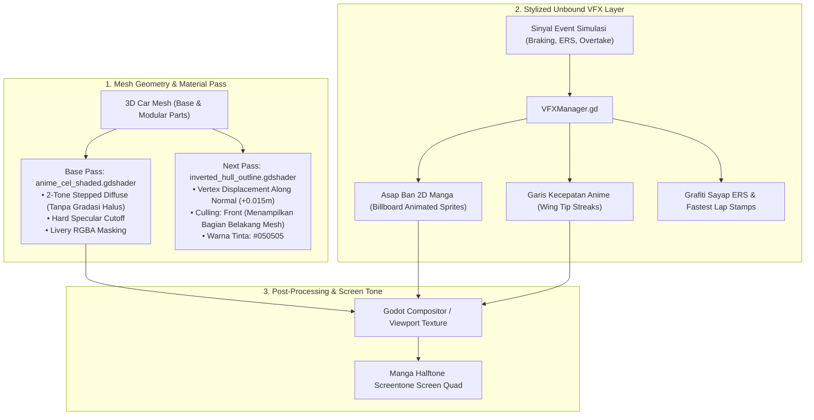
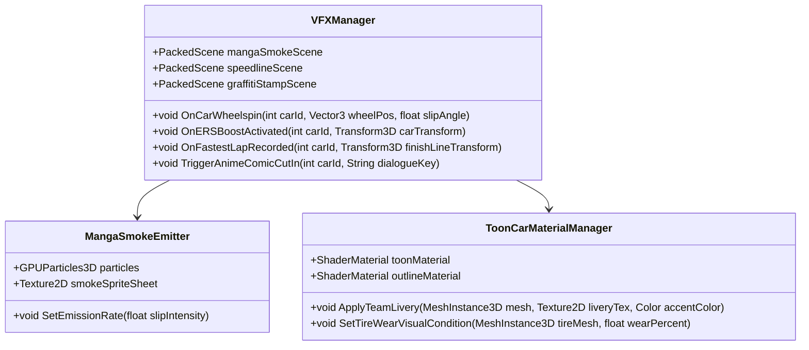
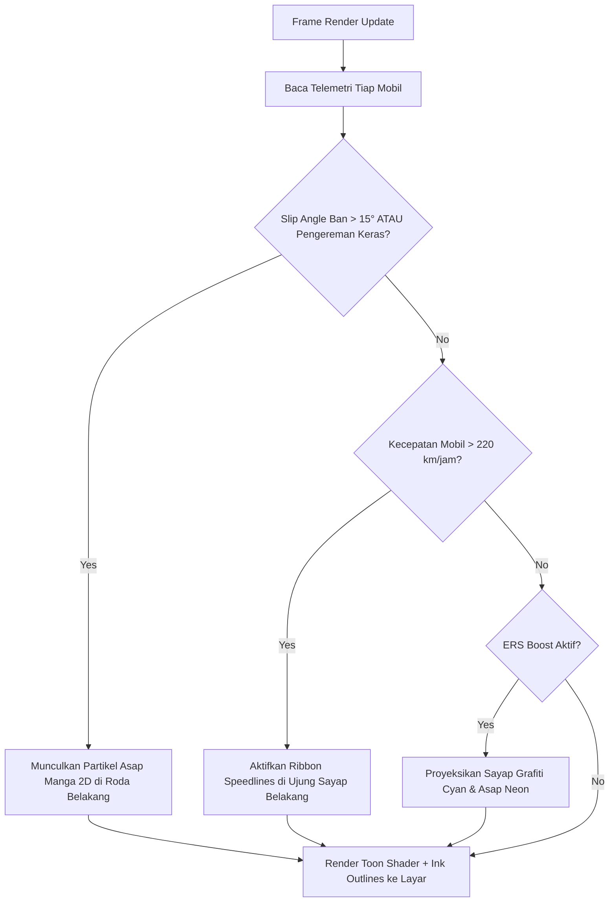

# PRD 04: Rendering Shaders & Anime VFX
**Fase:** 4 (Visual Identity & Shaders)  
**Target:** Technical Artist, Shader Programmer, VFX Artist  
**Referensi:** [DESIGN.md](file:///D:/Occupation/Porto/genex/La_Voiture/DESIGN.md) (DNA Visual: NFS Unbound $\times$ Hard-Edge Manga)

---

## 1. Arsitektur Rendering & Pipeline Shader (Render Architecture)

Visual *La Voiture* menggunakan pendekatan **Non-Photorealistic Rendering (NPR)** di Godot 4 yang memadukan pencahayaan berundak tegas (*Stepped Toon Shading*), garis luar tinta komik (*Inverted-Hull Ink Outline*), dan efek partikel grafiti 2D bergaya *Need for Speed Unbound*:



### Class Diagram Pengendali Efek Visual (VFX)



---

## 2. Fitur & Spesifikasi Shader (Features)

| ID | Fitur Visual | Deskripsi Teknis | Standar Output |
| :--- | :--- | :--- | :--- |
| **VFX-01** | **Stepped Toon Shading** | Cahaya Lambert dibagi menjadi 2 band tegas: area terang ($100\%$) dan area bayangan ($45\%$ kecerahan). Dilarang ada gradasi halus (*soft gradient*). | Menghasilkan tampilan ilustrasi anime cell animasi 90-an. |
| **VFX-02** | **Inverted-Hull Ink Outline** | Pass tambahan yang mengekstrusi vertex sepanjang normal sebesar $0.015\text{m}$ dengan culling depan (*front-face culling*) berwarna `#050505`. | Garis tinta hitam tebal yang konsisten mengelilingi seluruh kontur bodi mobil. |
| **VFX-03** | **2D Manga Tire Smoke** | Asap pengereman keras dan drift berupa animasi frame komik hitam-putih dengan garis arsir (*hatching*), bukan partikel asap volumetrik 3D lembut. | Efek asap tegas ala manga Initial D / NFS Unbound. |
| **VFX-04** | **Speedlines & Aero Streaks** | Partikel garis putih neon yang memanjang dari sudut *endplate* sayap belakang ketika kecepatan mobil $> 220\text{ km/jam}$. | Visual sensasi kecepatan tinggi saat di trek lurus. |
| **VFX-05** | **Graffiti ERS Boost Wings** | Saat tombol ERS / Push-to-Pass diaktifkan, sayap grafiti bercahaya *Electric Cyan* (`#00F0FF`) muncul sesaat di samping mobil selama $2\text{ detik}$. | Identitas grafiti jalanan *NFS Unbound*. |

---

## 3. Flowchart Eksekusi Render & Pemicu Efek Partikel



---

## 4. Implementasi Kode Shader Godot 4 (Shader Code Standards)

### 4.1 Shader Toon Cel-Shaded (`anime_cel_shaded.gdshader`)
```glsl
shader_type spatial;
render_mode diffuse_toon, specular_toon;

uniform sampler2D albedo_texture : source_color, filter_nearest;
uniform sampler2D livery_texture : source_color, filter_nearest;
uniform vec4 shadow_tint : source_color = vec4(0.12, 0.14, 0.20, 1.0);
uniform float shadow_threshold = 0.5;
uniform float shadow_smoothness = 0.02;

void fragment() {
    vec4 base_col = texture(albedo_texture, UV);
    vec4 livery_col = texture(livery_texture, UV);
    vec3 final_albedo = mix(base_col.rgb, livery_col.rgb, livery_col.a);
    
    ALBEDO = final_albedo;
    ROUGHNESS = 0.8;
    SPECULAR = 0.2;
}

void light() {
    float n_dot_l = dot(NORMAL, LIGHT);
    float light_intensity = smoothstep(shadow_threshold - shadow_smoothness, 
                                       shadow_threshold + shadow_smoothness, 
                                       n_dot_l);
    
    vec3 diffuse = mix(shadow_tint.rgb * ALBEDO, ALBEDO * LIGHT_COLOR, light_intensity);
    DIFFUSE_LIGHT += diffuse * ATTENUATION;
}
```

### 4.2 Shader Garis Tinta Komik (`inverted_hull_outline.gdshader`)
---

## 6. Dinamika Sasis 3D, Tag Grafiti Anime & Suite VFX Balap (Spesifikasi Fase 5.7)

### 6.1 Dinamika Sasis & Roda Adaptif (`GtCarActor`)
Mobil 3D tidak kaku, melainkan merespons gaya inersia dan kelengkungan lintasan secara real-time:
* **Steering Roda Depan Nyata:** Hanya sepasang roda depan yang berbelok mengikuti sudut kemudi dan tangen belokan sirkuit:
  $$\theta_{\text{steer}} = \text{clamp}\Big(\kappa \times 14.0 + \text{heading}_{\text{lateral}} \times 1.35,\; -0.42\text{ rad},\; +0.42\text{ rad}\Big)$$
  Sepasang roda belakang terkunci lurus sejajar sasis ($0.0\text{ rad}$).
* **Chassis Body Roll:** Bodi mobil miring ke sisi luar tikungan proporsional terhadap akselerasi sentrifugal:
  $$\theta_{\text{roll}} = \text{clamp}\Big(a_{\text{centrifugal}} \times 0.0022,\; -0.085\text{ rad},\; +0.085\text{ rad}\Big)$$
* **Chassis Pitch (Nose Dive & Squat):**
  $$\theta_{\text{pitch}} = \text{clamp}\Big(-a_{\text{longitudinal}} \times 0.0026,\; -0.06\text{ rad},\; +0.05\text{ rad}\Big)$$
  Hidung mobil menukik saat pengereman keras dan mendongak ke belakang saat akselerasi penuh.
* **Filter Dua-Tahap Bebas Getar (`ease2` Cascaded Low-Pass):**
  Karena simulasi fisika berjalan pada $20\text{ Hz}$ sedangkan render berjalan pada $60\text{ fps}$, sudut sasis disaring dengan dua filter lolos-rendah bertingkat ($\tau = 0.07\text{s}$) yang menghilangkan $100\%$ getaran/stuttering visual.

### 6.2 Brutalist Anime Graffiti Billboard Tags (`graffiti_tag.gd`)
Sebagai ganti tip teks biasa, setiap mobil dilengkapi elemen grafiti jalanan pop-art khas *NFS Unbound*:
* **Procedural Paint Slab:** Dilukis secara dinamis ke `SubViewport` lalu diproyeksikan sebagai `Sprite3D` billboard di atas mobil:
  - Pelat cat miring dengan warna identitas tim.
  - Bayangan tinta hitam keras (*hard ink drop shadow*) dan garis batas tebal.
  - Cipratan spray, tetesan cat (*paint drips*), pita hazard diagonal di sudut, dan panah stensil.
* **Transisi Ephemeral:** Nama kode pembalap muncul sesaat ($2.4\text{ detik}$) dengan animasi fade-in ($0.1\text{s}$) dan fade-out ($0.5\text{s}$) saat posisi berubah, mobil dipilih, atau rival mendekat dalam jarak $< 60\text{ meter}$.
* **Stiker Status Grafiti:** Ikon stiker kecil yang menyala untuk status krusial: `[DRS]` cyan, `[PIT]` kuning, `[HAZARD]` berkedip merah saat ada insiden/pecah ban, dan `[BRAKE]` merah saat mobil yang diikuti mengerem keras.

### 6.3 Suite VFX Balap Terpadu (`RaceVfx` / `race_vfx.gd`)
1. **Hujan Manga & Aspal Basah:** Partikel hujan 3D dengan streak mengikuti pergerakan kamera, langit mendung kelabu, petir anime, dan lingkaran riak air (*water puddle rings*) di atas aspal.
2. **Road Spray Cipratan Air:** Gumpalan cel-shaded ber-outline tinta di belakang roda mobil saat melaju kencang di trek basah.
3. **Asap Ban Manga:** Partikel kepulan asap arsir komik saat start kencang (*wheelspin*) atau pengereman mengunci (*lockup*).
4. **Slipstream Ribbon:** Pita garis aerodinamis semi-transparan yang memanjang di belakang diffuser mobil lawan saat mobil melakukan *slipstream drafting*.
5. **Letupan Api Knalpot (Exhaust Flame Pop):** Semburan api kartun kuning/oranye menyala di ujung knalpot sesaat setelah mobil menaikkan gigi (*upshift*).
6. **Lampu Proyektor Malam (Night Headlights):** Lampu sorot depan menyala otomatis saat skenario waktu malam atau badai gelap.
7. **Safety Car Lightbar:** Lampu strobo oranye/kuning berkedip cepat di atap mobil Safety Car saat bendera kuning berkibar.

