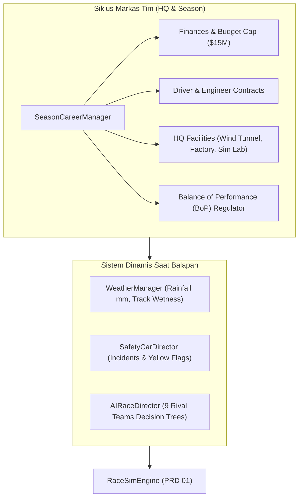
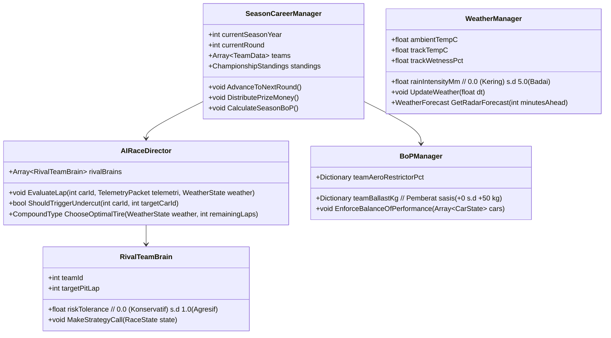
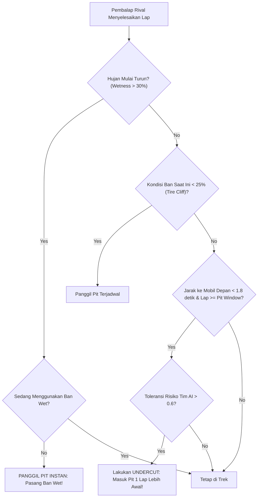
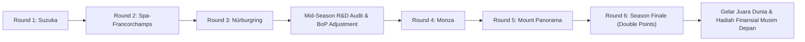

# PRD 05: Gameplay Systems, Career & AI Strategist
**Fase:** 5 (Macro Systems, AI & Season Progression)  
**Target:** Systems Designer, AI Programmer, Economy Tuner  
**Referensi:** [DESIGN.md (Layar 2: HQ Engineering)](file:///D:/Occupation/Porto/genex/La_Voiture/DESIGN.md#L148-L178)

---

## 1. Arsitektur Sistem Karir & AI Rival (System Architecture)

Modul ini mengatur sistem makro manajemen tim di markas (HQ), dinamika kejuaraan musim balap (*Championship Season*), sistem cuaca dinamis, insiden *Safety Car*, serta **AI Decision Engine** yang mengendalikan 9 tim rival (18 mobil lawan) dengan kepribadian strategi yang unik:

### Class Diagram Sistem Karir & AI

---

## 2. Fitur & Mekanika Gameplay Utama (Features)

| ID | Fitur | Deskripsi | Standar Teknis |
| :--- | :--- | :--- | :--- |
| **GP-01** | **Dynamic Weather System** | Cuaca dinamis bertransisi: *Cerah $\rightarrow$ Berawan $\rightarrow$ Hujan Gerimis $\rightarrow$ Hujan Deras $\rightarrow$ Lintasan Mengering*. | Air di trek mempengaruhi grip secara linear; jika wetness $> 35\%$, ban slick kehilangan grip $60\%$. |
| **GP-02** | **Safety Car & Virtual Safety Car** | Tabrakan atau insiden mekanis memicu bendera kuning dan keluarnya mobil keselamatan. | Kecepatan semua mobil dibatasi otomatis ke *Delta Target Pace*; celah jarak (*gaps*) antar pembalap memadat. |
| **GP-03** | **AI Rival Undercut/Overcut** | Tim lawan AI menghitung gap waktu dan melakukan pit stop lebih awal (*Undercut*) untuk menyalip via ban baru. | Algoritma heuristik mengevaluasi *traffic out-lap* sebelum memanggil pit. |
| **GP-04** | **Balance of Performance (BoP)** | Regulasi resmi untuk menyeimbangkan kecepatan ke-10 tim mobil GT3. | Tim yang mendominasi kemenangan diberi tambahan bobot pemberat (*ballast*) hingga $+30\text{ kg}$ di seri berikutnya. |
| **GP-05** | **Driver Stamina & Morale** | Stamina pembalap menurun setiap lap bergantung pada temperatur kokpit (*G-force & Heat*). | Jika stamina $< 20\%$, kemungkinan membuat kesalahan (*locking wheels/spin*) naik $400\%$. |

---

## 3. Flowchart Logika Keputusan Pit Stop AI Rival

---

## 4. Gameplay Mechanics & Formulasi Matematika

### 4.1 Formulasi Balance of Performance (BoP)
Regulator balap menetapkan penalti bobot ballast berdasarkan total poin klasemen kejuaraan:

$$\text{Ballast}_{\text{team}} = \min\left(50\text{ kg}, \; \max\left(0\text{ kg}, \; (\text{Points} - \text{MedianPoints}) \times 1.5\text{ kg}\right)\right)$$

Pemberat diletakkan di kotak ballast sisi kokpit penumpang ([Full-Car-Component-Guide.md](file:///D:/Occupation/Porto/genex/La_Voiture/Full-Car-Component-Guide.md)), menaikkan inersia mobil saat menikung.

### 4.2 Simulasi Lintasan Basah & Garis Balap Kering (*Drying Line*)
* Kecepatan penumpukan genangan air:
  $$\frac{dW}{dt} = R_{\text{intensity}} \times 0.05 - (T_{\text{ambient}} \times 0.001) - (\text{CarsPassingPerMin} \times 0.002)$$
* Mobil yang terus melintas di atas garis balap akan membuang air keluar (*dispersal effect*), menciptakan celah kering (*dry groove*) yang menguntungkan ban slick sebelum trek basah merata.

---

## 5. Flowchart Siklus Musim Balap (Season Progression)

---

## 6. Prosedur Akhir Pekan Balap & Scene Pitstop 3D (Spesifikasi Fase 5.5)

### 6.1 Prosedur Alur Balapan Resmi FIA (Race Weekend Flow)
1. **Grid Lineup & Formation:** 20 mobil menempati petak grid statis 2-kolom berselang-seling sesuai hasil kualifikasi.
2. **FIA 5-Red-Lights Countdown:**
   - 5 lampu merah di gantry menyala satu per satu setiap $1.0\text{ detik}$ ($1 \dots 5$).
   - Jeda acak ($0.5\text{s} \dots 2.2\text{s}$) dengan 5 lampu merah menyala penuh.
   - *LIGHTS OUT!* Seluruh lampu padam seketika menandakan start balapan dimulai.
3. **Racing Phase & Pit Strategy:** Balapan berlangsung sesuai jumlah lap dengan telemetri real-time.
4. **Chequered Flag & Parc Fermé:** Mobil melambat setelah garis finis, memunculkan layar podium juara dan pembagian poin.

### 6.2 Jalur Pit Lane & Koreografi Animasi Kru Pitstop 3D
* **Jalur Pit Lane Fisik:** Terpisah sejajar di sebelah kiri trek lurus utama dengan garis *Pit In* dan *Pit Out*.
* **Pit Speed Limiter ($80\text{ km/jam}$):** Mobil otomatis menahan kecepatan $80\text{ km/jam}$ begitu melintasi garis *Pit In*.
* **10 Garasi Tim 3D:** Setiap tim memiliki stall box berhias logo warna tim dan rambu lollipop.
* **Koreografi Servis Pitstop 3D:**
  1. Mobil belok masuk ke stall pit box dan berhenti di marka berhenti.
  2. **Hydraulic Jacks Lift:** Sasis mobil terangkat secara hidrolik $+15\text{cm}$.
  3. **Tire Swap Modular:** 4 mekanik pit stop mencopot 4 roda modular lama dan memasang 4 roda modular baru sesuai kompon yang dipilih (Soft/Medium/Hard/Wet) menggunakan hierarki [`gt3_wheel_master.glb`](file:///D:/Occupation/Porto/genex/La_Voiture/assets/cars/parts/gt3_wheel_master.glb).
  4. **Lollipop Release:** Rambu lollipop diangkat ke atas, sasis mobil turun dari dongkrak, dan mobil meluncur menuju *Pit Exit*.
  5. **Cinematic Close-Up Pit Camera:** Kamera secara otomatis berganti sudut ke *close-up TV angle* menyorot aksi kru pit stop saat mobil pemain sedang diservis.
* **Sporting Regulation (Teammate Double-Stacking):** Jika kedua mobil tim pemain masuk pit di lap yang sama, mobil kedua wajib mengantre menunggu servis mobil pertama selesai.

### 6.3 Layar Selebrasi Podium Juara & Sistem Poin FIA GT3 (`podium_screen.tscn`)
Sistem selebrasi akhir balapan terhubung secara otomatis ke event penyelesaian balapan (`CHEQUERED_FLAG`):

1. **Transisi Pasca-Finis:**
   - Setelah bendera finis dikibarkan dan mobil melintasi garis finis ($2.5\text{ detik}$ cooldown), layar selebrasi podium juara muncul di layar secara penuh.
   - Suara mesin 3D dan decit ban otomatis diheningkan, digantikan alunan musik selebrasi.
2. **Koreografi Tangga Podium P1-P3:**
   - Layout 3-tingkat klasik: P1 di tengah (tertinggi), P2 di sebelah kiri, dan P3 di sebelah kanan.
   - Animasi tangga naik secara staggered dengan kurva interpolasi halus ($1.6\text{ detik}$).
   - Hujan partikel confetti komik (emas, putih, dan aksen warna pemenang) menghujani panggung podium bersama piala emas (*golden trophy*).
3. **Kartu Pembalap Podium:**
   - Menampilkan nomor mobil, nama pembalap, inisial 3 huruf (misal: `#01 RYU`, `#02 REN`), nama tim pabrikan, livery stripe tim, dan akumulasi total waktu finis balapan.
4. **Sistem Poin Resmi FIA GT3 & Poin Konstruktor:**
   - Standar alokasi poin 10 besar:
     $$\text{P1}: 25,\; \text{P2}: 18,\; \text{P3}: 15,\; \text{P4}: 12,\; \text{P5}: 10,\; \text{P6}: 8,\; \text{P7}: 6,\; \text{P8}: 4,\; \text{P9}: 2,\; \text{P10}: 1$$
   - **Fastest Lap Point Rule:** Pembalap dengan lap tercepat di seluruh balapan menerima tambahan $+1\text{ poin}$ bonus, dengan syarat mutlak finis di dalam posisi 10 besar (*Top 10 Finish Requirement*).
   - **Stempel Grafiti Manga:** Pemenang fastest lap ditandai stempel ungu miring mencolok:
     $$\mathbf{\star\; FASTEST\; LAP\; //\; +1\; PT\; BONUS}$$
   - **Klasemen Konstruktor:** Poin dari kedua mobil tiap tim diakumulasikan ke klasemen pabrikan.
5. **Navigasi Pasca Balapan:**
   - Tombol **`[RESTART RACE]`**: Memulai ulang sesi balapan akhir pekan dari grid start lights.
   - Tombol **`[EXIT TO HQ]`**: Menyimpan hasil balap dan kembali ke antarmuka HQ Pabrik untuk riset dan upgrade part modular berikutnya.

