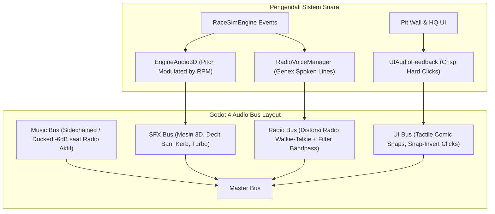
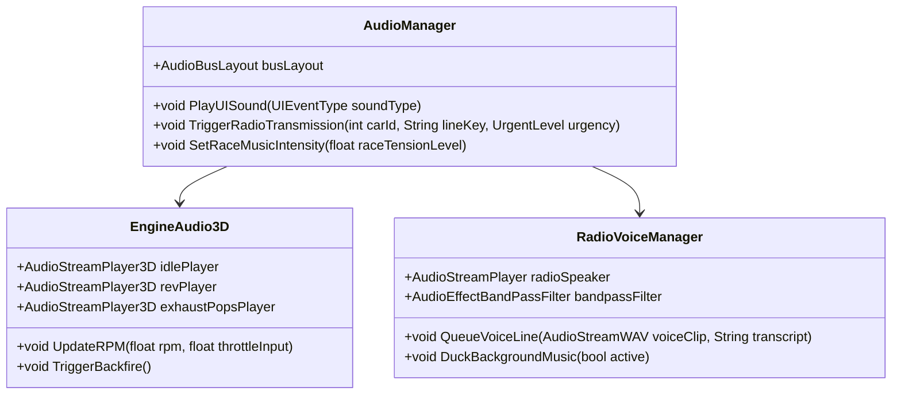
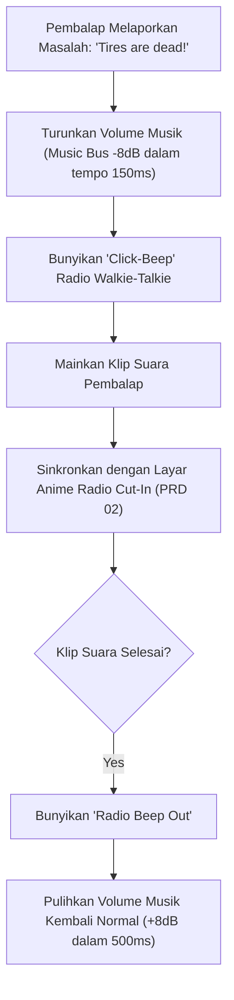

# PRD 06: Audio & Soundscape Direction
**Fase:** 6 (Acoustic Identity & Audio Pipeline)  
**Target:** Sound Designer, Audio Programmer  
**Referensi:** Genex Audio Suite (`npx genex sfx`, `music`, `voice`)

---

## 1. Arsitektur Sistem Audio (Audio Architecture)

Sistem suara *La Voiture* dirancang untuk memberikan **umpan balik taktil yang tajam (*tactile feedback*)** pada setiap interaksi data UI, raungan mesin balap GT3 yang bertenaga, serta drama percakapan radio pembalap bergaya anime:



### Class Diagram Pengendali Audio



---

## 2. Fitur & Identitas Akustik (Features)

| ID | Fitur Audio | Spesifikasi Suara | Sumber Produksi |
| :--- | :--- | :--- | :--- |
| **AUD-01** | **GT3 Engine Audio Curve** | Transisi mulus antara putaran idle ($1200\text{ RPM}$) hingga redline ($8500\text{ RPM}$) dengan suara letupan knalpot (*backfire pops*) saat deselerasi. | `npx genex sfx "GT3 racing car V8 twin turbo engine revving high rpm"` |
| **AUD-02** | **Tactile Comic UI Clicks** | Setiap klik tombol, hover tabel, dan aksi *Snap-Invert* menghasilkan suara klik mekanis berfrekuensi tajam tanpa echo lembut. | `npx genex sfx "hard tactile mechanical keyboard switch click sharp high frequency"` |
| **AUD-03** | **Tire Scrub & Kerb Rumble** | Bunyi decit gesekan ban saat mencapai ambang cengkeraman limit ($90\% - 100\%$ grip) dan getaran kerb sirkuit balap. | `npx genex sfx "racing tire screeching on asphalt near loss of grip"` |
| **AUD-04** | **Anime Radio Transmissions** | Garis suara radio pembalap dengan efek walkie-talkie lo-fi (*Bandpass Filter $300\text{Hz} - 3.4\text{kHz}$*), bersuara tegas saat situasi darurat ("BOX NOW!"). | `npx genex voice --archetype racer "Box this lap, confirming pit entry!"` |
| **AUD-05** | **Streetwear Synthwave Music** | Musik latar elektronik bernuansa *Phonk / Streetwear Cyberpunk* yang bertempo cepat saat lap krusial / pit window. | `npx genex music "fast aggressive dark synthwave racing soundtrack instrumental"` |

---

## 3. Flowchart Eksekusi Audio Radio & Music Ducking



---

## 4. Pipeline Aset Audio via Genex Tools

Semua aset suara dihasilkan langsung secara lokal ke folder `res://assets/audio/` menggunakan CLI Genex:

1. **Efek Suara Antarmuka (UI):**
   ```bash
   npx genex sfx "futuristic sports UI click snappy zero latency" --out-dir res://assets/audio/ui/
   ```
2. **Efek Balapan (Pit Wall & Track):**
   ```bash
   npx genex sfx "pneumatic wheel gun impact wrench racing pit stop" --out-dir res://assets/audio/sfx/
   npx genex sfx "carbon fiber car crash barrier impact" --out-dir res://assets/audio/sfx/
   ```
3. **Pemberitahuan Radio Pembalap:**
   ```bash
   npx genex voice "Fastest lap recorded, let's keep this rhythm!" --out-dir res://assets/audio/radio/
   ```

---

## 5. Konfigurasi Bus Audio & Efek DSP (`default_bus_layout.tres`)

Sistem audio menggunakan routing 5 bus mandiri dengan pemrosesan sinyal digital (DSP) spesifik:

| Bus | Volume Dasar | Bus Tujuan | Pemrosesan & Karakteristik |
| :--- | :--- | :--- | :--- |
| **`Master`** | $0.0\text{ dB}$ | Speaker | Saluran akhir keluaran audio perangkat keras. |
| **`Music`** | $-4.0\text{ dB}$ | Master | Memutar track elektronik streetwear looping (`streetwear_synth.ogg`). Dilengkapi **Dynamic Ducking**: volume turun $-8.0\text{ dB}$ (menjadi $-12.0\text{ dB}$) saat transmisi radio aktif (durasi tween $150\text{ms}$) dan pulih ke $-4.0\text{ dB}$ ($500\text{ms}$) setelah seluruh radio selesai. |
| **`SFX`** | $0.0\text{ dB}$ | Master | Mengakomodasi suara lingkungan balap 3D: raungan mesin GT3, decit ban lateral, getaran kerb, letupan knalpot, dan suara pneumatik pit gun. |
| **`UI`** | $-2.0\text{ dB}$ | Master | Feedback antarmuka taktil: klik tombol snap mekanis, sirene darurat BOX, start gantry beeps, dan buzzer lights out. |
| **`Radio`** | $+2.0\text{ dB}$ | Master | Efek transmisi radio walkie-talkie lo-fi dengan rantai 2 efek Godot: <br>1. `AudioEffectBandPassFilter` (Cutoff: $1850\text{ Hz}$, Resonance: $0.85$, $24\text{ dB/oct}$).<br>2. `AudioEffectDistortion` (Mode: `CLIP`, Drive: $0.28$, Post-gain: $1.2$). |

---

## 6. Spesifikasi Spatial Car Audio & Feedback Taktil (`SpatialCarAudio`)

Setiap mobil GT3 di sirkuit dilengkapi node terintegrasi `SpatialCarAudio` (`scripts/audio/spatial_car_audio.gd`):

### 6.1 Modulasi Mesin 3D (`EngineAudio3D`)
* **Peredaman Spasial:** `AudioStreamPlayer3D`, Max Distance $80\text{ m}$, Atenuasi `ATTENUATION_INVERSE_DISTANCE`.
* **Modulasi Pitch RPM:** Mengikuti kurva daya putaran mesin ($1200\text{ RPM} \dots 8500\text{ RPM}$):
  $$\text{pitch} = 0.65 + 1.20 \times (\text{norm\_rpm})^{0.85}$$
* **Modulasi Volume:** Merespons input gas (*throttle*) dan laju kecepatan:
  $$\text{vol\_db} = \text{clamp}\big(-18.0 + 12.0 \times \text{throttle} + 6.0 \times (v / 76.0),\; -30.0\text{ dB},\; +4.0\text{ dB}\big)$$
* **Exhaust Backfire Pop:** Memicu sampel audio letupan knalpot sesaat setelah transmisi melakukan kenaikan gigi (*upshift*).
* **Mute pada Simulasi Cepat:** Suara mesin dan ban diheningkan otomatis saat kecepatan waktu sim $> 2\times$ atau setelah melintasi finis.

### 6.2 Decit Ban & Kerb Rumble (`TireAudio3D`)
* **Threshold Aktivasi:** Bunyi decit ban aktif saat gaya lateral melebihi ambang batas grip ($|G_{\text{lateral}}| > 1.8G$) atau terjadi penguncian roda (*brake lockup* / *wheelspin*).
* **Kurva Volume Decit:** $\text{vol\_db} = \text{clamp}\big(-24.0 + (|G| - 1.8) \times 12.0,\; -28.0\text{ dB},\; 0.0\text{ dB}\big)$.
* **Kerb Rumble:** Getaran suara kerb sirkuit bergemuruh saat koordinat lateral mobil melampaui batas aspal ($|lateral| > 5.2\text{ meter}$).

### 6.3 Pit Gun & Start Gantry Audio
* **8-Shot Pneumatic Pit Gun:** Pada sesi pit stop 3D, terdengar 8 tembakan impact gun pneumatik spasial (4 roda lepas $+15\text{cm}$ jack lift, 4 roda pasang baru) di masing-masing posisi mekanik garasi.
* **FIA 5-Red-Lights Gantry Beeps:** Lampu merah menyala bertahap dengan nada beep yang naik secara berjenjang ($1.00, 1.09, 1.18, 1.27, 1.36\times$ pitch), diakhiri buzzer hijau bervolume mantap saat *LIGHTS OUT*.

---

## 7. Sistem Suara Radio TTS Realistis (Kokoro-82M) & Dual Overlays

Untuk menghadirkan atmosfer balap broadcast yang hidup tanpa biaya token/kredit eksternal, seluruh komunikasi radio diisi dengan suara sintetis neural lokal:

### 7.1 Pipeline Vokal Kokoro-82M
* **Model:** Kokoro-82M TTS neural ONNX berjalan secara lokal tanpa biaya (`tools/audio/generate_radio_voices.mjs`).
* **Karakter Suara:**
  - **Race Engineer:** Preset `bm_lewis` (aksen British pit wall tenang dan tegas).
  - **Driver:** Preset `am_eric` (aksen American pembalap beradrenalin tinggi).
* **Standarisasi Audio:** 64 klip suara di `assets/audio/radio/voice/<id>.wav` (24 kHz Mono, fade-in/out $30\text{ms}$, normalisasi volume $-16\text{ LUFS}$).
* **Katalog Suara (`radio_lines.mjs`):** Mencakup 100% skenario radio simulasi (box timing, pergantian ban, konsumsi bensin, degradasi kompon, overcut/undercut, yellow flag, hujan badai, track drying, overtake, pertahanan posisi).

### 7.2 Urutan Eksekusi Radio (In-Game Dispatch Flow)
1. **Squelch In:** Efek klik radio walkie-talkie berbunyi di awal transmisi.
2. **Music Ducking:** Volume bus `Music` diturunkan $-8.0\text{ dB}$ (dalam tempo $150\text{ms}$).
3. **Voice Playback:** Klip suara diputar melalui bus `Radio` dengan filter bandpass $1850\text{ Hz}$ dan distorsi CLIP. Jika klip suara ada, sirene darurat dilewati agar vokal terdengar jelas.
4. **Squelch Out:** Efek key-down squelch terdengar saat percakapan selesai.
5. **Music Recovery:** Volume musik kembali normal $+8.0\text{ dB}$ (dalam tempo $500\text{ms}$) setelah seluruh overlay radio selesai.

### 7.3 Dual Manga Radio Overlays (Top-Left & Top-Right Dock)
* **Driver Cut-In (Kiri):** Tampil di sudut kiri atas area panggung bebas (`RADIO_DOCK`), warna aksen *Acid Lime*, potret manga helm pembalap.
* **Engineer Cut-In (Kanan):** Tampil di sudut kanan atas area panggung bebas, warna aksen *Electric Cyan* (atau *Crimson Red* bila urgent/BOX), potret manga race engineer dengan headset pit wall.
* **Desain Bebas Tabrakan (Zero UI Collision):** Posisi kedua banner ($x: 352, y: 88$, area bebas $1230 \times 790\text{px}$) terjamin tidak menutupi Top Ribbon, Timing Tower, Telemetry Drawer, Radar Cuaca, maupun Tactical Deck.
* **Durasi Adaptif:** Banner bertahan selama durasi klip suara berlangsung (minimal $2.6\text{ detik}$) lalu melakukan fade-out mulus.

