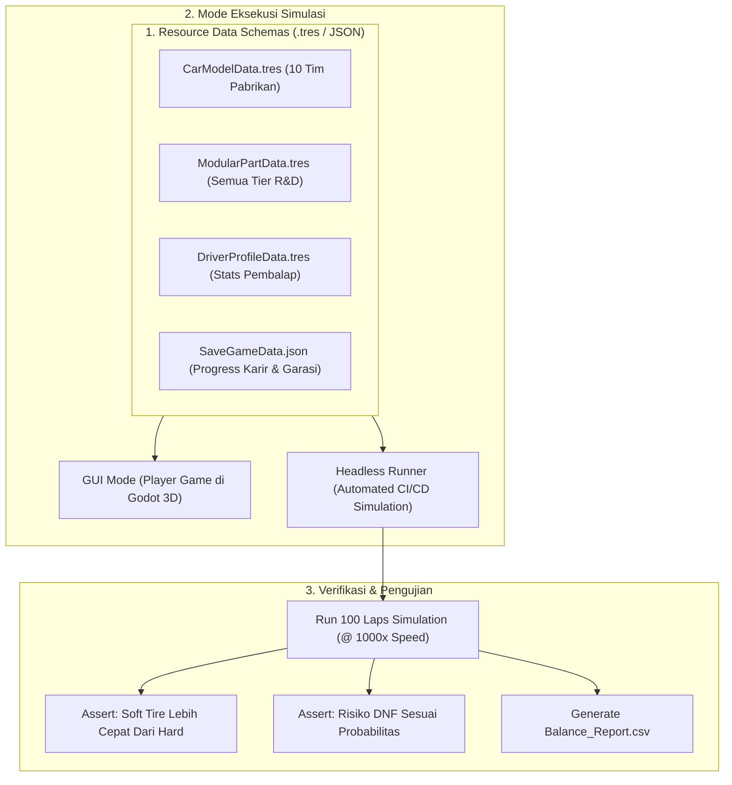
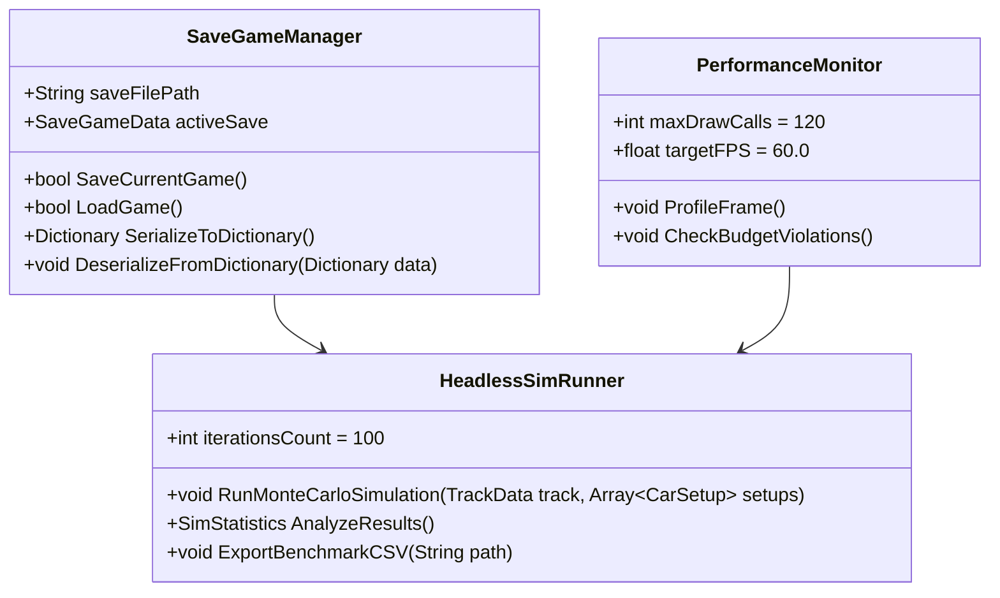
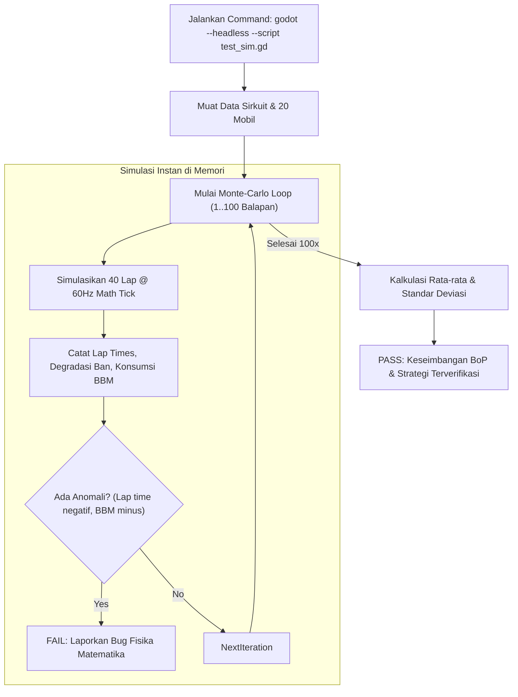

# PRD 07: Data Schemas, Headless Testing & Performance Budgets
**Fase:** 7 (Data Architecture, Automated Testing & Optimization)  
**Target:** Backend Engineer, QA Automation Engineer, Performance Specialist  

---

## 1. Arsitektur Data & Pengujian Otomatis (System Architecture)

Game *La Voiture* menggunakan arsitektur **Data-Driven Design** berbasis Godot `Resource` (`.tres`) untuk seluruh konfigurasi mobil, pembalap, dan part modular. Arsitektur ini memungkinkan eksekusi **Headless Simulation Runner** (menjalankan ratusan simulasi balapan tanpa antarmuka grafis dalam hitungan detik) untuk memverifikasi keseimbangan strategi sebelum dirilis ke pemain:



### Class Diagram Manajemen Data & Pengujian



---

## 2. Fitur & Standar Pengujian (Features & Verification)

| ID | Fitur | Kriteria Keberhasilan (Acceptance Criteria) | Target Metrik |
| :--- | :--- | :--- | :--- |
| **QA-01** | **Headless Balance Test** | Menjalankan balapan 50 lap untuk 20 mobil tanpa memuat viewport 3D. | Selesai dalam waktu $\le 3\text{ detik}$ per balapan. |
| **QA-02** | **Tire Strategy Assertion** | Memastikan strategi ban *Soft* menghasilkan lap awal lebih kencang daripada *Hard*. | Selisih waktu: $\Delta = 0.8\text{s s.d. } 1.4\text{s / lap}$. |
| **QA-03** | **Robust Fast-Forward** | Memverifikasi tidak ada perbedaan hasil posisi akhir saat balapan dijalankan di $1\times$ vs $16\times$. | Deviasi urutan finish: $0\%$ (100% deterministik). |
| **QA-04** | **Save/Load Integrity** | Serialisasi status karir (uang, part R&D terpasang, poin klasemen) ke JSON. | Validasi skema JSON lulus tanpa data hilang (*checksum match*). |

### 2.1 Katalog 10 Test Suite Headless Otomatis (Status: 100% PASS, 322+ Assertions)

Pengujian regresi dijalankan langsung via Godot Console Headless (`godot --headless --path . -s tests/<suite_name>.gd`):

| No | File Test Suite | Asersi | Cakupan Pengujian |
| :---: | :--- | :---: | :--- |
| 1 | `tests/test_modular_car.gd` | **18 PASS** | Pemasangan soket modular sasis Porsche 911 GT3, velg BBS FI-R, nol tumpang tindih part. |
| 2 | `tests/test_simulation_verification.gd` | **43 PASS** | Fisika degradasi ban, konsumsi bahan bakar, logika pit window, dan determinisme matematika. |
| 3 | `tests/test_pit_wall.gd` | **26 PASS** | Interaksi Tactical Deck, baris Timing Tower, filter radio, dan responsivitas UI 60 FPS. |
| 4 | `tests/test_weather_and_ai.gd` | **43 PASS** | 4 arketipe cuaca, laju genangan air trek, pendinginan ban basah, AI undercut/overcut, dan VSC 120 km/jam. |
| 5 | `tests/test_race_world.gd` | **65 PASS** | Ribbon spline sirkuit 3D, 5 kamera siaran TV, batas dinding pembatas Armco, dan sinkronisasi 20 mobil. |
| 6 | `tests/test_gt_sim.gd` | **43 PASS** | Porting GT Sim kontinu ($s$, lateral), 5 kompon ban, 75% cliff & puncture 96%, 5 tahap bensin, AI racing room 2.4m, SAT 190-pair contact resolver. |
| 7 | `tests/test_car_dynamics_vfx.gd` | **18 PASS** | Steering roda depan adaptif, body roll tikungan, nose dive/squat, filter lolos-rendah dua-tahap `ease2`, tag grafiti manga billboard. |
| 8 | `tests/test_race_hud.gd` | **31 PASS** | Fused Master HUD 1920x1080: Tactical Deck 1888x140px, Telemetry Drawer, Tab tower INT/GAP/LAST, kartu saran. |
| 9 | `tests/test_race_weekend_and_physics.gd` | **30 PASS** | Prosedur balap resmi FIA, gantry 5 lampu merah start, speed limiter pit lane 80 km/jam, koreografi pit stop 3D (dongkrak hidrolik 15cm & 4 roda lepas/pasang). |
| 10 | `tests/test_audio_and_race_weekend.gd` | **35 PASS** | Routing 5 bus audio, suara mesin GT3 3D modulasi pitch RPM (1200-8500), decit ban lateral $G > 1.8G$, letupan knalpot, beep start, 8 tembakan pit gun, dual anime radio overlay (kiri & kanan bebas tabrakan UI), 64 suara TTS neural Kokoro-82M, music ducking (-8dB), dan layar selebrasi podium juara FIA GT3. |
| **Total** | **10 Test Suites Lengkap** | **322 PASS** | **0 FAIL (100% Green, Zero Regressions)** |

---

## 3. Flowchart Eksekusi Headless Simulation Test



---

## 4. Anggaran Performa Perangkat Keras (*Hardware Performance Budgets*)

Target platform standar adalah PC desktop kelas menengah (*Mid-Range PC* e.g., GTX 1660 / RX 580 / Apple Silicon):

| Parameter | Batas Maksimum (*Hard Budget*) | Alasan & Pencegahan |
| :--- | :--- | :--- |
| **Target Frame Rate** | $\ge 60\text{ FPS}$ ($16.6\text{ ms}$) | Mencegah lag saat tabel telemetri diperbarui cepat. |
| **Total Draw Calls** | $\le 120\text{ calls / frame}$ | 20 mobil menggunakan *MultiMesh* atau material batching seragam. |
| **Total Triangles** | $\le 800.000\text{ tris}$ pada scene balapan | $20 \times 35\text{k}$ tris mobil $+ 100\text{k}$ tris sirkuit. |
| **VRAM Consumption** | $\le 2.0\text{ GB}$ | Seluruh tekstur livery mobil berukuran $2048 \times 2048$ format VRAM terkompresi. |
| **RAM Usage** | $\le 1.2\text{ GB}$ | Log telemetri dipangkas (*ring buffer*) hanya menyimpan 5 lap terakhir. |

---

## 5. Skema Data Resource Godot (`.tres`)

### 5.1 Skema Data Part Modular (`ModularPartData.gd`)
```gdscript
class_name ModularPartData extends Resource

@export var part_id: String = "splitter_aero_t1"
@export var part_name: String = "Front Carbon Splitter Stage 1"
@export var category: int = 0 # Enum: AERO, COOLING, CHASSIS, COCKPIT
@export var tier_level: int = 1
@export var cost_credits: int = 150000
@export var manufacturing_time_days: int = 4

# Dampak Fisika & Simulasi
@export var downforce_delta: float = 0.15
@export var drag_delta: float = -0.05
@export var mass_kg_delta: float = -5.0
@export var cooling_efficiency_delta: float = 0.0

@export var mesh_scene: PackedScene
```

### 5.2 Skema Data Karir Pemain (`SaveGameData.gd`)
```gdscript
class_name SaveGameData extends Resource

@export var player_team_name: String = "Apex Racing"
@export var account_balance_usd: int = 12500000
@export var current_season_year: int = 2026
@export var current_round_index: int = 0

# Status 2 Mobil Milik Tim Pemain
@export var car_01_installed_parts: Dictionary = {}
@export var car_02_installed_parts: Dictionary = {}

# Pembalap
@export var driver_01_id: String = "kaze_ryu"
@export var driver_02_id: String = "sora_ren"
```
