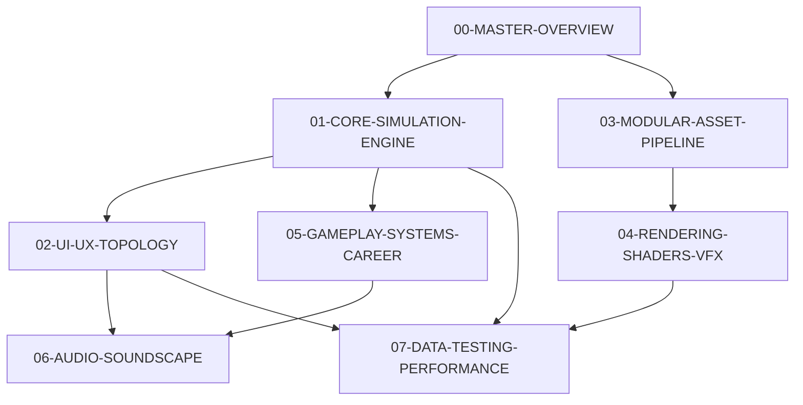

# La Voiture — Product Requirement Document (PRD) Suite
**Versi:** 1.0.0 (Production Blueprint)  
**Game Engine:** Godot Engine 4.x  
**Visual Style:** Cel-Shaded Toon Anime $\times$ Streetwear Brutalism (NFS Unbound)  
**Genre:** Motorsport Strategy & Simulation (GT Manager adaptation)

---

## 1. Daftar Dokumen Modul PRD

Dokumen arsitektur dan persyaratan game *La Voiture* dibagi menjadi beberapa modul spesifikasi teknis sesuai fase implementasi:

| Dokumen | Fase | Cakupan Utama | Status |
| :--- | :--- | :--- | :--- |
| **[00-MASTER-OVERVIEW.md](file:///D:/Occupation/Porto/genex/La_Voiture/PRD/00-MASTER-OVERVIEW.md)** | Master | Visi Produk, Game Loop, 4 Pilar, Arsitektur Sistem Global | ✅ Ready |
| **[01-CORE-SIMULATION-ENGINE.md](file:///D:/Occupation/Porto/genex/La_Voiture/PRD/01-CORE-SIMULATION-ENGINE.md)** | Fase 1 | Kinematic Ribbon Physics, Fast-Forward 16x, Telemetri Matematika Ban/BBM/Aero | ✅ Ready |
| **[02-UI-UX-TOPOLOGY.md](file:///D:/Occupation/Porto/genex/La_Voiture/PRD/02-UI-UX-TOPOLOGY.md)** | Fase 2 | Pit Wall Command Center, Bento Grid HQ, Halftone Screentones, Anime Cut-Ins | ✅ Ready |
| **[03-MODULAR-ASSET-PIPELINE.md](file:///D:/Occupation/Porto/genex/La_Voiture/PRD/03-MODULAR-ASSET-PIPELINE.md)** | Fase 3 | 10 Mobil GT3, Universal Sockets, Blender Quality Gate, Meshy Ingestion, Zero-Overlap | ✅ Ready |
| **[04-RENDERING-SHADERS-VFX.md](file:///D:/Occupation/Porto/genex/La_Voiture/PRD/04-RENDERING-SHADERS-VFX.md)** | Fase 4 | Toon Cel-Shading, Inverted-Hull Ink Outline, Asap Ban 2D Manga, Grafiti Unbound | ✅ Ready |
| **[05-GAMEPLAY-SYSTEMS-CAREER.md](file:///D:/Occupation/Porto/genex/La_Voiture/PRD/05-GAMEPLAY-SYSTEMS-CAREER.md)** | Fase 5 | AI Rival Strategist, Cuaca Dinamis, Safety Car, HQ R&D, Balance of Performance | ✅ Ready |
| **[06-AUDIO-SOUNDSCAPE.md](file:///D:/Occupation/Porto/genex/La_Voiture/PRD/06-AUDIO-SOUNDSCAPE.md)** | Fase 6 | Audio Mesin GT3, Tactile Manga UI SFX, Radio Pembalap Dinamis (Genex Voice) | ✅ Ready |
| **[07-DATA-TESTING-PERFORMANCE.md](file:///D:/Occupation/Porto/genex/La_Voiture/PRD/07-DATA-TESTING-PERFORMANCE.md)** | Fase 7 | Skema Resource (`.tres`), Headless Simulation Benchmark, Performance Budgets | ✅ Ready |

---

## 2. Dependency Matrix Antar Modul

---

## 3. Aturan Standar Dokumentasi
Setiap modul PRD diwajibkan memuat elemen komprehensif berikut:
1. **Architecture & Class Diagram:** Diagram struktural berbasis Mermaid.
2. **Features & Requirements:** Persyaratan fungsional dan non-fungsional dengan kriteria ketercapaian (*acceptance criteria*).
3. **Flowchart:** Alur eksekusi logika (*control flow*).
4. **Gameplay Mechanics:** Formulasi matematika, parameter, dan relasi aturan balapan.
5. **Asset Workflow & Game Visual:** Standar aset 2D/3D, spesifikasi shader, dan palet warna.
6. **Data Contract:** Representasi tipe data input/output.
