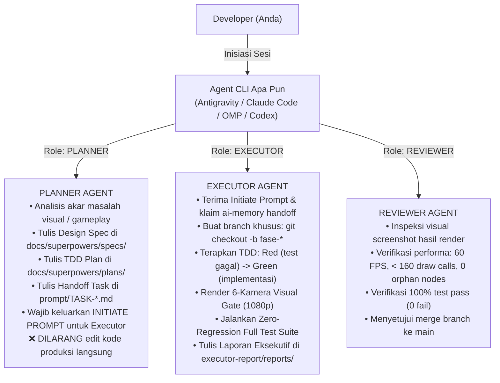

# PANDUAN RESMI ALUR KERJA MULTI-AGENT & PROTOKOL INISIASI (La Voiture)

> **Dokumen Terkait:** [`AGENTS.md`](file:///D:/Occupation/Porto/genex/La_Voiture/AGENTS.md) · [`Circuit-Environment-Component-Guide.md`](file:///D:/Occupation/Porto/genex/La_Voiture/Circuit-Environment-Component-Guide.md) · [`ROADMAP.md`](file:///D:/Occupation/Porto/genex/La_Voiture/ROADMAP.md)

Dokumen ini adalah standar baku tata kelola kolaborasi antar agen AI (Antigravity, Claude Code, Oh My Pi, Codex, Cursor) dalam repositori *La Voiture*, yang diikat oleh sistem kontrol memori persisten [**`ai-memory`**](https://github.com/akitaonrails/ai-memory).

---

## 1. Filosofi Inti: Peran Fungsional Dinamis (*Model-Agnostic Roles*)

Peran agen dalam proyek ini **tidak terikat permanen pada nama vendor / CLI tertentu**, melainkan bersifat **peran fungsional (*functional contract*)** yang dapat dipertukarkan kapan saja:



---

## 2. Aturan Emas: Wajib Menyertakan "Initiate Prompt"

Setiap kali peran **Planner** menyelesaikan tahap perencanaan (Design Spec, Plan, Handoff Task), Planner **WAJIB** mencetak blok **Initiate Prompt** siap-salin (*ready-to-paste*) di akhir jawabannya.

### Format Standar Initiate Prompt:

```markdown
### 🚀 INITIATE PROMPT UNTUK AGENT EXECUTOR:

Salin dan tempel prompt berikut ke terminal agen Executor (Claude Code / OMP / Codex / dll):

---
Bertindaklah sebagai **AGENT EXECUTOR** untuk repositori *La Voiture*.
Tugas Anda: Eksekusi **[NAMA-TASK / FASE]**.

Dokumen Acuan Resmi:
- Prompt Handoff: `prompt/[NAMA-TASK-FILE].md`
- TDD Implementation Plan: `docs/superpowers/plans/[NAMA-PLAN-FILE].md`
- Design Spec: `docs/superpowers/specs/[NAMA-SPEC-FILE].md`
- Local Memory Context: Tersedia via `ai-memory` (klaim pending handoff).

Langkah Kerja Wajib:
1. Buat branch baru: `git checkout -b [nama-branch-fase]`
2. Terapkan TDD: perbarui test suite hingga RED, lalu implementasikan kode hingga GREEN.
3. Render dan inspeksi visual 6-Camera Visual Gate (1080p).
4. Pastikan Zero Regression (seluruh unit test PASS 100%).
5. Tulis laporan resmi di `executor-report/reports/[NAMA-LAPORAN].md` dan laporkan saat tuntas.
---
```

---

## 3. Integrasi `ai-memory` (Local Control Plane)

Seluruh agen terhubung ke satu sistem memori lokal yang sama di komputer pengembang:

* **Service URL:** `http://127.0.0.1:49374/`
* **Web UI Dashboard:** [http://127.0.0.1:49374/web](http://127.0.0.1:49374/web)
* **Auth Token:** Tersimpan di `%LOCALAPPDATA%\ai-memory\auth-tokens\default`.
* **Protokol Estafet Handoff:**
  * Saat Planner selesai dan sesi ditutup $\rightarrow$ Hook `SessionEnd` membuat paket *Open Handoff*.
  * Saat Executor dibuka $\rightarrow$ Hook `SessionStart` otomatis mengklaim paket handoff tersebut ke dalam konteksnya.
  * Saat sesi di-compact $\rightarrow$ Hook `PreCompact` membekukan detail teknis ke disk agar tidak hilang.

---

## 4. Alur Pembuatan & Overhaul Sirkuit (5 Tahap Baku)

Setiap pengembangan sirkuit baru maupun perbaikan lingkungan (*environment overhaul*) wajib melalui 5 tahapan:

1. **Tahap 1: Concept Art & 4-View Reference Gate** (`reference-assets/tracks/<slug>/`).
2. **Tahap 2: Track Spline & Civil Ground Envelope** (**Hukum Kontinuitas Sipil: 0 floating roads** di bawah jalan, pohon, dan barrier).
3. **Tahap 3: Pemasangan Tier A (Reusable Core Kit)** (Aspal, Kerb, Paddock 10-Stall, Shared Cel-Sky).
4. **Tahap 4: Perakitan Tier B (Improvised Biome & 2–4 Hero Landmarks)**.
5. **Tahap 5: Quality Gate & Definition of Done** (100% Test PASS, 6-Camera Visual Gate 1080p, $\le 160$ draw calls, 60 FPS locked, 0 orphan nodes).

---

## 5. Matriks Skenario Pergantian Agen (Cheat Sheet)

| Anda Ingin Menggunakan | Cara Menetapkan Peran |
| :--- | :--- |
| **Oh My Pi (OMP) sebagai Planner** | Berikan instruksi: *"Bertindaklah sebagai PLANNER. Susun Design Spec, Plan, dan Handoff prompt untuk [Fitur]. Jangan ubah kode produksi langsung."* |
| **Claude Code sebagai Executor** | Berikan **Initiate Prompt** yang telah dicetak oleh Planner. Claude Code langsung membuat branch dan mengeksekusi TDD. |
| **Antigravity sebagai Executor** | Berikan instruksi: *"Bertindaklah sebagai EXECUTOR. Eksekusi [Task ID] di branch baru sesuai TDD Plan."* |
| **Codex sebagai Reviewer** | Berikan instruksi: *"Bertindaklah sebagai REVIEWER. Jalankan seluruh test suite, inspeksi screenshots di `executor-report/screenshots/`, dan verifikasi DoD."* |
