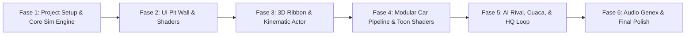

# Implementation Roadmap: *La Voiture*
> **For agentic workers:** REQUIRED SUB-SKILL: Use `superpowers:subagent-driven-development` or `superpowers:executing-plans` to implement this plan task-by-task. Steps use checkbox (`- [ ]`) syntax for tracking.

**Goal:** Membangun game simulasi manajemen motorsport GT3 (*GT Manager $\times$ NFS Unbound Toon Anime*) di Godot 4 secara bertahap mulai dari mesin simulasi matematika hingga visual 3D modular dan audio.

**Architecture:** Data-driven & Headless-capable Core Simulation (60Hz Tick, Fast-Forward 16x) terpisah dari Viewport 3D (Kinematic Ribbon Corridor) dan Antarmuka Control Nodes 3-Tier Z-Index ([DESIGN.md](file:///D:/Occupation/Porto/genex/La_Voiture/DESIGN.md)).

**Tech Stack:** Godot Engine 4.x, Blender 4.x (via Blender MCP), Meshy AI (via Meshy MCP / Genex CLI), Genex Audio.

---

## Roadmap Ringkas Antar Fase

---

## FASE 1: Inisialisasi Proyek Godot 4 & Core Simulation Math Engine
*Target: Engine simulasi matematika berjalan deterministik di background dengan 20 mobil dan fitur Fast-Forward 16x.*

- [x] **Task 1.1: Inisialisasi Proyek Godot 4 & Struktur Folder**
  - [x] Buat file konfigurasi proyek `project.godot` (Target: Forward+, 60 FPS, resolusi 1920x1080).
  - [x] Susun struktur direktori proyek sesuai standar [PRD 00](file:///D:/Occupation/Porto/genex/La_Voiture/PRD/00-MASTER-OVERVIEW.md) (`scenes/`, `scripts/core/`, `scripts/ui/`, `shaders/`, `assets/`).
  - [x] Commit inisialisasi: `git commit -m "feat(init): godot 4 project structure & project.godot"`.

- [x] **Task 1.2: Model Data Telemetri & State Mobil (`CarState.gd`)**
  - [x] Buat `scripts/core/car_state.gd` (Posisi spline, lajur, kecepatan mps, data lap).
  - [x] Buat `scripts/core/tire_model.gd` (Degradasi 4 ban FL, FR, RL, RR, suhu inner/surface, kurva kompon S/M/H/W).
  - [x] Buat `scripts/core/fuel_model.gd` (Massa bensin kg, laju pembakaran per lap, penalti bobot detik).
  - [x] Buat unit test verifikasi model ban & bensin (`tests/test_tire_fuel.gd`).
  - [x] Commit: `git commit -m "feat(sim): car state, tire degradation, and fuel mass models"`.

- [x] **Task 1.3: Core Simulation Engine & Sub-stepping (`RaceSimEngine.gd`)**
  - [x] Buat `scripts/core/race_sim_engine.gd` dengan loop $60\text{ Hz}$ tick.
  - [x] Implementasikan fungsi `SetTimeScale(1.0 s.d 16.0)` dengan sub-stepping matematika deterministik.
  - [x] Implementasikan perhitungan slipstream & dirty air (wake turbulensi aero di tikungan).
  - [x] Implementasikan pelacak mini-sektor dan kalkulator delta waktu lap.
  - [x] Commit: `git commit -m "feat(sim): deterministic race sim engine with 16x fast forward"`.

- [x] **Task 1.4: Headless Simulation Benchmark Script**
  - [x] Buat script headless `scripts/core/headless_sim_runner.gd` ([PRD 07](file:///D:/Occupation/Porto/genex/La_Voiture/PRD/07-DATA-TESTING-PERFORMANCE.md)).
  - [x] Jalankan simulasi 50 lap untuk 20 mobil tanpa grafis: verifikasi konsistensi lap times dan ketiadaan nilai negatif/anomali.
  - [x] Commit: `git commit -m "test(sim): headless 20-car benchmark verification suite"`.

---

## FASE 2: UI Pit Wall Command Center & Manga Styling ([DESIGN.md](file:///D:/Occupation/Porto/genex/La_Voiture/DESIGN.md))
*Target: Antarmuka strategi balap neo-brutalisme dengan garis tinta hitam, halftone, dan reaksi Snap-Invert.*

- [x] **Task 2.1: Shader Halftone & Token Tema Antarmuka**
  - [x] Buat `shaders/halftone_screentone.gdshader` (pola radial Ben-Day dots manga).
  - [x] Buat `shaders/chamfer_header.gdshader` (potongan sudut kanan atas $45^\circ$).
  - [x] Buat `scripts/ui/ui_theme_tokens.gd` (konstanta warna: Acid Lime `#CCFF00`, Cyan `#00F0FF`, Crimson `#FF1E56`, dll.).
  - [x] Commit: `git commit -m "feat(ui): halftone screentone shader and color token constants"`.

- [x] **Task 2.2: Live Timing Tower Component (Zone B)**
  - [x] Buat `scenes/pit_wall/driver_row.tscn` (komponen baris pembalap).
  - [x] Implementasikan logika **Snap-Invert State** (latar putih `#F4F5F7` instan $\le 120\text{ms}$ + hard offset $+6\text{px}$).
  - [x] Buat `scenes/pit_wall/timing_tower.tscn` (wadah 20 baris pembalap terurut otomatis).
  - [x] Hubungkan pembaruan data delta langsung dari sinyal `RaceSimEngine`.
  - [x] Commit: `git commit -m "feat(ui): live timing tower with snap-invert row selection"`.

- [x] **Task 2.3: Driver Strategy Deck Component (Zone D)**
  - [x] Buat `scenes/pit_wall/driver_strategy_deck.tscn`.
  - [x] Implementasikan indikator visual 4 sudut ban (FL, FR, RL, RR) dengan bar persentase dan suhu.
  - [x] Tambahkan slider Pace Mode (`Conserve / Balanced / Attack`) dan Fuel Mode.
  - [x] Tambahkan tombol aksi `[⚡ BOX THIS LAP ★]` dengan getaran mikro dan pulse halftone.
  - [x] Tambahkan tab toggle untuk beralih instan antara `Car #01` dan `Car #02`.
  - [x] Commit: `git commit -m "feat(ui): driver strategy deck with 4-corner tire telemetry"`.

- [x] **Task 2.4: Anime Radio Cut-In Overlay (Zone E)**
  - [x] Buat `scenes/pit_wall/anime_radio_cutin.tscn` pada `CanvasLayer (Z:30)`.
  - [x] Implementasikan animasi slide masuk panel komik dari kiri bawah saat transmisi radio aktif.
  - [x] Tambahkan ticker marquee berjalan untuk pesan cepat (*Fastest Lap, Yellow Flag*).
  - [x] Commit: `git commit -m "feat(ui): anime radio cut-in comic overlay with marquee ticker"`.

---

## FASE 3: Lintasan 3D Ribbon & Kinematic Vehicle Actor
*Target: Mobil 3D melaju mulus di lintasan dengan koridor 3 lajur tanpa risiko tunneling fisika.*

- [x] **Task 3.1: Konstruksi Track Ribbon Spline 3D**
  - [x] Buat scene `scenes/race_world/track_circuit.tscn` memuat kurva `Path3D` / Spline.
  - [x] Buat script `scripts/car/track_ribbon.gd` untuk mengekstrak 3 koridor lajur (*Inside, Optimal, Outside*).
  - [x] Buat mesh dasar sirkuit sirkular uji coba (*Test Track Circuit*).
  - [x] Commit: `git commit -m "feat(track): 3-lane ribbon corridor spline generator"`.

- [x] **Task 3.2: Kinematic Car Actor Controller**
  - [x] Buat `scenes/race_world/car_actor.tscn` berbasis `Node3D`.
  - [x] Implementasikan interpolasi posisi visual sepanjang spline mengikuti tick simulasi.
  - [x] Tambahkan raycast sensorik depan dan samping untuk mendeteksi mobil lawan.
  - [x] Implementasikan manuver perpindahan lajur (*lane switching*) saat menyalip.
  - [x] Commit: `git commit -m "feat(car): kinematic dynamic vehicle controller with lane shift"`.

- [x] **Task 3.3: Integrasi 2D Circuit Radar**
  - [x] Buat `scenes/pit_wall/circuit_radar_2d.tscn` di layar Pit Wall.
  - [x] Proyeksikan posisi 20 mobil 3D menjadi titik-titik bergerak pada minimap 2D.
  - [x] Commit: `git commit -m "feat(ui): real-time 2d circuit radar tracking 20 cars"`.

---

## FASE 4: Pipeline Mobil 3D Modular & Shader Anime Toon ([Full-Car-Component-Guide.md](file:///D:/Occupation/Porto/genex/La_Voiture/Full-Car-Component-Guide.md))
*Target: Sistem sasis Universal Socket di Godot & Blender, dengan shader cel-shaded bebas overlap.*

- [x] **Task 4.1: Shader Cel-Shaded & Inverted Hull Ink Outlines**
  - [x] Buat `shaders/anime_cel_shaded.gdshader` (2-tone stepped lighting + hard specular).
  - [x] Buat `shaders/inverted_hull_outline.gdshader` (garis tinta hitam komik `#050505`).
  - [x] Verifikasi shader pada mesh sampel: pastikan garis tepi tajam tanpa gradien buram.
  - [x] Commit: `git commit -m "feat(shader): stepped toon lighting and inverted hull comic outlines"`.

- [x] **Task 4.2: Sistem Universal Socket & Dynamic Assembler**
  - [x] Buat `scripts/car/modular_car_assembler.gd`.
  - [x] Definisikan titik kaitan socket standar: `Socket_FrontSplitter`, `Socket_RearWing`, `Socket_Diffuser`, `Socket_Wheel_*`, `Socket_Cockpit`.
  - [x] Implementasikan fungsi `EquipPart(category, tier)` yang menempelkan mesh GLB secara presisi ke socket.
  - [x] Commit: `git commit -m "feat(car): universal socket mounting system for modular parts"`.

- [x] **Task 4.3: Ingestion & Slicing Mobil GT3 Pertama (Blender MCP + Meshy)**
  - [x] Siapkan bodi referensi (misal: *Porsche 911 GT3 R* atau *Aston Martin Vantage* dari `reference-assets/images`).
  - [x] Jalankan pemotongan part di Blender (via Blender MCP) pada garis nat panel alami.
  - [x] Terapkan titik origin bersama `(0,0,0)` pada sasis dan part modular.
  - [x] Ekspor ke `res://assets/cars/` dan pasangkan ke scene `BaseChassis.tscn` di Godot.
  - [x] Uji perakitan: pastikan 0% overlap geometri / clipping.
  - [x] Commit: `git commit -m "feat(assets): first gt3 modular car chassis and swappable parts"`.

- [x] **Task 4.4: Efek Partikel Gaya NFS Unbound**
  - [x] Buat `scenes/vfx/manga_smoke_emitter.tscn` (animasi sprite sheet asap 2D hitam-putih).
  - [x] Buat partikel garis kecepatan (*speed lines*) di sudut sayap belakang saat kecepatan $> 220\text{ km/jam}$.
  - [x] Buat efek grafiti sayap bercahaya saat ERS Boost aktif.
  - [x] Commit: `git commit -m "feat(vfx): nfs unbound 2d manga smoke and graffiti boost wings"`.

---

## FASE 5: AI Rival Strategist, Cuaca Dinamis, & Markas Tim (HQ)
*Target: Siklus karir lengkap, cuaca dinamis, dan 18 mobil rival yang bertarung cerdas.*

- [ ] **Task 5.1: AI Rival Race Director (`AIRaceDirector.gd`)**
  - [ ] Implementasikan pohon keputusan strategi 9 tim rival (undercut, overcut, reaksi terhadap pit window).
  - [ ] Beri profil kepribadian pada tim lawan (agresif vs hemat ban).
  - [ ] Commit: `git commit -m "feat(ai): rival strategist decision tree for 18 opponent cars"`.

- [ ] **Task 5.2: Cuaca Dinamis & Safety Car System**
  - [ ] Buat `scripts/core/weather_manager.gd` (transisi hujan, akumulasi air trek mm, drying line).
  - [ ] Buat `scripts/core/safety_car_director.gd` (pemicu bendera kuning & mobil pengaman saat insiden).
  - [ ] Integrasikan efek hujan visual garis arsir manga di layar.
  - [ ] Commit: `git commit -m "feat(sim): dynamic rain weather system and safety car deployment"`.

- [ ] **Task 5.3: Layar HQ Car Development & Bento Grid ([DESIGN.md Layar 2](file:///D:/Occupation/Porto/genex/La_Voiture/DESIGN.md#L148-L178))**
  - [ ] Buat `scenes/hq/hq_engineering.tscn`.
  - [ ] Implementasikan navigasi menu samping dan Bento Grid modul R&D (*Aero, Cooling, Chassis, Cockpit*).
  - [ ] Hubungkan aksi upgrade part dengan *Visual Mesh Swap* pada mobil 3D di garasi.
  - [ ] Commit: `git commit -m "feat(hq): bento grid engineering menu with 3d car visual swap"`.

---

## FASE 6: Audio Soundscape Genex & Polishing Balapan Penuh
*Target: Seluruh suara mesin, UI, radio pembalap, dan loop balapan dari kualifikasi hingga podium siap dimainkan.*

- [ ] **Task 6.1: Integrasi Audio Mesin GT3 & SFX Balapan**
  - [ ] Generate efek suara menggunakan Genex Audio CLI (`npx genex sfx`).
  - [ ] Buat `scripts/audio/engine_audio_3d.gd` (modulasi pitch RPM $1200\text{ s.d. } 8500\text{ RPM}$).
  - [ ] Tambahkan suara gesekan ban pada batas limit cengkeraman (*tire scrub*).
  - [ ] Tambahkan suara klik taktil tajam pada setiap interaksi UI (*comic clicks*).
  - [ ] Commit: `git commit -m "feat(audio): gt3 engine pitch curves and tactile manga ui clicks"`.

- [ ] **Task 6.2: Audio Radio Pembalap Dinamis & Music Ducking**
  - [ ] Generate klip suara radio pembalap via Genex Voice (`npx genex voice`).
  - [ ] Implementasikan sistem ducking musik otomatis (volume musik turun $-8\text{dB}$ saat driver berbicara).
  - [ ] Sinkronkan suara radio dengan banner anime cut-in.
  - [ ] Commit: `git commit -m "feat(audio): dynamic driver radio voice lines with music ducking"`.

- [ ] **Task 6.3: Integrasi Akhir Akhir Pekan Balapan Penuh**
  - [ ] Sambungkan alur: Kualifikasi 1-Lap $\rightarrow$ Grid Start $\rightarrow$ Balapan Utama $\rightarrow$ Podium.
  - [ ] Pengujian performa menyeluruh: pastikan $\ge 60\text{ FPS}$ dengan 20 mobil di trek.
  - [ ] Commit: `git commit -m "feat(game): complete race weekend integration from qualy to podium"`.
