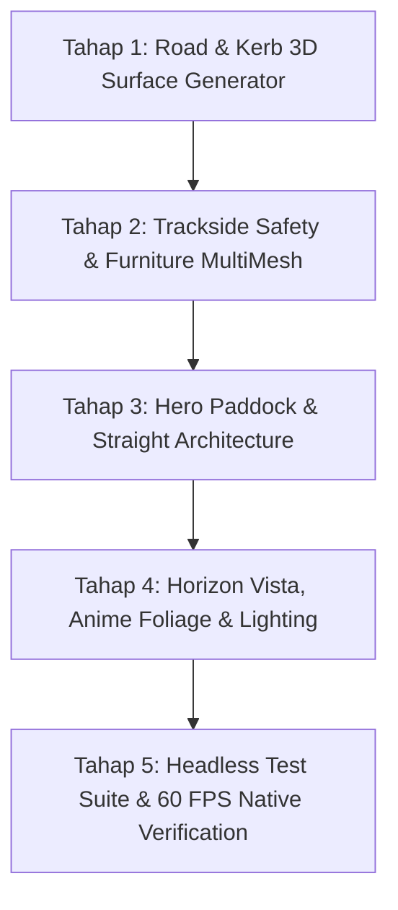

# IMPLEMENTATION PLAN: HYBRID PROCEDURAL TRACK ENVIRONMENT & CIRCUIT DRESSING

**Tanggal:** 2026-10-22  
**Status:** READY FOR EXECUTION  
**Spec Referensi:** [`docs/superpowers/specs/2026-10-22-track-environment-hybrid-procedural-design.md`](file:///D:/Occupation/Porto/genex/La_Voiture/docs/superpowers/specs/2026-10-22-track-environment-hybrid-procedural-design.md)  
**Godot Version:** 4.7.2 stable (Forward Plus / D3D12/Vulkan, Windows)  

---

## 1. Ikhtisar Rencana Kerja

Rencana ini mengeksekusi peningkatan visual lingkungan sirkuit balap Apex Ring International secara bertahap dan terukur tanpa mengubah data spline fisika `Curve3D` di `track_circuit.tscn`. Pekerjaan dibagi ke dalam 5 tahap berurutan dengan gerbang verifikasi di setiap tahap.

---

## 2. Tahap Implementasi Detail

### Tahap 1: Road & Kerb 3D Surface Generator
*Tujuan: Menggantikan asfal datar primitif dan kerb 2D dengan geometri kerb 3D berprofil elevasi dan shader asfal bertekstur anime.*

1. **Shader Asfal Prosedural (`shaders/road_asphalt.gdshader`):**
   - Buat shader cel-shaded dengan micro-grit noise, warna dasar `#26282E`.
   - Tambahkan input uniform untuk *Rubber Groove Intensity* yang menggelapkan area lintasan balap ideal (`AdaptiveRacingLine`).
   - Tambahkan input uniform untuk *Wetness/Puddle Mask* yang mengubah roughness dan memantulkan langit/lampu secara reflektif saat cuaca basah.
   - Tambahkan garis tepi putih tipis di tepi terluar asfal ($X = \pm \text{road\_half\_width}$).
2. **Geometri Kerb 3D Sawtooth (`scripts/world/shared/enhanced_track_geometry.gd`):**
   - Buat fungsi generasi mesh kerb dengan elevasi nyata:
     - Lebar $1.2\text{ m}$, tinggi puncak $0.05\text{ m}$ di $0.4\text{ m}$ dari tepi trek, lalu melandai turun ke $0.0\text{ m}$ di sisi gravel.
     - Segmen warna merah (`#D9232E`) dan putih (`#F0F2F5`) berulang setiap $1.5\text{ m}$ dengan chamfer miring $0.5\text{ m}$.
3. **Zona Runoff & Gravel Trap:**
   - Deteksi tikungan dengan kelengkungan $|\kappa| > 0.008\text{ m}^{-1}$.
   - Ekstrusi strip runoff asfal selebar $6\text{ m}$ di sisi luar tikungan, diikuti oleh hamparan gravel trap selebar $8\text{ m}$ bertekstur pasir kasar.
4. **Verifikasi Tahap 1:**
   - Jalankan `godot --headless --path . -s tests/test_track_environment.gd` untuk memastikan elevasi asfal tepat $0.0\text{ m}$ dan puncak kerb tidak melebihi $+0.05\text{ m}$.

---

### Tahap 2: Trackside Safety & Furniture MultiMesh
*Tujuan: Membangun guardrail baja detail, pembatas Tecpro, papan jarak pengereman, dan menara lampu stadion dengan biaya draw-call minimal.*

1. **FIA Triple-Rib Armco & Posts (`scripts/world/shared/trackside_furniture_builder.gd`):**
   - Buat profil mesh baja berlekuk W-beam (tinggi $0.65\text{ m}$, tebal $0.08\text{ m}$) dengan bahan shader logam anime reflektif.
   - Buat tiang I-beam yang di-instansiasi via `MultiMeshInstance3D` setiap $4.0\text{ m}$ di sepanjang kedua sisi trek.
   - Buat celah terbuka otomatis di zona Pit Entry dan Pit Exit agar mobil pemain dan AI dapat masuk/keluar pit tanpa benturan.
2. **Tecpro Safety Barriers:**
   - Buat modul pembatas busa berdaya serap tinggi (merah dan abu-abu gelap) di zona luar tikungan kritis (Turn 1, Hairpin Turn 4, dan chicane akhir).
   - Di-instansiasi via MultiMesh di depan pagar penonton.
3. **Braking Distance Markers (150m, 100m, 50m):**
   - Buat mesh papan penanda jarak pengereman putih dengan angka hitam tebal dan garis hazard kuning-hitam di bawahnya.
   - Posisikan secara prosedural pada jarak 150m, 100m, dan 50m sebelum titik puncak tikungan (*apex*).
4. **Stadium Floodlight Towers:**
   - Buat menara lampu kisi baja tinggi ($18\text{ m}$) dengan 8 lampu sorot LED di kepalanya.
   - Tempatkan 28 menara di sekeliling sirkuit via MultiMesh dengan pencahayaan aktif saat balapan malam (*Night*).
5. **Verifikasi Tahap 2:**
   - Verifikasi bahwa semua tiang dan pembatas menggunakan MultiMesh (maksimal 4 node MultiMeshInstance3D di scene).

---

### Tahap 3: Hero Paddock & Straight Architecture
*Tujuan: Menghadirkan atmosfer balap megah di garis start/finish dengan gedung pit, tribun penonton raksasa, dan menara kontrol balap.*

1. **Pit Building & VIP Paddock Club (`scenes/race_world/paddock/pit_building_structure.tscn`):**
   - Bangun struktur modular 2 lantai di belakang 10 stall pit stop:
     - Lantai bawah: 10 modul garasi tim dengan pintu rolling, logo tim, dan nomor stall.
     - Lantai atas: VIP Paddock Lounge berdinding kaca tinted transparan dengan teras observasi berkanopi.
2. **Main Grandstand (`scenes/race_world/paddock/main_grandstand.tscn`):**
   - Bangun tribun penonton 3 tingkat sepanjang $240\text{ m}$ di seberang pit straight.
   - Atap kantilever melengkung warna abu-abu titanium dengan struktur penyangga truss baja.
   - Tambahkan papan LED raksasa (*Giant Jumbotron*) yang menampilkan animasi grafis race live leaderboard.
3. **Race Control Tower (`scenes/race_world/paddock/race_control_tower.tscn`):**
   - Bangun menara kontrol futuristik berlantai 4 di ujung pit exit dengan jendela observasi sudut 360°.
4. **Start/Finish Gantry Upgrade (`scripts/world/shared/start_gantry.gd`):**
   - Perbarui mesh gantry start dengan struktur truss ganda yang menaungi seluruh lebar trek dan jalur pit wall.
   - Sinkronisasikan dengan sistem 5 lampu merah FIA (`RaceWeekendWorld.lights_state`).
5. **Verifikasi Tahap 3:**
   - Pastikan mobil di stall pit lane dan di trek lurus memiliki clearance vertikal bebas tanpa tabrakan dengan struktur bangunan.

---

### Tahap 4: Horizon Vista, Anime Foliage & Multi-Condition Lighting
*Tujuan: Menghadirkan kedalaman visual lanskap anime di kejauhan dan integrasi pencahayaan balapan dinamis.*

1. **Stylized Low-Poly Mountain Backdrop (`scenes/race_world/mountain_vista.tscn`):**
   - Bangun cincin pegunungan bergerigi bergaya cel-shaded di radius $1500\text{ m}$ dari pusat sirkuit.
   - Gradasi warna kabut atmosferik anime (*atmospheric depth haze*) yang menyatu dengan skybox.
2. **Anime Foliage Clusters (`scripts/world/shared/foliage_scatter.gd`):**
   - Buat 3 jenis pohon kartun: Cedar runcing, Oak bulat bertingkat, dan Pine lereng.
   - Distribusikan menggunakan Poisson-disc sampling di luar batas pagar keamanan ($> 18\text{ m}$ dari aspal).
   - Gunakan shader ayunan angin lembut (*wind sway*) untuk menghidupkan dedaunan.
3. **Preset Pencahayaan Lingkungan (`scripts/world/shared/circuit_lighting_controller.gd`):**
   - Hubungkan dengan waktu balapan `RaceConfigData.time_of_day`:
     - `Day`: Matahari terik dengan bayangan tajam dan langit biru cerah anime.
     - `Sunset`: Cahaya matahari terbenam keemasan (*golden hour*), bayangan panjang, langit gradasi oranye-ungu.
     - `Night`: Langit malam gelap berbintang, 28 menara lampu stadion menyala terang menerangi asfal dengan specular reflektif.
4. **Verifikasi Tahap 4:**
   - Screenshot visual capture untuk kondisi Day, Sunset, dan Night balapan.

---

### Tahap 5: Headless Test Suite & 60 FPS Native Verification
*Tujuan: Menjamin stabilitas kode, nol regresi pada seluruh test suite proyek, dan performa tinggi 60 FPS.*

1. **Unit & Integration Test Suite (`tests/test_track_environment.gd`):**
   - Uji elevasi permukaan jalan ($Y = 0.0\text{ m}$).
   - Uji tinggi puncak kerb ($0.04\text{ m} \le Y \le 0.05\text{ m}$).
   - Uji kontinuitas Armco dan keberadaan celah Pit Entry/Exit.
   - Uji instansiasi papan jarak pengereman di semua tikungan tajam.
   - Uji integrasi gedung pit dan tribun utama.
2. **Regresi Seluruh Test Proyek:**
   - Jalankan seluruh 20 test suite headless (`test_modular_car`, `test_gt_sim`, `test_race_weekend_and_physics`, `test_main_menu_flow`, dll). Seluruh test wajib **0 FAIL**.
3. **Pengujian Native Smoke 60 FPS:**
   - Jalankan balapan 3 lap 20 mobil dalam mode Fullscreen 1080p High. Ukur frame time median dan pastikan terkunci di 60 FPS ($16.66\text{ ms}$).

---

## 3. Matriks Berkas Baru & Modifikasi

| Aksi | Jalur Berkas | Tanggung Jawab |
| :--- | :--- | :--- |
| **Baru** | `shaders/road_asphalt.gdshader` | Cel-shaded asphalt dengan racing rubber groove & wetness |
| **Baru** | `shaders/wind_foliage.gdshader` | Vertex sway shader untuk pohon anime |
| **Baru** | `scripts/world/shared/enhanced_track_geometry.gd` | Generator kerb 3D sawtooth, runoff, dan gravel traps |
| **Baru** | `scripts/world/shared/trackside_furniture_builder.gd` | MultiMesh builder untuk Armco, Tecpro, marker 150/100/50m, dan floodlights |
| **Baru** | `scenes/race_world/paddock/pit_building_structure.tscn` | Gedung pit 2 lantai & VIP Paddock Club |
| **Baru** | `scenes/race_world/paddock/main_grandstand.tscn` | Tribun penonton kantilever dengan Jumbotron LED |
| **Baru** | `scenes/race_world/paddock/race_control_tower.tscn` | Menara kontrol balap di ujung pit exit |
| **Baru** | `scenes/race_world/mountain_vista.tscn` | Backdrop pegunungan anime di horizon |
| **Baru** | `tests/test_track_environment.gd` | Headless unit test suite untuk validasi lingkungan trek |
| **Modifikasi** | `scripts/world/circuits/apex_ring/apex_environment.gd` | Mengorkestrasi builder baru dan mengintegrasikan hero assets |
| **Modifikasi** | `scripts/world/shared/start_gantry.gd` | Peningkatan visual gantry baja ganda & lampu digital FIA |
