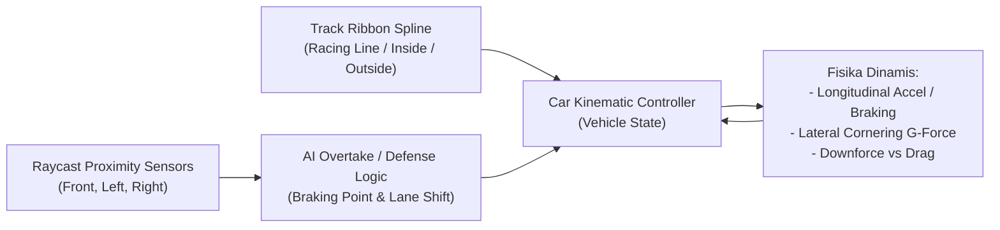

# Spesifikasi Desain Arsitektur Game: *La Voiture*
**Tanggal:** 20 Oktober 2026  
**Status:** Approved by User (Brainstorming Phase Completed)  
**Target Engine:** Godot Engine 4.x (C# / GDScript Hybrid)  
**Referensi Utama:** [DESIGN.md](file:///D:/Occupation/Porto/genex/La_Voiture/DESIGN.md) & [Full-Car-Component-Guide.md](file:///D:/Occupation/Porto/genex/La_Voiture/Full-Car-Component-Guide.md)

---

## 1. Ringkasan Eksekutif & DNA Game

*La Voiture* adalah game simulasi manajemen motorsport (*GT Racing Strategy Management*) yang menggabungkan kedalaman taktik balapan ala **GT Manager & F1 Manager** dengan estetika visual **Cel-Shaded Toon Anime $\times$ Streetwear Brutalism (NFS Unbound)**. 

Pemain berperan sebagai *Team Principal* & *Head Race Strategist* di Pit Wall yang mengendalikan 2 mobil balap GT3, mengatur alur pit stop, degradasi ban, bahan bakar, dan R&D part modular di markas (HQ).

### 4 Pilar Utama Sistem
1. **Core Simulation Engine:** *Semi-Physics 3D Kinematic Ribbon Corridor* + *Deterministic Telemetry sub-stepping* yang stabil di kecepatan Fast-Forward (1x, 2x, 4x, 8x, 16x).
2. **UI Topology & Manga Visuals:** Adaptasi penuh [DESIGN.md](file:///D:/Occupation/Porto/genex/La_Voiture/DESIGN.md) (Zero Softness, Halftone Ben-Day screentones, Snap-Invert tables, Anime Radio Cut-Ins).
3. **Modular 3D Car Pipeline:** Sasis dasar dengan sistem *Universal Sockets* di Blender & Godot, memisahkan komponen modular eksterior & interior berbasis [Full-Car-Component-Guide.md](file:///D:/Occupation/Porto/genex/La_Voiture/Full-Car-Component-Guide.md) dengan jaminan 0% geometric clipping/overlap.
4. **Rendering & Anime VFX:** Toon Shading (stepped lighting + ink outlines) dikombinasikan dengan efek partikel grafiti, asap donat 2D bergaris, dan decal streetwear khas *NFS Unbound*.

---

## 2. Arsitektur Simulasi Balap (Pilar 1)

### 2.1 Model Fisika & Navigasi: Kinematic-Dynamic Ribbon
Untuk mencegah anomali fisika (tunneling, mobil melayang saat senggolan di kecepatan 16x), mobil tidak digerakkan oleh *RigidBody3D* bebas, melainkan **Kinematic-Dynamic Ribbon Controller**:



* **Track Corridor:** Lintasan balap dibagi menjadi 3 pita lajur (*Racing Line*, *Inside Overtake Lane*, *Outside Defense Lane*).
* **Physics Bounds:** Mobil menghitung batas grip lateral berdasarkan:
  $$\text{Max Cornering Speed} = \sqrt{\mu_{\text{tire}} \cdot g \cdot R \cdot \left(1 + \frac{F_{\text{downforce}}}{m \cdot g}\right)}$$
  Jika pembalap memaksakan kecepatan di atas batas grip, mobil akan mengalami *understeer* melebar atau *oversteer slide* yang memicu hilangnya waktu lap (*time penalty*).

### 2.2 Sub-stepping & Fast-Forward Support
* Simulasi matematika telemetri berjalan pada tick tetap ($60\text{ Hz}$).
* Ketika pemain mengaktifkan **Fast-Forward (2x, 4x, 8x, 16x)**:
  * Engine mengeksekusi multiple math ticks per frame render.
  * Node 3D menginterpolasi posisi visual menggunakan *Transform Lerp* sepanjang spline lintasan, memastikan animasi mobil, putaran roda, dan getaran suspensi tetap mulus tanpa distorsi fisika.

### 2.3 Model Telemetri Balapan
1. **Model Ban (4-Corner Degradation):**
   * Tiap roda (FL, FR, RL, RR) memiliki degradasi independen berbasis beban tikungan trek.
   * Kompon: *Soft* (Grip 100%, cepat aus), *Medium* (Grip 90%, seimbang), *Hard* (Grip 80%, tahan lama), *Wet* (Wajib saat hujan $\ge 1.0\text{mm}$).
   * *Tire Cliff:* Ketika ban $< 20\%$ kondisi, waktu putaran melambat $2.5\text{ detik/lap}$ dan risiko *puncture* (ban pecah) meningkat.
2. **Model Bahan Bakar & Massa:**
   * Konsumsi bensin: $\approx 1.8\text{ s.d. } 2.4\text{ kg/lap}$.
   * Bobot bensin mempengaruhi performa: $+10\text{ kg}$ bensin $= +0.15\text{ detik/lap}$ perlambatan.
3. **Dirty Air & Slipstream (Aero Wake):**
   * Di lintasan lurus ($< 0.8\text{ detik}$ di belakang lawan): Hambatan angin (*drag*) berkurang 30% $\rightarrow$ Efek *Slipstream Tow* mempermudah menyalip.
   * Di tikungan ($< 1.0\text{ detik}$ di belakang lawan): *Downforce* berkurang 18% dan suhu ban naik 12% akibat udara panas knalpot lawan (*Dirty Air*).

### 2.4 Struktur Sesi & Kontrol Pembalap
* **Grid:** 10 Tim Pabrikan $\times$ 2 Mobil $= 20$ Mobil total di grid.
* **Sesi:** Kualifikasi Singkat (1 Lap Shootout) $\rightarrow$ Balapan Utama (25–40 Lap) dengan *Dynamic Weather* (Cerah $\leftrightarrow$ Berawan $\leftrightarrow$ Hujan Deras) dan *Safety Car*.
* **Driver Command Palette (Layar Pit Wall):**
  * **Pace Mode:** *Conserve* (Ban awet) $\leftrightarrow$ *Standard* $\leftrightarrow$ *Push / Attack* (Grip instan, ban cepat habis).
  * **Engine Mode:** *Eco / Lift & Coast* $\leftrightarrow$ *Balanced* $\leftrightarrow$ *Full Power*.
  * **ERS Boost:** Pemicu motor listrik/baterai tambahan untuk pertahanan atau manuver menyalip.
  * **Pit Call:** Tombol `BOX THIS LAP` untuk pergantian ban dan reparasi part.

---

## 3. Arsitektur UI & Visual Topologi ([DESIGN.md](file:///D:/Occupation/Porto/genex/La_Voiture/DESIGN.md))

### 3.1 Struktur 3-Tier Layer di Godot Control Nodes
```text
CanvasLayer (Z: 10) -> Diegetic Backdrop: LED Dot Matrix (.backdrop-led-matrix) + Teks Hollow 16vw
CanvasLayer (Z: 20) -> Data Workspace: Timing Tower, Telemetry Bento, Track Radar, HQ Menus
CanvasLayer (Z: 30) -> High-Voltage Events: Anime Radio Cut-Ins, Fastest Lap Stamp, Critical Alerts
```

### 3.2 Token Desain Kunci
* **Zero Softness:** Semua panel bersudut tegas ($0\text{px}$ radius), outline tinta hitam tebal ($2.5\text{px}$ `#050505`), dan hard-offset shadow ($5\text{px}$ offset, $0\text{px}$ blur).
* **Manga Screentone / Halftone:** Tekstur titik *Ben-Day dots* radial diterapkan pada panel latar belakang gelap (`#0E1118`) dan aksen tombol.
* **Snap-Invert State:** Baris tabel aktif langsung membalikkan warna menjadi latar putih terang (`#F4F5F7`) dan teks hitam tebal (`#050505`) dalam waktu $\le 120\text{ms}$.
* **Palet Warna Aksen (NFS Unbound $\times$ Anime):**
  * `Acid Lime (#CCFF00)`: Status aktif, Pace Optimal, Push Mode.
  * `Electric Cyan (#00F0FF)`: Telemetri Live, Sektor Cepat, Kondisi Hujan.
  * `Cyber Yellow (#FFE600)`: Peringatan Ban, Bendera Kuning, Kompon Medium.
  * `Anime Crimson (#FF1E56)`: Box Box Now, Overheat, Red Flag, Kompon Soft.
  * `Purple Sector (#D946EF)`: Overall Fastest Lap / Rekor Putaran.

---

## 4. Pipeline Aset 3D Modular ([Full-Car-Component-Guide.md](file:///D:/Occupation/Porto/genex/La_Voiture/Full-Car-Component-Guide.md))

### 4.1 10 Tim Pabrikan GT
1. Aston Martin Vantage GT3
2. Audi R8 LMS GT3
3. BMW M4 GT3
4. Chevrolet Corvette Z06 GT3.R
5. Honda NSX GT3 Evo22
6. Lamborghini Huracán GT3 EVO2
7. Lexus RC F GT3
8. McLaren 720S GT3 Evo
9. Nissan GT-R NISMO GT3
10. Porsche 911 GT3 R (992)

### 4.2 Sistem Universal Socket (Blender $\rightarrow$ Godot)
Setiap mobil memiliki node dasar sasis (`BaseChassis_CarName.tscn`) dengan titik kait standar (*Marker3D*):

```text
BaseChassis_Root (Node3D)
├── Mesh_BodyShell (MeshInstance3D)
├── Socket_FrontSplitter (Marker3D at front ground level)
├── Socket_Canards (Marker3D at front bumper corners)
├── Socket_HoodLouvers (Marker3D at engine bay vents)
├── Socket_SideSkirts (Marker3D at rocker panels)
├── Socket_RearDiffuser (Marker3D at rear underfloor)
├── Socket_SwanNeckWing (Marker3D at trunk decklid)
├── Socket_Wheel_FL / FR / RL / RR (Marker3D for Center-Lock rims)
└── Socket_Cockpit (Marker3D for DDU, Steering Yoke, Bucket Seat)
```

### 4.3 4 Paket R&D Komponen Modular di HQ
Tiap paket R&D meningkatkan statistik mobil dan secara instan mengganti visual mesh 3D di garasi dan di sirkuit:

| **R&D Package** | **Komponen Terkait** | **Efek Performa Game** | **Visual Swap** |
| :--- | :--- | :--- | :--- |
| **Aero Pack** | Front Splitter, Canards, Swan-Neck Wing, Rear Diffuser | Downforce menikung naik, hambatan udara (*drag*) lurus turun | Bentuk bilah splitter makin lebar, sayap belakang bertingkat |
| **Cooling & Durability** | Brake Cooling Ducts, Vented Hood Louvers, Cool Suit | Suhu rem stabil, konsumsi ban menurun saat push, stamina driver awet | Kisi-kisi louvers terbuka, corong intake rem karbon besar |
| **Chassis & Lightweight** | Widebody Carbon, Lexan Windows, Center-Lock Rims | Bobot total berkurang (kg), akselerasi meningkat, deselerasi pengereman memendek | Pelek balap bintang ultralight, jendela rivet polikarbonat |
| **Cockpit & Telemetry** | DDU Digital Dash, Steering Yoke, Scrutineering Logger | Akurasi prediksi pit window naik, waktu setup kualifikasi lebih cepat | Tampilan layar instrumen MoTeC berubah lebih canggih |

### 4.4 Quality Gate Blender: Pencegahan Overlap Geometri
1. **Meshy Ingestion:** Foto siluet dari `reference-assets/images` di-generate menjadi bodi 3D mentah via Meshy AI.
2. **Blender MCP Seam Cutter:** Memotong part bodi pada garis nat panel alami (*panel gaps*).
3. **Pusat Koordinat Bersama (Shared Origin):** Semua part modular diekspor dengan titik tumpu `(0,0,0)` yang relatif terhadap socket sasis.
4. **Universal Hardware Kit:** Komponen standar seperti roda *Center-Lock*, ban slick, baut mounting sayap leher angsa, spion kamera, dan setir yoke dibuat sekali dengan topologi bersih di Blender untuk dipasangkan ke seluruh 10 mobil.

---

## 5. Shader Cel-Shaded & Efek Anime (Pilar 4)

### 5.1 Toon Material Shader (Godot Spatial Shader)
* **Stepped Diffuse Shading:** Cahaya dibagi menjadi 2–3 tingkat batas tegas (*hard threshold ramp*), menghilangkan gradien lembut.
* **Inverted-Hull Ink Outline:** Pass kedua menggunakan mesh yang diperbesar sedikit dengan normal terbalik (*vertex displacement along normal*) berwarna hitam pekat (`#050505`) setebal $2\text{px}$ untuk menghasilkan garis tepi komik manga.
* **Livery Masking:** Menggunakan tekstur mask RGBA untuk warna dasar mobil, nomor balap, striping grafiti, dan stiker sponsor tanpa memecah shader.

### 5.2 Stylized NFS Unbound VFX
* **2D Anime Tire Smoke:** Asap ban saat *wheelspin* atau pengereman keras menggunakan partikel billboard dengan animasi sprite sheet garis tinta manga (bukan asap volumetrik 3D realistis).
* **Speed Lines & Slipstream Streaks:** Garis kecepatan anime yang memanjang di sudut belakang sayap dan spoiler saat mobil melaju $> 200\text{ km/jam}$.
* **Radio Cut-In VFX:** Saat pembalap berbicara di radio, muncul grafiti anime tajam (*comic panel cut-in*) dengan teks pesan pembalap bergaya manga.

---

## 6. Struktur Direktori Proyek di Godot

```text
res://
├── scenes/
│   ├── main.tscn                  # Game Root Scene & State Machine
│   ├── pit_wall/                  # Layar Balapan (Topologi Layar 1)
│   │   ├── pit_wall_dashboard.tscn
│   │   ├── timing_tower.tscn
│   │   ├── circuit_radar_2d.tscn
│   │   ├── driver_strategy_deck.tscn
│   │   └── anime_radio_cutin.tscn
│   ├── hq/                        # Layar Manajemen & R&D (Topologi Layar 2)
│   │   ├── hq_engineering.tscn
│   │   ├── car_setup_bay.tscn
│   │   └── driver_roster.tscn
│   └── race_world/                # 3D Viewport Balapan
│       ├── track_circuit.tscn     # Spline Corridor Ribbon
│       └── car_actor.tscn         # Kinematic-Dynamic Car Scene
├── scripts/
│   ├── core/                      # Logika Simulasi Balap
│   │   ├── race_sim_engine.gd     # Tick-based math calculator
│   │   ├── tire_model.gd          # 4-corner degradation & temperature
│   │   ├── fuel_model.gd          # Burn rate & weight mass delta
│   │   ├── weather_system.gd      # Dynamic rain & track wetness
│   │   └── ai_race_director.gd    # AI strategy for 18 rival cars
│   ├── car/                       # Kendali Mobil 3D
│   │   ├── kinematic_car_actor.gd # Ribbon corridor movement & raycast
│   │   └── modular_assembler.gd   # Dynamic socket loader for GLB parts
│   └── ui/                        # Skrip UI & Halftone Controllers
│       ├── pit_wall_controller.gd
│       └── hq_engineering_controller.gd
├── shaders/
│   ├── anime_cel_shaded.gdshader  # Toon stepped light + ink outline
│   ├── halftone_screentone.gdshader # Ben-Day manga dot texture
│   └── unskew_panel.gdshader      # Parallelogram skew styling
└── assets/
    ├── cars/                      # Model 3D Modular (Sasis & Part GLB)
    │   ├── aston_vantage/
    │   ├── audi_r8/
    │   ├── universal_parts/       # Roda, Wing bracket, Cockpit DDU
    │   └── ...
    ├── tracks/                    # 3D Mesh lintasan & spline path
    └── vfx/                       # Sprite sheets asap kartun & grafiti
```

---

## 7. Tahapan Implementasi (Next Step: Implementation Plan)

Spesifikasi desain arsitektur di atas siap dijadikan acuan pembuatan rencana implementasi bertahap (*writing-plans*):
* **Fase 1:** Fondasi Proyek Godot 4, Core Simulation Math Engine (Tick & Fast-Forward), dan 20-Car Timing Tower.
* **Fase 2:** Spline Track Ribbon 3D & Kinematic-Dynamic Vehicle Controller dengan Raycast Avoidance.
* **Fase 3:** Sistem UI Pit Wall Command Center & Halftone Anime Shaders ([DESIGN.md](file:///D:/Occupation/Porto/genex/La_Voiture/DESIGN.md)).
* **Fase 4:** Pipeline Modular 3D Car (Blender Universal Sockets + Meshy AI Ingestion) & Layar R&D HQ.
* **Fase 5:** Audio (SFX mesin, derit ban, radio pembalap via Genex Audio) & Polishing Balapan Penuh.
