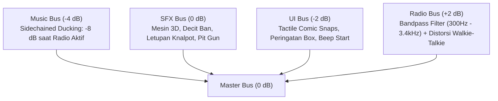

# SPECIFICATION: FASE 6 — AUDIO SOUNDSCAPE GENEX & POLISHING BALAPAN PENUH

**Target:** Audio Engineer, Systems Designer, UI/UX Lead  
**Scope:** Membangun arsitektur tata suara Godot 4 (5 bus audio), modulasi suara mesin 3D berbasis RPM, decit ban limit lateral G, radio walkie-talkie lo-fi dengan music ducking dinamis, umpan balik taktil klik UI, layar selebrasi podium juara akhir pekan balap, serta verifikasi otomatis tanpa regresi.

---

## 1. Arsitektur Bus Audio (`default_bus_layout.tres`)

Sistem tata suara menggunakan 5 bus terpisah:



### Parameter Efek Bus Radio:
* `AudioEffectBandPassFilter`: `cutoff_hz = 1850.0`, `resonance = 0.85`, `db = 24dB`.
* `AudioEffectDistortion`: `mode = CLIP`, `drive = 0.28`, `post_gain = 1.2`.

---

## 2. Struktur File & Modul Baru

```
D:/Occupation/Porto/genex/La_Voiture/
├── default_bus_layout.tres            (Update: 5 Bus + Efek Bandpass & Distorsi)
├── assets/
│   └── audio/
│       ├── engine/
│       │   ├── gt3_engine_loop.wav    (Loop suara mesin V8/Flat-6 GT3)
│       │   └── gearshift_pop.wav      (Letupan api kompresi knalpot)
│       ├── sfx/
│       │   ├── tire_screech.wav       (Decit gesekan karet ban aspal)
│       │   ├── pit_gun.wav            (Pneumatic impact wrench mekanik)
│       │   └── kerb_rumble.wav        (Getaran ban melindas kerb bergerigi)
│       ├── ui/
│       │   ├── click_snap.wav         (Klik saklar mekanis taktil tanpa echo)
│       │   ├── warning_siren.wav      (Alarm darurat BOX / Ban Kritis)
│       │   ├── start_beep.wav         (Nada hitung mundur lampu start FIA)
│       │   └── lights_out.wav         (Buzzer nada start hijau balapan)
│       ├── radio/
│       │   ├── squelch_in.wav         (Klik-chirp radio tim masuk)
│       │   └── squelch_out.wav        (Beep-hiss radio tim selesai)
│       └── music/
│           └── streetwear_synth.ogg   (Loop soundtrack synthwave / phonk balap)
├── scripts/
│   ├── audio/
│   │   ├── audio_manager.gd           (Autoload/Controller: Pengatur global bus, ducking & UI SFX)
│   │   ├── engine_audio_3d.gd         (Komponen 3D: Modulasi pitch RPM 1200-8500 & volume)
│   │   ├── tire_audio_3d.gd           (Komponen 3D: Modulasi decit ban berbasis lateral G > 1.8G)
│   │   └── radio_audio_director.gd    (Pengarah radio: Squelch in/out + ducking otomatis -8dB)
│   └── ui/
│       └── podium_screen.gd           (Pengendali layar podium selebrasi juara)
├── scenes/
│   ├── audio/
│   │   └── spatial_car_audio.tscn     (Node terpadu audio 3D untuk GtCarActor)
│   └── ui/
│       └── podium_screen.tscn         (Layar selebrasi podium P1/P2/P3 neo-brutalisme)
└── tests/
    └── test_audio_and_race_weekend.gd (Suite pengujian otomatis akseptansi Fase 6)
```

---

## 3. Spesifikasi Teknis Matematika & Perilaku Audio

### A. Modulasi Suara Mesin 3D (`engine_audio_3d.gd`)
* **Pitch Scale Berbasis RPM:**
  $$\text{Pitch}(N) = 0.65 + 1.20 \times \left(\frac{N - 1200.0}{8500.0 - 1200.0}\right)^{0.85}$$
  - Pada idle ($1200\text{ RPM}$): Pitch $= 0.65$.
  - Pada redline ($8500\text{ RPM}$): Pitch $= 1.85$.
* **Volume Berbasis Beban Gas (*Throttle*) & Kecepatan:**
  $$\text{Volume}(\text{dB}) = -18.0 + 12.0 \times \text{throttle} + 6.0 \times \left(\frac{v}{v_{\text{max}}}\right)$$
* **Atenuasi 3D Spasial:**
  - Jarak maksimum dengar: $80.0\text{ meter}$.
  - Model atenuasi: `ATTENUATION_INVERSE_DISTANCE`.
* **Letupan Knalpot (*Gearshift Pop*):**
  - Dipicu seketika saat sinyal pergantian gigi (*gear upshift*) terdeteksi dari `GtCarActor`.

### B. Decit Ban Adaptif (`tire_audio_3d.gd`)
* **Ambang Aktivasi (*Threshold*):**
  - Gaya sentrifugal lateral $|G_{\text{lat}}| > 1.8\text{G}$ ATAU slip ban pengereman keras (*lockup / wheelspin*).
* **Volume Decit:**
  $$\text{Volume}_{\text{screech}}(\text{dB}) = \text{clamp}\Big(-24.0 + (|G_{\text{lat}}| - 1.8) \times 12.0,\; -30.0\text{dB},\; 0.0\text{dB}\Big)$$

### C. Alur Music Ducking Dinamis (`radio_audio_director.gd`)
1. Sinyal radio masuk diterima (`play_radio`).
2. Bus `Music` diduck dari $0\text{dB}$ ke $-8.0\text{dB}$ melalui tween halus dalam $150\text{ms}$.
3. Mainkan `squelch_in.wav` di bus `Radio`.
4. Jalankan banner anime radio cut-in.
5. Setelah pesan selesai, mainkan `squelch_out.wav`.
6. Pulihkan volume bus `Music` kembali ke volume normal dalam waktu $500\text{ms}$.

### D. Layar Podium Selebrasi Juara (`podium_screen.tscn`)
* **Trigger:** Ketika bendera finis (`CHEQUERED_FLAG`) berkibar dan seluruh mobil menyelesaikan lap finis.
* **Elemen Visual (Manga Neo-Brutalism):**
  - Panggung podium 3 tingkat: Posisi 1 (tengah tertinggi), Posisi 2 (kiri), Posisi 3 (kanan).
  - Nama driver, badge nomor, kode tim pabrikan, dan total waktu tempuh balapan.
  - Cap grafiti ungu miring `[★ FASTEST LAP // +1 PT]` pada pencetak rekor putaran tercepat.
  - Tabel poin konstruktor FIA GT3 resmi ($25, 18, 15, 12, 10, 8, 6, 4, 2, 1$).
  - Tombol aksi taktil: `[RESTART RACE]` dan `[EXIT TO HQ]`.
