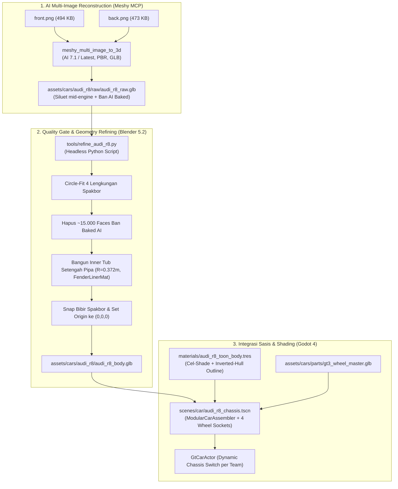

# SPEC-08: Audi R8 LMS GT3 Prototype & Multi-Image 3D Pipeline
**Tanggal:** 2026-10-22  
**Status:** DIIMPLEMENTASI (FASE 7, lihat `executor-report/FASE-7-AUDI-R8-PROTOTYPE-ASSEMBLY.md`). Angka di bagian 3 adalah rancangan awal; nilai terukur dan penyimpangannya ada di bagian 8, standar untuk semua mobil di bagian 9.  
**Referensi:** `reference-assets/cars/audi-r8-gt3/` (`front.png` & `back.png`) & `PRD/03-MODULAR-ASSET-PIPELINE.md`

---

## 1. Tujuan & Ringkasan Fitur (Objective)

Tujuan dari spesifikasi ini adalah membuktikan pipeline pembuatan model 3D bodi mobil balap non-Porsche pertama (**Audi R8 LMS GT3**) secara end-to-end dengan memanfaatkan pendekatan **Meshy Multi-Image 3D AI** dan otomatisasi **Blender Headless Refining**:

1. **Rekonstruksi Multi-View Akurat:** Menggunakan dua sudut pandang referensi (`front.png` untuk kisi grille depan dan `back.png` untuk diffuser/sayap belakang) agar geometri bodi belakang tidak di-halusinasi oleh AI.
2. **Pemisahan Roda Bersih (Wheel Stripping):** Menghapus seluruh poligon ban bawaan AI yang buram (*baked wheels*) dan membangun sumur roda dalam (*inner fender tubs*, $R = 0.372\text{m}$) agar bodi mobil tidak berlubang ke kabin.
3. **Pemasangan Modul Roda Universal:** Mengintegrasikan sasis bodi dengan 4 soket `Marker3D` universal untuk menerima modul roda balap beresolusi tinggi [`assets/cars/parts/gt3_wheel_master.glb`](file:///D:/Occupation/Porto/genex/La_Voiture/assets/cars/parts/gt3_wheel_master.glb).
4. **Shading Stylized Manga:** Menerapkan shader Cel-Shaded 2-step lighting dan Inverted-Hull ink outline tebal sesuai standar visual seni *La Voiture*.

---

## 2. Diagram Alur Pipeline & Data Flow



---

## 3. Spesifikasi Teknis Komponen

### 3.1 Parameter Panggilan Meshy MCP
* **Endpoint:** `meshy_multi_image_to_3d`
* **File Paths:**
  - `D:/Occupation/Porto/genex/La_Voiture/reference-assets/cars/audi-r8-gt3/front.png`
  - `D:/Occupation/Porto/genex/La_Voiture/reference-assets/cars/audi-r8-gt3/back.png`
* **AI Model:** `latest` (Meshy 7.1)
* **Konfigurasi Tambahan:**
  - `enable_pbr: true`
  - `should_texture: true`
  - `target_formats: ["glb"]`
  - `topology: "triangle"`
* **Biaya Token:** 30 kredit (dari sisa 1.903 kredit Meshy).
* **Target Output Mentah:** `assets/cars/audi_r8/raw/audi_r8_raw.glb`.

### 3.2 Parameter Otomatisasi Blender (`tools/refine_audi_r8.py`)
Skrip dijalankan via Blender 5.2 headless (`blender.exe --background --python tools/refine_audi_r8.py`):
1. **Pusat Lengkungan Spakbor Audi R8:**
   - Depan Kiri (FL): $X \approx -0.88\text{m}, Y \approx 0.33\text{m}, Z \approx 1.20\text{m}$
   - Depan Kanan (FR): $X \approx +0.88\text{m}, Y \approx 0.33\text{m}, Z \approx 1.20\text{m}$
   - Belakang Kiri (RL): $X \approx -0.88\text{m}, Y \approx 0.33\text{m}, Z \approx -1.25\text{m}$
   - Belakang Kanan (RR): $X \approx +0.88\text{m}, Y \approx 0.33\text{m}, Z \approx -1.25\text{m}$
2. **Inner Fender Tubs:**
   - Dinding melengkung setengah-pipa radius $R = 0.372\text{m}$ sepanjang busur $300^\circ$.
   - Batas dasar $Z \ge 0.10\text{m}$ agar tidak menembus kolong mobil.
   - Material slot: `FenderLinerMat` (`#0A0A0A`, roughness 0.95).
3. **Invarian Dimensi & Sumbu:**
   - Panjang total: $\approx 4.55\text{m}$, Lebar: $\approx 2.04\text{m}$, Tinggi: $\approx 1.25\text{m}$.
   - Pivot origin $(0, 0, 0)$ di ground level tengah wheelbase.
   - Orientasi sumbu: $+Z$ depan, $+Y$ atas, $+X$ kanan.
* **Target Output Bersih:** `assets/cars/audi_r8/audi_r8_body.glb`.

### 3.3 Struktur Scene Sasis Godot (`audi_r8_chassis.tscn`)
* **Root Node:** `ModularCarAssembler` (`scripts/car/modular_car_assembler.gd`)
  - `car_name = "Audi R8 LMS GT3 Evo II"`
  - `team_name = "Ironclad Racing"` (atau slot tim terkait)
* **BodyShell:**
  - `AudiBody` (`assets/cars/audi_r8/audi_r8_body.glb`)
  - Override Material 0: Toon Paint Shader (`materials/audi_r8_toon_body.tres`)
  - Override Material 1: Carbon Aero Shader (`materials/toon_carbon_aero.tres`)
* **Sockets (`Marker3D`):**
  - `Socket_Wheel_FL` $\rightarrow (-0.88, 0.33, 1.20)$
  - `Socket_Wheel_FR` $\rightarrow (0.88, 0.33, 1.20)$
  - `Socket_Wheel_RL` $\rightarrow (-0.88, 0.33, -1.25)$
  - `Socket_Wheel_RR` $\rightarrow (0.88, 0.33, -1.25)$
  - `Socket_Cockpit` $\rightarrow (0.0, 0.72, 0.05)$

---

## 4. Kriteria Keberhasilan & Pengujian (Acceptance Criteria)

| ID | Kriteria Pengujian | Kriteria Lulus (Pass Metric) |
| :---: | :--- | :--- |
| **AC-01** | **Meshy 3D Generation** | Model GLB mentah berhasil di-generate dan diunduh ke direktori lokal tanpa eror. |
| **AC-02** | **Zero Baked Wheel Remains** | Roda bawaan AI 100% terhapus di Blender, spakbor bersih, inner tub terpasang rapat. |
| **AC-03** | **Modular Socket Calibration** | Keempat soket roda sejajar sempurna dengan bibir spakbor (*flush stance*), tidak ada tembus/clipping ke bodi. |
| **AC-04** | **Toon Shader & Outline Integrity** | Bodi menampilkan bayangan cel-shaded tegas dan garis outline tinta hitam Inverted-Hull. |
| **AC-05** | **Modular Car Regression Test** | Pengujian unit test Godot headless lulus 100% tanpa regresi. |
| **AC-06** | **Visual Verification Capture** | Screenshot close-up bodi dan 4 roda berhasil diambil dan diverifikasi kualitas visualnya. |

---

## 8. Hasil Implementasi: Nilai Terukur & Penyimpangan dari Rancangan

| Item | Rancangan (bagian 3) | Hasil terukur / dibuat | Alasan |
| :--- | :--- | :--- | :--- |
| Sumbu roda (Godot) | Z = +1,20 / -1,25, Y = 0,33, \|X\| = 0,88 | Z = **+-1,338**, Y = 0,33, \|X\| = 0,88 | Z rancangan tidak cocok dengan geometri hasil Meshy dan bertentangan dengan wheelbase 2650 mm (1,20 + 1,25 = 2,45 m). Circle-fit menghasilkan wheelbase 2,676 m. |
| Dimensi | 4,55 x 2,04 x 1,25 m | 4,55 x 2,06 x 1,27 m | Skala seragam dari panjang; lebar dan tinggi mengikuti mesh. |
| Polycount | 80k-120k | 104.626 tris | Retopo (voxel remesh 10 mm, smooth, collapse ke 118k), lalu 4 roda dibuang dan 4 tub ditambah. Versi pertama (decimate langsung, 101.394 tris) diganti karena mesh-nya robek di seam UV (67 ribu edge terbuka). |
| Tekstur Audi | `base_color.png` dan `normal.png` asli Meshy | **hasil bake 4096 x 4096** dari mesh mentah ke UV baru (`base_color.png`, `normal.png` di `textures/`) | Retopo mengubah topologi dan UV, jadi tekstur harus di-bake ulang; tekstur asli Meshy tetap di `raw/`. |
| Lip spakbor dan splitter | snap vertex tepi ke lingkaran | **lip warp** (tepi bukaan ditarik ke lingkaran R 0,372 dan dilebur ke flare) dan **zona detail** (splitter depan tidak di-smooth, dipertahankan saat decimate) | Mesh hasil voxel remesh tertutup, jadi tidak ada tepi terbuka untuk di-snap. Zona detail disetel di `scratch/car_configs/audi_r8.json`. |
| Inner tub | Setengah-pipa 300 derajat, R 0,372 | R 0,369, busur mengikuti sisi bodi yang punya kulit, taper 25 derajat, dinding dalam disc penuh | Kulit R8 berakhir di bawah sumbu roda; tub 300 derajat penuh menonjol keluar bodi. |
| Outline hull | 0,02 m | 0,012 m, `#050505` | Pada 0,02 m serpihan geometri mesh AI jadi goresan hitam. |
| Shader | `toon_car_paint.gdshader` | dibuat baru (cel 2 langkah + normal map), uniform sama dengan `anime_cel_shaded` | Shader itu belum ada. |
| Warna di game | tidak diatur | **cat asli tekstur dipakai apa adanya**, tanpa tint warna tim (`keeps_original_paint = true`) | Livery Audi (abu-abu muda dengan aksen merah) adalah warna aslinya; tint tim mengubahnya jadi cyan. |
| Sumbu roda | ukur manual per mobil | **deteksi otomatis** dari ban baked (titik kontak + circle-fit), config `"raw_axle": "auto"` | Rongga spakbor tiap mobil berbeda, tetapi ban selalu bulat dan menyentuh tanah. Selisih dengan ukuran manual sekitar 1 cm (bagian 9.3). |
| Diffuser belakang | tidak diatur | zona detail kedua (sama seperti splitter) | Smoothing 40 iterasi melelehkan sirip diffuser. |
| Tekstur: noda gelap Meshy | dipakai apa adanya | dibersihkan sebelum bake (`texture_clean`): bercak abu-abu gelap berukuran besar ditarik ke luminansi cat; logo, merah, dan hitam tetap | Noda ikut ter-bake dan terlihat sebagai bercak di cat. |
| Mengilap dan timbul | tidak ada (shader tanpa specular) | pita specular clear-coat dari roughness bake, relief dari normal map bake, AO bake (`orm.png`) | Bagian 9.5. |
| Warna Porsche | diwarnai warna tim (tint 60%) | **cat asli** (livery biru-putih-oranye), `keeps_original_paint = true` di `base_chassis.tscn` | Keputusan pengguna: semua mobil memakai warna aslinya. |
| Folder Porsche | tekstur ber-UUID di folder yang sama dengan bodi | `raw/`, `textures/` (`base_color.jpg`, `normal.png`, `orm.jpg`), `porsche_911_body.glb`, `porsche_911_full.glb` | Disamakan dengan struktur standar (bagian 9.1). |
| Pilihan sasis | tidak diatur | `GtCarActor.CHASSIS_BY_TEAM`, team id 1 (Neon Drift) = Audi | Tidak ada tim "Ironclad" di `GtData`. |

Nilai di bagian 3.2 (koordinat roda) dan 3.3 (socket) sebaiknya dibaca sebagai angka awal; scene `scenes/car/audi_r8_chassis.tscn` adalah sumber kebenaran.

---

## 9. Usulan Standar untuk Semua Aset Mobil

Usulan ini berlaku untuk ke-10 mobil (`PRD/03-MODULAR-ASSET-PIPELINE.md` bagian 4.1). Status: **diterapkan ke Audi R8 dan Porsche 911** (folder, `*_full.glb`, pengaturan impor, cat asli); delapan mobil lain mengikutinya saat dibuat.

### 9.1 Struktur folder per mobil

```text
assets/cars/<car_slug>/
├── raw/
│   ├── <car_slug>_raw.glb                  # keluaran generator (Meshy/Tripo), tidak pernah diubah
│   ├── <car_slug>_raw.glb.import           # impor ringan: tanpa LOD, shadow mesh, tangent (file 85 MB / 2,77 juta tris)
│   └── <car_slug>_raw_textures/            # PBR asli: base_color, metallic, roughness, normal
├── textures/
│   ├── base_color.png                      # hasil bake (UV bodi retopo) untuk material toon (VRAM compressed + mipmap)
│   └── normal.png                          # normal map hasil bake (compress/normal_map = Enabled)
├── <car_slug>_body.glb                     # bodi bersih, TEKSTUR TERTANAM (berwarna di viewer mana pun)
└── <car_slug>_full.glb                     # bodi + 4 roda master di posisi socket, aset utuh untuk viewer dan promosi
scenes/car/<car_slug>_chassis.tscn          # ModularCarAssembler + BodyShell + Sockets (sumber kebenaran posisi roda)
materials/<car_slug>_toon_body.tres         # toon + outline hull
tests/test_<car_slug>_chassis.gd            # salin dari test_audi_r8_chassis.gd
```

Aturan: file `raw/` tidak diubah dan tidak dihapus; file turunan selalu bisa dibangun ulang dari skrip.

### 9.2 Pembangunan yang bisa diulang

| Langkah | Perintah / lokasi |
| :--- | :--- |
| Refining bodi (retopo + bake otomatis, sekitar 3 sampai 6 menit) | `blender --background --python scratch/refine_car.py -- scratch/car_configs/<car_slug>.json [--out-dir <dir>]`. Satu file config per mobil (arah depan mesh mentah, sumbu roda hasil ukur, ukuran voxel, tingkat smooth, zona detail, resolusi tekstur); `--out-dir` untuk uji coba tanpa menimpa aset. `scratch/refine_audi_r8.py` dan `scratch/refine_body.py` adalah jalur lama (decimate langsung / mesh bersih Tripo). |
| Aset penuh (bodi + roda) | `blender --background --python scratch/build_full_car.py -- scenes/car/<car_slug>_chassis.tscn assets/cars/<car_slug>/<car_slug>_full.glb`. Skrip umum: GLB bodi dan posisi socket dibaca dari `.tscn`, jadi hasilnya selalu sama dengan rakitan di game. |
| Pratinjau tanpa impor | `godot --rendering-driver d3d12 -s scratch/view_glb.gd -- res://assets/cars/<car_slug>/<car_slug>_full.glb res://scratch/<prefix>` |
| Impor ke Godot | lewat editor (`filesystem_manage scan` bila editor terbuka). `godot --headless --import` tidak mengimpor aset baru bila ada editor yang terbuka di proyek yang sama. |

### 9.3 Ukur, jangan tebak

Sumbu roda **tidak lagi diukur manual**. `refine_car.py` mendeteksinya dari ban baked mesh mentah (`"raw_axle": "auto"`, `"front_axis_raw": "auto"` di config):

1. Arah depan: sumbu horizontal terpanjang; hidung = ujung yang lebih rendah (kap mesin, bukan penutup mesin dan sayap).
2. Posisi sumbu y: titik kontak ban dengan tanah (vertex terendah di tiap setengah mobil, pita |x| 0,55 .. 1,15). Karena ban bulat, pusat patch kontak = sumbu roda, di mana pun rongga spakbor berada.
3. Tinggi sumbu dan radius tapak: pencarian lingkaran dengan pusat di z = radius, lalu fit lingkaran kuadrat terkecil pada busur bawah tapak.
4. Pusat wheelbase = origin; bodi diturunkan agar sumbu jatuh di 0,33 m (radius ban master). Wheelbase boleh berbeda per mobil (MOD-01: 2650 +-50 mm); socket-nya yang berbeda, roda master tetap sama.
5. Posisi rongga spakbor yang berbeda per mobil ditangani lip warp: radius lip alami diukur per derajat di sekitar sumbu hasil deteksi, lalu ditarik ke lingkaran arch.
6. Potong roda baked dengan boolean eksak pada silinder R 0,372 (tepi bukaan langsung bulat), bukan menghapus face per pusat segitiga.

Validasi deteksi otomatis terhadap ukuran manual: Audi sumbu depan y -1,216 (manual -1,215), belakang 1,451 (manual 1,461), tinggi 0,350 (manual 0,350); Porsche -1,190 dan 1,260 (nilai lama -1,19 dan 1,261). Selisih sekitar 1 cm. `--detect-only` mencetak hasil deteksi tanpa memproses mesh; bila gagal (misalnya mobil tidak berdiri di atas ban), isi `raw_axle` manual di config.

#### 9.3a Fitment roda per mobil (ditambahkan setelah perbaikan wheel fit)

Rongga ban berbeda per mobil: radius tapak ban mentah AI 0,38 sampai 0,42 m (ban master 0,33 m), lebar fender depan dan belakang berbeda 0 sampai 4 cm, tinggi lantai berbeda. Aturan yang dipakai sekarang:

1. `refine_car.py` **tidak pernah mengangkat bodi** untuk mengejar tinggi lantai; sumbu roda dan lengkung tetap terikat. Sisa tapak ban mentah di bawah roda dibuang dan geometri di bawah `ground_min` (0,05 m) diratakan (langkah 4a).
2. Dinding tub dibatasi `tub_arc_deg` (sekitar 125 derajat) supaya tidak masuk ke separuh bawah ban.
3. Socket X diturunkan dari mesh per as: `godot --headless --path . -s scratch/fit_cars.gd -- --apply <mobil>`. Z tidak diubah (sudah ditentukan oleh deteksi sumbu dan wheelbase di tengah).
4. **Fender depan diangkat otomatis** (`fender_lift: "auto"` di `refine_car.py`). Mesh AI menyatukan ban dengan fender, sehingga kulit fender di atas ban bisa lebih rendah dari puncak lengkung (sumbu + 0,372 m); pemotongan roda lalu menghapus seluruh fender luar dan ban menyembul keluar bodi (terjadi di Aston, McLaren, Lambo, Nissan, Lexus; terlihat dari `*_full.glb`). Skrip mengukur tinggi kulit mentah per as dan menaikkannya (peluruhan halus, pada mesh mentah sebelum potong agar bake tetap cocok) sampai kulit melewati puncak lengkung sebesar `fender_margin` (4 cm). Angka yang terpakai tercatat di log (`fender lift applied`); `--lift-report` hanya mencetak angkanya.
5. Pemotongan lengkung memakai boolean eksak dengan `use_self` dan diperiksa (jumlah face sesudah potong harus di atas 60 persen sebelum potong); mesh yang diangkat bisa bersilangan dengan dirinya sendiri dan boolean tanpa `use_self` diam-diam menghapus hampir seluruh bodi.
6. Gerbang satu perintah `scratch/fit_cars.gd` (celah radial 2,5 sampai 5 cm, 0 vertex di dalam ban termasuk surface liner, ban rata dengan fender per as dalam 1,5 cm, kulit fender di atas ban minimal 5 cm di seluruh lebar ban, lantai di atas 0,04 m). Ia menggantikan metrik clearance lama di `diagnose_wheels.gd` (angka +0,011 m adalah artefak jendela, bukan celah sebenarnya). Test chassis memakai ukuran kulit yang sama lewat `tests/wheel_fit_checks.gd`. Detail: `executor-report/FASE-7-WHEEL-FITMENT-REPAIR-REPORT.md`.

Seluruh langkah 4 sampai 6 di atas (refine, pasang, impor, gerbang, `*_full.glb`, test, render tinjauan) dijalankan berurutan oleh `scratch/make_car.ps1 -Car <slug>` dan berhenti pada kegagalan pertama; aturannya tertulis di `.claude/rules/car-asset-pipeline.md`.

### 9.4 Kebijakan warna: cat asli

- Flag baru `ModularCarAssembler.keeps_original_paint`. **True** untuk model yang teksturnya adalah livery asli (hasil Meshy/Tripo); **false** untuk cat placeholder yang diwarnai warna tim.
- `GtCarActor._apply_livery` tidak mengubah `base_color` bila flag true, jadi material toon (albedo = tekstur asli, `base_color` putih) tampil apa adanya.
- Diterapkan ke semua mobil: Audi (`audi_r8_chassis.tscn`) dan Porsche (`base_chassis.tscn`, livery biru-putih-oranye) memakai true; mobil baru memakai true juga. Tint warna tim (`LIVERY_TINT`) tetap ada di `GtCarActor` untuk chassis yang sengaja memakai false (diuji).
- Mobil tetap dikenali lewat warna tim di HUD, radar, dan papan waktu (`team_liveries.gd` tidak berubah).
- GLB bodi wajib menyimpan tekstur tertanam. Versi pertama Audi diekspor tanpa tekstur dan tampil polos di viewer mana pun.

### 9.5 Material toon

- Bodi bertekstur memakai `shaders/toon_car_paint.gdshader` (`base_color` putih = warna tidak berubah). Bodi cat polos placeholder tetap boleh memakai `anime_cel_shaded.gdshader`.
- **Mengilap (shine):** pita highlight clear-coat keras (`spec_size`, `spec_smoothness`), kekuatannya dari roughness hasil bake (`orm.png` kanal G, `gloss_strength`). Shader lama tidak punya specular sama sekali.
- **Timbul (emboss):** normal map hasil bake membentuk highlight dan rim light saja; pita cel diffuse memakai normal geometri yang halus, sehingga relief terbaca sebagai garis panel dan ventilasi yang timbul tanpa membuat pita cel menjadi bercak. `ao_strength` menggelapkan celah dari AO hasil bake (`orm.png` kanal R).
- **Normal toon:** `refine_car.py` mengganti normal shading cat dengan normal salinan yang di-smooth (geometri tetap, dicampur kembali ke normal asli di tepi tajam). Tanpa ini, riak milimeter pada panel yang berada di ambang cahaya menjadi bercak gelap bergerigi (pita cel berpindah di mana n.l melewati `shadow_threshold`).
- `orm.png` dikemas seperti ORM Porsche (R = AO, G = roughness, B = metallic, tidak dipakai); `orm.jpg` Porsche bisa dipakai langsung oleh shader yang sama bila Porsche ingin pindah ke `toon_car_paint`.
- Lebar outline hull: 0,016 m untuk mesh bersih; 0,012 m atau kurang untuk mesh AI hasil decimate (lebih tebal membuat serpihan geometri tampak sebagai goresan hitam).
- Normal map hampir tidak terlihat pada lighting 2 langkah; tetap dipasang, tetapi jangan dijadikan syarat kualitas.

### 9.6 Budget poligon (perlu diputuskan)

MOD-04 (bodi maksimal 20.000 tris) tidak tercapai oleh mesh AI yang masih punya detail: prototipe Audi 101.394 tris. Bila semua 10 mobil memakai mesh seperti ini, 20 mobil di trek menjadi sekitar 2 juta tris. Pilihan yang diusulkan: (a) mengandalkan LOD otomatis impor Godot (`meshes/generate_lods=true`, sudah aktif untuk `*_body.glb`), (b) membuat varian decimate 30-40k tris untuk mobil lawan di trek dan memakai varian penuh hanya untuk showroom dan kamera dekat. Belum diukur FPS-nya di 20 mobil.

### 9.7 Pengaturan impor Godot

| File | Pengaturan |
| :--- | :--- |
| `*_raw.glb` | `meshes/generate_lods=false`, `meshes/create_shadow_meshes=false`, `meshes/ensure_tangents=false`, `meshes/light_baking=0`, `gltf/embedded_image_handling=2` |
| `*_body.glb` | `gltf/embedded_image_handling=0` (buang tekstur tertanam saat impor; material toon sudah memakai `textures/`). Terukur: memori video chassis Audi turun 43 MB (dua tekstur 4096 x 4096) dan Porsche turun 160 MB (selisih `RENDERING_INFO_VIDEO_MEM_USED`; sekitar 64 MB-nya tekstur, sisanya overhead unggah GPU satu kali; pengukuran kasar). File GLB tetap berisi tekstur untuk viewer lain. |
| `*_full.glb` | `gltf/embedded_image_handling=2` (tekstur tertanam sebagai Basis Universal; tidak dimuat di game, dipakai untuk melihat mobil utuh berwarna di editor) |
| `textures/base_color.png` | `compress/mode=2` (VRAM), `mipmaps/generate=true` |
| `textures/normal.png` | `compress/mode=2`, `compress/normal_map=1`, `mipmaps/generate=true` |

### 9.8 Pemilihan sasis per tim dan tes

- `scripts/car/gt_car_actor.gd`: `CHASSIS_BY_TEAM = {team_id: PackedScene}`; tim yang tidak terdaftar memakai Porsche. Menambah mobil = satu baris.
- Tes per mobil: socket, ukuran bodi, jumlah tris, tidak ada geometri roda di lengkung, ban flush dan menyentuh tanah, mapping sasis per tim, kebijakan warna. Setiap tes baru harus dilihat gagal dulu (matikan fiturnya sementara) sebelum dipercaya.

### 9.9 Alur kerja per mobil (setelah FASE 7)

| # | Langkah | Alat | Waktu |
| :--- | :--- | :--- | :--- |
| 1 | Generate mesh (Meshy/Tripo) ke `raw/<car_slug>_raw.glb`. Kirim foto depan, belakang, kiri, kanan bila bisa: Audi hanya mendapat 2 foto dan sisi sampingnya ditebak AI. | generator | menit (kredit) |
| 2 | Cek mesh: `weld` lalu hitung edge terbuka dan sudut antar-face (`scratch/audi/mesh_quality.py`). Mesh bersih (seperti Tripo Porsche: median sudut sekitar 4 derajat, sedikit edge terbuka) tidak perlu retopo dan memakai `refine_body.py`. Mesh Meshy yang kasar memakai langkah 3-4. | Blender | 1 menit |
| 3 | Salin config terdekat ke `scratch/car_configs/<car_slug>.json` dan isi nama file; arah depan dan sumbu roda `auto`. Jalankan `refine_car.py ... --detect-only` untuk memeriksa hasil deteksi (selisih sekitar 1 cm dari ukuran manual). Atur zona detail (splitter, diffuser) bila ada. | Blender + config | 2 menit |
| 4 | `refine_car.py`: weld, orient/skala, voxel remesh, smooth, collapse, potong roda, lip warp, tub, UV, bake warna dan normal, ekspor body GLB dan tekstur. Jalankan dengan `--out-dir temp/...` dulu, lihat hasilnya, baru timpa aset. | Blender headless | sekitar 3 sampai 6 menit |
| 5 | `build_full_car.py` membuat `*_full.glb` dari `.tscn`. | Blender headless | 10 detik |
| 6 | Godot: salin `audi_r8_chassis.tscn` dan material toon, atur `keeps_original_paint`, tambah satu baris `CHASSIS_BY_TEAM`, salin tes mobil, impor lewat editor, capture. | Godot | 15 menit |

Parameter Meshy yang disarankan untuk langkah 1 (`meshy_multi_image_to_3d`, daftar parameter dari dokumentasi Meshy; **belum diuji** pada mobil, hanya Audi yang dibuat dengan 2 foto):

| Parameter | Nilai | Alasan |
| :--- | :--- | :--- |
| `image_urls` | 4 foto: depan dulu, lalu belakang, kiri, kanan | Dengan `meshy-7.1` foto pertama dianggap tampak depan. Audi hanya 2 foto sehingga sisinya ditebak AI. |
| `ai_model` | `latest` (Meshy 7.1) | Syarat `geometry_resolution` 2k dan `texture_image_urls`. |
| `geometry_resolution` | `2k` | Detail geometri lebih tinggi sebagai sumber bake. |
| `should_remesh` | `false` | Kualitas tertinggi; pipeline kita meretopo sendiri dari mesh mentah. |
| `should_texture`, `enable_pbr` | `true`, `true` | PBR diperlukan karena roughness-nya di-bake menjadi `orm.png` (shine). |
| `texture_resolution` | `4k` | Bake kita 4096 x 4096. Jangan `8k` (tidak ada emission map, berat). |
| `remove_lighting` | `true` | Membuang highlight dan bayangan dari warna dasar; kita menambah shine sendiri. |
| `image_enhancement` | `false` (usulan) | Menjaga warna livery persis seperti foto; belum diuji bandingannya. |
| `texture_image_urls` | 4 foto yang sama (opsional) | Menjaga livery konsisten di semua sisi; tidak boleh bersama `texture_prompt`. |
| `target_formats` | `["glb"]` | Lebih cepat. |
| `auto_size`, `symmetry_mode`, `ultra_mode` | tidak dipakai | Skala diatur pipeline (4,55 m); dua yang terakhir sudah deprecated. |

Foto referensi: satu mobil, livery sama di semua foto, berdiri di atas keempat ban (deteksi sumbu roda memakai titik kontak ban), tanpa bayangan tanah, latar polos, tidak terpotong, roda lurus, resolusi sedikitnya 1024 px.

Yang berubah dibanding alur sebelumnya: (a) mesh di-weld sebelum diproses (decimate pada mesh yang belum di-weld merobek seam UV); (b) retopo dan bake kini bagian otomatis dari langkah 4, bukan pekerjaan manual per mobil; (c) tekstur AI asli tidak dipakai langsung, tetapi di-bake ulang ke UV bodi baru; (d) GLB bodi diimpor tanpa tekstur tertanam; (e) ada uji coba ke `temp/` sebelum menimpa aset.

Cara menghindari retopo ulang:
- **Cukup satu config dan satu perintah per mobil.** Ukuran voxel, smooth, dan zona detail adalah angka di config; mengulang setelah mengubah angka hanya beberapa menit.
- **Livery lain untuk mobil yang sama** tidak butuh retopo: UV bodi tetap, jadi cukup bake ulang warna dari mesh mentah baru atau ganti `base_color.png`.
- **Hasil generator yang lebih bersih** mengurangi pekerjaan: foto 4 sisi, dan opsi remesh/polycount bawaan generator bila ada (Meshy menyediakan `topology`, `target_polycount`, `should_remesh`; belum diuji apakah hasilnya lebih baik dari pipeline ini).
- **Roda, tub, dan socket sudah modular**, jadi hanya bodi yang diproses per mobil.

### 9.10 Daftar periksa per mobil

- [ ] `raw/` utuh dan terimpor (atau sengaja di-skip) dengan pengaturan ringan
- [ ] `<car_slug>_body.glb` berwarna saat dibuka sendiri; polycount tercatat
- [ ] Sumbu roda terukur, socket di `.tscn`, `<car_slug>_full.glb` dibangun ulang dari `.tscn`
- [ ] `scratch/fit_cars.gd` PASS untuk mobil itu (lantai, celah radial, penetrasi, flush per as, kulit fender di atas ban); socket X dari `--apply`, bukan angka tangan
- [ ] Log refine dibaca (`fender lift applied`, `wheel cut` dengan jumlah face yang wajar) dan `scratch/capture_wheel_review.gd -- <mobil>` dijalankan: close-up roda depan dan belakang dari samping dan dari atas dilihat, tidak ada ban yang menyembul dari bodi
- [ ] Gerbang atau test baru dilihat gagal dulu pada aset yang diketahui rusak sebelum dipercaya (pelajaran dari `executor-report/FASE-7-WHEEL-FITMENT-REPAIR-REPORT.md`, bagian 8)
- [ ] Material toon: `base_color` putih, outline sesuai jenis mesh
- [ ] `keeps_original_paint` diputuskan (true untuk livery asli)
- [ ] Baris `CHASSIS_BY_TEAM` dan tes mobil lulus; suite lama tetap 0 failure
- [ ] Screenshot showroom (3/4 depan, samping, belakang, close-up 4 roda) dan satu frame di race world
