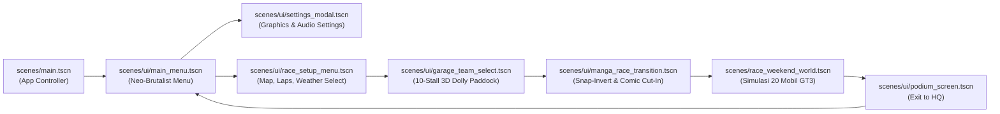

# SPECIFICATION: MAIN MENU, PRE-RACE CONFIGURATION, & 3D GARAGE TEAM SELECT FLOW

**Tanggal:** 2026-10-22  
**Status:** VALIDATED & READY FOR IMPLEMENTATION  
**Fitur:** Main Menu, Race Setup Configuration, 3D Pitstop Garage Team Select, and Manga Comic Race Transition  
**Referensi:** [`PRD/01-GAME-OVERVIEW.md`](file:///D:/Occupation/Porto/genex/La_Voiture/PRD/01-GAME-OVERVIEW.md), [`DESIGN.md`](file:///D:/Occupation/Porto/genex/La_Voiture/DESIGN.md), [`DRIVER-CHARACTERIZATION-ROSTER.md`](file:///D:/Occupation/Porto/genex/La_Voiture/reference-assets/characters/DRIVER-CHARACTERIZATION-ROSTER.md), [`scripts/world/pit_lane_complex.gd`](file:///D:/Occupation/Porto/genex/La_Voiture/scripts/world/pit_lane_complex.gd)

---

## 1. Ringkasan & Tujuan Arsitektur (Executive Summary)

Fitur ini mengubah alur masuk permainan dari yang semula memuat sirkuit langsung secara otomatis (`scenes/race_weekend_world.tscn`) menjadi alur pengguna profesional (*full game presentation loop*) yang berkarakter kuat:



---

## 2. Struktur Alur Layar & Spesifikasi Antarmuka (UI/UX Specification)

### 2.1 Layar Menu Utama (`scenes/ui/main_menu.tscn`)
* **Latar Belakang Visual:** 3D Pit Garage ambient viewport dengan pencahayaan neon temaram, mobil prototipe di tengah, partikel kabut anime halus, dan alunan musik synthwave motorsport.
* **Layout Tombol (Gaya Neo-Brutalism Manga, teks miring miring kontras):**
  1. `EXHIBITION RACE` — Tombol utama (Active) dengan highlight warna *Acid Lime* (`#CCFF00`) / *Electric Cyan* (`#00F0FF`). Mengarahkan ke `race_setup_menu.tscn`.
  2. `CAREER MODE` — Tombol non-aktif (Disabled) dengan pita hazard kuning-hitam `COMING SOON`.
  3. `SETTINGS` — Membuka modal pengaturan (`settings_modal.tscn`).
  4. `CREDITS` — Membuka modal pop-up apresiasi tim pengembang.
  5. `QUIT TO DESKTOP` — Keluar dari aplikasi dengan konfirmasi dialog.

### 2.2 Modal Pengaturan (`scenes/ui/settings_modal.tscn`)
Menyediakan konfigurasi komprehensif untuk menjamin stabilitas 60 FPS pada 20 mobil:
* **Display & Resolusi:**
  * Mode Jendela: Fullscreen / Borderless Window / Windowed.
  * Resolusi: 1920x1080 (Baku), 1280x720, 2560x1440.
  * V-Sync: On (60 FPS cap) / Off.
* **Kualitas Grafis (Presets: Low, Medium, High, Ultra):**
  * *Shadow Quality:* Soft Shadows (PCF5) / Hard Shadows / Off.
  * *Toon Ink Outline:* Full 0.02m Inverted Hull / Performance Outline.
  * *Anime VFX Density:* High (Asap ban, grafiti ERS, hujan manga 3D penuh) / Low.
  * *Manga Halftone Screentone:* On / Off (opsi tampilan cel-shading bersih tanpa titik halftone).
* **Audio Mixer:** Slider volume mandiri untuk Master, Engine SFX, Pit Radio Voice (TTS), Musik Synthwave, dan UI Click.

### 2.3 Layar Konfigurasi Balapan (`scenes/ui/race_setup_menu.tscn`)
* **Pilihan Sirkuit (Track / Map Selection):**
  * *Pilihan Aktif:* **Apex Ring International** (Sirkuit GP 3.840 m, 14 Turns, Arah Clockwise, Rekor Lap 79.6s).
    * Tampilan visual: 2D GPS Radar HUD sirkuit dengan nomor tikungan, sektor 1/2/3, dan elevasi.
  * *Pilihan Mendatang:* "Suzuka Touge Night" dan "Macau GP Guia Circuit" (berlabel `COMING SOON`).
* **Parameter Balapan:**
  * **Jumlah Lap:** Quick Sprint (3 Lap), Standard (5 Lap), Endurance (10 Lap).
  * **Preset Cuaca:**
    * `Sunny Dry` (Asfal kering, grip ban 100%).
    * `Threatening Rain` (Mendung abu-abu, peluang hujan dinamis 60%).
    * `Dynamic Wet` (Hujan gerimis $\rightarrow$ genangan air basah berkerut).
    * `Full Monsoon Storm` (Badai ekstrem, jarak pandang rendah).
  * **Waktu Balapan (Time of Day):** Siang Hari (Daylight), Senja (Golden Hour Sunset), Malam Berlampu Neon (Night Circuit).
* **Tombol Aksi:** `CONTINUE TO TEAM GARAGE` dan `BACK TO MAIN MENU`.

---

## 3. Garasi Tim 3D & Integrasi Duo Karakter 2D (`scenes/ui/garage_team_select.tscn`)

### 3.1 Paddock Environment & Sistem Dolly Kamera
* Menggunakan pendekatan **10 Stall Pit Lane Dolly Track**:
  * Terdapat 10 stall garasi bersebelahan di sepanjang pit lane (Stall 0 s/d Stall 9).
  * Setiap stall memuat mobil tim masing-masing menggunakan aset `assets/cars/<car_slug>/<car_slug>_full.glb` (bodi + 4 master BBS wheels di socket sasis, berukuran ringan $\sim 6-8\text{ MB}$).
  * Saat tombol tim berikutnya/sebelumnya ditekan, kamera meluncur (*smooth dolly pan*) dengan kurva interpolasi kubik (*cubic ease2*) melintasi sekat garasi.
* **Elemen Ruangan Prosedural Garasi:**
  * Lantai: Dark Epoxy abu-abu arang (`#141721`) dengan pantulan bayangan mobil (*mirror gloss*), garis batas pit box hazard chevron kuning-hitam, dan tipografi lantai `// STALL 0X: TEAM NAME`.
  * Partisi: Sekat baja kontainer modular antar-stall dengan strip lampu LED vertikal yang warnanya berganti dinamis mengikuti warna identitas tim.
  * Properti: Rak ban bertingkat (tire rack dengan garis ban kompon), toolbox mekanik hitam doff, monitor telemetri gantung, dan bukaan depan menghadap pit lane terbuka.

### 3.2 Kontrol Kamera Orbit 360°
* Pemain dapat mengklik-tahan mouse kiri dan menggeser untuk memutar (*orbit turntable*) mobil tim terpilih 360°, memeriksa proporsi bodi, livery asli, dan pelek balap.

### 3.3 Integrasi Duo Karakter 2D & Matriks Tim (UI Overlay)
* **Panel Sisi Kiri (Spesifikasi Tim):**
  * Nama Tim & Principal (misal: "Kenji Takahashi" untuk Apex Racing, "Daisuke Kurogane" untuk Kurogane GT).
  * Pabrikan Mobil GT3 & Kode Tim (misal: "Porsche 911 GT3 R").
  * Matrix Performa: Bar Top Speed, Cornering Downforce, dan Tire Wear Efficiency.
* **Panel Sisi Kanan (Duo Pembalap 2D):**
  * Menampilkan **Kartu Duo Pembalap Tim** menggunakan aset 2D Comms Radio Portrait asli:
    * `reference-assets/characters/<team>/<driver_1>/radio_portrait.png`
    * `reference-assets/characters/<team>/<driver_2>/radio_portrait.png`
  * Menampilkan nomor mobil, kode 3-huruf (misal `#01 RYU`, `#02 REN`), dan bar keahlian: *Pace*, *Tire Management*, dan *Wet Weather Mastery* sesuai kanon [`DRIVER-CHARACTERIZATION-ROSTER.md`](file:///D:/Occupation/Porto/genex/La_Voiture/reference-assets/characters/DRIVER-CHARACTERIZATION-ROSTER.md).

### 3.4 Team Principal Mode: Pemilihan Kompon Ban Awal
* Sesuai keputusan Opsi A (*Team Principal Mode*), pemain mengatur strategi kompon ban awal secara mandiri untuk kedua mobil:
  * **Mobil 1:** Pilihan Soft (Merah) / Medium (Kuning) / Hard (Putih) / Inter (Hijau) / Wet (Cyan).
  * **Mobil 2:** Pilihan Soft / Medium / Hard / Inter / Wet.
  * Terdapat panel radar ramalan cuaca balapan (*Weather Forecast Widget*) untuk memandu pilihan taktis.
* **Tombol Aksi Utama:** Tombol besar bergaya manga **"LAUNCH TO GRID"** dengan efek suara raungan mesin (*engine rev*).

---

## 4. Transisi Animasi Balapan Manga (`scenes/ui/manga_race_transition.tscn`)

Ketika tombol *"LAUNCH TO GRID"* ditekan, alur transisi visual berjalan dengan urutan sinematik:

1. **Tahap 1: Snap-Invert Flash (0.1 detik)**
   * Layar seketika berkedip monokrom negatif (inversi warna hitam-putih brutalist 1-frame) diiringi suara raungan pedal gas penuh (*full throttle roar*).
2. **Tahap 2: Manga Comic Cut-In Slice (0.8 detik)**
   * Tiga bilah panel komik miring meluncur cepat dari sisi kiri dan kanan layar (*comic strip slash*).
   * Menampilkan close-up mata tajam pembalap 2D tim terpilih, nomor mobil dengan grafiti petir/api, dan efek garis aksi komik (*speedlines*).
3. **Tahap 3: Halftone Wipe & Gantry Fly-Through (1.2 detik)**
   * Transisi sapuan bintik halftone (*halftone dot screentone wipe*) membuka kamera sirkuit 3D di `scenes/race_weekend_world.tscn`.
   * Kamera meluncur menukik dari atas tribun, menyusuri barisan 20 mobil di grid start, dan masuk ke posisi start di belakang mobil pemain tepat saat deretan 5 lampu merah FIA mulai menyala satu per satu.

---

## 5. Model Data & Arsitektur Kode (Data Flow)

### 5.1 Singleton Konfigurasi Balapan (`scripts/core/race_config_data.gd`)
Struktur data yang membawa pilihan pemain dari menu ke dalam simulasi balapan:

```gdscript
class_name RaceConfigData
extends RefCounted

var selected_team_id: int = 0
var track_id: String = "apex_ring"
var total_laps: int = 5
var weather_preset: int = 0 # 0=Sunny, 1=Threatening, 2=Wet, 3=Monsoon
var time_of_day: int = 0    # 0=Noon, 1=Sunset, 2=Night
var car1_starting_compound: int = 0 # ModularCarAssembler.TireCompound.SOFT
var car2_starting_compound: int = 1 # ModularCarAssembler.TireCompound.MEDIUM
```

### 5.2 Modifikasi pada `RaceWeekendWorld` (`scripts/world/race_weekend_world.gd`)
* Menerima instance `RaceConfigData`.
* Menerapkan `selected_team_id` untuk menentukan mobil mana yang dikontrol strategi taktisnya di HUD oleh pemain (bukan lagi otomatis default ke Tim 0).
* Memasang kompon ban awal yang dipilih pemain ke mobil 1 dan mobil 2 tim tersebut saat start sequence.
* Menyesuaikan parameter cuaca awal dan jumlah lap simulasi dengan data konfigurasi.

---

## 6. Standar Kualitas & Rencana Verifikasi (Verification Gates)

1. **Verifikasi Alur UI Bebas Error:**
   * Alur transisi `Main Menu -> Race Setup -> Garage Team Select -> Manga Transition -> Race Weekend -> Podium Screen -> Main Menu` dapat dijalankan berulang kali tanpa kebocoran memori (*memory leak*) atau scene dangling.
2. **Performa Garasi 3D:**
   * Dolly kamera antar-stall berjalan mulus stabil pada $60\text{ FPS}$.
   * Model `*_full.glb` dimuat instan tanpa stutter.
3. **Integritas Suara:**
   * Audio slider di Settings mengubah volume bus audio Godot (`Master`, `Music`, `SFX`, `Radio`, `UI`) secara real-time.
4. **Regresi Nol:**
   * Seluruh 11 test suite proyek (257+ assertions) tetap berstatus **100% PASS (0 FAIL)**.
