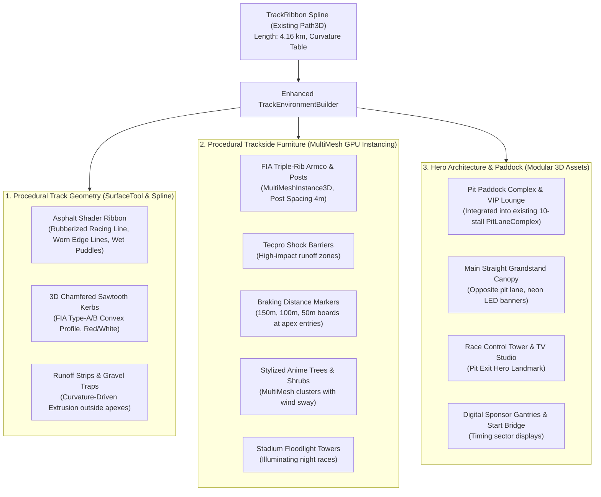

# SPECIFICATION: HYBRID PROCEDURAL TRACK ENVIRONMENT & CIRCUIT DRESSING (APEX RING INTERNATIONAL)

**Tanggal:** 2026-10-22  
**Status:** VALIDATED & READY FOR IMPLEMENTATION  
**Fitur:** Track Environment Visual Upgrade, Procedural Trackside Systems, Hero Architectural Assets, and Cel-Shaded Motorsport Dressing  
**Referensi:** [`PRD/01-GAME-OVERVIEW.md`](file:///D:/Occupation/Porto/genex/La_Voiture/PRD/01-GAME-OVERVIEW.md), [`DESIGN.md`](file:///D:/Occupation/Porto/genex/La_Voiture/DESIGN.md), [`scripts/world/circuits/apex_ring/apex_environment.gd`](file:///D:/Occupation/Porto/genex/La_Voiture/scripts/world/circuits/apex_ring/apex_environment.gd), [`scripts/world/shared/ribbon_geometry.gd`](file:///D:/Occupation/Porto/genex/La_Voiture/scripts/world/shared/ribbon_geometry.gd), [`scripts/world/circuits/apex_ring/apex_pit_complex.gd`](file:///D:/Occupation/Porto/genex/La_Voiture/scripts/world/circuits/apex_ring/apex_pit_complex.gd), [`executor-report/FASE-9-MAIN-MENU-AND-GARAGE-FLOW-REPORT.md`](file:///D:/Occupation/Porto/genex/La_Voiture/executor-report/FASE-9-MAIN-MENU-AND-GARAGE-FLOW-REPORT.md)

---

## 1. Ringkasan & Tujuan Arsitektur (Executive Summary)

Sirkuit balap saat ini (`track_circuit.tscn` + `track_environment_builder.gd`) memiliki sistem fisika dan spline matematika yang sangat solid (4.16 km, 9 apex, elevasi teruji pada 20 test suite), namun aspek visual lingkungannya masih berupa *wireframe/box placeholder*:
- Kerb datar tanpa profil 3D gundukan (*flat strip polygon*).
- Guardrail dan tiang menggunakan box primitif abu-abu seragam tanpa detail braket/rib.
- Tidak ada area *runoff* asfal/gravel trap yang realistis di tikungan tajam.
- Pohon berupa prisma kerucut primitif dengan warna seragam.
- Area pit lane dan start/finish straight belum memiliki gedung grandstand megah (*Main Grandstand*), Menara Kontrol Balap (*Race Control Tower*), jembatan sponsor (*Gantry Bridges*), dan papan jarak pengereman (*Braking Markers* 150m, 100m, 50m).

**Fase 10 (Track Environment Hybrid Upgrade)** mentransformasi sirkuit Apex Ring International menjadi arena balap GT3 spektakuler bertaraf internasional dengan pendekatan **Hybrid Procedural & Modular Asset**:

---

## 2. Batasan Kritis & Prinsip Non-Regresi

1. **Jalur Fisika Tidak Boleh Berubah:**
   - Objek `Path3D` dan data koordinat `Curve3D` di [`scenes/race_world/track_circuit.tscn`](file:///D:/Occupation/Porto/genex/La_Voiture/scenes/race_world/track_circuit.tscn) **tidak boleh diubah titik maupun tangent-nya**. Seluruh 20 test suite (AI driving, simulation verification, lap timing, pit entry/exit lane) bergantung 100% pada spline ini.
2. **Ketinggian Permukaan Jalan Tetap:**
   - Posisi $Y$ permukaan asfal tetap berada pada $Y = 0.0\text{ m}$. Kerb memiliki tonjolan vertikal maksimal $+0.05\text{ m}$ (sesuai spesifikasi suspensi mobil yang sudah lolos uji *ground clearance* $+0.05\text{ m}$).
3. **Performa 60 FPS pada 20 Mobil:**
   - Semua elemen repetitif (tiang guardrail, pembatas ban/Tecpro, pohon, lampu sorot, penonton billboard) **wajib** menggunakan `MultiMeshInstance3D` agar jumlah *draw call* tetap di bawah 150 pada resolusi 1080p High.
4. **Konsistensi Estetika Cel-Shading:**
   - Semua aset arsitektur dan lingkungan menggunakan material yang kompatibel dengan tema seni game: cel-shaded anime lighting, outline inverted-hull halus pada landmark utama, dan warna kontras neo-brutalist (hitam asfal, merah-putih kerb, aksen kuning/cyan).

---

## 3. Spesifikasi Komponen Lingkungan

### 3.1 Geometri Jalan & Kerb 3D (`scripts/world/shared/enhanced_track_geometry.gd`)
* **Asphalt Surface Shader (`shaders/road_asphalt.gdshader`):**
  - Tekstur asfal makro berbutir halus (PBR micro-roughness).
  - Lapisan *Racing Groove* dinamis: jejak karet ban gelap di garis balap ideal (`AdaptiveRacingLine`).
  - Efek genangan air reflektif saat cuaca `Wet` atau `Monsoon`, memanfaatkan mask roughness dinamis yang sudah terhubung dengan `RaceWeekendWorld.weather_wetness`.
* **Kerb 3D Berprofil Sawtooth (FIA Type-A):**
  - Bukan strip datar, melainkan prisma dengan kemiringan 15° menghadap trek dan punggung melengkung turun ke gravel (tinggi puncak $0.05\text{ m}$, lebar $1.2\text{ m}$).
  - Pola warna belang merah/putih berulang setiap $1.5\text{ m}$ dengan ujung miring (*slanted tooth* $0.5\text{ m}$).
* **Runoff Zones & Gravel Traps:**
  - Di luar tikungan tajam (radius tikungan $< 150\text{ m}$), permukaan rumput digantikan oleh zona gravel dengan warna pasir kasar (`#A69477`) dan area asfal penahan selip (*tarmac runoff*) berwarna abu-abu terang dengan strip peringatan biru/putih.

### 3.2 Trackside Safety & Furniture (`scripts/world/shared/trackside_furniture_builder.gd`)
* **FIA Triple-Rib Armco Guardrail & Posts:**
  - Bentuk rel baja berlekuk W-beam 3 baris yang akurat, dengan tiang I-beam setiap $4.0\text{ m}$.
  - Pembukaan otomatis pada area Pit Entry ($s \approx 3920\text{ m}$) dan Pit Exit ($s \approx 280\text{ m}$).
* **Tecpro Safety Barriers:**
  - Ditempatkan di area pengereman zona limpasan tikungan kritis (Turn 1 setelah trek lurus utama, Hairpin Turn 4, dan chicane terakhir).
  - Blok polietilena modular berwarna merah dan abu-abu gelap dengan pita pengikat.
* **Braking Distance Markers:**
  - Papan penanda jarak pengereman bertuliskan `150`, `100`, `50` meter sebelum titik apex setiap tikungan tajam (berada $2.5\text{ m}$ di luar garis batas trek).
  - Dilengkapi garis hazard hitam-kuning di tiang penyangga.
* **Stadium Floodlight Towers:**
  - 28 menara lampu stadion tinggi ($18\text{ m}$) di sekeliling sirkuit untuk balapan malam (*Night Race*).
  - Memancarkan cahaya putih hangat terfokus pada trek lurus dan tikungan, lengkap dengan efek volumetrik anime halus.

### 3.3 Hero Architecture & Pit Complex Upgrade (`scenes/race_world/paddock/`)
* **Pit Building & VIP Paddock Club (`pit_building_structure.tscn`):**
  - Gedung 2 lantai modern yang memanjang di atas 10 stall pit stop (`PitLaneComplex`).
  - Lantai 1: 10 pintu garasi bermerk tim dengan apron pit lane berlantai epoxy gelap.
  - Lantai 2: VIP Paddock Lounge berdinding kaca besar, teras penonton atap, dan tiang bendera internasional.
* **Main Grandstand (`main_grandstand.tscn`):**
  - Tribun raksasa bertingkat 3 yang terletak di seberang pit straight.
  - Atap kantilever modern bermodel melengkung, dilengkapi kursi warna-warni berpenonton kartun manga 2.5D billboard dan layar video raksasa (*Giant Jumbotron Screen*).
* **Race Control Tower (`race_control_tower.tscn`):**
  - Menara pengawas balap berlantai 4 di ujung pit exit dengan desain arsitektur sudut tajam neo-brutalis.
* **FIA Start/Finish Gantry Upgrade (`start_gantry.tscn`):**
  - Jembatan gantry baja ganda di atas garis start dengan 5 pasang lampu merah FIA digital, layar pencatat waktu lap, dan logo seri balap *La Voiture GT*.

### 3.4 Vegetasi & Latar Belakang Lingkungan (`scripts/world/shared/foliage_scatter.gd`)
* **Stylized Manga Trees & Foliage:**
  - 3 varian pohon anime: Japanese Cedar (runcing), Broadleaf Oak (bulat berlapis), dan Flowering Cherry/Alpine Pine.
  - Menggunakan vertex color shading dengan *soft wind sway shader* (`shaders/wind_foliage.gdshader`).
* **Skybox & Mountain Vista Backdrop:**
  - Siluet pegunungan low-poly di cakrawala kejauhan ($R \approx 1500\text{ m}$) yang memberi kedalaman visual pada kamera orbit, kamera siaran TV (*BroadcastDirector*), dan tampilan kokpit/chase.

---

## 4. Anggaran Performa (Performance Budget)

| Parameter | Target Budget | Strategi Optimasi |
| :--- | :--- | :--- |
| **FPS Target** | 60 FPS terkunci (16.6ms) | MultiMesh instancing untuk seluruh objek duplikat |
| **Draw Calls** | $< 180$ draw calls di trek penuh | Batching tiang, pohon, lampu, penonton, pembatas |
| **Total Triangles** | $< 350.000$ tris untuk seluruh lingkungan | Geometri teroptimasi, profil rel strip sederhana |
| **LOD / Culling** | Horizon culling pada 1800m | Elemen kecil (marker papan) di-cull pada jarak $> 250\text{ m}$ |
| **Memory footprint** | Tambahan VRAM $< 120\text{ MB}$ | Tekstur atlas bersama dan material cel-shader prosedural |

---

## 5. Rencana Pengujian & Gerbang Verifikasi

1. **Uji Geometri Tanpa Regresi:**
   - `tests/test_track_environment.gd`: Memverifikasi ketinggian jalan tetap $0.0\text{ m}$, kerb terdeteksi di setiap tikungan tajam dengan tinggi $\le 0.05\text{ m}$, armco memiliki lubang terbuka untuk pit lane, dan marker jarak 150/100/50m terpasang di depan setiap apex.
2. **Uji Seluruh 20 Test Suite Lama:**
   - `test_gt_sim.gd`, `test_race_weekend_and_physics.gd`, `test_main_menu_flow.gd`, dan 17 suite lainnya harus tetap **100% PASS (0 failures)**.
3. **Uji Smoke Native 60 FPS:**
   - 3 lap balapan penuh dengan 20 mobil dalam kondisi Day, Sunset, dan Monsoon Night menghasilkan frame time rata-rata $\le 16.67\text{ ms}$ tanpa spike di atas 20ms.
