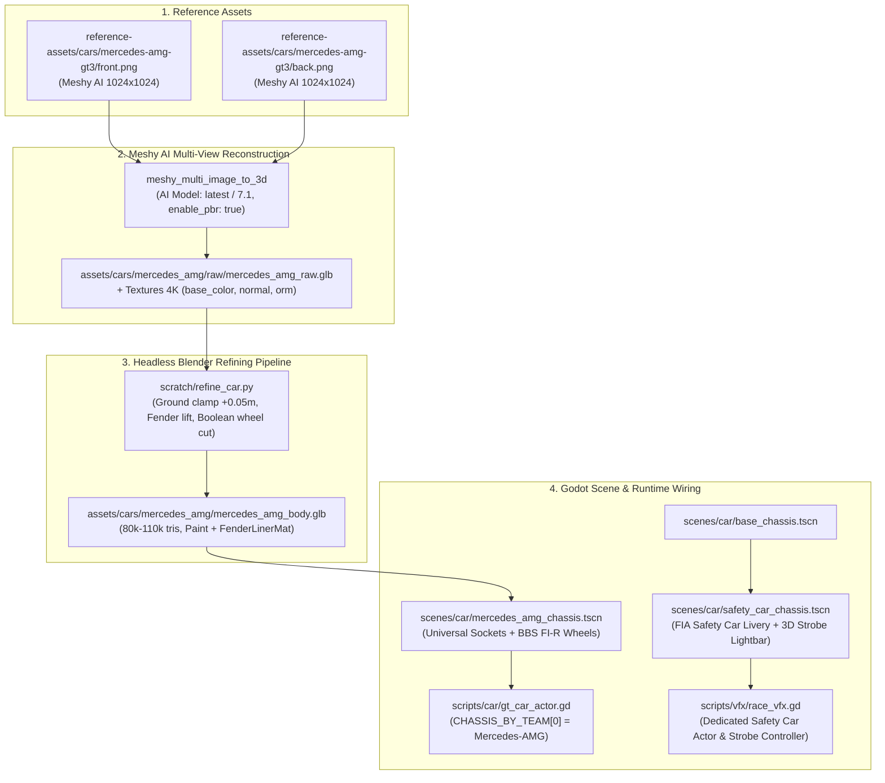

# Spesifikasi Desain: Langkah 1 — Pipeline Mercedes-AMG GT3 Evo & Transisi Official FIA Safety Car

**Status:** DRAFT UNTUK PERSETUJUAN  
**Target Engine:** Godot Engine 4.7.2 stable  
**Dokumen Terkait:** [AGENTS.md](file:///D:/Occupation/Porto/genex/La_Voiture/AGENTS.md) · [Full-Car-Component-Guide.md](file:///D:/Occupation/Porto/genex/La_Voiture/Full-Car-Component-Guide.md) · [ROADMAP.md](file:///D:/Occupation/Porto/genex/La_Voiture/ROADMAP.md)  
**Tanggal:** 2026-10-23  

---

## 1. Executive Summary & Visi Desain

Simulasi motorsport *La Voiture* membutuhkan diferensiasi visual yang kuat antara kendaraan balap kompetitor dengan kendaraan pengatur keselamatan resmi federasi (*Official FIA Safety Car*). Saat ini terdapat dua anomali:
1. **Mobil Tim 0 (Apex Racing):** Menggunakan sasis Porsche 911 GT3 sebagai sasis dasar (`base_chassis.tscn`), sehingga tim unggulan protagonis (Kaze Ryu & Sora Ren) belum memiliki identitas sasis mandiri seperti 9 tim rival lainnya.
2. **Safety Car:** Sistem balapan di `race_vfx.gd` meminjam sasis Lexus (Team 7) dengan lightbar kubus darurat sederhana, tanpa livery keselamatan resmi atau animasi lampu strobo yang autentik.

### Solusi Arsitektural:
1. **Penggantian Sasis Tim 0 (Apex Racing):** Membangun sasis mandiri **Mercedes-AMG GT3 Evo** lengkap dengan moncong *Panamericana grille* vertikal, splitter agresif, sirip aero samping, dan knalpot samping bertenaga buas.
2. **Transisi Porsche 911 Menjadi Safety Car Resmi:** Merekayasa sasis Porsche 911 GT3 menjadi **Official FIA Safety Car** dengan livery perak-hitam, strip chevron hazard neon kuning-oranye, stempel tebal `SAFETY CAR`, serta strobo lightbar LED 3D aktif di atap mobil (kedipan amber saat fase `DEPLOYED` dan hijau saat fase `IN_THIS_LAP`).

---

## 2. Diagram Alur & Topologi Komponen

---

## 3. Spesifikasi Teknis Komponen

### A. Parameter Fisik Mercedes-AMG GT3 Evo (`scratch/car_configs/mercedes_amg.json`)
* **Dimensi FIA GT3:** Panjang 4.55 m, lebar bodi ~2.06 m, tinggi bodi ~1.24 m.
* **Ground Clearance:** Ketinggian titik terendah bodi $\ge +0.04\text{ m}$ (target $+0.05\text{ m}$).
* **Wheelbase & Axle Offsets:**
  * Front Wheel Socket: $z \approx -1.32\text{ m}$, $y = 0.33\text{ m}$, $x = \pm 0.92\text{ m}$ (disesuaikan agar rata spakbor).
  * Rear Wheel Socket: $z \approx +1.32\text{ m}$, $y = 0.33\text{ m}$, $x = \pm 0.94\text{ m}$.
* **Wheel Cut Parameters:** Radius lengkung spakbor $R_{\text{arch}} = 0.372\text{ m}$, radius bak roda $R_{\text{tub}} = 0.369\text{ m}$.
* **Shader:** Menggunakan `shaders/toon_car_paint.gdshader` dengan outline inverted-hull `shaders/inverted_hull_outline.gdshader`.

### B. Spesifikasi Official FIA Safety Car (`scenes/car/safety_car_chassis.tscn`)
* **Base Mesh:** Menggunakan sasis Porsche 911 GT3 (`assets/cars/porsche_911/porsche_911_body.glb`).
* **Material & Livery:**
  * Base paint: Metallic Iridium Silver / Obsidian Black (`next_pass` cel-shading inverted hull).
  * FIA Decals: Teks tebal "SAFETY CAR" di pintu samping dan kap mesin, strip reflektif kuning/oranye neon.
* **3D Rooftop Lightbar:**
  * Dimensi: Slab ramping aerodinamis di atas atap ($y \approx 1.28\text{ m}$).
  * Lampu Strobo Dua Warna:
    * **Amber Strobo (Fase `DEPLOYED`):** 4 segmen LED berkedip bergantian pada frekuensi 10–12 Hz.
    * **Green Light (Fase `IN_THIS_LAP`):** LED hijau konstan/berdenyut lembut menandakan Safety Car akan masuk pit di akhir lap ini dan balapan akan restart (*lights out*).
* **Front Grille Strobe:** Sepasang titik strobo putih/amber di balik grille depan.

---

## 4. Definisi Selesai (Definition of Done) & Quality Gates

Pekerjaan Langkah 1 dinyatakan selesai jika memenuhi seluruh kriteria DoD berikut:
1. **Wheel Fitment Gate (`scratch/fit_cars.gd`):**
   * Mobil Mercedes-AMG GT3 lolos verifikasi headless: 0 vertex di dalam volume ban, celah radial 2.5–5.0 cm, bibir fender rata $\le 1.5\text{ cm}$.
2. **Unit Test Suite:**
   * Script test baru [`tests/test_mercedes_amg_chassis.gd`](file:///D:/Occupation/Porto/genex/La_Voiture/tests/test_mercedes_amg_chassis.gd) (18 asersi) menghasilkan **100% PASS, 0 FAIL**.
   * Integrasi Safety Car pada [`tests/test_car_dynamics_vfx.gd`](file:///D:/Occupation/Porto/genex/La_Voiture/tests/test_car_dynamics_vfx.gd) memverifikasi sasis dedicated Safety Car dengan lightbar aktif.
3. **Zero Regression:**
   * Seluruh 25 test suite yang ada tetap **100% PASS (0 FAIL)**.
4. **Dokumentasi & Git LFS:**
   * File mentah GLB terdaftar di Git LFS (`assets/cars/mercedes_amg/raw/`).
   * Tangkapan layar close-up fitment roda tersimpan di `executor-report/screenshots/`.
