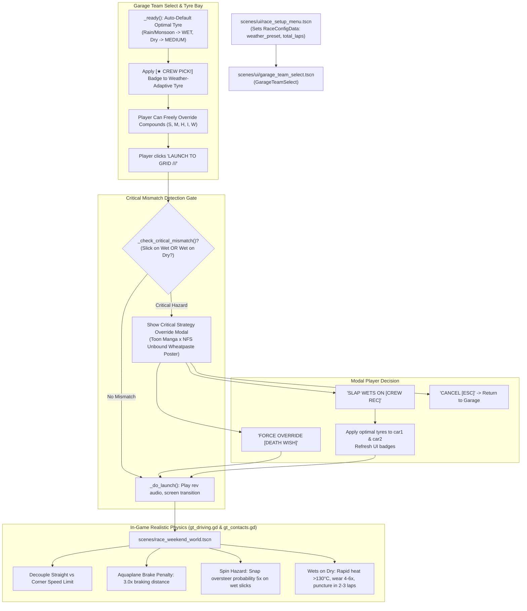

# Spesifikasi Desain: Langkah 2 — Setup Garage Weather-Adaptive Tyre Strategy, Critical Mismatch Alert Modal, dan Realistic Tyre Physics Penalty

**Status:** APPROVED BY USER (SIAP DIIMPLEMENTASIKAN)  
**Target Engine:** Godot Engine 4.7.2 stable  
**Dokumen Terkait:** [AGENTS.md](file:///D:/Occupation/Porto/genex/La_Voiture/AGENTS.md) · [ROADMAP.md](file:///D:/Occupation/Porto/genex/La_Voiture/ROADMAP.md) · [ui_toon_manga_nfs_unbound.html](file:///D:/Occupation/Porto/genex/La_Voiture/temp/brainstorm/content/ui_toon_manga_nfs_unbound.html)  
**Tanggal:** 2026-10-24  

---

## 1. Executive Summary & Visi Desain

Pada simulasi motorsport tingkat lanjut, keputusan pemilihan kompon ban awal (*starting tyre strategy*) sebelum balapan dimulai adalah faktor taktikal paling krusial. Dalam versi terdahulu *La Voiture*, terdapat beberapa keterbatasan:
1. **Tidak Ada Rekomendasi Cuaca Otomatis:** Di `garage_team_select.gd`, pilihan ban awal tidak otomatis menyesuaikan prakiraan cuaca lintasan (*weather preset*), dan tidak ada penanda visual kompon yang ideal.
2. **Ketiadaan Peringatan Strategi Kritis (Silent Mismatch):** Pemain dapat secara tidak sengaja membawa ban Slick di tengah cuaca Hujan Badai (*Monsoon*) tanpa adanya konfirmasi bahaya, yang merusak pengalaman balapan.
3. **Fisika Penalti Ban Kurang Realistis:** Saat ini, penalti ban di `gt_driving.gd` memotong seluruh nilai `pace`, sehingga mobil pada ban Slick di lintasan basah melaju lambat secara artifisial bahkan di lintasan lurus kosong (~120 km/jam seolah mesin tersedak). Seharusnya, mobil di lintasan lurus tetap memiliki kecepatan tinggi, namun dihukum berat pada **jarak pengereman (3x lebih panjang akibat aquaplaning)**, **kecepatan puncak di tikungan (-45% karena kehilangan grip lateral)**, dan **risiko melintir mandiri (*solo spin*) yang melonjak 500%**. Begitu juga ban Wet di trek kering harus mengalami *thermal blistering* ekstrem (>130°C) dan pecah ban (*puncture*) dalam 2–3 lap.
4. **Penyelarasan Visual Toon Manga × NFS Unbound × Street Graffiti:** Antarmuka garasi dan modal peringatan darurat diselaraskan penuh dengan gaya visual baru yang telah disetujui (garis tinta tebal 3.5px–6px, tekstur halftone, slap stickers, coretan graffiti sayap & mahkota 2D, lakban duct-tape, serta poster liar *wheatpaste*).

---

## 2. Ringkasan Keputusan Desain (User Alignment)

Berdasarkan diskusi dan approval pengguna:
1. **Mekanisme Pemicu Modal (Opsi 2):** Modal peringatan bahaya dipicu saat pemain menekan tombol **`LAUNCH TO GRID ///`** jika mobil tim pemain memakai kompon yang bertabrakan fatal dengan kondisi cuaca.
2. **Filter Mismatch Kritis (Opsi A):** Modal HANYA muncul untuk skenario bahaya ekstrem:
   - **Slicks di Trek Basah:** Memilih ban `SOFT`, `MEDIUM`, atau `HARD` pada cuaca `DYNAMIC WET` atau `FULL MONSOON` (air lintasan $\ge 40\%$).
   - **Wets di Trek Kering:** Memilih ban `WET` pada cuaca `SUNNY DRY` (air lintasan $\le 10\%$).
   - *Catatan:* Perubahan antar-kompon kering (misal Soft vs Medium di trek kering) TIDAK memicu popup karena merupakan variasi strategi yang sah.
3. **Arah Gaya Visual:** Mengadopsi 100% konsep **Toon Manga × NFS Unbound × Street Graffiti** sebagaimana dimodelkan pada [ui_toon_manga_nfs_unbound.html](file:///D:/Occupation/Porto/genex/La_Voiture/temp/brainstorm/content/ui_toon_manga_nfs_unbound.html).
4. **Realitas Fisika Balap:**
   - Kecepatan lurus (*straight-line speed*) mobil tetap tinggi; hukuman difokuskan pada *cornering speed limit*, *braking deceleration*, *wheelspin traction*, *thermal blistering*, dan *spin probability*.

---

## 3. Diagram Alur & Topologi Arsitektur



---

## 4. Spesifikasi Antarmuka & Visual (Toon Manga × NFS Unbound)

### A. Team Garage Tyre Selector
* **Tombol Kompon Kaleng Semprot (Spray Can Buttons):**
  - Lima pilihan: `SOFT` (Hot Magenta `#FF007F`), `MEDIUM` (Taxi Yellow `#FFD400`), `HARD` (Pure White `#FFFFFF`), `INTER` (Mint Cyan `#00F5D4`), `WET` (Electric Lime `#D8FF00`).
  - Sudut kemiringan pelat $-12^\circ$ dengan border tebal tinta hitam 3.5px dan drop-shadow solid 4px.
* **Badge Rekomendasi `[★ CREW PICK!]`:**
  - Dipasang secara otomatis pada tombol kompon yang cocok dengan radar cuaca sirkuit.
  - Memiliki aksen meletup (*burst badge*) berwarna Hot Magenta dengan rotasi $+12^\circ$.
* **Kotak Telemetri Dinamis:**
  - Menampilkan status kompatibilitas:
    - `OPTIMAL (100% MATCH)` (Hijau Acid Lime) jika cocok.
    - `CRITICAL MISMATCH (HAZARD!)` (Merah Kirmisi `#FF0055`) jika bertabrakan fatal dengan prakiraan cuaca.
  - Ringkasan teknis: Alur pembuangan air, jendela suhu ideal, dan estimasi delta waktu.

### B. Modal Peringatan Mismatch Kritis (Wheatpaste Danger Poster)
* **Desain:** Poster jalanan bergaya *wheatpaste* yang tertempel lakban bening (*duct tape*) di sudut-sudutnya, outline tebal 6px hitam, drop shadow berlapis Hot Magenta dan Acid Lime.
* **Balon Kata Manga:** Label seru di sudut atas: `「アホか！？」ARE YOU CRAZY?!`
* **Matriks Hukuman Konkret:**
  1. `CORNERING SPEED LIMIT: -45% SLOW` (Grip lateral ambruk).
  2. `BRAKING DISTANCE: 3.0x LONGER` (Roda mengunci di genangan).
  3. `STRAIGHT-LINE HEADROOM: 100% TOPSPEED` (Kecepatan garis lurus tetap terjaga).
  4. `SOLO SPIN RISK: 500% (5x LIPAT)` (Potensi melintir tinggi di tikungan).
* **Dua Tombol Keputusan:**
  - **`FORCE OVERRIDE [DEATH WISH]`:** Melanjutkan balapan dengan ban pilihan pemain tanpa mengubah strategi.
  - **`SLAP WETS ON [CREW REC]`:** Otomatis mengubah kompon ke ban basah dan langsung meluncur ke grid.

---

## 5. Spesifikasi Teknis Fisika & Dinamika Kendaraan

### A. Dekopling Kecepatan Lurus dan Grip Tikungan (`scripts/gt/gt_driving.gd`)
Pada implementasi lama:
```gdscript
# LAMA (Tidak Realistis):
var pace: float = car.grip * car.skill * tyre_factor(car) * fuel_factor * error_factor * damage_factor * pace_mult
_target = minf(car.top_speed + top_speed_bonus, track.speed_limit_at(car.s) * pace)
```
Pada implementasi baru:
1. **Kecepatan di Lintasan Lurus (`absf(curv_now) < 0.0035`):**
   - Kecepatan puncak lurus tidak dipotong oleh `tyre_factor`. Mobil pada ban Slick di trek basah tetap mampu mencapai *top speed* asalkan lintasan cukup panjang.
   - Akselerasi awal dari kecepatan rendah (`car.v < 40.0 m/s`) mengalami reduksi traksi (*wheelspin factor*) sebesar $30\% - 45\%$ di atas genangan air.
2. **Batas Kecepatan di Tikungan (`absf(curv_now) >= 0.0035`):**
   - Batas kecepatan tikungan ditentukan oleh grip lateral aktual:
     $$\text{corner\_limit} = \text{track.speed\_limit\_at}(s) \times \text{lateral\_grip\_factor}$$
   - Untuk ban Slick di trek basah ($>40\%$ air), $\text{lateral\_grip\_factor}$ jatuh hingga $0.55 - 0.65$ (kecepatan apex turun $35\% - 45\%$).
3. **Pengereman & Aquaplaning (`brake_rate`):**
   - Dekelerasi pengereman normal GT3 berkisar $28 - 38\text{ m/s}^2$.
   - Saat ban Slick mengerem di lintasan basah ($>20\%$ air), koefisien gesek dinamis jatuh:
     $$\text{aquaplane\_mult} = \max(0.33, 1.0 - \frac{\text{water} - 20}{70} \times 0.67)$$
   - Hal ini membuat jarak pengereman bertambah $2.5\times - 3.0\times$ lebih panjang, memaksa mobil meluncur keluar jalur (*overshoot*) jika mengerem pada titik referensi normal.

### B. Degradasi Termal Ban Wet di Trek Kering (`scripts/gt/gt_driving.gd`)
* Saat mobil memakai ban `WET` di lintasan kering ($\text{water} < 12\%$):
  - Suhu ban meroket pesat: $\text{target\_temp} \approx 135^\circ\text{C}$ (normal $80 - 90^\circ\text{C}$).
  - Laju keausan ban (*wear rate*) melonjak $5\times$ lipat.
  - Efek *blistering*: setelah 2 lap, ban mencapai *wear cliff* ($>75\%$), dan pecah ban (*puncture*) terjadi pada lap 3 jika tidak segera masuk pit.

### C. Probabilitas Melintir Mandiri (*Solo Spin Risk*) (`scripts/gt/gt_contacts.gd` / `gt_driving.gd`)
* Jika mobil memakai ban Slick di tikungan basah dan melaju melebihi batas grip lateral ($v > \text{corner\_limit} \times 1.12$), mobil memicu *snap oversteer*:
  - Mengaktifkan `car.error_timer = 2.2` (kehilangan kendali sesaat, melintir, dan melambat).
  - Mengirim transmisi radio keluhan pembalap: *"Zero grip! The car snapped on corner entry!"*

---

## 6. Spesifikasi Test Suite Baru (`tests/test_garage_tyre_strategy.gd`)

Test suite baru wajib dibuat untuk memverifikasi secara headless:
1. **Auto-Default Verification:** Verifikasi bahwa saat cuaca `MONSOON` atau `RAIN`, `car1_starting_compound` dan `car2_starting_compound` otomatis diset ke `WET` / `INTER`.
2. **Critical Mismatch Detection:**
   - Menguji kondisi Slick di trek basah terdeteksi sebagai critical mismatch (`is_critical_mismatch == true`).
   - Menguji kondisi Soft vs Medium di trek kering TIDAK memicu critical mismatch (`is_critical_mismatch == false`).
   - Menguji kondisi Wet di trek kering terdeteksi sebagai critical mismatch (`is_critical_mismatch == true`).
3. **Modal Actions Simulation:**
   - Memanggil `apply_recommended_tyres()` berhasil mengubah kompon kedua mobil ke ban optimal.
   - Memanggil `force_override()` berhasil melanjutkan tanpa mengubah kompon.
4. **Physics Decoupling Verification:**
   - Memvalidasi bahwa mobil ban Slick di trek basah mampu mencapai $>240\text{ km/jam}$ di trek lurus panjang.
   - Memvalidasi bahwa jarak pengereman ban Slick di trek basah minimal $2\times$ lebih panjang daripada ban Wet.
   - Memvalidasi bahwa ban Wet di trek kering mengalami kenaikan suhu $>125^\circ\text{C}$ dan keausan $4\times$ lebih cepat.

---

## 7. Definition of Done (DoD)

1. **Zero Regression:** Seluruh 26 test suite yang sudah ada + 1 test suite baru (`test_garage_tyre_strategy.gd`) wajib menghasilkan **100% PASS (0 FAIL)** via `godot --headless`.
2. **UI Interactivity:** Garasi menampilkan badge `[★ CREW PICK!]`, dan modal muncul dengan visual Toon Manga × NFS Unbound jika terjadi mismatch pada klik *Launch to Grid*.
3. **Realistic Simulation:** Mobil di trek basah dengan ban slick tidak lagi lambat di trek lurus, namun realistis tergelincir di tikungan dan pengereman.
4. **Git Cleanliness:** Perubahan kode rapi, terdokumentasi, dan siap untuk Langkah 3.