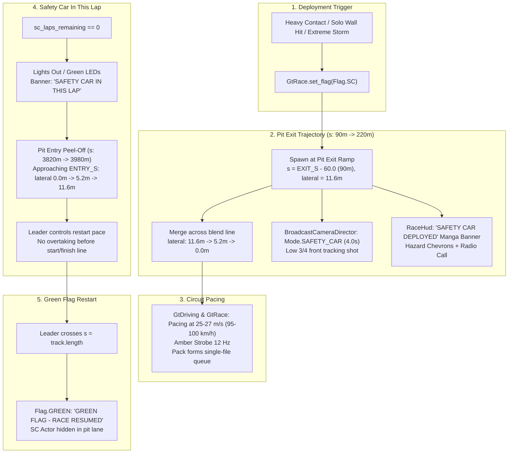

# Spesifikasi Desain: Prosedur Autentik Safety Car — Pit Exit Deployment, Cinematic Cut-In & Pit Entry Peel-Off

**Status:** APPROVED FOR IMPLEMENTATION  
**Target Engine:** Godot Engine 4.7.2 stable  
**Dokumen Terkait:** [AGENTS.md](file:///D:/Occupation/Porto/genex/La_Voiture/AGENTS.md) · [ROADMAP.md](file:///D:/Occupation/Porto/genex/La_Voiture/ROADMAP.md) · [01-CORE-SIMULATION-ENGINE.md](file:///D:/Occupation/Porto/genex/La_Voiture/PRD/01-CORE-SIMULATION-ENGINE.md)  
**Tanggal:** 2026-10-25  

---

## 1. Executive Summary & Visi Fitur

Dalam balapan sirkuit GT3 resmi (FIA Motorsport), kehadiran **Official Safety Car** bukan sekadar entitas yang tiba-tiba teleportasi di depan mobil terdepan, melainkan suatu prosedur koreografi balap penuh:
1. **Pit Exit Deployment (Meluncur Keluar dari Pit):** Saat insiden berat terjadi atau cuaca badai ekstrem memicu `Flag.SC`, Safety Car yang siaga di ujung pit lane menyalakan lampu strobo amber (12 Hz), melaju di sepanjang jalur keluar pit (*pit exit ramp*), dan menyatu (*merge*) ke lintasan sirkuit melalui *pit blend line*.
2. **Cinematic Broadcast Cut-In & Manga Banner:** Kamera siaran langsung otomatis melakukan *cut-in shot* dramatis (sudut rendah 3/4 depan yang menyorot gril bertenaga, lampu LED, dan strobo atap) diiringi banner manga neo-brutalis tebal: `"SAFETY CAR DEPLOYED"` dengan aksen hazard chevron dan garis aksi (*speedlines*), serta komunikasi radio pit wall.
3. **Pacing the Field:** Safety Car mengendalikan kecepatan rombongan pada 90–110 km/jam, memadatkan jarak antar mobil hingga batas aman.
4. **Safety Car In This Lap & Peel-Off (Masuk Kembali ke Pit):** Saat lintasan aman, Race Control mengumumkan `IN_THIS_LAP`. Strobo amber atap dipadamkan (lampu hijau aktif atau *lights out*). Menjelang tikungan terakhir / *Pit Entry line*, Safety Car menyalakan lampu sein kanan dan memisahkan diri (*peel-off*) ke jalur perlambatan pit (*pit entry ramp*), membebaskan sang pemimpin balap (*race leader*) untuk mengendalikan kecepatan *rolling restart* hingga bendera hijau berkibar di garis start/finish.

---

## 2. Arsitektur Komponen & Alur Prosedur

---

## 3. Spesifikasi Matematis Trajektori (Kinematic Geometry)

### A. Pit Exit Ramp & Blend Line (Deployment)
* **Titik Awal (Standby Ramp):**
  * $s_{\text{start}} = \text{EXIT\_S} - 60.0\text{ m} = 90.0\text{ m}$.
  * $\text{lateral}_{\text{start}} = \text{FAST\_LANE\_M} = 11.6\text{ m}$.
  * Kecepatan awal: $v = 18.0\text{ m/s}$ (berakselerasi halus hingga $27.0\text{ m/s}$).
* **Fungsi Interpolasi Lateral Pit Exit:**
  Untuk offset $s_{\text{rel}} = s - \text{EXIT\_S}$:
  $$\text{lateral}(s_{\text{rel}}) = \begin{cases}
  11.6 & \text{jika } s_{\text{rel}} \le -60.0 \\
  \operatorname{lerp}(11.6, 5.2, \operatorname{smoothstep}(-60.0, 0.0, s_{\text{rel}})) & \text{jika } -60.0 < s_{\text{rel}} \le 0.0 \\
  \operatorname{lerp}(5.2, 0.0, \operatorname{smoothstep}(0.0, 70.0, s_{\text{rel}})) & \text{jika } 0.0 < s_{\text{rel}} \le 70.0 \\
  0.0 & \text{jika } s_{\text{rel}} > 70.0
  \end{cases}$$
* **Sifat Kinematika:** Turunan pertama $\frac{d(\text{lateral})}{ds} = 0$ pada $s_{\text{rel}} = -60.0$ dan $s_{\text{rel}} = 70.0$, menjamin tidak ada sentakan kemudi (*zero steering jerk*).

### B. Pit Entry Ramp & Peel-Off (Withdrawal)
* **Titik Awal Pemisahan Jalur:**
  * Menjelang $\text{ENTRY\_S} = 3900.0\text{ m}$, Safety Car mulai bergeser ke kanan pada $s = \text{ENTRY\_S} - 80.0\text{ m} = 3820.0\text{ m}$.
* **Fungsi Interpolasi Lateral Pit Entry:**
  Untuk offset $s_{\text{rel}} = s - \text{ENTRY\_S}$:
  $$\text{lateral}(s_{\text{rel}}) = \begin{cases}
  0.0 & \text{jika } s_{\text{rel}} \le -80.0 \\
  \operatorname{lerp}(0.0, 5.2, \operatorname{smoothstep}(-80.0, 0.0, s_{\text{rel}})) & \text{jika } -80.0 < s_{\text{rel}} \le 0.0 \\
  \operatorname{lerp}(5.2, 11.6, \operatorname{smoothstep}(0.0, 60.0, s_{\text{rel}})) & \text{jika } 0.0 < s_{\text{rel}} \le 60.0 \\
  11.6 & \text{jika } s_{\text{rel}} > 60.0
  \end{cases}$$
* **Efek Terhadap Pemimpin Balap:** Mobil pembalap tetap mengikuti *racing line* ($\text{lateral} \approx 0.0$), tidak mengikuti Safety Car masuk ke pit.

---

## 4. Spesifikasi Kamera Broadcast & Visual Manga

### A. Broadcast Camera Director (`BroadcastCameraDirector`)
* Mode baru: `Mode.SAFETY_CAR` (Index 5).
* Prosedur Cut-In Otomatis:
  * Saat Safety Car dipanggil, `trigger_safety_car_cut(sc_actor, 4.0)` dipanggil.
  * Kamera beralih ke sudut pelacakan 3/4 depan rendah:
    $$\text{pos} = \mathbf{P}_{\text{SC}} - 7.5 \cdot \mathbf{Z}_{\text{SC}} + 2.8 \cdot \mathbf{X}_{\text{SC}} + 1.2 \cdot \mathbf{Y}_{\text{up}}$$
    $$\text{look\_at} = \mathbf{P}_{\text{SC}} + 0.8 \cdot \mathbf{Y}_{\text{up}}$$
  * Setelah durasi 4.0 detik selesai, kamera kembali secara mulus (*smooth ease-out*) ke mode kamera pemain sebelumnya.
  * Tombol `C` dapat beralih ke `SAFETY CAR CAM` kapan pun Safety Car aktif di lintasan.

### B. Stylized Manga Banner Overlay (`SafetyCarBanner`)
* Banner popup manga tebal:
  * Dimensi: $800 \times 120\text{ px}$, posisikan di sepertiga atas layar.
  * Latar belakang: Hitam pekat bertinta manga dengan garis-garis screentone halftone diagonal dan border ganda.
  * Strip hazard: Chevron miring kuning cyber (`#D8FF00`) dan hitam neon.
  * Tipografi: Header 32pt ultra-bold `"SAFETY CAR DEPLOYED"`, subteks `"セーフティーカー出動 // MAINTAIN DELTA TIME"`.
  * Mode In-Lap: Warna aksen beralih ke hijau neon (`#38BDF8` / `#3FB950`), header `"SAFETY CAR IN THIS LAP"`, subteks `"LIGHTS OUT // PREPARE FOR RESTART"`.
  * Animasi: 1-frame negative snap (punch flash putih), meluncur masuk dari atas dengan pegas elastis, bertahan 3.5 detik lalu meluncur keluar.

---

## 5. Definisi Selesai (Definition of Done) & Quality Gates

1. **Unit Test Suite Baru (`tests/test_safety_car_cinematic.gd`):**
   * Menguji transisi koordinat pit exit merge (lateral bergerak dari 11.6 m ke 0.0 m secara mulus).
   * Menguji transisi koordinat pit entry peel-off (lateral bergerak dari 0.0 m ke 11.6 m saat in-lap).
   * Menguji peralihan kamera broadcast ke Safety Car saat deployment dan kembali ke kamera pemain.
   * Menguji banner HUD muncul saat status SC berubah.
2. **Zero Regression Test:**
   * Seluruh 33 test suite sebelumnya wajib tetap **100% PASS (0 FAIL)**, termasuk `test_car_dynamics_vfx.gd` dan `test_gt_sim.gd`.
3. **Standar Performa & Arsitektur:**
   * 0 Orphan Nodes saat keluar dari race weekend.
   * Tetap deterministik pada `race_seed` yang sama.
