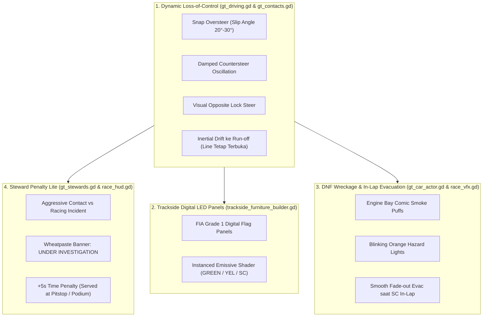

# Design Spec: Authentic GT3 Incident Dynamics, Trackside Digital Flag Panels & Steward Penalties

**Dokumen:** Spesifikasi Desain Resmi (Fase 11 / Langkah 6)  
**Target:** Senior Simulation Engineer, Gameplay Designer & Trackside VFX Artist  
**Rujukan:** [`AGENTS.md`](file:///D:/Occupation/Porto/genex/La_Voiture/AGENTS.md) · [`ROADMAP.md`](file:///D:/Occupation/Porto/genex/La_Voiture/ROADMAP.md) · [`scripts/gt/gt_contacts.gd`](file:///D:/Occupation/Porto/genex/La_Voiture/scripts/gt/gt_contacts.gd) · [`scripts/gt/gt_driving.gd`](file:///D:/Occupation/Porto/genex/La_Voiture/scripts/gt/gt_driving.gd) · [`scripts/car/gt_car_actor.gd`](file:///D:/Occupation/Porto/genex/La_Voiture/scripts/car/gt_car_actor.gd)

---

## 1. Executive Summary & Design Vision

Sistem insiden saat ini telah memiliki fondasi simulasi SAT (*Separating Axis Theorem*) 190-pasangan yang solid dan prosedur Safety Car Mercedes-AMG yang lengkap. Namun, pengalaman visual dan dramatis insiden saat ini masih memiliki kekurangan utama:
1. **Animasi Kehilangan Kendali Tidak Realistis:** Mobil yang melintir berputar 360° berkali-kali seperti gasing (*spinning top*), yang tidak merepresentasikan perilaku mobil GT3 modern dengan *high downforce*, ban slick lebar, ABS, dan Traction Control. Putaran 360° ini juga menyebabkan *bounding box* di Match Collider membengkak-mengecil secara liar.
2. **Ketiadaan Visual Bendera di Lintasan 3D:** Bendera kuning (*Yellow Flag*) dan status *Safety Car* hanya tampil di layar 2D (HUD minimap & banner). Lingkungan sirkuit 3D terasa mati tanpa ada sinyal bendera fisik/digital.
3. **Bangkai DNF Statis & Tanpa Evakuasi:** Mobil yang DNF hanya diam membeku di rumput tanpa efek kerusakan (asap/hazard) dan tidak pernah dievakuasi hingga balapan selesai.
4. **Ketiadaan Regulasi & Konsekuensi Sportif:** Tabrakan agresif belum memiliki sistem investigasi wasit (*Steward Review*) maupun penalti waktu (*5s Time Penalty*).

Spesifikasi ini merombak sistem insiden menjadi **"Authentic GT3 Incident Dynamics & High-Tempo Stewarding"** yang memadukan regulasi balap FIA dengan estetika anime manga neo-brutalisme khas *La Voiture*.

---

## 2. Arsitektur 4 Modul Inti

---

## 3. Rincian Modul Spesifikasi

### Modul 1: Dynamic Loss-of-Control (Menghapus Putaran 360°)
* **Prinsip Fisika GT3:** Mobil GT3 tidak berputar gasing 360° kecuali terkena benturan tegak lurus (*T-bone*) berkecepatan ekstrem. Kehilangan kendali normal akibat ban aus (*tyre cliff*), aquaplaning basah, atau benturan roda adalah **Snap Oversteer** yang disusul usaha koreksi kemudi (*Countersteer / Tank-Slapper*).
* **Model Matematis Sudut Yaw (`yaw_offset`):**
  Alih-alih mengakumulasi `car.spin_angle += (14.0 - ...) * dt` secara tak terbatas, sudut yaw dibatasi pada envelope damped harmonic:
  $$\theta_{\text{slip}}(t) = \theta_{\max} \cdot e^{-\lambda t} \cdot \cos(\omega t)$$
  * $\theta_{\max} = \pm 0.45\text{ rad}$ ($25.7^\circ$), arah ditentukan oleh arah *lateral slip* ($+1$ membuang ke kiri, $-1$ membuang ke kanan).
  * $\lambda = 1.15$ (faktor redaman suspensi & cengkeraman ban).
  * $\omega = 7.5\text{ rad/s}$ (frekuensi ayunan *tank-slapper* pembalap membanting setir).
  * Durasi osilasi: $2.4\text{ s}$ s.d. $3.2\text{ s}$.
* **Visual Opposite Lock Steering (Roda Depan 3D):**
  Di [`scripts/car/gt_car_actor.gd`](file:///D:/Occupation/Porto/genex/La_Voiture/scripts/car/gt_car_actor.gd), sudut kemudi roda depan `_steer_angle` dikalibrasi menjadi:
  $$\text{steer\_angle} = -\text{clamp}(\theta_{\text{slip}} \times 1.6, -0.65, 0.65)$$
  Roda depan membanting penuh ke arah berlawanan dari sudut geser bokong mobil, memperlihatkan usaha aktif pembalap mengoreksi *slide*.
* **Inertial Drift ke Arah Run-Off:**
  Kecepatan longitudinal berkurang drastis akibat *heavy tire scrub* ($v = \max(12.0, v - 16.0 \cdot dt)$). Mobil meluncur menyamping ke arah luar tikungan ($v_{\text{lat}} = \text{slide\_dir} \cdot 2.8\text{ m/s}$) menuju kerb/run-off, memastikan *racing line* utama di sisi dalam tetap bersih dan terbuka bagi mobil yang menyalip dari belakang.
* **Integritas Match Collider (`gt_contacts.gd`):**
  Karena `absf(sin(yaw_offset))` sekarang dibatasi maksimal $\approx 0.43$ (bukan $1.0$), dimensi *bounding box* SAT (`width` dan `reach`) tetap terkontrol rapat. Mobil yang menyalip tidak akan terlempar atau mengalami *collision tunneling*.

---

### Modul 2: Digital Trackside Flag Panels (FIA Grade 1 Digital Boards)
* **Penempatan Furnitur 3D:**
  Di [`scripts/world/shared/trackside_furniture_builder.gd`](file:///D:/Occupation/Porto/genex/La_Voiture/scripts/world/shared/trackside_furniture_builder.gd), pasang 8 unit panel digital di tiang pagar lintasan atau tiang lampu sirkuit pada titik-titik krusial (Turn 1, Hairpin, Dunlop curve, Chicane, Gantry Finish).
* **Dimensi & Shader:**
  * Ukuran layar LED: $1.8\text{ m} \times 1.2\text{ m}$, bingkai matte hitam dengan kisi-kisi pelindung.
  * Shader emisi beresolusi rendah dengan tekstur matriks dot-matrix LED:
    * **Status GREEN:** LED padam atau hijau redup statis (`#00E08A`, emisi 0.2).
    * **Status YELLOW (per sektor):** LED kuning mencolok (`#FFE600`, emisi 2.5) berkedip pada 4 Hz dengan chevron panah peringatan atau teks `YEL`.
    * **Status SAFETY CAR:** LED kuning/oranye menyala bergantian menampilkan teks `SC` di seluruh panel sirkuit.
* **Performa:** Menggunakan 1 single `MultiMeshInstance3D` dengan shader instancing data (hanya 1 draw call untuk seluruh 8 panel di trek).

---

### Modul 3: DNF Wreckage VFX & Clean In-Lap Evacuation
* **Visual Bangkai Mobil Rusak:**
  Ketika mobil dinyatakan DNF (`car.is_dnf = true`):
  1. Mobil berhenti menyandar sejajar dengan barrier luar ($lateral = \pm 7.4\text{ m}$, sudut benturan $15^\circ$–$20^\circ$).
  2. Partikel asap cel-shaded manga ([`scenes/vfx/manga_smoke_emitter.tscn`](file:///D:/Occupation/Porto/genex/La_Voiture/scenes/vfx/manga_smoke_emitter.tscn)) keluar mengepul perlahan dari area kap radiator/mesin.
  3. Lampu hazard 3D berkedip sinkron (oranye terang) di sudut bodi mobil.
* **Evakuasi Otomatis saat Safety Car In-Lap:**
  * Saat Race Control mengumumkan Safety Car memasuki putaran penarikan (`IN_THIS_LAP`):
    * Mobil DNF melakukan transisi *fade-out* halus (modulasi alpha $1.0 \to 0.0$ selama 2.0 detik) atau ditarik ke balik dinding evakuasi.
    * Radio Race Control berbunyi di Pit Wall:
      > *"Race Control: Track is clear in Sector %d. Recovery completed, Safety Car in this lap."*
    * Status lintasan kembali aman (Green Flag restart).

---

### Modul 4: Steward Penalty Lite (FIA-Style Snappy Verdict)
* **Klasifikasi Pelanggaran Kontak (`gt_stewards.gd`):**
  Menggunakan telemetri presisi dari `GtContacts._resolve_pair()`:
  * **Racing Incident (No Further Action):** Senggolan bodi lateral (*door rubbing*) saat berdampingan (`abs_d_lat >= 1.35`) atau kontak dengan selisih kecepatan rendah ($closing \le 2.4\text{ m/s}$).
  * **Causing a Collision (At-Fault):** Mobil belakang menyeruduk mobil depan di zona pengereman (`closing > 2.8\text{ m/s}`, kontak *nose-to-tail*). Mobil penyeruduk dinyatakan bersalah (*offender*).
* **Alur Notifikasi HUD:**
  1. **Deteksi Insiden ($T + 0\text{ s}$):**
     * Banner mini manga muncul di sudut atas-tengah layar:
       `/// STEWARDS: INCIDENT INVOLVING CAR #%d UNDER INVESTIGATION`
  2. **Putusan Wasit ($T + 8\text{ s}$ s.d. $12\text{ s}$):**
     * Jika Racing Incident: Banner hijau redup `NO FURTHER ACTION - RACING INCIDENT`.
     * Jika Terbukti Bersalah: Banner crimson bergaris hazard:
       `+5s TIME PENALTY // CAR #%d: CAUSING A COLLISION`
     * Efek suara: *Buzzer/Gavel strike audio cue*.
* **Eksekusi Penalti:**
  * Jika mobil melakukan pit stop berikutnya: Kru pit menahan mobil diam selama 5.0 detik sebelum dongkrak hidrolik dinaikkan (*5s stop-and-go before service*).
  * Jika mobil tidak masuk pit lagi hingga finis: Waktu penalti 5.0 detik otomatis ditambahkan ke total catatan waktu balap di layar podium ([`scenes/ui/podium_screen.tscn`](file:///D:/Occupation/Porto/genex/La_Voiture/scenes/ui/podium_screen.tscn)).

---

## 4. Definition of Done & Verification Gates

1. **Zero Regression Test Suite:**
   * Seluruh 34 test suite yang ada tetap **100% PASS (0 FAIL)** via `godot --headless`.
   * Test suite baru [`tests/test_track_incidents_and_stewards.gd`](file:///D:/Occupation/Porto/genex/La_Voiture/tests/test_track_incidents_and_stewards.gd) lulus dengan validasi:
     - `yaw_offset` teredam dan tidak pernah melebihi $0.55\text{ rad}$ ($31.5^\circ$).
     - Roda depan melakukan *opposite lock* berlawanan arah slip.
     - 190 pasangan Match Collider terverifikasi bebas *tunneling* dan *glitch* saat insiden terjadi.
     - Digital Flag Panels merespons pergantian bendera (Green -> Yellow -> SC -> Green).
     - Alur penalti 5 detik tereksekusi di pitstop dan terakumulasi di podium.
2. **Native Smoke Test & 60 FPS Performance Gate:**
   * Menjalankan balapan 20 mobil di preset High 1080p cuaca hujan badai (*Thunderstorm Night*) selama 3 lap dengan insiden aktif.
   * Frame rate rata-rata $\ge 50.0\text{ FPS}$, p95 frame time $\le 32.0\text{ ms}$, dan **0 orphan nodes** saat kembali ke HQ.
3. **Dokumentasi Resmi:**
   * Laporan eksekutif diterbitkan di `executor-report/reports/FASE-11-LANGKAH-6-INCIDENTS-AND-STEWARDING-REPORT.md`.
   * Bukti tangkapan visual native 1080p disimpan di `executor-report/screenshots/phases/phase-11-step-6-*.png`.
