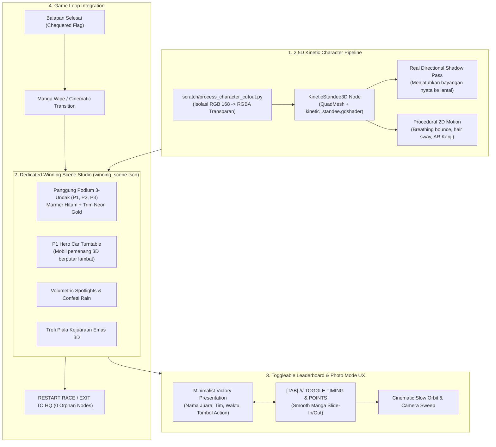

# Design Spec: Dedicated Winning Scene Studio & 2.5D Kinetic Character Pipeline

**Dokumen:** Spesifikasi Desain Resmi (Fase 11 / Langkah 7)  
**Target:** Senior Gameplay Architect, Technical Artist & UI/UX Designer  
**Rujukan:** [`AGENTS.md`](file:///D:/Occupation/Porto/genex/La_Voiture/AGENTS.md) · [`ROADMAP.md`](file:///D:/Occupation/Porto/genex/La_Voiture/ROADMAP.md) · [`reference-assets/characters/DRIVER-CHARACTERIZATION-ROSTER.md`](file:///D:/Occupation/Porto/genex/La_Voiture/reference-assets/characters/DRIVER-CHARACTERIZATION-ROSTER.md) · [`scripts/ui/podium_screen.gd`](file:///D:/Occupation/Porto/genex/La_Voiture/scripts/ui/podium_screen.gd) · [`scripts/ui/garage_car_orbit.gd`](file:///D:/Occupation/Porto/genex/La_Voiture/scripts/ui/garage_car_orbit.gd)

---

## 1. Executive Summary & Design Vision

Saat ini, akhir dari sebuah balapan di *La Voiture* hanya memunculkan antarmuka 2D biasa ([`podium_screen.gd`](file:///D:/Occupation/Porto/genex/La_Voiture/scripts/ui/podium_screen.gd)) berupa tabel teks dan *cardboard standee* datar di atas viewport balap. Hal ini meninggalkan celah besar pada **Game Presentation Loop**: tidak ada panggung selebrasi kemenangan yang dramatis dan emosional bagi pemain setelah memenangkan balapan intens 20 mobil.

Spesifikasi ini mendefinisikan panggung selebrasi kemenangan 3D mandiri (**`scenes/ui/winning_scene.tscn`**) dengan **Pipeline Karakter 2.5D Kinetik ("2.5D Comic Stage")**, mobil juara P1 di atas *turntable* berputar, efek visual confetti dan hologram kanji, serta **Toggleable Leaderboards (`[TAB]`)** agar pemain dapat menikmati sinematografi kemenangan tanpa terhalang elemen antarmuka yang padat.

---

## 2. Arsitektur 4 Modul Inti

---

## 3. Rincian Modul Spesifikasi

### Modul 1: Pipeline Karakter 2.5D Kinetik (`KineticStandee3D`)
* **Pengolahan Aset Sumber:**
  * Menggunakan konsep seni beresolusi tinggi yang sudah ada di [`reference-assets/characters/`](file:///D:/Occupation/Porto/genex/La_Voiture/reference-assets/characters/).
  * Skrip otomasi [`scratch/process_character_cutout.py`](file:///D:/Occupation/Porto/genex/La_Voiture/scratch/process_character_cutout.py) mengisolasi latar belakang studio abu-abu (`RGB ~168`) menjadi format PNG transparan (`RGBA`) beresolusi tinggi dengan *anti-aliased manga ink border*.
  * Hasil disimpan di `assets/characters/standees/<driver_slug>.png`.
  * *Prototipe Utama (Vertical Slice):* **Kaze Ryu (#01 RYU - Apex Racing)** untuk juara P1, didampingi 2 rival representatif untuk P2 dan P3.
* **Arsitektur Node `KineticStandee3D`:**
  * Mewarisi `Node3D`. Menggunakan `QuadMesh` 3D berukuran proporsional ($1.85\text{ m} \times 1.05\text{ m}$).
  * `cast_shadow = GeometryInstance3D.SHADOW_CASTING_SETTING_ON`: Menjatuhkan bayangan nyata ke lantai podium 3D sesuai sudut lampu sorot.
  * **Shader `kinetic_standee.gdshader`:**
    * Mendukung *diffuse cel-shading* dan *rim lighting* neon sesuai warna identitas tim pembalap.
    * Mempertahankan garis tinta tebal manga di sekeliling siluet karakter (*manga outer inking*).
* **Animasi Kinetik Prosedural (Living Manga):**
  * **Breathing Loop:** Animasi pernapasan halus ($Y$-scale berosilasi $\pm 1.2\%$ dengan kurva sinus periode $2.4\text{ s}$).
  * **Hair & Cloth Sway:** Goyangan halus pada helai rambut dan jaket streetwear via *vertex shader displacement* mikro.
  * **Holographic AR Kanji Emitter:** Partikel 3D huruf kanji `勝者` (*WINNER*) dan garis kecepatan manga (*speedlines*) melayang di belakang siluet pembalap.

---

### Modul 2: Panggung Podium Studio 3D (`winning_scene.tscn`)
* **Struktur Panggung:**
  * **Podium 3 Tingkat:**
    * P1 (Tengah): Ketinggian $+0.80\text{ m}$, aksen trim neon emas *Cyber Gold* (`#FFD23F`).
    * P2 (Kiri): Ketinggian $+0.50\text{ m}$, aksen trim perak *Sleek Silver* (`#D8DCE6`).
    * P3 (Kanan): Ketinggian $+0.30\text{ m}$, aksen trim perunggu *Bronze* (`#D9803A`).
    * Material panggung: Polished dark obsidian marble dengan refleksi cermin halus.
  * **P1 Hero Car Turntable Display:**
    * Platform bundar di belakang panggung podium berdiameter $6.5\text{ m}$.
    * Memuat model sasis 3D mobil pemenang balapan secara dinamis dari `assets/cars/<car_slug>/<car_slug>_full.glb`.
    * Berputar lambat ($0.06\text{ rad/s}$), lampu depan LED dan lampu belakang menyala menerobos kabut studio.
  * **Trofi Kejuaraan 3D (The Championship Cup):**
    * Model 3D piala emas bersayap GT3 bertekstur *toon gold shader* berdiri megah di atas pedestal panggung P1.
  * **Atmosfer & Pencahayaan:**
    * 3 Volumetric Spotlights dramatis menyorot ke masing-masing pembalap di podium.
    * Partikel confetti emas dan pita berkilauan berjatuhan dari langit-langit panggung.

---

### Modul 3: Toggleable Leaderboard & Photo Mode UX
* **Tampilan Default (Cinematic Clean View):**
  * Tampilan layar dibuat bersih, minimalis, dan elegan:
    * Header atas bergaya street stencil: `/// LA VOITURE // CHAMPIONSHIP PODIUM`.
    * Kartu nama pembalap P1, P2, P3 di bawah podium dengan nomor mobil, nama, dan selisih waktu.
    * Tombol navigasi di sudut kanan bawah:
      - **`[TAB] /// SHOW LEADERBOARD`**
      - **`[R] /// RESTART RACE`**
      - **`[ESC] /// EXIT TO HQ`**
* **Tampilan Expanded (Full Timing & Points Tower):**
  * Saat tombol **`[TAB]`** ditekan oleh pemain:
    * Papan klasemen 20 pembalap meluncur masuk (*smooth manga slide-in*) dari sisi kanan layar.
    * Menampilkan: Urutan finis P1 s.d. P20, selisih gap waktu, lap tercepat (*Fastest Lap +1 PT Bonus* ungu), dan perolehan poin konstruktor FIA GT3 (25-18-15-12...).
    * Diberi gaya visual *neo-brutalist plate* dengan bayangan keras (*hard offset shadow*) dan pola halftone screentone.
  * Saat ditutup kembali, kamera panggung melakukan *cinematic dolly orbit* perlahan, memberikan sudut pandang estetik yang sangat cocok untuk tangkapan layar (*Photo Mode*).

---

### Modul 4: Integrasi Game Loop & Siklus Hidup Scene
* **Transisi dari Balapan:**
  * Di [`scripts/world/weekend/race_weekend_world.gd`](file:///D:/Occupation/Porto/genex/La_Voiture/scripts/world/weekend/race_weekend_world.gd), ketika balapan selesai dan mobil melintasi bendera finis:
    * Transisi manga negatif snap 1-frame ([`scenes/ui/manga_race_transition.tscn`](file:///D:/Occupation/Porto/genex/La_Voiture/scenes/ui/manga_race_transition.tscn)) memicu pergantian scene ke `winning_scene.tscn`.
    * Seluruh data balap (urutan finis `order`, mobil pemenang `winner_car`, waktu lap, poin tim) dioperasikan secara utuh.
* **Pengelolaan Memori (0 Orphan Nodes):**
  * Saat pemain menekan `EXIT TO HQ`, seluruh node 3D, partikel confetti, mesh standee, dan sasis mobil dibebaskan secara bersih (`queue_free()`), mengembalikan pemain ke Main Menu tanpa kebocoran memori.

---

## 4. Definition of Done & Quality Gates

Pekerjaan dinyatakan **SELESAI** jika memenuhi kriteria:
1. **Zero Regression Test Suite:**
   * Seluruh 35 test suite yang ada tetap **100% PASS (0 FAIL)** via `godot --headless`.
   * Test suite baru `tests/test_winning_scene_and_standee.gd` lulus 100% (memvalidasi pemuatan aset standee, bayangan 3D, turntable mobil P1, dan toggle leaderboard `[TAB]`).
2. **Performa 60 FPS Locked:**
   * Scene `winning_scene.tscn` berjalan pada resolusi 1920×1080 High Preset dengan frame rate terkunci **60 FPS** (frame time $\le 16.66\text{ ms}$, 0 orphan node).
3. **Verifikasi Visual Native:**
   * Tangkapan layar native 1080p tersimpan di `executor-report/screenshots/winning_scene/`:
     - Tampilan bersih (*Clean Cinematic Mode*).
     - Tampilan leaderboard terbuka (*Expanded Timing Tower Mode*).
     - Detail close-up karakter 2.5D Kaze Ryu dan bayangan di lantai podium.
