# SPESIFIKASI DESAIN: FASE 13.1 — OVERHAUL VISUAL & LINGKUNGAN AUTODROMO DI BRIANZA (6-LAYER ARCHITECTURE)

**Tanggal:** 28 Oktober 2026 · **Status:** Draft Siap Eksekusi · **Domain:** Sirkuit Grand Prix #2 (`brianza`)  
**Dokumen Terkait:** [`Circuit-Environment-Component-Guide.md`](file:///D:/Occupation/Porto/genex/La_Voiture/Circuit-Environment-Component-Guide.md) v2.0 · [`docs/superpowers/specs/2026-10-28-autodromo-di-brianza-track-design.md`](file:///D:/Occupation/Porto/genex/La_Voiture/docs/superpowers/specs/2026-10-28-autodromo-di-brianza-track-design.md) · [`ROADMAP.md`](file:///D:/Occupation/Porto/genex/La_Voiture/ROADMAP.md)

---

## 1. Latar Belakang & Akar Masalah (Root Cause In-Game Evaluation)

Pada pengujian *in-game gameplay* (kamera *chase cam* dan balapan 20 mobil GT3) pada Fase 13, sirkuit **Autodromo di Brianza** terbukti secara mekanis berjalan baik (spline $5.789,96\text{ m}$, 11 tikungan, pit lane 10 stall, fisika dan AI berfungsi penuh). Namun, dari segi visual lingkungan, sirkuit ini dinilai **prematur** karena mengalami 5 cacat visual fatal:

1. **Ketiadaan Ground Plane / Terrain (Hukum Kontinuitas Sipil Dilanggar):**
   - Di luar permukaan aspal dan kerb, tidak ada ground mesh sama sekali. Di balik Armco barrier terbentang jurang hampa putih (*white void / empty sky*), sehingga pepohonan, tiang lampu, dan pagar terlihat melayang di udara tanpa pijakan tanah.
2. **Vegetasi Taman Kerajaan Primitif & Jarang:**
   - Model pohon pinus payung Italia dan cemara dibuat dari tumpukan silinder low-poly primitif prosedural darurat tanpa tekstur kayu dan kanopi berdaun, serta tanpa semak belukar (*undergrowth*), jalan setapak kerikil, dan pembatas dinding taman.
3. **Landmark *La Sopraelevata di Monza* Kurang Megah:**
   - Struktur viaduk lengkung miring legendaris 1950-an baru berupa 1 boks lurus tunggal di atas Serraglio straight ($s = 3.450\text{ m}$), belum memperlihatkan lengkungan oval beton miring (*banked oval deck*) $28^\circ$ multi-span yang meliuk megah di atas lanskap taman.
4. **Minim Fasilitas Trackside & Tribun di Luar Main Straight:**
   - Kompleks tikungan pengereman ekstrem paling terkenal seperti **Variante del Rettifilo (T1-T2)** dan **Variante Ascari (T9-T11)** tidak memiliki tribun penonton berpenonton (*crowd grandstands*), pos marshal, ban pengaman Tecpro, dan pagar kawat pengaman (*FIA debris catch fence*).
5. **Ketiadaan Distant Vista Ring & `bind_world` Pasif:**
   - Pemandangan batas horizon kosong tanpa siluet bukit kaki Alpen Italia (*Montevecchia hills*) atau dinding pepohonan lebat. Fungsi `bind_world()` pada `brianza_environment.gd` bernilai kosong (`pass`), sehingga sudut matahari, bayangan, dan kabut hangat Mediterania tidak tersambung ke `WorldEnvironment`.

---

## 2. Arsitektur Solusi 6-Lapis (Standard Circuit Guide v2.0)

Untuk mengubah Autodromo di Brianza dari status graybox menjadi sirkuit balap GT3 berstandar AAA cel-shaded, kita menerapkan arsitektur 6-lapis:

```mermaid
flowchart TD
    subgraph Layer1["Layer 1: Ground Massing & Park Terrain"]
        G1["ParcoRealeGroundMesh (4200m x 3600m stepped cel grass #3c7a38)"]
        G2["ParkPathways (Jalur kerikil taman & apron tanah 4-8m)"]
        G3["MuraDelParco (Dinding bata terakota historis pembatas taman)"]
    end

    subgraph Layer2["Layer 2: Hero Landmark 1 — La Sopraelevata Overpass"]
        S1["Curved High-Banked Oval Deck (Lengkung 480m, inclinasi 28 deg)"]
        S2["Massive Dual-Arch Concrete Support Portals (Clearance 13.5m)"]
        S3["Weathered Concrete Shaders + Rusty Historic Guardrails"]
    end

    subgraph Layer3["Layer 3: Hero Landmarks 2, 3 & Corner Grandstands"]
        H1["VillaRealeGatehouse (Gerbang bata neoklasik s=5600m)"]
        H2["TorreAscari (Menara batu timing s=4150m + banner Agip kuning)"]
        H3["RettifiloGrandstand (Tribun kanopi merah T1-T2 120m + penonton)"]
        H4["AscariGrandstand (Tribun stadion T9-T11 160m)"]
    end

    subgraph Layer4["Layer 4: Dense Royal Park Foliage & Undergrowth"]
        F1["Stone Pines MultiMesh (Kanopi payung bertingkat 3-tone cel)"]
        F2["Italian Cypresses MultiMesh (Kolom hijau ramping di jalan taman)"]
        F3["Undergrowth Bushes (Semak belukar hijau penutup celah tanah)"]
    end

    subgraph Layer5["Layer 5: Trackside Safety, Catch Fence & Sponsor Culture"]
        T1["FIA Debris Catch Fencing (Panel kawat jaring di atas Armco 4.2km)"]
        T2["Braking Distance Overhead Gantries (200m, 150m, 100m, 50m)"]
        T3["Italian Sponsor Billboards (Pirelli, Brembo, Magneti Marelli, Agip)"]
        T4["Marshal Posts & Tecpro Barriers di zona benturan"]
    end

    subgraph Layer6["Layer 6: Distant Vista Ring & Lighting Controller"]
        V1["BrianzaVistaRing (Siluet bukit Alpen & kanopi hutan 4.5km)"]
        V2["Full bind_world() (Warm golden sun, ambient light, cel depth fog)"]
        V3["Night Floodlight Towers (Lampu sorot tiang kisi di tikungan)"]
    end

    Layer1 --> Layer2 --> Layer3 --> Layer4 --> Layer5 --> Layer6
```

---

## 3. Detail Spesifikasi per Lapisan

### A. Layer 1: Ground Massing & Park Terrain
* **Mesh Tanah Luas (`ParcoRealeGroundMesh`):**
  - Ukuran: $4.200\text{ m} \times 3.600\text{ m}$ berpusat di tengah loop sirkuit.
  - Elevasi: Mengikuti ketinggian dasar sirkuit ($y = 0\text{ m}$ pada padang taman, berlembah halus hingga $y = -7,2\text{ m}$ di bawah viaduk Sopraelevata, dan melandai $+4,8\text{ m}$ di Lesmo).
  - Material: `ToonMaterials.make(Color("#3c7a38"))` dengan variasi stepped 3-tone shading agar rumput tidak polos.
* **Apron & Jalur Taman:**
  - Strip tanah/kerikil selebar $4\text{ s.d. }8\text{ m}$ di balik kerb dan runoff sebelum padang rumput.
  - Jalur inspeksi dan jalan setapak bersejarah bertekstur kerikil kuning tua (`#8c7e63`).
* **Dinding Taman (*Mura del Parco di Monza*):**
  - Tembok bata terakota merah tua berlumut setinggi $3,2\text{ m}$ dengan topi batu kapur yang membentang di perimeter luar sirkuit.

### B. Layer 2: Hero Landmark 1 — *La Sopraelevata di Monza* (High-Banked Oval Deck)
* **Geometri Lengkung Multi-Span:**
  - Panjang busur: $480\text{ m}$ melintasi Sektor 2 ($s = 3.200\text{ s.d. }3.680\text{ m}$).
  - Sudut kemiringan deck: $28^\circ$ banking ke arah dalam oval.
  - Penampang deck: Lebar $14\text{ m}$, tebal $1,8\text{ m}$ dari beton bertulang berpori (*weathered reinforced concrete*).
  - Struktur penyangga: 4 pasang portal pilar beton lengkung ganda dengan bukaan bentang bersih $18\text{ m}$ dan ketinggian bebas (*vertical clearance*) $13,5\text{ m}$ di atas lintasan Serraglio straight.
  - Pagar pengaman historis: Pagar baja berkarat di bibir atas perbankan setinggi $2,2\text{ m}$.

### C. Layer 3: Hero Landmarks & Tribun Penonton Tikungan
* **Tribun Variante del Rettifilo (`RettifiloGrandstand`):**
  - Lokasi: Sisi luar pengereman Turn 1 ($s = 1.120\text{ s.d. }1.240\text{ m}$, panjang $120\text{ m}$).
  - Struktur: 3 tingkat kursi penonton, kanopi merah khas Italia, dan MultiMesh penonton anime bersorak.
* **Tribun Variante Ascari (`AscariGrandstand`):**
  - Lokasi: Sisi luar kompleks Turn 9-11 ($s = 3.960\text{ s.d. }4.120\text{ m}$, panjang $160\text{ m}$).
  - Menghadap ke arah chicane beruntun berkecepatan tinggi dengan jumbotron kedua.
* **Gerbang Taman Kerajaan (*Porta di Monza*):**
  - Portal bata merah dan marmer putih neoklasik di $s = 5.600\text{ m}$, lateral $-36\text{ m}$.
* **Menara Sinyal Batu (*Torre Ascari*):**
  - Menara batu bersejarah 4 lantai di $s = 4.150\text{ m}$ dengan spanduk retro kuning cerah.

### D. Layer 4: Parco Reale Foliage Overhaul
* **Pinus Payung Italia (*Pinus pinea*):**
  - Batang kokoh bertekstur kulit kayu cokelat tua (`#4a3728`).
  - Kanopi payung melebar bertingkat 3 lapis cel-shaded (`#2d5432`, `#3f7345`, `#528c5a`).
  - Ditempatkan dalam 3 baris kerapatan di sepanjang sisi lintasan (jarak $18\text{ m} \dots 65\text{ m}$ dari garis tengah).
* **Cemara Italia (*Cupressus sempervirens*):**
  - Pohon ramping tegak setinggi 9–14 m berwarna hijau cemara pekat (`#1c3822`).
  - Membingkai jalan-jalan lurus dan gerbang bersejarah.
* **Semak Belukar (*Undergrowth Shrubbery*):**
  - Gugusan semak rendah di bawah pepohonan untuk menutupi transisi tanah-pohon.

### E. Layer 5: Trackside Safety, Catch Fence & Sponsor Culture
* **FIA Debris Catch Fencing:**
  - Tiang baja bengkok $45^\circ$ dengan jaring kawat semi-transparan (`#1e232d`, alpha $0,35$) setinggi $2,8\text{ m}$ di atas Armco barrier di sepanjang area tribun dan zona pengereman.
* **Papan Penanda Jarak Pengereman (Brake Boards):**
  - Papan rem $200\text{ m}$, $150\text{ m}$, $100\text{ m}$, $50\text{ m}$ berbentuk panel overhead dan trackside boards berangka besar di Rettifilo, Roggia, dan Ascari.
* **Papan Sponsor Motorsport Italia:**
  - Papan reklame retro di atas barrier: *Pirelli* (merah/kuning), *Brembo* (merah/putih), *Agip* (kuning/hitam), *Magneti Marelli* (biru/putih).
* **Pos Marshal & Tecpro:**
  - Pos pantau marshal beratap kanopi di apex tikungan dan deretan bantalan busa peredam Tecpro di hidung chicane.

### F. Layer 6: Distant Vista Ring & Environmental Lighting
* **Cincin Vista (*BrianzaVistaRing*):**
  - Siluet panorama melingkar pada radius $4.500\text{ m}$ yang menampilkan kanopi hutan tak terputus dan perbukitan kaki pegunungan Alpen Italia utara.
* **Implementasi Penuh `bind_world()`:**
  - Menghubungkan DirectionalLight3D `Sun` dengan sudut matahari rendah sore hari ($42^\circ$ pitch) yang menghasilkan bayangan panjang dramatis.
  - Mengonfigurasi warna cahaya hangat (`#fff3db`), ambient sky (`#a3c2f0`), dan kabut tipis Mediterania (`#dce8f5`).
  - Mendukung transisi mulus ke `SUNSET` (langit ungu-emas) dan `NIGHT` (lampu sorot stadion menyala otomatis).

---

## 4. Anggaran Kinerja (Performance Budget)

| Parameter | Batas Anggaran | Target Brianza Overhaul | Mekanisme Optimasi |
| :--- | :--- | :--- | :--- |
| **Draw Calls per Kamera** | $\le 160$ draw calls | **$95 \dots 135$ draw calls** | Instancing `MultiMeshInstance3D` untuk seluruh pohon, tiang pagar, dan penonton. |
| **Lingkungan Triangles** | $\le 320.000$ tris | **$\sim 245.000$ tris** | Single surface mesh batching untuk tribun, dinding, dan overpass. |
| **Target Frame Rate** | $60\text{ FPS locked}$ ($16,66\text{ ms}$) | **$60\text{ FPS}$** pada RTX 3050 Laptop / GTX 1660 High Preset. | Shadow casting dimatikan pada daun pohon dan pagar; LOD culling alami via sub-distrik. |
| **Orphan Nodes** | **0 Orphan Nodes** | **0** | Pembebasan memori bersih saat perpindahan scene. |

---

## 5. Kriteria Verifikasi 6 Kamera Wajib

1. **Cam 1 (Start / Paddock Straight):** Paddock lengkap, start gantry 5 lampu FIA, pit wall, tribun utama dengan jumbotron, dan ground rumput hijau membentang.
2. **Cam 2 (Turn 1 Variante del Rettifilo):** Chicane tajam dengan papan rem 200/150/100/50m, tribun Rettifilo berkanopi merah, penonton, dan catch fence.
3. **Cam 3 (Curva Grande & Royal Park):** Tikungan sapuan panjang dengan kanopi lebat pinus payung Italia, kerb tricolor, bayangan dapple, dan dinding taman.
4. **Cam 4 (Sopraelevata Banked Oval Cross):** Viaduk beton lengkung oval miring $28^\circ$ melintang megah di atas lintasan Serraglio straight.
5. **Cam 5 (Variante Ascari Stadium):** Rangkaian chicane cepat T9-T11 dengan tribun Ascari, Torre Ascari, dan sponsor retro.
6. **Cam 6 (Player Chase Cam Action):** Kamera gameplay pemain di belakang mobil GT3 memperlihatkan dunia terisi penuh, berpijak di atas tanah, dengan siluet vista Alpen di horizon.
