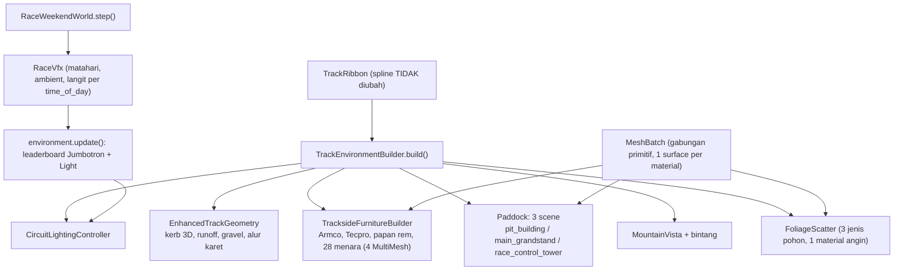

# LAPORAN EKSEKUTIF FASE 10: UPGRADE LINGKUNGAN SIRKUIT HYBRID PROSEDURAL (APEX RING INTERNATIONAL)

Tugas: `prompt/TASK-TRACK-ENVIRONMENT-HYBRID-PROCEDURAL.md`. Spec: `docs/superpowers/specs/2026-10-22-track-environment-hybrid-procedural-design.md`. Plan: `docs/superpowers/plans/2026-10-22-track-environment-hybrid-procedural-plan.md`. Godot 4.7.2 stable (Forward+ / D3D12), Windows, RTX 3050 Laptop GPU.

## 1. Ringkasan

- Kelima tahap plan dieksekusi berurutan dengan TDD: tiap tahap diawali test yang terbukti **gagal** (RED), baru kode (GREEN). Spline fisika `Curve3D` di `track_circuit.tscn` **tidak disentuh** (dijaga test `#S0`: 303 titik kontrol, lap 4.158,75 m).
- Hasil: asfal cel-shaded dengan grit, kerb 3D sawtooth (+0,05 m), runoff + gravel trap, alur karet pada racing line, Armco/Tecpro/papan rem 150-100-50/28 menara lampu sorot via 4 `MultiMeshInstance3D`, gedung pit 2 lantai + tribun 3 tingkat + Jumbotron + menara kontrol + gantry ganda, cincin gunung R≈1500 m dengan kabut, 1.100 pohon anime dengan goyangan angin, dan pencahayaan Day/Sunset/Night tersinkron dengan `RaceConfigData.time_of_day`.
- Putaran umpan balik (bagian 9, setelah tahap 5): pagar yang menembus jalan di seberangnya dan pagar di dalam pit lane diperbaiki, tiga garis lajur cat dihapus (itu cat koridor sim, bukan livery GT asli), aspal pit lane kini satu material dengan jalan, pit lane dirancang ulang (dinding, fast lane, working lane, box, garasi, jalur masuk/keluar di sisi kanan trek, bukan di racing line), kru 13 orang per tim siaga di garasi lalu keluar saat mobilnya datang, dan minimap HUD memperlihatkan nomor pembalap, sektor S1/S2/S3, mobil yang diikuti, tim pemain, dan bendera kuning per sektor.
- Verifikasi: **`tests/test_track_environment.gd` 40 assertion, 0 FAIL**, **`tests/test_pit_lane.gd` 19**, **`tests/test_circuit_minimap.gd` 7**; **seluruh 20 suite lama 0 FAIL** (bagian 5); smoke native 1080p/High dengan 20 mobil: median 3,0–4,9 ms/frame (206–329 FPS tanpa vsync) sebelum putaran umpan balik, balapan 3 lap penuh selesai (bagian 6).
- Anggaran: estimasi **~108 draw call** main-pass untuk seluruh scene trek (anggaran < 180; ~90 sebelum putaran umpan balik, garasi kini membawa perlengkapan dan kru siaga) dan **~289 ribu segitiga** lingkungan (anggaran < 350 ribu). Semua elemen repetitif memakai MultiMesh (7 node: 4 furnitur + 3 jenis pohon).

## 2. Arsitektur

Urutan per frame: `RaceVfx.update` menulis matahari/ambient/langit dari tabel `GtWeather.time_of_day`; **setelah itu** `environment.update()` memperbarui leaderboard Jumbotron dan menjalankan `CircuitLightingController.apply()` yang menambah kabut, lampu sorot, jendela, papan, kabut gunung, bintang, goyangan angin, serta menggelapkan ambient/bulan/horizon saat malam.

## 3. Berkas

Baru:

| Area | Berkas |
| :--- | :--- |
| Shader | `shaders/road_asphalt.gdshader`, `shaders/anime_cel_vertex_color.gdshader`, `shaders/braking_marker.gdshader`, `shaders/led_jumbotron.gdshader`, `shaders/mountain_haze.gdshader`, `shaders/wind_foliage.gdshader` |
| Geometri permukaan | `scripts/world/enhanced_track_geometry.gd` |
| Utilitas mesh | `scripts/world/mesh_batch.gd` (box, extrude, silinder, truss, strut → satu surface per material) |
| Furnitur | `scripts/world/trackside_furniture_builder.gd` |
| Hero architecture | `scripts/world/paddock/{pit_building,main_grandstand,jumbotron,race_control_tower}.gd`, `scenes/race_world/paddock/{pit_building_structure,main_grandstand,race_control_tower}.tscn` |
| Horizon / vegetasi / cahaya | `scripts/world/mountain_vista.gd`, `scenes/race_world/mountain_vista.tscn`, `scripts/world/foliage_scatter.gd`, `scripts/world/circuit_lighting_controller.gd` |
| Test | `tests/test_track_environment.gd` |
| Putaran umpan balik | `scripts/car/pit_crew_figure.gd` (figur kru low-poly, 7 peran, satu mesh per orang), `tests/test_pit_lane.gd`, `tests/test_circuit_minimap.gd` |

Diubah (seperlunya; cadangan asli di `temp/backup_track_env_20261022/`):

- `scripts/world/track_environment_builder.gd` — orkestrasi builder baru; pohon/guardrail lama diganti.
- `scripts/world/start_gantry.gd` — gantry truss ganda yang menaungi trek + pit lane, lampu FIA tetap 5 pasang (API `set_lights`/`lit_lamp_count` utuh).
- `scripts/world/race_weekend_world.gd` — `environment.bind_world()` dan `environment.update()` setelah `vfx.update()`.
- `scripts/vfx/race_vfx.gd` — material jalan kini memakai `road_asphalt.gdshader` (superset `track_ribbon.gdshader`, uniform `track_wetness`/`rain_intensity` sama).
- `scripts/world/pit_lane_complex.gd` — garasi, service box, dan rambu limit digabung lewat `MeshBatch` (visual identik; 142 → 40 draw call). Nama `Garage%02d`, posisi, dan seluruh API tetap.
- Putaran umpan balik: `pit_lane_complex.gd` ditulis ulang (tata letak melintang baru, aspal bersama, dinding, marka, perlengkapan garasi, kru siaga); `pitstop_choreographer.gd` (kru persisten per tim); `gt_driving.gd` (lintasan pit memakai `PitLaneScript.lane_lateral_at`); `race_weekend_world.gd` (`_update_pit_crews`); `race_vfx.gd` (aspal pit memakai material cuaca jalan); `broadcast_camera_director.gd` (`PIT_CAM_OFFSET`); `paddock/pit_building.gd` (kanopi/teras relatif ke muka garasi); `enhanced_track_geometry.gd`, `trackside_furniture_builder.gd`, `track_environment_builder.gd` (pagar); `track_ribbon.gd` (garis lajur cat dihapus); `circuit_radar_2d.gd` dan `race_hud.gd` (minimap).
- `scripts/world/toon_materials.gd` — `vertex_colored()`, `glass()`, `set_glow_energy()`.
- `scripts/core/presentation_settings.gd` — 3 baris di `_apply_light`: lampu ber-meta `no_shadow` tidak pernah diberi bayangan (lihat bagian 4).

Tidak diubah: `track_circuit.tscn`, `assets/shaders/track_ribbon.gdshader` (test #19 `test_weather_and_ai` membaca teksnya), seluruh test lama.

## 4. Keputusan dan deviasi dari plan (semuanya tercatat di ledger kerja)

| Keputusan | Alasan | Biaya bila salah |
| :--- | :--- | :--- |
| Tanpa worktree/commit | Repo belum punya satu commit pun | Tidak ada; pemilik commit sendiri |
| Test mengikuti konvensi repo (`SceneTree`, `check()`), bukan gdUnit4 | Ke-20 suite lama memakai pola itu | — |
| Alur karet = strip mesh yang mengikuti `AdaptiveRacingLine.target_offset`, bukan uniform shader | Mesh jalan `TrackRibbon` tidak punya UV/data garis; mengubahnya di luar lingkup | Intensitas alur diatur lewat konstanta geometri, bukan uniform shader |
| Garis tepi putih = cat vertex-color yang sudah ada di `TrackRibbon` + keausan cat di shader | Garis tepi sudah ada pada mesh | — |
| Kerb mulai 0,2 m di dalam tepi aspal, crest 0,05 m di 0,4 m, chamfer 0,5 m | Menjaga ground clearance +0,05 m | — |
| Runoff/gravel dipotong bila jalur lain lebih dekat dari `2×half+3 m`, dan ditutup di sisi kanan antara Pit Entry−20 m dan Pit Exit+40 m | Dua tikungan memiliki jalur lain 2–5 m dari pita luar; pit lane ada di sisi luar tikungan terakhir | Tikungan s≈4113 tanpa gravel |
| Armco dilangkahkan menurut panjang rel sebenarnya, dan bergeser keluar di belakang gravel trap | Langkah per centerline menyisakan celah 5,4 m di luar tikungan ketat | — |
| Tecpro di Turn 1, tikungan terketat (hairpin), dan **setiap** pasangan chicane (terdeteksi dua) | Spec hanya menyebut "chicane akhir" | Blok busa ekstra di satu chicane |
| Papan rem di sisi dalam tikungan, 2,5 m dari tepi jalan | Spec tidak menyebut sisi | — |
| Tribun utama di sisi kiri **lintasan lurus start** (s 5–245), bukan tepat di depan garasi | Garasi hanya berada pada ruas lurus ±126 m; satu-satunya ruas lurus 240 m ada di start straight | Tribun menghadap sisi pit-exit, bukan deretan garasi |
| Gedung pit = lantai 2 di atas atap garasi + shutter di fasad; modul garasi tetap milik `PitLaneComplex` | Menghindari duplikasi 10 garasi | Nomor stall tidak digambar (pelat nama tim sudah ada) |
| Jumbotron menggambar bar/chip warna tim per baris (tanpa glyph teks) | Satu draw call, data dari `race.standings()` tiap 0,5 s | Tidak ada nama/waktu teks pada layar |
| Penonton = 1.484 figur low-poly MultiMesh, bukan billboard 2,5D | Cukup terbaca dari kamera balap, biaya satu draw call | — |
| 6 `SpotLight3D` mengikuti menara terdekat kamera, bukan 28 lampu nyata | 28 lampu Forward+ terlalu mahal; sisanya lensa emisif | Menara jauh tidak menerangi aspal |
| `presentation_settings._apply_light` menghormati meta `no_shadow` | `apply_to_tree` menyalakan bayangan di SEMUA `Light3D` pada preset ≥ MEDIUM → 6 shadow map spot | Satu cabang `if` tambahan di kode pengaturan |
| Kelembutan bayangan matahari dibiarkan milik `PresentationSettings` | Preset kualitas pemain berhak menentukan | Bayangan siang tidak "tajam" pada High |
| Malam digelapkan oleh controller **setelah** `RaceVfx` menulis nilainya (ambient ×0,5, bulan ×0,6, horizon −60%) | `RaceVfx` menimpa nilai itu tiap frame; tanpa ini malam terlalu terang untuk lampu sorot | Malam lebih gelap daripada sebelum fase ini |
| Test MultiMesh membaca pose yang disimpan builder (`*_transforms`) | Godot `--headless` mengembalikan transform nol dari MultiMesh | Test mempercayai pembukuan builder untuk pose (geometri mesh tetap dibaca dari `ArrayMesh`) |
| `visibility_range` per-node tidak dipakai untuk papan rem; kamera `far` tetap 3.500 m | Jarak diukur ke pusat AABB seluruh lap sehingga seluruh MultiMesh ter-cull; cincin gunung + bintang butuh far ≥ 3.200 m | Culling jarak 250 m / 1.800 m pada spec tidak diterapkan (27 papan: biaya diabaikan) |
| Jumlah pohon 1.100, bukan 1.500 | Menjaga anggaran segitiga setelah Armco 2.000 pos | — |
| Bukaan Armco di pit mengikuti logika lama (Pit Entry−20 m s.d. Pit Exit+40 m ≈ s 3.880–171) | Angka spec (≈3.920 / ≈280) adalah aproksimasi; bukaan lama sudah teruji | — |

## 5. Verifikasi headless

Perintah per suite (identik dengan baseline sebelum fase): `godot --headless --path . -s res://tests/<suite>.gd` (`test_race_world` dengan `--fixed-fps 60`; `test_race_weekend_and_physics` dengan `-- --skip-legacy` karena suite lamanya dijalankan satu per satu di tabel ini). Godot console: `Godot_v4.7.2-stable_win64_console.exe`. Hasil baseline sebelum perubahan apa pun: ke-20 suite lama exit 0, 0 FAIL.

| Suite | Assertion PASS | FAIL | Exit |
| :--- | ---: | ---: | ---: |
| `test_track_environment` (**baru**; 37 di tahap 5, 40 setelah umpan balik) | 40 | 0 | 0 |
| `test_pit_lane` (**baru**, putaran umpan balik) | 19 | 0 | 0 |
| `test_circuit_minimap` (**baru**, putaran umpan balik) | 7 | 0 | 0 |
| `test_aston_vantage_chassis` | 18 | 0 | 0 |
| `test_audio_and_race_weekend` | 35 | 0 | 0 |
| `test_audi_r8_chassis` | 17 | 0 | 0 |
| `test_bmw_m4_chassis` | 18 | 0 | 0 |
| `test_car_dynamics_vfx` | 18 | 0 | 0 |
| `test_chevy_corvette_chassis` | 18 | 0 | 0 |
| `test_gt_sim` | 43 | 0 | 0 |
| `test_honda_nsx_chassis` | 18 | 0 | 0 |
| `test_lambo_huracan_chassis` | 18 | 0 | 0 |
| `test_lexus_rcf_chassis` | 18 | 0 | 0 |
| `test_main_menu_flow` | 64 | 0 | 0 |
| `test_mclaren_720s_chassis` | 18 | 0 | 0 |
| `test_modular_car` | 18 | 0 | 0 |
| `test_nissan_gtr_chassis` | 18 | 0 | 0 |
| `test_pit_wall` | 26 | 0 | 0 |
| `test_race_hud` | 31 | 0 | 0 |
| `test_race_weekend_and_physics` | 30 | 0 | 0 |
| `test_race_world` | 65 | 0 | 0 |
| `test_simulation_verification` | 43 | 0 | 0 |
| `test_weather_and_ai` | 43 | 0 | 0 |

**20 suite lama + 3 suite baru: 0 FAIL** (regresi penuh dijalankan ulang setelah putaran umpan balik; `test_audio_and_race_weekend` dijalankan ulang sendiri setelah penyesuaian kamera pit, lihat bagian 9.7). Angka per suite lama identik dengan baseline.

Keluaran `tests/test_track_environment.gd` pada tahap 5 (37 assertion; putaran umpan balik menambah #B1, #B2, #S10):

| # | Yang dibuktikan |
| :--- | :--- |
| S0–S9 | Spline tak berubah (303 titik, 4.158,75 m); asfal Y = 0,0 m (cat maks 0,03 m); `road_asphalt.gdshader` aktif dengan uniform cuaca + grit + keausan cat; kerb 3D crest 0,05 m, normal menghadap atas; runoff + gravel `#A69477` di luar tikungan (8 tikungan; tikungan yang sisi luarnya pit lane sengaja tanpa), tak pernah menutupi aspal; alur karet mengikuti racing line (selisih < 0,35 m) |
| M1–M4 | `MeshBatch`: 1 surface per material, winding clockwise dengan normal keluar, extrusion dua arah profil, end cap |
| F1–F6 | 4 MultiMesh furnitur; Armco kontinu (pos ≤ 4,0 m setelah umpan balik; sebelumnya 4,6 m) kecuali satu bukaan pit 472 m, 1.985 pos, di belakang gravel trap; papan 150/100/50 m di depan ke-9 apex; 28 menara 18 m, ≥ 58 m satu sama lain, ≥ 15 m dari asfal; 176 blok Tecpro di Turn 1, hairpin, dan chicane |
| H1–H7 | Tiga scene paddock; gedung pit 141 m dengan kaca tinted dan (setelah umpan balik) berdiri di belakang working lane, lateral 18,1–30,9 m; tribun 243 m, 3 tingkat, atap 29,6 m (terendah 17,8 m), 1.484 penonton, Jumbotron menghadap trek; menara 4 lantai, 28,1 m; gantry truss ganda 27,5 m; 5 pasang lampu FIA tetap berfungsi; leaderboard mengikuti klasemen live |
| V1–V2, T1–T2 | Cincin gunung 1.250–1.500 m, puncak 470 m, shader kabut; 900 bintang (tak terlihat siang); 1.100 pohon tiga jenis berbagi satu material angin; spasi Poisson ≥ 6 m, ≥ 28 m dari centerline, di luar zona gedung |
| P1–P3 | Estimasi ~90 draw call (< 180) dan 253.413 segitiga (< 350.000) pada tahap 5; **~108 draw call dan 289.197 segitiga** setelah perlengkapan garasi dan kru siaga ditambahkan; semua elemen berulang = MultiMesh |
| L1–L3 | Day: matahari 1,15 / −76°, lampu & jendela mati, tanpa bintang; Sunset: matahari −30° keemasan, lampu menyala bertahap (0,39); Night: glow 4,0, 6 spot light tanpa bayangan, jendela hangat, bintang 1,0 |

Bukti RED: tiap tahap dijalankan dulu terhadap kode kosong dan gagal untuk alasan yang benar (6 FAIL tahap 1, 9 FAIL tahap 2, 6 FAIL tahap 3, 7 FAIL tahap 4). Untuk #P1/#P2 bukti RED adalah probe statis sebelum optimasi: **193 draw call dan 349.804 segitiga** (batas 180 / 350.000).

## 6. Performa

Skrip ukur: `temp/perf_smoke.gd` (SceneTree, bukan headless). Kondisi: Godot 4.7.2, D3D12, **NVIDIA GeForce RTX 3050 Laptop GPU**, window 1920×1080 (area render 1920×1055), preset kualitas **High**, 20 mobil, kamera chase mobil pemain, balapan dimulai dari grid (mobil paling rapat), `vsync` mati agar angka menunjukkan kemampuan mesin. Editor Godot terbuka di latar belakang.

Jendela 60 detik, kecepatan 1×:

| Kondisi | Frame (ms) median | p95 | p99 | Maks | FPS median | Frame > 16,67 ms | Draw call/frame median (p95) |
| :--- | ---: | ---: | ---: | ---: | ---: | ---: | ---: |
| Day | 3,04 | 8,25 | 10,38 | 42,5 | 329 | 0,05 % | 521 (1.662) |
| Sunset | 3,60 | 8,12 | 9,72 | 45,0 | 278 | 0,04 % | 581 (1.676) |
| Night | 3,72 | 7,99 | 9,79 | 46,1 | 269 | 0,04 % | 674 (1.766) |
| Monsoon Night | 4,87 | 9,75 | 11,15 | 48,2 | 206 | 0,06 % | 580 (1.786) |

Balapan penuh **3 lap, 20 mobil, Day, kecepatan 8×** sampai chequered flag (34,3 detik, 5.651 frame): median **4,15 ms**, p95 **12,94 ms**, p99 15,36 ms, 0,78 % frame > 16,67 ms (kecepatan 8× menjalankan 8× tick simulasi per frame, jadi ini batas atas beban CPU).

Dengan `vsync` menyala layar laptop ini berjalan ±144 Hz: Day median 6,80 ms (147 FPS), Monsoon Night 6,83 ms (146 FPS), p99 12,7 ms. Artinya 60 FPS terkunci dengan margin besar; angka 16,668 ms pada fase 9 berasal dari scene garasi yang berbeda.

**Spike > 20 ms**: ada 4–6 frame tunggal per menit (maks 42–62 ms) pada tiap kondisi, bukan terus-menerus. Untuk memastikan penyebabnya bukan fase ini, jalankan yang sama dengan **kode asli** (berkas lama dari `temp/backup_track_env_20261022/` dipasang sementara, lalu dikembalikan dan dicek hash-nya): Day median 3,45 ms / 12 spike, Night median 3,50 ms / 7 spike, dengan spike di detik yang sama (3,8 s; 28,8 s; 31,4 s; 53,8 s; 56,5 s). Jadi spike sudah ada sebelum fase ini (kompilasi pipeline pertama pada 3,8 s, aktivitas latar belakang); kriteria spec "tanpa spike di atas 20 ms" **tidak terpenuhi secara harfiah** pada mesin ini, baik sebelum maupun sesudah fase.

Anggaran spec:

| Parameter | Anggaran | Terukur |
| :--- | :--- | :--- |
| Draw call scene trek (jalan, lingkungan, pit lane, gantry; estimasi main-pass statis di `test_track_environment` #P1) | < 180 | **~90** (sebelum optimasi 193; pit lane 142 → 40) |
| Segitiga lingkungan (#P2) | < 350.000 | **253.413** |
| Elemen repetitif via MultiMesh (#P3) | semua | 7 `MultiMeshInstance3D`, 0 mesh tunggal pada furnitur/pohon |
| Draw call seluruh frame (`RenderingServer`, termasuk 20 mobil, bayangan 4 cascade, HUD) | tidak dianggarkan | median 500–670, p95 ±1.700 (kode asli: median 508–616, p95 1.654–1.760) |
| Segitiga per frame (primitif `RenderingServer`) | tidak dianggarkan | median 2,0–2,4 juta (kode asli 1,9–2,1 juta) |
| Waktu bangun dunia (`RaceWeekendWorld._ready`, termasuk lingkungan, headless) | — | ±200–240 ms |

## 7. Bukti visual

Disimpan di `executor-report/screenshots/phases/` (1920×1055, HUD balapan disembunyikan, panel radio engineer tetap tampil):

| Kondisi | Tikungan + gravel | Tribun + Jumbotron | Gantry + tribun | Cakrawala |
| :--- | :--- | :--- | :--- | :--- |
| Day | `phase-10-day-corner.png` | `phase-10-day-grandstand-far.png` | `phase-10-day-gantry-wide.png` | `phase-10-day-vista-n.png` |
| Sunset | `phase-10-sunset-corner.png` | `phase-10-sunset-grandstand-far.png` | `phase-10-sunset-gantry-wide.png` | `phase-10-sunset-vista-n.png` |
| Monsoon Night | `phase-10-monsoon-night-corner.png` | `phase-10-monsoon-night-grandstand-far.png` | `phase-10-monsoon-night-gantry-wide.png` | `phase-10-monsoon-night-vista-n.png` |

Dibuat dengan `temp/capture_env.gd` (GPU, bukan headless): `--tod 0|1|2 --weather 0|3`. Monsoon Night memakai preset cuaca 3 (hujan lebat, genangan, riak) dengan `time_of_day = 2`.

## 8. Batasan yang diketahui

- Culling jarak untuk elemen kecil (spec 3.4 / anggaran) tidak diterapkan; lihat bagian 4.
- Teks pada Jumbotron tidak digambar. (Nomor box kini digambar di aspal pit lane sejak putaran umpan balik, bagian 9.)
- `anime_cel_vertex_color` memakai flat normal sehingga outline inverted-hull pada kotak besar tampak putus di sudut; outline dipakai hemat (gedung pit, tribun, menara, gantry).
- Hasil FPS diukur pada window 1080p (bukan fullscreen eksklusif) dengan editor Godot terbuka di latar belakang.
- Kriteria "tanpa spike di atas 20 ms" tidak terpenuhi secara harfiah pada mesin ini (4–6 frame tunggal per menit); penyebab sudah ada di kode asli (bagian 6).
- `.uid` untuk skrip/shader baru dibuat oleh `godot --headless --path . --import`; repo belum punya commit sehingga tidak ada yang di-commit.

## 9. Putaran umpan balik (setelah tahap 5, sebelum laporan ini difinalkan)

Pengguna menguji hasil tahap 5 dan memberi empat kelompok umpan balik: (1) minimap di HUD harus menampilkan nomor pembalap dan sektor dengan jelas, (2) pagar saling menembus jalan di seberangnya pada bagian sempit di sisi kanan trek, (3) pertanyaan tentang tiga garis lajur, warna aspal pit yang tidak menyatu dengan trek, jalur keluar pit yang menyambung ke garis tengah, dan pagar pit yang berdiri di tengah jalur, (4) penyempurnaan pit lane secara menyeluruh (paddock, pit lane, pagar, entry/exit lane, lebar celah ke pit box, kru pit yang lengkap dan siaga, adegan pit stop yang realistis). Spline `Curve3D` tetap tidak disentuh (#S0 hijau).

### 9.1 Jawaban atas pertanyaan

| Pertanyaan | Jawaban |
| :--- | :--- |
| Mengapa trek tetap punya tiga garis? Apakah trek GT memang begitu? | **Tidak.** Sirkuit GT/balap sungguhan hanya punya garis tepi putih dan garis start/finish. Tiga garis di tengah adalah cat untuk tiga koridor lajur sim (`TrackRibbon.get_point_on_ribbon(lane 0..2)`) sejak fase awal. Cat dihapus dari `track_ribbon.gd`; koridor lajur tetap ada sebagai data untuk sim. Dijaga test #S10 (0 vertex garis lajur; garis tepi putih 16.656 vertex tetap ada). |
| Warna aspal pit tidak menyatu dengan trek | Aspal pit memakai material cel `#3C3F4A` yang jauh lebih gelap daripada shader jalan. Kini aspal pit memakai `road_asphalt.gdshader`, warna vertex `#2A2C33` yang sama dengan jalan, dan pada frame pertama `RaceVfx` memberinya **objek material yang sama** dengan jalan, sehingga basah, genangan, dan riak hujan identik (#A1, #A2). |
| Keluar dari pit apakah menyambung ke garis tengah? | Ya, dan itu salah: pusat lane menuju lateral 0 (racing line) di Pit Entry dan Pit Exit, dan sim menyetir mobil ke 0. Kini lane meninggalkan dan bergabung kembali di **lateral 5,2 m (separuh kanan trek)** sepanjang rampa 80 m (masuk) dan 90 m (keluar), kemiringan maksimum 0,120 m/m. Mobil sim memakai kurva yang sama (`PitLaneScript.lane_lateral_at`); terukur dalam stop nyata: lateral terendah di lane 5,20 m dan 5,20 m saat bergabung (#L4, #L5, #C6). |
| Pagar pit berada di tengah jalur | Pagar tangkap luar mengabaikan bukaan pit: probe menemukan **47 tiang pagar di dalam pit lane**. Pagar kini hanya berdiri di tempat ada barisan penghalang (`has_barrier_row_at`) dan dinding pit baru berdiri di verge antara trek dan fast lane (#B2, #W1). |

### 9.2 Pagar yang menembus jalan di seberangnya

Akar masalah (probe di `temp/probe_overlap.gd`, `probe_narrow.gd`): di sekitar (1205, −380) dua ruas jalan hanya berjarak 22,3 m antar centerline (s≈1564 dan s≈2580; juga s≈1500–1660 terhadap 2490–2630), sedangkan rel Armco berdiri tetap 11,5 m di tiap sisi, sehingga rel kedua ruas saling menyilang dan sebagian melewati badan jalan di seberang. Perbaikan di `enhanced_track_geometry.gd`: `max_extent()` mengukur jarak terjauh rel tetap di sisinya sendiri dari celah ke jalan lain (cincin 0,25 m, jarak minimum 1,2 m, ruang pagar 1,8 m); lebar runoff/gravel dan jarak rel di `trackside_furniture_builder.gd` (dilebur, dihaluskan, lalu diklem titik demi titik) memakainya, dan Tecpro serta pagar tangkap ikut hanya di tempat barisan penghalang benar-benar ada. Tiang Armco dibagi rata (jarak ≤ 4,0 m, lap kiri tertutup). Hasil: #B1 (2.525 tiang diperiksa, tidak ada yang melewati tengah celah ke jalan lain), #B2 (tidak ada pagar di dalam pit lane), #F2 dan #F3 tetap hijau.

### 9.3 Tata letak pit lane baru (lateral dari centerline, + = kanan arah jalan)

| Elemen | Lateral | Keterangan |
| :--- | ---: | :--- |
| Tepi trek | 7,00 | garis tepi putih di 6,7 |
| Verge | 7,00–8,25 | 1,25 m antara tepi trek dan dinding |
| Dinding pit (beton) | 8,50 | tebal 0,5 m, tinggi 1,1 m, ujung berupa crash cushion merah/putih (2 buah); hanya ada di mana lane sudah cukup jauh dari trek (93 potong) |
| Fast lane | 9,30–13,90 | lebar 4,6 m; jalur mobil di 11,6; garis kuning pembatas kecepatan di tepi kiri, garis putih di kanan |
| Garis pemisah putih | 13,90 | memisahkan fast lane dari working lane di depan sepuluh box |
| Working lane | 13,90–20,05 | aspal selalu sampai fascia, termasuk box 0–4 yang berdiri di rampa masuk (bug ditemukan lewat capture native, #A3) |
| Mobil di box | 17,00 | kotak cat 3,3 × 6,4 m berwarna tim, garis putih, bar kuning hidung, nomor box 7-segmen di tanah |
| Fascia garasi / muka garasi | 20,05 / 20,60 | gedung pit, kanopi, dan teras kini relatif terhadap muka garasi (`pit_building.gd`) |

Celah yang diminta: mobil melintas di fast lane ke mobil di box **3,30 m** (≥ 3,0, #L2); ruang kru **2,05 m** di sisi lane dan **2,00 m** di sisi garasi (≥ 1,8, #L3); dinding ≥ 1,0 m dari tepi trek dengan verge 0,55 m ke fast lane (#L1). Sebelumnya celah mobil-lewat ke mobil-box hanya 1,0 m dan ruang kru negatif (−1,45 m). Tanda batas 80 km/jam di tiang dinding, papan PIT LANE dan PIT EXIT, dan garis stop kuning di Pit Entry/Exit ditambahkan.

### 9.4 Perlengkapan garasi dan kru

- Tiap garasi kini berisi: 4 tumpukan ban (warna senyawa soft/medium/hard/wet), rak 4 wheel gun dengan selang, 2 hydraulic jack, rig bahan bakar, 2 pemadam, meja monitor dengan 3 layar dan 2 insinyur, kotak perkakas, bendera tim, dan 3 lampu bar (#E1).
- Kru **13 orang per tim**: 4 wheel-gun, 4 penangan ban, 2 jack, 1 fueler, 1 petugas pemadam, 1 lollipop (`ROSTER` di `pitstop_choreographer.gd`). Mereka berdiri siaga di garasi sebagai satu mesh statis (`StandbyCrew`, satu draw call per garasi, #C1). Saat mobil timnya datang (permintaan pit dan ≤ 300 m dari Pit Entry, atau di jalur masuk/lane/box) orang-orang yang sama berjalan keluar lewat koridor di depan hidung atau ekor box, menunggu di working lane, memutar menghadap mobil (#C2); setelah mobil berhenti mereka melangkah ke roda (wheel gun mengikuti soket roda nyata, #C5) dan setelah mobil pergi mereka mundur lalu berjalan pulang, nodenya dibebaskan dan garasi menampilkan kru berdirinya lagi (#C3). Posisi tunggu menjauhi lintasan mobil yang berbelok masuk: jarak terdekat 1,00 m terukur dalam stop nyata (#C4).
- Bug yang ditemukan lewat test #C5: soket "front left" model mobil berada di sisi +x (kanan arah jalan), sehingga pemetaan sudut-ke-orang harus mengikuti soket nyata, bukan nama sudut (`_assign_corners`).
- Kamera pit close-up dipindahkan ke atas sudut depan sisi lane box (`PIT_CAM_OFFSET` (−2,4; 3,3; −3,8), tetap < 6 m dari box, test #26) karena 13 kru menutupi kamera lama.

### 9.5 Minimap HUD

Panel tetap 300×200 px di (1604, 88): kolom kanan tidak punya ruang tambahan (telemetri 496 px di bawahnya, deck di y = 880, dan test_audio #30 menjaga banner radio tetap bebas dari panel). Isi panel yang ditambahkan (`circuit_radar_2d.gd`; data digambar dari `marks`/`bands`/`ticks`/`chips` sehingga bisa diuji tanpa frame):

- Setiap mobil adalah cakram warna tim 16 px dengan **nomor mobil** 11 px (kontras otomatis dengan warna tim); mobil yang diikuti 22 px dengan cincin putih dan halo, mobil tim pemain bercincin kuning, mobil di pit bercincin cyan putus-putus, mobil gugur abu-abu; urutan gambar menaruh mobil yang diikuti di atas dan pemimpin di atas yang lain (#R1, #R3).
- Lap dibagi **tiga pita sektor** (sepertiga panjang trek sim, aturan sektor sim sendiri) berwarna cyan / putih / oranye, berlabel S1 S2 S3, dengan tanda garis start (kotak-kotak) dan dua tanda batas sektor (#R2).
- Strip di bawah peta: tiga chip S1 S2 S3 berwarna hasil sektor mobil yang diikuti (ungu terbaik keseluruhan, hijau terbaik pribadi, kuning, kosong), chip sektor yang sedang dilewati diberi bingkai putih, dan nama mobil `#NN KODE` (#R4).
- Bendera kuning di sektor N menyalakan pita dan chip sektor N dengan warna kuning dan hilang bersama bendera (#R5).
- Pemanggil lama yang hanya mengirim `car_id`, `team_id`, `spline_distance` tetap mendapat dot bernomor (`car_id + 1`) dan strip sektor (#R6); ukuran panel tidak berubah (#R7).

### 9.6 Berkas test baru dan bukti RED/GREEN

| Test | Isi | Bukti |
| :--- | :--- | :--- |
| `test_track_environment` #B1, #B2, #S10 (40 total) | pagar tidak melewati tengah celah ke jalan lain; tidak ada pagar di pit lane; tidak ada garis lajur | ditulis dulu; RED terhadap kode tahap 5 (probe: 47 tiang pagar di pit lane, rel menyilang di s≈1564/2580, garis lajur ada) lalu hijau |
| `test_pit_lane` #L1–L5, #A1–A3, #W1–W2, #M1–M2, #E1, #C1–C6 (19) | celah, entry/exit di 5,2 m, aspal dan material, dinding dan cushion, marka, perlengkapan, kru, stop nyata di dunia | ditulis dulu: **15 FAIL** pada kode lama; #A3 RED terpisah (aspal terlalu pendek di box [0, 1, 2, 3]) sebelum perbaikan `lane_edges()`; #C5 gagal (0 dari 4) sampai pemetaan soket diperbaiki |
| `test_circuit_minimap` #R1–R7 (7) | nomor, sektor, mobil yang diikuti, chip, bendera kuning, pemanggil lama, ukuran panel | ditulis setelah implementasi (propertinya belum ada sebelumnya, jadi tidak ada RED terpisah yang diamati); hijau pada percobaan pertama |

Regresi penuh sesudah semua perubahan: 20 suite lama + `test_track_environment` + `test_pit_lane` + `test_circuit_minimap`, 0 FAIL (tabel bagian 5). Satu kegagalan sementara muncul di `test_race_weekend_and_physics` #26 (dan turunannya di `test_audio_and_race_weekend` #20) ketika kamera pit pertama dipindahkan lebih dari 6 m dari box; offset dikoreksi (bagian 9.4), kedua suite dijalankan ulang dan hijau.

### 9.7 Bukti visual putaran umpan balik

Di `executor-report/screenshots/phases/` (dibuat dengan `temp/capture_pit.gd` dan `temp/capture_env.gd`, GPU):

| Berkas | Isi |
| :--- | :--- |
| `phase-10-feedback-pit-crew-ready.png` | kru 13 orang menunggu di working lane di samping box tim, aspal pit menyatu dengan trek |
| `phase-10-feedback-pit-stop-service.png` | stop berlangsung: wheel gun dengan percikan, jack, lollipop, penangan ban |
| `phase-10-feedback-pit-closeup-hud-minimap.png` | kamera pit close-up baru bersama HUD, minimap dengan nomor, sektor, dan chip |
| `phase-10-feedback-minimap-zoom.png` | minimap diperbesar 3× (nomor di dot, pita S1/S2/S3, chip, nama mobil) |
| `phase-10-feedback-pit-lane-aerial.png`, `phase-10-feedback-pit-entry.png` | lane keluar dari separuh kanan trek, dinding dengan crash cushion, kotak box bernomor |
| `phase-10-feedback-narrow-gap-barriers.png` | dua ruas jalan yang berdekatan, rel masing-masing di sisinya sendiri |

Performa native setelah putaran umpan balik (`temp/perf_smoke.gd`, kondisi bagian 6, Day, 60 detik, 1×, vsync mati): median **3,35 ms** (298 FPS; sebelum putaran umpan balik 3,04 ms), p95 9,42 ms, p99 11,72 ms, 0,07 % frame > 16,67 ms, draw call median 578 (p95 1.730). Tujuh frame > 20 ms terjadi di detik yang sama dengan kode asli (3,8 s; 28,8 s; 31,4 s; 53,8 s; 56,5 s), jadi sumbernya tetap bukan fase ini.

Catatan jujur: pada pengambilan gambar pertama working lane tampak berumput di depan box 0–3. Itu bug nyata (aspal terpotong selama rampa masuk), ditemukan lewat capture native dan diperbaiki dengan #A3; capture ulang menunjukkan aspal penuh.

### 9.8 Keputusan putaran umpan balik

| Keputusan | Alasan | Biaya bila salah |
| :--- | :--- | :--- |
| Tiga garis lajur dihapus, bukan dipertahankan sebagai marka | Sirkuit GT asli tidak punya garis itu | Koridor sim tidak terlihat lagi (datanya tetap ada) |
| Mobil bergabung ke trek di lateral 5,2 m, bukan di racing line | Lane pit di sirkuit nyata keluar di tepi trek; 5,2 m masih di separuh kanan | Mobil keluar pit lebih ke kanan daripada garis ideal sampai pengendali sim menggesernya |
| Minimap tetap 300×200 px | Tidak ada ruang vertikal di kolom kanan dan test_audio #30 | Dot padat saat peloton rapat (mis. 19 mobil dalam 600 m) menumpuk dan sebagian nomor tertutup |
| Kru jalan keluar saat mobil mendekat, tidak hanya muncul saat mobil berhenti | Kru nyata menunggu di depan garasi | Kru berdiri di working lane lebih lama dan menambah beberapa ms CPU hanya saat ada tim yang sedang pit |
| Kru siaga digambar sebagai satu mesh statis per garasi, dan orang yang sama dianimasikan sebagai node terpisah saat keluar | Satu draw call per garasi di kondisi biasa (estimasi ~108 draw call total, < 180) | Dua representasi kru harus tetap sinkron (posisi awal rute = posisi siaga) |
| Posisi tunggu kru menjauhi lintasan belok-masuk, lalu melangkah ke posisi kerja setelah mobil berhenti | Kru di posisi kerja menabrak mobil yang berbelok masuk dari fast lane | Kru melangkah ±1 m saat mobil berhenti (0,6 detik) |
| Dinding pit hanya berdiri di mana lane sudah ≥ 1,1 m dari tepi trek (93 potong), dengan crash cushion di kedua ujung | Dinding tidak boleh berdiri di lajur mana pun, termasuk rampa masuk/keluar | Tidak ada dinding di sekitar box 0–2 yang berdiri di rampa |

### 9.9 Batasan yang diketahui setelah putaran umpan balik

- Dot minimap yang saling menumpuk di peloton rapat tidak dipisahkan (tidak ada tolak-menolak); nomor yang tertutup tetap terbaca di timing tower.
- State machine dan profil kecepatan pit sim tidak diubah, hanya lateral kurva lane; mobil keluar pit tidak mengalah pada mobil di trek (di luar lingkup).
- Kru 13 orang berjalan, berdiri, dan bekerja, tetapi tanpa animasi berjalan bergaya (hanya ayunan langkah sederhana) dan hanya penangan ban yang membawa prop ban baru.
- Bidikan "walkout" dari `temp/capture_pit.gd` (kamera berada di dalam gedung) tidak disertakan dalam bukti visual.
- Pengukuran performa native setelah putaran umpan balik hanya diulang untuk kondisi Day (60 detik, tanpa pit stop berlangsung); Sunset, Night, Monsoon Night, dan balapan 3 lap 8× tidak diulang (bagian 6 berlaku untuk kondisi itu).
