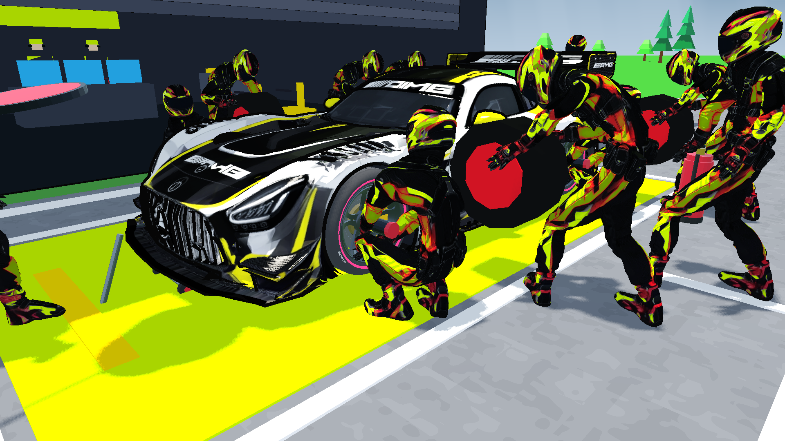
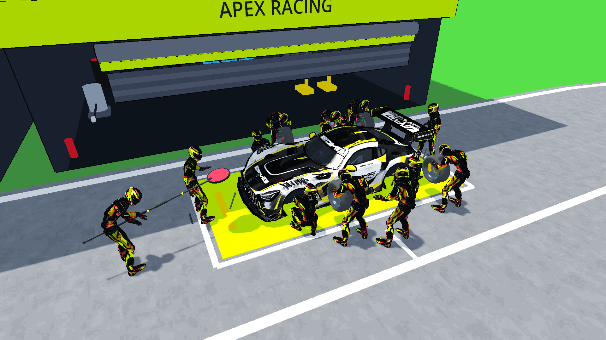
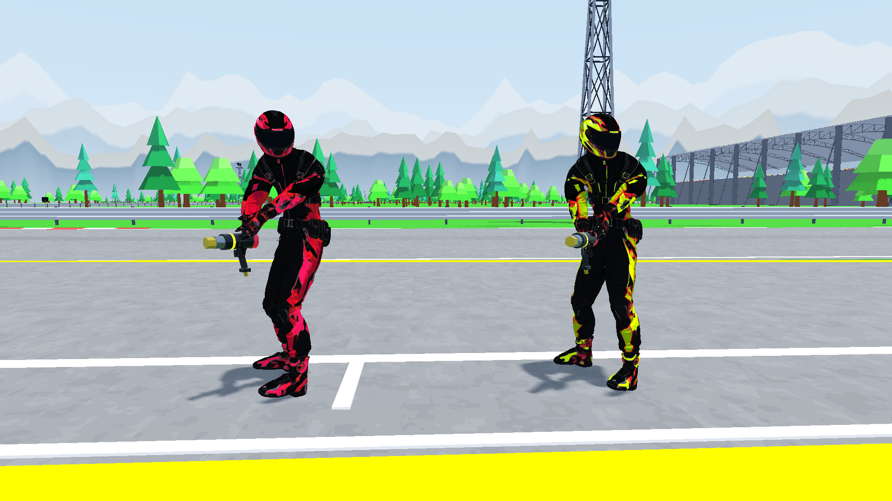

# FASE 11 / LANGKAH 4 — Pit Crew 3D Rigging, Animated Mechanics & Visual Proof

## 1. Executive Summary & Goals

Kalibrasi visual, smoke fungsional, dan regresi akhir telah terverifikasi: **33 suite assertion PASS, 0 FAIL; seluruh proses keluar dengan kode 0**. Warning/resource error pada dua suite dicatat terpisah di bagian 5; hasil ini bukan klaim engine-clean shutdown untuk seluruh headless matrix.

**Pengecualian yang disetujui pengguna:** lingkup visual/fungsi boleh ditutup dengan gate performa 60 FPS tetap terbuka. Laporan ini tidak menyatakan “60 FPS locked”, “zero overhead”, atau seluruh performance DoD terpenuhi.

Tujuan pekerjaan: 13 kru per tim berpijak pada aspal, perkakas mengikuti grip yang dapat dijangkau, gunner melayani hub roda aktual, handler membawa ban tanpa mengisi tangan gunner, serta dongkrak mengikuti lift sasis. HUD tidak diubah. Master GLB, tekstur, shader sumber, dan lima GLB props tidak ditimpa atau diregenerasi. Tidak ada dependensi atau biaya generasi baru.

## 2. Aset 3D, Rigging, dan Animasi

Hitungan berikut dibaca dari accessor indeks GLB, bukan estimasi laporan generasi sebelumnya.

| Aset runtime | Segitiga | Surface | Pemakaian |
| --- | ---: | ---: | --- |
| `assets/characters/pitcrew/pitcrew_master.glb` | 16.443 | 1 | Master bersama; 24 bone, `RightHand` index 23 |
| `assets/props/wheel_gun.glb` | 416 | 6 | Empat gunner |
| `assets/props/quick_jack.glb` | 552 | 5 | Dongkrak depan dan belakang saat job aktif |
| `assets/props/fuel_nozzle.glb` | 768 | 5 | Fueler |
| `assets/props/lollipop_board.glb` | 728 | 6 | Pengendali release |
| `assets/props/fire_extinguisher.glb` | 476 | 5 | Fire marshal |

Master lebih tinggi daripada target referensi awal 6.000–9.000 tris; aset yang diterima berisi 16.443 segitiga setelah triangulasi. Retopologi bukan bagian patch ini dan GLB asli dipertahankan.

Empat aksi yang dipakai: `idle`, `walk`, `run`, `tire_service`. Import juga menyertakan `Armature|clip0|baselayer`; aksi tambahan tersebut tidak dipanggil choreographer. Bone menggunakan satuan sentimeter di bawah armature berskala 0,01; root instance dan geometry mesh menggunakan skala 1. Empat klip dibuat looping dan transisi menggunakan blend 0,18 detik.

PBR lokal beresolusi **2048×2048**, bukan 4K: `textures/base_color.png`, `normal.png`, `metallic.png`, `roughness.png`. Uniform runtime mengikat albedo dan normal; metallic/roughness tidak ditambahkan sebagai sampler uniform baru. Tekstur default hasil ekstraksi master tetap merupakan dependency import GLB. Paket gabungan `pit_equipment_pack.glb`, klip mentah, unduhan Meshy, dan tooling generasi sebelumnya tidak dibutuhkan runtime patch ini.

## 3. Implementasi Kalibrasi

Target produksi: `scripts/car/pitstop_choreographer.gd`.

- **Ground support:** gerak pitch/bob prosedural pada root dihapus agar tidak menumpuk di atas animasi biped. Callback `Skeleton3D.skeleton_updated` menghitung tinggi 16 vertex sol terukur dengan bobot skin asli, lalu mengoreksi Y model. Data vertex/bind dibaca sekali; penyimpanan pose dipakai ulang.
- **Kalibrasi dapat diulang:** `scratch/calibrate_pitcrew_soles.gd` menyampel master yang tidak dimodifikasi pada 30 Hz untuk keempat klip. Hasil sebelum koreksi menunjukkan error sol hingga 0,122339 m. Indeks support terikat pada topologi master ini; resampling wajib jika master diganti.
- **Grip:** `TwoBoneIK3D` bawaan Godot mengarahkan rantai arm–forearm–hand. Modifier torso kecil (`CarryPose`) membuat handler/fueler/lollipop dapat meraih perlengkapan tanpa memiringkan root dan kaki. Fire marshal memegang extinguisher dengan tangan kanan; tangan kirinya bebas.
- **Facing:** yaw `Hips` pada resource animasi runtime dinetralkan karena arah perjalanan dan arah kerja dimiliki root kru. File GLB tidak ditulis ulang. Resource klip dipakai bersama oleh seluruh instance; ini bukan salinan animasi terisolasi per karakter.
- **Gunner:** corner ditentukan dari socket mobil sebenarnya. Posisi kerja mengikuti wheelbase/track tiap sasis, bukan label FL/FR yang diasumsikan. Soket gun mengarah ke pusat roda yang telah diangkat; perpindahan grip ke/dari posisi servis dibaurkan selama 0,18 detik.
- **Handler:** pusat ban berjalan pada Y 0,75 m di depan tubuh. Roda bekas diparent ke `Hands` handler corner yang sesuai, bukan gunner; ban baru disembunyikan ketika handler sudah memegang roda bekas. Skala roda bekas tidak diperkecil secara arbitrer.
- **Dongkrak:** axle berada pada Y 0,05 m, di z ±2,1 m. GLB diputar terhadap axle mengikuti lift, bukan diregangkan secara nonuniform. Jack men dapat meraih handle pada fase pompa awal; saat handle sudah ditekan dan mobil terangkat mereka berdiri clear, tidak dipaksa memegang handle di tanah.
- **Lollipop:** papan berdiri saat dibawa, turun saat lifting, dan kembali naik/membalik ke sisi GO hanya saat release. Material indikator dipakai ulang, tidak dialokasikan lagi setiap update.
- **Uniform:** satu `ShaderMaterial` per warna dalam choreographer, dengan tekstur master bersama. `suit_color_strength=1` dan rim mengikuti warna tim agar tekstur asal tidak mendominasi warna seragam. Boots, belt, visor, serta detail gelap tetap dipertahankan oleh shader yang sudah ada.
- **Penutupan job:** pose servis, grip gun, jack IK, dan papan direset; kru berjalan kembali dan standby garage ditampilkan lagi.

## 4. Bukti Visual Native 1920×1080

Capture menggunakan `RaceWeekendWorld`, actor, wheel scene, rig, shader, dan props runtime asli. Simulasi dibekukan untuk staging melalui `present()`/`advance()`; gambar bukan klaim replay pitstop simulasi. Kamera close-up berada pada arah horizontal 45 derajat di roda depan agar handler tidak menutupi gunner. Overview menggunakan sudut samping tinggi/tiga-perempat untuk mengurangi oklusi kru di sisi jauh.

Pada gambar uniform, hanya dua gunner representatif ditampilkan; actor disembunyikan sementara dan root lengkap tim kedua digeser. Pose serta material anggota tidak diganti. Semua visibility/transform staging dikembalikan sebelum capture servis. HUD hanya disembunyikan, layout tidak ditulis ulang.

### Gunner & Wheel Service



### Full Crew Action



### Team Uniform Variations



Ketiga file ditulis native pada resolusi penuh, tanpa crop/upscale, dan ditinjau sebagai gambar. Windowed 1920×1080 sempat diperkecil Windows menjadi 1920×1055; capture final memakai fullscreen dan memeriksa ukuran image aktual.

## 5. Automated Test Suite & Quality Gates

`tests/test_pitcrew_visual.gd` mengikuti runner `SceneTree` proyek, menghitung kegagalan dan keluar nonzero saat gagal. P1–P6 mencakup asset load/skala, klip, skeleton/socket, binding uniform, enam peran, serta siklus `walk → idle → tire_service → idle → walk` pada actor/job nyata.

Regresi awal memperlihatkan empat kegagalan root pitch/bob. Run terarah setelah patch: **32 assertions, 0 failures**. Pengukuran kontak terarah:

| Pemeriksaan | Batas | Hasil terukur |
| --- | ---: | ---: |
| Sol seluruh 13 kru, empat klip × empat waktu | ±0,01 m | 208 pose; 0,000000 m pada pembulatan enam desimal |
| Tinggi pusat ban saat berjalan | 0,70–0,80 m | 0,750–0,750 m |
| Grip perkakas/ban setelah pose stabil | 0,05 m | Error maksimum 0,007804 m |
| Ujung soket empat wheel gun ke hub terangkat | 0,01 m | Error maksimum 0,000034 m |
| Cradle dua dongkrak mengikuti lift sasis | 0,01 m | Error maksimum 0,001167 m |
| Kepemilikan empat roda yang dilepas | Handler yang sesuai | PASS |
| Pose gunner setelah job ditutup | Idle | PASS |

Scan sol pada test membaca seluruh vertex boot, independen dari 16 indeks yang dipakai produksi. Grip dibaca saat `modification_processed`, bukan setelah Godot memulihkan pose sementara modifier.

**Regresi seluruh proyek:** run akhir selesai dengan `FINAL suites=33 failed=0` dalam 1.306,50 detik; seluruh 33 exit code 0, tanpa `SCRIPT ERROR` atau assertion FAIL. Suite pitcrew menghasilkan 32 assertions dan angka kontak pada tabel di atas. Baseline 32 suite juga assertion PASS/exit 0. Batas bukti baseline: 24 suite selesai sebelum edit produksi; delapan sisanya beririsan dengan kalibrasi, sehingga baseline tidak diklaim sebagai seluruhnya pre-change pristine.

**Warning/resource error terpisah dari assertion PASS:** baseline `test_hud_theme_and_telemetry.gd` mengeluarkan 44 ObjectDB leak dan satu resource masih dipakai. Run akhir mengeluarkan 42 ObjectDB leak dan satu resource masih dipakai pada suite HUD yang sama, serta 42 ObjectDB leak pada `test_radio_and_podium.gd` (warning ini tidak tercatat pada baseline suite radio). Kedua file test tidak diubah. Hubungan warning radio dengan patch ini belum diisolasi; tidak dinyatakan pasti sebagai debt lama atau regresi baru. Run diagnostik HUD dengan `--verbose` sesudahnya tidak mengeluarkan warning, tetapi tidak menghapus bukti full-matrix tersebut. Suite pitcrew dan smoke native final tidak mengeluarkan warning/error ini. “0 FAIL” tidak berarti seluruh proses headless bebas warning/error resource.

## 6. Smoke Native, Performa, dan VRAM

Run final dengan guard resolusi: Godot 4.7.2, Vulkan Forward+, NVIDIA GeForce RTX 3050 Laptop GPU, High, fullscreen 1920×1080, render scale 1,0, thunderstorm malam, 20 mobil dan tiga lap. Timing diambil pada 1× sebelum percepatan; tidak ada suite headless/capture lain yang dijalankan bersamaan dengan interval pengukuran final ini.

Pit request memakai API dunia nyata. Guard mengharuskan stop bertambah dan job selesai pada 1× sebelum masuk 8×; sampel berhenti setelah siklus kru selesai atau mencapai ceiling 30 detik, bukan menjanjikan tepat 30 detik. Setelah itu balapan mencapai podium, seluruh 20 mobil classified, dan `podium.exit_requested` membawa kembali ke `res://scenes/main.tscn`.

| Metrik run final | Hasil |
| --- | ---: |
| Interval sampel kru 1× | 20,72 s / 1.213 frame |
| Frame job aktif | 192 |
| Frame time minimum / median | 9,03 / 14,64 ms |
| Frame time rata-rata | 17,08 ms |
| FPS rata-rata | 58,5 |
| Frame time p95 / p99 | 24,85 / 31,66 ms |
| Frame time maksimum | 40,13 ms |
| Frame melampaui 16,667 ms | 470 / 1.213 |
| Frame melampaui 18,5 / 33,4 ms | 434 / 7 |
| Monitor `_process` / physics rata-rata | 15,09 / 16,27 ms |
| Godot static memory awal / akhir / peak | 186,2 / 185,5 / 186,7 MiB |
| Video memory awal / akhir / peak | 1.389,9 / 1.392,7 / 1.393,5 MiB |
| Total draw calls peak | 1.278 |
| Orphan sebelum / setelah race, podium, dan menu dibebaskan | 0 / 0 |

Angka memori adalah monitor Godot dibagi 1024², bukan Windows process working set. Draw calls adalah total frame dunia/HUD/kendaraan/VFX/shadow, bukan pengukuran terisolasi furnitur trek; tidak dibandingkan langsung dengan budget trek <180. Monitor `_process` dan physics tidak dijumlahkan sebagai biaya independen. Engine masih dibatasi `max_fps=60`, sehingga wall interval mencakup penjadwalan/cap; tidak dipakai untuk menyatakan GPU saja sebagai bottleneck.

**Gate 60 FPS: BELUM LULUS.** Pengguna menyetujui pengecualian ini secara eksplisit setelah hasil native pertama ditampilkan. Run bukan benchmark A/B tanpa kru, sehingga tidak ada klaim seluruh biaya berasal dari pit crew. Nilai peak VRAM terukur, tetapi batas VRAM proyek terpisah tidak ditentukan; tidak ada klaim lolos ceiling VRAM yang tidak tersedia.

**Shader tinting bukan zero overhead.** Tambahan palet tim tidak membutuhkan satu set tekstur baru per tim, tetapi rig, IK, support skinning, material, props, dan draw calls tetap mempunyai biaya. Mesh/tekstur bersama menghindari duplikasi per anggota; ini tidak membuktikan biaya total nol. Cold construction probe headless 13 kru tercatat 10,294 ms, terpisah dari timing render native.

Guard negatif juga dieksekusi: native 1280×720 ditolak dengan exit 1 dan pesan `native 1080p required`. Run final dengan resolusi dan render scale yang benar selesai dengan exit 0 dan 0 orphan.

## 7. Review dan Batas Pembuktian

Dua review read-only dijalankan: runtime rig/lifecycle serta validitas harness. Review runtime tidak menemukan Critical/Important defect. Harness diperbaiki agar tidak meloloskan resolusi rendah atau service yang belum selesai saat beralih ke percepatan.

Ruling: usulan durasi tetap 30 detik tidak diambil karena 30 detik adalah ceiling sampel, bukan syarat handoff. Reviewer menarik temuan tersebut setelah kontrak dijelaskan. Bukti runtime final menunjukkan seluruh siklus kru dan service selesai pada interval yang dilaporkan.

Minor/gap yang dicatat, bukan disamarkan sebagai bukti menyeluruh:

- Animasi runtime dimutasi sebagai resource bersama; seluruh consumer produksi yang ditemukan memakai choreography yang sama. Consumer baru yang membutuhkan yaw sumber harus mengisolasi resource klipnya.
- Assertion grip/hub adalah kontak servis stabil team 0, bukan pembuktian collision mesh kontinu seluruh 10 tim, jack-hand grip di semua sudut handle, atau tiap frame transisi.
- Dunia live memanggil `present()` sebelum `advance()`, sedangkan probe kontak menstabilkan `advance()` lalu `present()`. Smoke native menguji alur live, tetapi tidak merekam error kontak setiap frame alur itu.
- Capture menunjukkan keadaan yang ditinjau; gambar tunggal bukan bukti seluruh lintasan animasi bebas intersection.
- Warning/resource leak baseline pada test HUD tetap merupakan debt lama di luar patch ini.

## 8. Reproduksi

```powershell
# Regresi khusus
 godot --headless --path . -s res://tests/test_pitcrew_visual.gd

# Semua suite; periksa tiap exit code serta output assertion/error
 Get-ChildItem tests/test_*.gd | ForEach-Object { godot --headless --path . -s ("res://tests/" + $_.Name) }

# Resampling support dari master asli, tanpa mengubah aset
 godot --headless --path . -s res://scratch/calibrate_pitcrew_soles.gd

# Preview/capture ulang ke temp agar tidak menimpa bukti final
 godot --path . --fullscreen --resolution 1920x1080 -s res://scratch/capture_pitcrew_visual.gd -- res://temp/pitcrew-review

# Smoke nyata dengan guard resolusi, stop selesai pada 1x, dan orphan
 godot --path . --fullscreen --resolution 1920x1080 -s res://scratch/smoke_pitcrew_visual.gd
```

Pada checkout tanpa cache import, jalankan `godot --headless --path . --import` sebelum script yang memuat GLB. Runtime assets selalu lokal; tidak ada URL unduhan yang di-fetch saat bermain. `.gdignore` pada `executor-report/` dan `temp/` dipertahankan; tidak ada `.gdignore` yang ditambahkan ke `reference-assets/`.
