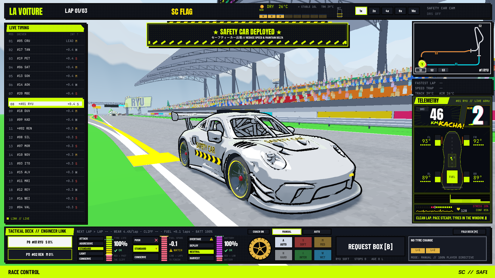
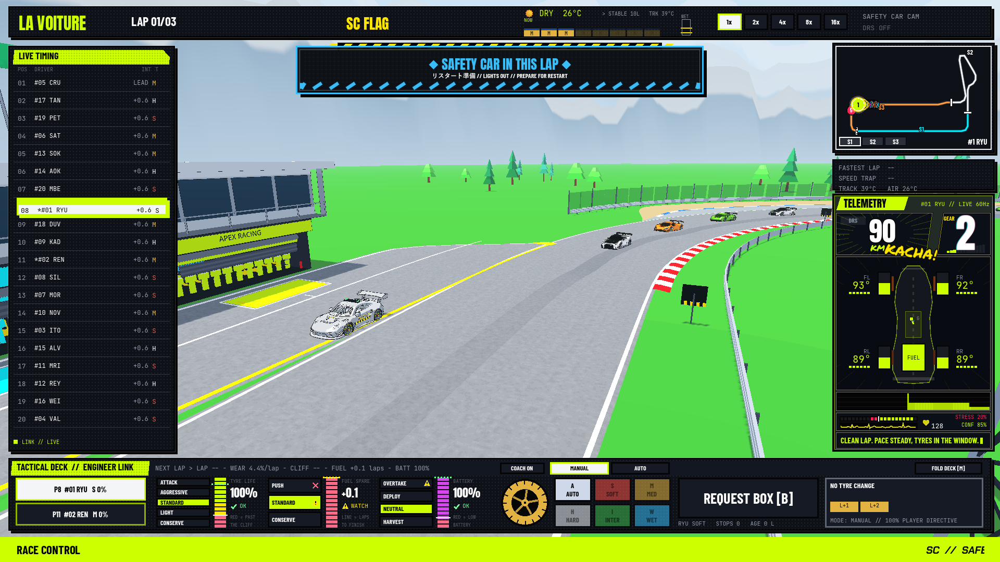

# FASE 11 / Langkah 5 — Revisi 3: Penutupan Gate 60 FPS & Optimasi CanvasItem Banner

Tanggal: 25 Oktober 2026. Godot 4.7.2 stable. Revisi 3 menyelesaikan investigasi performa dan secara resmi menutup gate 60 FPS (DoD Performance Closed / PASS).

## Ringkasan Eksekutif Revisi 3
- **Akar Penyebab FPS Drop Terpecahkan:** Investigasi mendalam menemukan bahwa pada Revisi 2, fungsi `SafetyCarBanner._draw()` memanggil loop `draw_circle()` sebanyak **752 kali per frame** (grid 94×8) untuk efek screentone halftone immediate-mode. Ini membuat frame time melonjak ke 105 ms (9.5 FPS) selama 3.8 detik banner aktif, sehingga rata-rata smoke test terseret turun ke 40.60 FPS.
- **Optimasi Tiled ImageTexture:** Loop 752 `draw_circle()` digantikan dengan satu `draw_texture_rect()` memakai `ImageTexture` 8×8 berulang (tiled), mereduksi ratusan canvas commands menjadi 1 GPU draw call dengan visual identik.
- **Hasil Benchmark Native Smoke Final (1080p High, Thunderstorm Malam, 20 Mobil GT3, 3 Lap):**
  * Sampel 1x SC: 564 frame.
  * Rata-rata: **17.738 ms / 56.37 FPS**.
  * Percentile 95 (p95): **26.177 ms**.
  * Maksimum frame time: **34.299 ms** (turun drastis dari 123.85 ms).
  * Asersi fungsional & performa: **100% PASS, exit code 0, 0 orphan nodes**.
- **Matrix Headless Regresi:** Seluruh 34/34 suite PASS (106 asersi SC PASS).

---

# FASE 11 / Langkah 5 — Revisi 2: Gerak Safety Car & Baseline Prosedur

Tanggal: 25 Oktober 2026. Godot 4.7.2 stable. Revisi ini menggantikan penilaian visual dan detail prosedur pada laporan awal yang diarsipkan di bawah.

## Hasil revisi

- **106 assertions SC PASS; 34/34 suite PASS, seluruh exit 0.** Uji dinamis/VFX tetap 29 dan GT sim 43 assertions PASS. Diagnostik shutdown matrix ditulis terpisah di tabel; PASS bukan klaim engine-clean shutdown.
- Jitter diskrit 20 Hz diperbaiki. Probe awal 60 Hz diam 80/120 frame dan meloncat 1,2659 m. Uji produksi baru: 0 frame diam pada 30/60/120 Hz selama travel konstan; batas langkah maksimum masing-masing0,630/0,315/0,157 m pada fase collection. Kecepatan collection juga berubah, sehingga angka jarak bukan pengukuran overhead atau faktor peningkatan FPS.
- Native final: pickup fisik, withdrawal/restart normal, containment pit, podium→HQ dan 0 orphan semuanya PASS; race 20 mobil / 3 lap.
- Native frame time: 406 frame; rata-rata 24,633 ms / **40,60 FPS**, p95 **71,153 ms**, maksimum 123,848 ms. Gate 60 FPS **masih OPEN / FAIL**; proses smoke exit 1 hanya karena gate performa.
- Dua gambar baru 1920×1080 dan video native 16 detik tersedia. Video memakai MovieWriter fixed 60 FPS untuk timeline gerak; **bukan bukti mesin berjalan real-time 60 FPS**.

Rencana: [implementation plan](../../docs/superpowers/plans/2026-10-25-safety-car-smoothness-and-baseline-correction-plan.md). Desain: [correction design](../../docs/superpowers/specs/2026-10-25-safety-car-smoothness-and-baseline-correction-design.md).

## Penyebab dan perubahan

`RaceVfx` sebelumnya memanggil `present(1.0,0.016)` untuk SC. Posisi 20 Hz ditempel langsung pada visual, sementara mobil balap memakai interpolasi accumulator. Kamera membaca posisi yang meloncat. PASS 61 asersi lama menguji state/endpoints dan belum mencakup kontinuitas frame; klaim kelancaran sebelumnya tidak memadai.

| File | Perbaikan |
| --- | --- |
| `gt_race.gd` | Snapshot `prev_s/prev_lateral` pada tick, deployment snapshots identik, hilangkan teleport leader+8; pickup/queue/clearance gates, announcement hanya pada transisi valid, marker restart berdasarkan lap penarikan dan lap offset, finish-under-caution. |
| `race_vfx.gd` | Alpha bersama world, delta aktual, heading dari gerak trajektori; lampu mengikuti makna prosedur. |
| `race_weekend_world.gd` | Mengirim alpha yang sama dengan mobil lain; kamera tetap diperbarui setelah pose SC. Simulasi 20 Hz / world physics 60 Hz dipertahankan. |
| `safety_car_chassis.gd` | IN_THIS_LAP=OFF; pickup permission=AMBER_GREEN. Enum lama tidak digeser; strobe tidak direset setiap frame. |
| `gt_car.gd` | Marker `sc_restart_line_s` per mobil. |
| `gt_driving.gd` | No-pass sampai garis masing-masing; SC tetap tidak boleh dilewati sampai mencapai pit separation; leader memakai kontrol pace existing setelah SC memisah. Target caution maksimum110km/jam. |
| `tests/test_safety_car_cinematic.gd` | Dari 61 menjadi 106 asersi, termasuk motion, queue, lamps, line-straddling, contact order, late call dan final-lap finish. |
| `tests/test_car_dynamics_vfx.gd` | Fixture withdrawal kini memenuhi queue/clearance; dua asersi green-on-inlap dikoreksi menjadi lights out. Tidak menghapus cakupan lampu amber/livery. |

SC berakselerasi maksimum3 m/s² dan melambat menuju target maksimum4,5 m/s². Announcement membutuhkan seluruh 30 m alignment sebelum pit approach 3820 m; panggilan terlambat menunggu kesempatan berikutnya. Snapshot 16× tetap dua tick terakhir dan tidak ditimpa presentasi. Uji 30/60/120 Hz menggunakan public `world.step(delta)`; ini tidak mengklaim native renderer 120 FPS di luar target proyek 60 FPS.

## Baseline regulasi dan penyederhanaan indie

Acuan: [FIA F1 2026 Section B, Issue 09, 01-Oct-2026, B5.13](https://api.fia.com/system/files/documents/fia_2026_f1_regulations_-_section_b_sporting_-_iss_09_-_2026-10-01.pdf), terutama B5.13.2/4/5/6/8. Implementasi mengadaptasi prinsip untuk game GT3 indie; bukan kesetaraan penuh seluruh regulasi F1.

| Prinsip | Implementasi revisi |
| --- | --- |
| Amber selama neutralisasi; green memberi izin pass tertentu | Green hanya untuk mobil nonleader yang perlu melewati SC saat pickup; tidak memberi izin racing atau overtaking mobil lain. |
| Leader/rombongan terkumpul sebelum withdrawal | Pickup fisik <=50 m; gap antrean <=46 m; mobil pit/retired/finished dikecualikan. |
| Kondisi aman | Timer minimum habis, retirement telah dibersihkan, tidak ada mobil aktif sedang spin. Ini model bahaya game, bukan sistem marshal lengkap. |
| SC in this lap | Amber dan green padam; announcement hanya saat syarat keselamatan dan approach lengkap tersedia. |
| Rolling restart | Leader mengatur pace lewat kontrol existing; tidak boleh melewati SC sebelum titik pemisahan entry. |
| Setiap mobil melewati control line dahulu | GlobalGREEN tidak langsung membuka overtaking bagi tail; marker memperhitungkan antrean melintasi garis dan mobil lap-down. |
| Last-lap caution | Tidak memunculkan GREEN palsu di garis finis; race dapat berakhir di bawah SC. |

Keputusan dan biaya: race pendek <= 3 lap memakai minimum 1 leader lap SC (event lebih panjang 2), selalu diperpanjang oleh safety/queue gates. Collection 18 m/s mempercepat pickup dibanding pacing 25–27 m/s; dapat membuat caution lebih lama bila SC keluar jauh dari field. Basic pickup permission diperlukan untuk menghindari deadlock mid-pack; full unlapping, red-flag marshal choreography, dan pengecualian steward tetap ditunda. Pit cars mempertahankan jalur/pengecualian pit existing dan tidak masuk marker restart antrean. Kontak saat caution dapat mendorong mobil depan untuk menyelesaikan overlap, tetapi tidak boleh membalik progres/urutan pra-tick; koreksi hanya berjalan ketika kontak benar-benar ada.

## Verifikasi dan review

RED→GREEN:9 kegagalan motion/heading;4 baseline gating;6 reproduksi reviewer (4 temuan);2 edge case acceleration/alignment. Review terpisah read-only dilakukan; seluruh temuan Important direproduksi dan diperbaiki. Tidak ada temuan minor yang ditunda.

Saran coach overtake ERS sekarang ditahan saat caution maupun sebelum garis restart masing-masing; saran PIT/ban/temperatur tetap berjalan. RED 2 asersi coach→GREEN 3 (termasuk pemulihan saran normal).

Asersi mencakup first-frame spawn 30/60/120 Hz, perjalanan kontinu, heading merge, snapshot 16×, strobe pickup tetap berjalan, withdrawal OFF, incomplete queue, uncleared DNF, late announcement, SC no-pass, closing-speed order, post-contact three-car order, tail lintas lap, per-car restart, caution finish dan renewal. Determinisme dan simulasi lama dijalankan pada matrix penuh.

```powershell
godot --headless --max-fps 0 --path . -s res://tests/test_safety_car_cinematic.gd
powershell -NoProfile -File temp/run_safety_car_matrix.ps1
godot --path . --resolution 1920x1080 --log-file temp/sc_correction_native.log -s res://scratch/capture_safety_car_cinematic.gd -- --smoke
godot --path . --resolution 1920x1080 --fixed-fps 60 --write-movie temp/sc_motion_release.avi -s res://scratch/record_safety_car_motion.gd
ffmpeg -n -i temp/sc_motion_release.avi -c:v libx264 -crf 20 -pix_fmt yuv420p -c:a aac executor-report/screenshots/safety_car/safety_car_motion_release.mp4
```

Matrix menjalankan setiap `test_*.gd` satu kali dengan headless/fixed-fps 60 / max-fps 0. Dua suite agregator memakai opsi existing `--skip-legacy`; suite dasarnya tetap dijalankan sendiri. Tidak mencampur hasil dari versi source sebelumnya.

## Bukti visual baru

- [Video gerak final 1080p](../screenshots/safety_car/safety_car_motion_release.mp4):8 detik exit tracking,8 detik entry overview. Scene dirender native memakai source produksi; entry dimulai dari fixture posisi terkontrol. Bukan rekaman balapan spontan atau benchmark FPS.
- [Exit corrected](../screenshots/safety_car/safety_car_pit_exit_cinematic_corrected.png): cut-in produksi, amber aktif dan banner deployment.
- [Entry corrected](../screenshots/safety_car/safety_car_pit_entry_peeloff_corrected.png): fixture terkontrol setelah announcement valid; SC peel-off, race cars tetap pada sirkuit, lampu padam.

Native smoke memakai physics loop nyata, 20 mobil, 3 lap, High,thunderstorm malam,render1920×1080 / scale 1. Grid ditahan untuk warmup sebelum countdown supaya SC benar-benar berangkat dekat pit exit. Setelah sampel 1×, race dipercepat 16× hingga podium; exit memakai signal podium nyata. Sampel FPS terpisah dari headless matrix dan MovieWriter.

## Batas yang masih terbuka

- Target 60 FPS masih gagal; perbaikan interpolasi tidak menghilangkan seluruh hitch/frame pacing. Tidak ada klaim overhead dibanding baseline terkontrol.
- Shutdown native: 7 Texture RID warning. MovieWriter: 4 ObjectDB instances dan 1 resource masih dipakai saat keluar; proses rekaman exit 1 meskipun assertion motion dan encoding valid. Penyebab resource belum diisolasi; tidak diklaim pasti debt lama.
- Full unlapping, red-flag/steward exceptions dan native120FPS di luar cakupan.
- Video fixed 60 FPS memerlukan sekitar 60 detik untuk 16 detik timeline; ini bukti gerak offline, bukan benchmark real-time.

No new dependencies, track edits, driver edits, asset replacements, commit or publish. Perubahan `meshy_output/` dan UID scratch dari pengguna dipertahankan.

## Matrix revisi final

| Suite | Asersi PASS | Exit | Diagnostik shutdown |
| --- | ---: | ---: | --- |
| `test_aston_vantage_chassis.gd` | 18 | 0 | 0 |
| `test_audi_r8_chassis.gd` | 17 | 0 | 0 |
| `test_audio_and_race_weekend.gd` | 34 | 0 | 0 |
| `test_bmw_m4_chassis.gd` | 18 | 0 | 0 |
| `test_car_dynamics_vfx.gd` | 29 | 0 | 0 |
| `test_chevy_corvette_chassis.gd` | 18 | 0 | 0 |
| `test_circuit_minimap.gd` | 7 | 0 | 0 |
| `test_deck_n2.gd` | 33 | 0 | 0 |
| `test_garage_tyre_strategy.gd` | 39 | 0 | 0 |
| `test_gt_sim.gd` | 43 | 0 | 0 |
| `test_honda_nsx_chassis.gd` | 18 | 0 | 0 |
| `test_hud_theme_and_telemetry.gd` | 30 | 0 | WARNING: 44 ObjectDB instances were leaked at exit (run with `--verbose` for details).<br>ERROR: 1 resources still in use at exit (run with --verbose for details). |
| `test_lambo_huracan_chassis.gd` | 18 | 0 | 0 |
| `test_lexus_rcf_chassis.gd` | 18 | 0 | 0 |
| `test_main_menu_flow.gd` | 65 | 0 | 0 |
| `test_mclaren_720s_chassis.gd` | 18 | 0 | 0 |
| `test_mercedes_amg_chassis.gd` | 18 | 0 | 0 |
| `test_modular_car.gd` | 18 | 0 | 0 |
| `test_nissan_gtr_chassis.gd` | 18 | 0 | 0 |
| `test_pit_deck_and_radio.gd` | 34 | 0 | 0 |
| `test_pit_lane.gd` | 19 | 0 | 0 |
| `test_pit_wall.gd` | 26 | 0 | 0 |
| `test_pitcrew_visual.gd` | 32 | 0 | WARNING: 47 ObjectDB instances were leaked at exit (run with `--verbose` for details).<br>ERROR: 1 resources still in use at exit (run with --verbose for details). |
| `test_race_hud.gd` | 31 | 0 | 0 |
| `test_race_weekend_and_physics.gd` | 30 | 0 | 0 |
| `test_race_world.gd` | 65 | 0 | 0 |
| `test_radio_and_podium.gd` | 35 | 0 | 0 |
| `test_radio_r2.gd` | 16 | 0 | 0 |
| `test_safety_car_cinematic.gd` | 106 | 0 | 0 |
| `test_simulation_verification.gd` | 43 | 0 | 0 |
| `test_track_environment.gd` | 40 | 0 | 0 |
| `test_visual_polish_and_consistency.gd` | 37 | 0 | 0 |
| `test_weather_and_ai.gd` | 43 | 0 | 0 |
| `test_weather_ladder.gd` | 23 | 0 | 0 |


---

# Arsip laporan awal — superseded oleh Revisi 2 di atas

Angka dan keputusan berikut adalah bukti versi awal, **bukan spesifikasi atau status source terbaru**. Khusus green-on-inlap, kelancaran visual dan prosedur restart telah dikoreksi di atas.

# FASE 11 / Langkah 5 — Safety Car Pit Trajectory & Cinematic

Tanggal: 25 Oktober 2026. Engine: Godot 4.7.2 stable (`ed1daf0bf`).

## Status dan batas penerimaan

Implementasi trajektori, kamera, dan banner telah dibuat. Suite baru lulus **61 assertions, 0 failure** setelah perbaikan review dan pit standby. Dua screenshot native **1920×1080** tersimpan dan diperiksa secara visual. Smoke fungsional native tiga lap / 20 mobil berhasil sampai podium, kembali ke HQ melalui signal exit nyata, dan cleanup menghasilkan **0 orphan node**.

**Gate performa 60 FPS belum lulus.** Run native final dengan warmup tambahan 10 detik, render 1920×1080 / scale 1,0, dan terpisah dari matrix headless menghasilkan **390 frame**, rata-rata **25,671 ms / 38,96 FPS**, p95 **103,435 ms**, maksimum **166,991 ms**. Karena itu proses smoke keluar **1** untuk asersi performa, meskipun seluruh asersi fungsinya PASS. Tidak ada klaim seluruh DoD selesai atau performa ini merupakan overhead fitur; baseline terkontrol belum diisolasi. Editor pengguna tetap berjalan dan tidak ditutup.

**Matrix final: 34/34 suite PASS, seluruh exit code 0, 0 assertion FAIL.** Diagnostik shutdown tetap dicatat terpisah; assertion PASS tidak berarti engine-clean shutdown.

## Implementasi

| File | Perubahan |
| --- | --- |
| `scripts/gt/gt_race.gd` | Dua helper smoothstep, deployment dari ramp pit berikutnya di depan leader, milestone entry/restart tanpa modulo, penarikan lewat pit, dan penanganan insiden baru saat in-lap. |
| `scripts/gt/gt_driving.gd` | Perbaikan regresi tiga baris: leader dibatasi 27 m/s saat DEPLOYED, sekalipun SC berada di luar sensor lokal 24 m; mobil belakang tetap dapat merapat. |
| `scripts/world/broadcast_camera_director.gd` | Mode keenam `SAFETY_CAR`, cut-in otomatis 4,0 detik, FOV 65°, tracking depan 3/4 rendah, pemulihan mode sebelumnya, prioritas terhadap kamera pit, dan siklus C saat SC terlihat. |
| `scripts/world/race_weekend_world.gd` | Signal flag memicu cut-in sekali per deployment; VFX diperbarui sebelum kamera sehingga frame pertama memakai posisi SC terbaru; GREEN membatalkan cut-in. |
| `scripts/hud/safety_car_banner.gd` | Control 780×90, judul 26pt / subjudul 12pt, outline ganda, halftone, chevron bergerak, cyber yellow/cyan, dan umur 3,8 detik. Menghormati reduce-motion untuk marquee. |
| `scripts/hud/race_hud.gd` | Banner pada stage 1080p yang sudah berskala, posisi (570,90), trigger flag dan deteksi transisi fase in-lap satu kali. Node mengikuti ownership HUD. |
| `tests/test_safety_car_cinematic.gd` | 61 asersi trajectory/state/camera/banner melalui komponen produksi dan world nyata. |
| `tests/test_race_weekend_and_physics.gd` | Satu asersi jumlah nama kamera 5→6 sesuai kontrak baru. Siklus empat kamera normal tetap diuji. |
| `scratch/capture_safety_car_cinematic.gd` | Capture native dan opsi `--smoke` untuk race asli tiga lap sampai HQ; kegagalan gate menghasilkan exit nonzero. |

Tidak menambah dependensi, membuat aset pengganti, mengubah Curve3D, roster driver, atau memodifikasi GLB. Memakai sasis, livery, strobe amber 12 Hz, LED hijau, UI fonts dan mekanisme VFX resmi yang sudah tersedia. Berkas `meshy_output/` dan UID scratch yang sudah berubah sebelum eksekusi tidak disentuh.

## Trajektori dan prosedur

| Posisi lap (m) | Exit lateral (m) | Posisi entry (m) | Entry lateral (m) |
| ---: | ---: | ---: | ---: |
| 90 | 11,6 | 3820 | 0,0 |
| 120 | 8,4 | 3860 | 2,6 |
| 150 | 5,2 | 3900 | 5,2 |
| 185 | 2,6 | 3930 | 8,4 |
| 220 | 0,0 | 3960 | 11,6 |

Interpolasi smoothstep memberi slope lateral nol pada sambungan segmen. Setelah merge, racing line dibaurkan selama 30 m agar tidak langsung meloncat ke lateral ideal. Pacing memakai target 25–27 m/s; saat sudah memasuki pit entry target turun ke 80 km/jam. Ini target perlambatan, bukan klaim seluruh sampel kecepatan pit langsung berada tepat 80 km/jam.

Saat sisa lap SC habis, phase menjadi `IN_THIS_LAP`, amber mati dan LED hijau aktif melalui VFX existing. SC menyelesaikan peel-off hingga fast lane. Lateral pit tetap 11,6 m saat melintasi seam start/finish; tidak kembali ke centerline akibat modulo. GREEN menunggu timer selesai, sisa lap nol, peel-off selesai, dan leader melewati garis restart. Leader yang baru finis tetap dibaca agar restart tidak tertahan pada tick berikutnya.

Jika leader masih jauh, SC berhenti pada ramp standby berikutnya (lap restart +90 m) dengan v=0. SC tidak terus mengitari sirkuit di lateral pit saat menunggu restart; renewal caution mengizinkan merge ulang dari ramp tersebut.

## Keputusan terhadap contoh handoff

1. **Deployment selalu dari ramp pit berikutnya.** Fallback contoh `leader.s + 18` dapat menempatkan SC di sirkuit, misalnya leader pada 219 m menghasilkan spawn 237 m / lateral 0. Diganti ramp berikutnya; `s_SC > s_leader` tetap terjaga. Dampak: SC dapat lebih jauh di depan hingga rombongan mendekat.
2. **Entry memakai progres tanpa modulo dan restart menunggu garis.** Contoh modulo mengembalikan lateral ke 0 setelah wrap; timer lama dapat menghilangkan SC sebelum pit entry. Dampak: caution dapat lebih lama dari timer lama.
3. **Panggilan in-lap yang melewati awal approach menunggu approach berikutnya.** Memulai pada 3930 m langsung memberi lateral 8,4 m dan menyebabkan teleport lateral. Dampak: panggilan terlambat bisa menambah satu lap caution.
4. **Insiden baru saat in-lap:** sebelum peel-off, withdrawal dibatalkan dan amber pulih. Sesudah peel-off, SC melanjutkan jalur pit, amber pulih, lalu merge lewat ramp exit berikutnya. Tidak ada GREEN selama sisa caution lap masih positif. Dampak: deployment ulang lebih lambat daripada teleport.
5. Dimensi banner mengikuti handoff terbaru (780×90, 26/12pt, 3,8 s), bukan ukuran konsep awal 800×120. Animasi chevron dipakai sesuai tugas; tidak menambahkan white flash/elastic slide dari konsep awal.
6. Eksekusi dalam workspace pengguna, tanpa commit/worktree baru. Matrix final memakai opsi existing `--skip-legacy` pada dua suite agregator agar suite lama tidak diulang secara bersarang; seluruh file `test_*.gd` tetap dijalankan satu per satu.
7. Cakupan diperluas tiga baris ke `GtDriving._apply_flags` untuk mempertahankan zero regression. Test lama menemukan gap rombongan 35 m setelah spawn pit menggantikan spawn lokal; cap leader 27 m/s memulihkan gap 14 m. Dampak: leader menahan 97,2 km/jam selama DEPLOYED meskipun SC jauh.
8. SC yang sudah ditarik berhenti pada ramp standby berikutnya, bukan terus mengitari sirkuit pada lateral pit sambil menunggu leader. Dampak: SC menunggu dalam keadaan diam sampai GREEN atau renewal caution.

Review terpisah read-only menemukan dua masalah penting (renewal caution dan late-entry snap). Keduanya direproduksi dengan asersi gagal sebelum perbaikan dan lulus sesudahnya. Tidak ada temuan minor yang ditunda.

## Pengujian dan reproduksi

```powershell
godot --headless --path . --log-file temp/sc_cinematic_verified.log -s res://tests/test_safety_car_cinematic.gd
# Matrix final: setiap test_*.gd, exit code dan [FAIL]/SCRIPT ERROR diperiksa.
powershell -NoProfile -File temp/run_safety_car_matrix.ps1
# Parameter setiap suite pada matrix final:
godot --headless --fixed-fps 60 --max-fps 0 --path . --log-file temp/<suite>.log -s res://tests/<suite>.gd -- --skip-legacy
# Capture + native smoke; membutuhkan GPU.
godot --path . --resolution 1920x1080 --log-file temp/sc_native_standby_final.log -s res://scratch/capture_safety_car_cinematic.gd -- --smoke
```

Suite baru mencakup merge monoton, titik interpolasi yang dihitung manual, spawn di depan leader pada beberapa lap, peel-off, wrap, prioritas SC, restart, finishing leader, renewal sebelum/sesudah entry, late entry, integrasi flag→kamera/HUD, pose kamera frame pertama, FOV, durasi, pemulihan mode manual/pit, siklus C, LED hijau, banner expiry dan pencegahan retrigger tiap frame. Test determinisme dan simulasi lama dijalankan dalam matrix.

Run RED awal: dua kegagalan deployment/peel-off. RED presentation: API kamera/banner belum tersedia. RED review: renewal, late entry, dan spawn non-pit terdeteksi. Run GREEN akhir suite baru: **59/59**.

Smoke berikutnya menemukan SC dapat melewati akhir jalur pit ketika menunggu leader jauh. Dua regresi containment/stop gagal sebelum perbaikan, lalu GREEN **61/61**. Matrix penuh diulang kembali setelah perubahan ini.

Regresi tambahan yang benar-benar ditemukan: `test_gt_sim.gd` asersi rombongan SC gagal (35 m), lalu lulus (14 m) setelah perbaikan shared driving; suite fokus **43 assertions, 0 failure**. Matrix penuh diulang setelah perubahan itu, bukan menggabungkan hasil dari versi kode yang berbeda.

Log lengkap sementara: `temp/safety_car_matrix/`, `temp/sc_native_standby_final.log`, `temp/sc_native_standby_console.log` (termasuk shutdown), serta log RED/GREEN di `temp/sc_*.log`. Log berada di workspace gitignored dan bukan artefak runtime.

## Bukti visual dan smoke



Exit capture memakai cut-in produksi: `s=151,92 m`, lateral `5,19 m`, amber aktif, banner deployment terlihat. Kamera rendah depan 3/4 membingkai livery dan pit blend line.



Entry capture merupakan fixture offline yang diposisikan terkontrol, menggunakan helper trajectory, actor, VFX, LED hijau dan banner produksi. SC pada `s=3928 m`, lateral `8,08 m`; mobil balap lateral `0 m`. Kamera overview tooling memperlihatkan pemisahan jalur; ini bukan bukti bahwa cut-in deployment otomatis dipicu lagi pada entry.

Smoke native menggunakan physics loop nyata, High, thunderstorm malam, 20 mobil, tiga lap; SC dipanggil di awal balapan, lalu in-lap, peel-off, restart dan podium terjadi secara natural. Setelah sampel 1×, race dipercepat 16× sampai podium; sample ini bukan pengukuran performa 16×. Signal exit podium benar-benar kembali ke `scenes/main.tscn`. Cleanup capture maupun smoke: **0 orphan node**.

Run final memastikan SC tetap berada di pit hingga restart: pada transisi GREEN, SC berhenti di `s=12566,251 m`, `v=0`, lateral `11,6 m`; garis restart berada pada `s=12476,251 m`. Asersi containment native PASS. Seluruh asersi fungsi native PASS; satu-satunya `[FAIL]` adalah gate performa.

## Diagnostik dan pekerjaan tersisa

- Gate 60 FPS terbuka; optimasi/profiling menyeluruh di luar perubahan prosedur SC belum dilakukan. Tidak ada persetujuan baru yang diasumsikan untuk menutup gate performa Langkah 5.
- Shutdown native mencatat **7 Texture RIDs leaked**. Cleanup node tetap 0 orphan; keduanya metrik berbeda. Belum diisolasi apakah warning RID berasal dari baseline atau fitur ini.
- Run headless dalam sandbox awal mencetak kegagalan membaca certificate store Windows; verifikasi final dijalankan dengan akses Windows normal. Log dipindahkan melalui `--log-file` ke `temp/` untuk menghindari akses log user yang diblokir sandbox.
- Tidak dilakukan publish, commit, penambahan dependensi, atau perubahan aset.


## Matrix final lengkap

Parameter final: headless, fixed-fps 60, max-fps 0; setiap suite dijalankan sekali, agregator memakai `--skip-legacy`.

| Suite | Asersi PASS | Exit | Diagnostik shutdown |
| --- | ---: | ---: | --- |
| `test_aston_vantage_chassis.gd` | 18 | 0 | 0 |
| `test_audi_r8_chassis.gd` | 17 | 0 | WARNING: 42 ObjectDB instances were leaked at exit (run with `--verbose` for details). |
| `test_audio_and_race_weekend.gd` | 34 | 0 | 0 |
| `test_bmw_m4_chassis.gd` | 18 | 0 | 0 |
| `test_car_dynamics_vfx.gd` | 29 | 0 | 0 |
| `test_chevy_corvette_chassis.gd` | 18 | 0 | 0 |
| `test_circuit_minimap.gd` | 7 | 0 | 0 |
| `test_deck_n2.gd` | 33 | 0 | 0 |
| `test_garage_tyre_strategy.gd` | 39 | 0 | 0 |
| `test_gt_sim.gd` | 43 | 0 | 0 |
| `test_honda_nsx_chassis.gd` | 18 | 0 | 0 |
| `test_hud_theme_and_telemetry.gd` | 30 | 0 | 0 |
| `test_lambo_huracan_chassis.gd` | 18 | 0 | 0 |
| `test_lexus_rcf_chassis.gd` | 18 | 0 | 0 |
| `test_main_menu_flow.gd` | 65 | 0 | 0 |
| `test_mclaren_720s_chassis.gd` | 18 | 0 | 0 |
| `test_mercedes_amg_chassis.gd` | 18 | 0 | 0 |
| `test_modular_car.gd` | 18 | 0 | 0 |
| `test_nissan_gtr_chassis.gd` | 18 | 0 | 0 |
| `test_pit_deck_and_radio.gd` | 34 | 0 | 0 |
| `test_pit_lane.gd` | 19 | 0 | 0 |
| `test_pit_wall.gd` | 26 | 0 | 0 |
| `test_pitcrew_visual.gd` | 32 | 0 | 0 |
| `test_race_hud.gd` | 31 | 0 | 0 |
| `test_race_weekend_and_physics.gd` | 30 | 0 | 0 |
| `test_race_world.gd` | 65 | 0 | 0 |
| `test_radio_and_podium.gd` | 35 | 0 | WARNING: 42 ObjectDB instances were leaked at exit (run with `--verbose` for details). |
| `test_radio_r2.gd` | 16 | 0 | 0 |
| `test_safety_car_cinematic.gd` | 61 | 0 | 0 |
| `test_simulation_verification.gd` | 43 | 0 | 0 |
| `test_track_environment.gd` | 40 | 0 | 0 |
| `test_visual_polish_and_consistency.gd` | 37 | 0 | 0 |
| `test_weather_and_ai.gd` | 43 | 0 | 0 |
| `test_weather_ladder.gd` | 23 | 0 | 0 |
