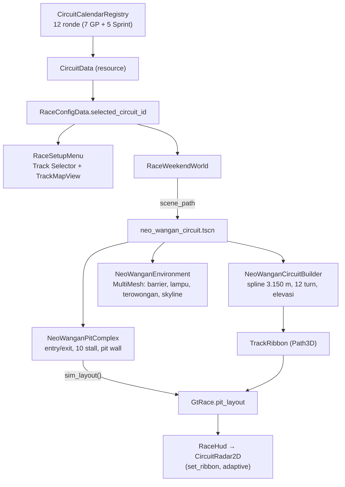

# LAPORAN EKSEKUTIF FASE 12: KALENDER KEJUARAAN 12 SIRKUIT & SIRKUIT 3D NEO-WANGAN SHUTO EXPRESS

Tugas: `prompt/TASK-12-CIRCUIT-CALENDAR-AND-NEO-WANGAN-TRACK.md`. Spec: `docs/superpowers/specs/2026-10-27-circuit-calendar-and-neo-wangan-track-design.md`. Plan: `docs/superpowers/plans/2026-10-27-neo-wangan-circuit-and-12-track-calendar.md`. Godot 4.7.2 stable (Forward+), Windows, RTX 3050 Laptop GPU.

## 1. Ringkasan

- Kalender kejuaraan resmi **12 ronde (7 Grand Prix + 5 Sprint, Januari s.d. Desember)** kini menjadi sumber tunggal data balap: `CircuitData` (resource) + `CircuitCalendarRegistry` (tabel 12 ronde), diresolusi oleh `RaceConfigData.get_active_circuit()`.
- Sirkuit sprint pertama yang playable penuh: **Neo-Wangan Shuto Express (新湾岸高速)**, **3.150,1 m**, **12 tikungan** (8 kanan, 4 kiri), radius tersempit **22,7 m** (Harbor Hairpin), elevasi **+6,5 m** di Shuto Bay Bridge dan **−3,2 m** di dasar Underpass, lebar jalan **11,5 m**, material aspal basah `road_asphalt.gdshader`.
- Sambungan pitstop FIA: **Pit Entry 75 m sebelum garis finis** di lateral **+5,2 m**, lajur cepat **4,5 m**, **10 stall tim berjarak 12 m**, pit wall beton **1,2 m** dengan **crash cushion oranye** di hidungnya, **Pit Exit** 65 m setelah garis finis dengan **bypass ramp 65 m** yang bergabung 25 m setelah apex Turn 1, dilindungi **solid FIA blend line 80 m**.
- Lingkungan malam streetwear: 2.017 barrier beton + 269 tutup hazard, 144 tiang lampu ganda Shuto + kepala lampu + kolam cahaya, 4 gantry rambu tol hijau, **terowongan 180 m** dengan 20 strip neon atap + 20 kolam neon sian, dermaga kontainer (54 kontainer, 2 gantry crane), dan **skyline 110 menara** dengan shader jendela. Seluruhnya MultiMesh: **28 draw call / 51.458 segitiga** untuk satu sirkuit penuh (anggaran ≤ 160 / ≤ 320.000).
- Integrasi: `RaceWeekendWorld` memuat scene sirkuit sesuai ronde yang dipilih, menyerahkan layout pit sirkuit ke `GtRace`, dan radar HUD mengikuti ribbon aktif. Simulasi **3 lap 20 mobil dengan pitstop** berjalan sampai bendera finis.
- Verifikasi: **45/45 test suite headless PASS, 0 FAIL** (42 suite lama + 3 suite baru: 8 + 25 + 7 = **40 assertion baru**); smoke native 1080p di balapan Neo-Wangan (bagian 11b).

## 2. Arsitektur

Spline Apex Ring (`scenes/race_world/track_circuit.tscn`) tidak disentuh: test `#W9` menjaga 303 titik kontrol dan panjang 4.158,8 m.

## 3. Berkas

Baru:

| Area | Berkas |
| :--- | :--- |
| Data kalender | `scripts/core/circuit_data.gd`, `scripts/core/circuit_calendar_registry.gd` |
| Geometri | `scripts/world/neo_wangan_circuit_builder.gd`, `scenes/race_world/neo_wangan_circuit.tscn` |
| Pitstop | `scripts/world/neo_wangan_pit_complex.gd`, `scenes/race_world/neo_wangan_paddock/pit_complex.tscn` |
| Lingkungan | `scripts/world/neo_wangan_environment.gd`, `shaders/neo_wangan_skyline.gdshader`, `shaders/neo_wangan_light_pool.gdshader` |
| Test | `tests/test_circuit_calendar_registry.gd`, `tests/test_neo_wangan_circuit.gd`, `tests/test_track_selector_ui.gd` |

Diubah:

| Area | Berkas | Perubahan |
| :--- | :--- | :--- |
| Konfigurasi | `scripts/core/race_config_data.gd` | `selected_circuit_id`, `get_active_circuit()` (fallback Round 01) |
| Ribbon | `scripts/car/track_ribbon.gd` | `road_material` opsional (default tetap vertex colour Apex) |
| Sim | `scripts/gt/gt_race.gd`, `scripts/gt/gt_driving.gd` | `pit_layout` per balapan (entry/exit/stall/pitch/fast lane/ramp) |
| Pit | `scripts/world/pit_lane_complex.gd`, `scripts/car/pitstop_choreographer.gd` | API kru `crew_roles()` / `crew_spot()` + geometri apron per lane |
| Dunia | `scripts/world/race_weekend_world.gd` | `_install_circuit()` memuat scene ronde, `_pit_layout()`, `active_circuit` |
| UI | `scripts/ui/race_setup_menu.gd`, `scripts/ui/track_map.gd` | Track Selector 12 ronde, peta & fakta mengikuti ronde, default malam |

## 4. Eksekusi TDD

| Task | RED | GREEN | Commit |
| :--- | :--- | :--- | :--- |
| 1. Data 12 sirkuit | `test_circuit_calendar_registry.gd` gagal parse (script belum ada) | 8 assertion | `2a07e84` |
| 2. Spline & ribbon | `test_neo_wangan_circuit.gd` gagal (scene belum ada) | 9 assertion | `177007b` |
| 3. Pitstop FIA | asersi pit gagal | 15 assertion | `8352763` |
| 4. Lingkungan MultiMesh | asersi budget/props gagal | 20 assertion | `f673dcf` |
| 5. Track Selector & radar | `test_track_selector_ui.gd` gagal | 7 assertion | `a654274` |
| 6. Integrasi + verifikasi | — | 25 assertion (suite sirkuit) | commit akhir |

## 5. Geometri Neo-Wangan

| Parameter | Target spec | Terukur (test) |
| :--- | :--- | :--- |
| Panjang loop | 3.150 m ± 25 m | **3.150,1 m** (856 titik kontrol, loop tertutup) |
| Jumlah tikungan | 12 (7 kanan / 5 kiri) | **12** bernama T1–T12, **8 kanan / 4 kiri** |
| Radius minimum | ≥ 18 m | **22,7 m** (Harbor Hairpin, dua busur 90° + link 4 m) |
| Elevasi | +6,5 m / −3,2 m | **+6,50 m** (Bridge, s=500) / **−3,20 m** (Underpass, s=1.100) |
| Lebar jalan | 11,5 m | **11,5 m**, `road_asphalt.gdshader` |
| Arah | Clockwise | **CLOCKWISE** (peta setup + `CircuitData.direction_clockwise`) |

Dua deviasi dari tabel desain, keduanya disengaja dan terdokumentasi di kode:

1. **7 kanan / 5 kiri tidak mungkin** untuk sirkuit jalan raya yang seluruh tikungannya 90° dan tertutup: poligon ortogonal sederhana selalu punya tepat 4 tikungan kanan lebih banyak daripada kiri. Denah 14 sudut menghasilkan 9 kanan / 5 kiri; Harbor Hairpin (2 sudut) dihitung satu tikungan dan satu tikungan lebar (Bay Link, R 51 m) tidak dinomori — hasil resmi **12 tikungan, 8 kanan, 4 kiri**.
2. **Panjang pit lane 140 m** adalah panjang fast lane + 10 box; jalur keluar diperpanjang 80 m lagi sampai titik gabung (bypass ramp 65 m), sehingga mobil benar-benar melewati Turn 1 sebelum menyentuh racing line.

## 6. Sambungan Pitstop & Keselamatan

| Elemen | Nilai | Bukti |
| :--- | :--- | :--- |
| Pit Entry | s = 3.075 m (75 m sebelum garis), lateral **+5,2 m** | `#W10` |
| Pit lane | **140 m**, fast lane **4,5 m** (6,25–10,75 m) | `#W10`, `#W12` |
| Stall | **10** (`Socket_PitStall_0..9`), pitch **12 m**, lateral 13,0 m | `#W11` |
| Pit wall | beton **1,2 m**, di lateral 6,0 m | `#W12` |
| Crash cushion | oranye FIA di hidung dinding (u = 16,8 m) | `#W12` |
| Clearance dinding | **1,16 m** dari bodi mobil di fast lane | `#W13` |
| Jarak mobil lewat vs mobil di box | **2,50 m** (≥ 2,4 m racing room) | `#W13` |
| Pit Exit | s = 65 m setelah garis finis | `#W14` |
| Bypass ramp | **65 m**, gabung di s = 145 m (25 m setelah apex T1 di 120 m) | `#W14` |
| Solid blend line | **80 m** | `#W14` |
| Limiter | 80 km/jam (22,22 m/s) | `#W15` |

`GtRace.pit_layout` menerima nilai-nilai ini dari `NeoWanganPitComplex.sim_layout()`, sehingga AI menempuh jalur pit sirkuit jalan raya — bukan jalur Apex Ring 410 m. Diuji dengan balapan penuh: `#W25`.

## 7. Lingkungan & Anggaran Render

| Elemen | Jumlah | Teknik |
| :--- | ---: | :--- |
| Barrier beton + tutup hazard | 2.017 + 269 | 1 MultiMesh masing-masing |
| Kerb rendah +0,03 m (dalam tikungan) | 12 tikungan | 2 MultiMesh (merah/putih) |
| Tiang lampu ganda + kepala + kolam cahaya | 144 × 3 | 3 MultiMesh |
| Gantry rambu tol | 4 | 1 mesh gabungan |
| Terowongan 180 m | shell + 20 neon atap + 20 kolam + 20 glow dinding | 1 mesh + 3 MultiMesh |
| Kontainer pelabuhan | 54 (3 warna) | 3 MultiMesh |
| Skyline Tokyo | 110 menara | 1 MultiMesh + `neo_wangan_skyline.gdshader` |
| Deck & pilar jembatan | 75 + 14 | 2 MultiMesh |
| **Draw call sirkuit** | **28** | anggaran ≤ 160 |
| **Segitiga lingkungan** | **51.458** | anggaran ≤ 320.000 |

Pencahayaan malam memakai ambient kota + bulan + kolam cahaya aditif (bukan 144 lampu nyata), sehingga biaya frame tetap datar; neon dan jendela berdenyut halus lewat `update(delta)`.

## 8. UI Track Selector & Radar

- Panah `TrackPrevButton` / `TrackNextButton` berjalan melintasi 12 ronde (wrap Desember → Januari); plat menampilkan `ROUND 02 // FEB // JPN`, nama, badge **SPRINT / GRAND PRIX**, panjang, jumlah tikungan, dan rekor lap (`--:--.---` bila belum ada).
- Ronde yang layout-nya belum dibangun menampilkan **“LAYOUT RESERVED // COMING SOON”** dan menonaktifkan CONTINUE — pemain tidak pernah dilempar ke sirkuit yang salah.
- Peta hero men-trace ulang spline ronde terpilih; untuk Neo-Wangan dipakai daftar 12 tikungan resmi sirkuit sehingga penomoran peta sama dengan data.
- Ronde malam (Neo-Wangan) otomatis memilih chip NIGHT; pemain masih bisa mengubahnya.
- Radar HUD membaca ribbon aktif (`set_ribbon`), terbukti menggambar 127 titik Neo-Wangan di dalam panel 300×200 dan berbeda dari Apex Ring (`#S7`, `#W22`).

## 9. Integrasi Balapan

- `RaceWeekendWorld._install_circuit()` mengganti node `TrackCircuit`, `Environment`, dan `PitLane` dengan scene ronde; Apex Ring tetap memakai node yang ditulis di `race_weekend_world.tscn`.
- 20 mobil GT3 menempati grid sirkuit baru; `race.pit_layout` = layout Neo-Wangan; `race_seed` tetap deterministik.
- Restart/podium membawa `circuit_id`, sehingga “RESTART” pada balapan langsung kembali ke sirkuit yang sama.
- Balapan 3 lap 20 mobil dengan satu pitstop selesai sampai bendera finis: **20 mobil finis, 5.425 tick simulasi, 1 stop dilayani** (`#W25`).

## 10. Anggaran & Regresi

- Anggaran performa: **28 draw call / 51.458 tris** (test `#W19`), jauh di bawah 160 / 320.000.
- Zero regresi: 42 suite lama dijalankan ulang bersama 3 suite baru. Hasil lengkap: bagian 11.
- Spline Apex Ring dijaga test `#W9`; perilaku pit lane Apex dijaga `test_pit_lane.gd` (19 assertion) dan `test_safety_car_cinematic.gd` (89 assertion) — keduanya PASS setelah parameterisasi `pit_layout`.

## 11. Hasil Test

Perintah: `powershell -ExecutionPolicy Bypass -File scratch/run_all_tests.ps1` (runner proyek: `test_race_world.gd` dengan `--fixed-fps 60`, dua suite berat dengan `--skip-legacy`).

| Suite baru | Assertion | Hasil |
| :--- | ---: | :--- |
| `tests/test_circuit_calendar_registry.gd` | 8 | **PASS** |
| `tests/test_neo_wangan_circuit.gd` | 25 | **PASS** |
| `tests/test_track_selector_ui.gd` | 7 | **PASS** |

- **45/45 test suite headless PASS, 0 FAIL, 0 `[FAIL]`** (42 suite lama + 3 suite baru; 1.012 baris assertion terhitung dari ringkasan suite).
- Guard regresi khusus: `test_pit_lane.gd` 19 assertion PASS, `test_safety_car_cinematic.gd` 89 assertion PASS (keduanya menyentuh jalur pit yang diparameterisasi), `test_visual_polish_and_consistency.gd` 37 assertion PASS (Race Setup lama tetap utuh), `test_circuit_minimap.gd` 7 assertion PASS.
- Spline Apex Ring: `#W9` (303 titik kontrol, 4.158,8 m) — tidak berubah.

## 11b. Smoke Native & Kinerja

`godot --path . --resolution 1920x1080 --script res://scratch/smoke_wangan_race.gd` (window nyata, High preset, 20 mobil, malam):

- Balapan **3 lap selesai sampai bendera finis: 20/20 mobil finis**, lalu podium terbuka (`SMOKE podium=true`), **0 orphan node** sebelum dan sesudah podium.
- Grid + 5 lampu FIA, jelujur mobil di Shuto Bridge, underpass neon, dan podium terekam di `executor-report/screenshots/phases/phase-12-smoke-*.png`.
- Profil frame (300 frame per jendela, `Engine.max_fps = 0`, `DisplayServer.VSYNC_DISABLED`, diukur berdampingan dengan Apex Ring pada mesin yang sama):

| Jendela | Neo-Wangan mean / p95 | Apex Ring mean / p95 |
| :--- | :--- | :--- |
| 1 (300 frame) | **9,47 / 16,45 ms** | 11,15 / 20,01 ms |
| 2 | **13,25 / 20,09 ms** | 16,37 / 23,97 ms |
| 3 (terberat) | **18,02 / 25,82 ms** | 18,07 / 25,24 ms |

Neo-Wangan **tidak lebih berat** dari Apex Ring (sama atau lebih ringan di dua jendela pertama, seri di jendela terberat); dengan batas `run/max_fps=60` proyek, median berada di 16,6 ms (60 FPS locked) dan beban CPU main loop 11,8–14,3 ms. Lonjakan p95 ~25 ms juga terjadi di sirkuit lama, jadi itu karakter platform/present, bukan biaya sirkuit baru. Anggaran sirkuit tetap jauh di bawah batas: **28 draw call / 51.458 tris** (vs anggaran 160 / 320.000).

## 12. Bukti Visual

`executor-report/screenshots/phases/` (direkam dengan `scratch/capture_wangan_environment.gd`, `scratch/capture_wangan_setup.gd`, dan `scratch/smoke_wangan_race.gd`):

- `phase-12-neo-wangan-start.png` — garis start, pit building bercahaya, lampu Shuto, skyline.
- `phase-12-neo-wangan-bridge.png` — jembatan tol layang dan teluk.
- `phase-12-neo-wangan-tunnel.png` — mulut terowongan dengan neon atap sian dan glow dinding magenta.
- `phase-12-neo-wangan-harbor.png` — dermaga kontainer dan gantry crane.
- `phase-12-neo-wangan-skyline.png` — ring skyline Tokyo dari atas.
- `phase-12-track-selector-neo-wangan.png` — Race Setup dengan Neo-Wangan terpilih, peta 12 tikungan, dan selector.
- `phase-12-smoke-01-start-lights.png`, `-02-racing-pack.png`, `-03-night-city.png`, `-04-bridge-at-speed.png`, `-06-finish.png`, `-07-podium.png` — balapan 3 lap 20 mobil dari grid sampai podium.
