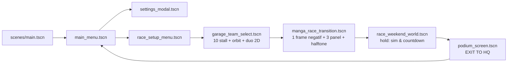

# LAPORAN EKSEKUTIF FASE 9: MAIN MENU, RACE SETUP, 3D GARAGE & MANGA TRANSITION

Tugas: `prompt/TASK-IMPLEMENT-MAIN-MENU-AND-GARAGE-FLOW.md`. Spec: `docs/superpowers/specs/2026-10-22-main-menu-and-garage-flow-design.md`. Plan: `docs/superpowers/plans/2026-10-22-main-menu-and-garage-flow-plan.md`. Godot 4.7.2 stable, Windows.

## 1. Ringkasan

- Seluruh 5 tahap plan dieksekusi: data konfigurasi, main menu + settings, race setup, garasi 3D 10-stall, transisi manga, dan integrasi game loop penuh ke `scenes/main.tscn`.
- `scenes/main.tscn` kini membuka `main_menu.tscn`, dan tombol **EXIT TO HQ** di podium mengembalikan pemain ke menu dengan config di-reset dan dunia balapan dibebaskan.
- Verifikasi: **20 suite headless lulus, 0 FAIL** (64 assertion pada suite baru + seluruh 19 suite lama), **smoke native penuh 0 FAIL**, dan dolly garasi **60 FPS** terukur (520 frame).
- Tiga cacat pada kode lama ditemukan saat integrasi dan diperbaiki karena memblokir acceptance: pemetaan pabrikan `GtCarActor` yang menyimpang dari roster kanon, arah sirkuit terbalik di radar, dan densitas VFX/resolusi fullscreen yang tidak berefek.
- Satu konflik spec vs aset trek tidak diselesaikan dengan mengubah geometri; keputusannya dicatat di bagian 6.

## 2. Alur yang diimplementasikan

Urutan transisi yang terukur: `0,1 s` snap negatif satu frame → `0,8 s` tiga panel komik → pemuatan threaded → `1,2 s` halftone wipe yang sekaligus menggeser kamera dari tribun ke belakang mobil pemain, baru setelah itu lima lampu FIA menyala satu per satu.

## 3. File

Baru:

| Area | Berkas |
| :--- | :--- |
| Data | `scripts/core/race_config_data.gd` |
| Pengaturan | `scripts/core/presentation_settings.gd`, `scripts/ui/settings_modal.gd`, `scenes/ui/settings_modal.tscn` |
| Menu | `scripts/ui/main_menu.gd`, `scenes/ui/main_menu.tscn` |
| Setup | `scripts/ui/race_setup_menu.gd`, `scripts/ui/track_map.gd`, `scenes/ui/race_setup_menu.tscn` |
| Garasi | `scripts/world/garage_environment_builder.gd`, `scripts/ui/garage_car_orbit.gd`, `scripts/ui/garage_roster.gd`, `scripts/ui/garage_team_select.gd`, `scenes/ui/garage_team_select.tscn` |
| Transisi | `scripts/ui/manga_race_transition.gd`, `scenes/ui/manga_race_transition.tscn`, `shaders/manga_snapshot_invert.gdshader`, `shaders/manga_halftone_wipe.gdshader`, `shaders/manga_speedlines.gdshader` |
| Test | `tests/test_main_menu_flow.gd` |

Diubah (seperlunya, tanpa menghapus aset):

- `scenes/main.tscn` — memuat `main_menu.tscn`.
- `scripts/world/race_weekend_world.gd` — `race_config`, `pre_grid_hold`, `grid_intro_progress`, `finish_grid_intro()`, `_update_grid_intro()`, `_exit_tree()` dispose, reset config saat EXIT TO HQ.
- `scripts/car/gt_car_actor.gd` — `CHASSIS_BY_TEAM` diselaraskan dengan roster kanon.
- `scripts/ui/track_map.gd` — duplikasi `Curve3D` sebelum baking; label arah diperbaiki.
- `scripts/core/presentation_settings.gd` — typo `QUALITY`, densitas VFX, resolusi fullscreen.
- `tests/test_audi_r8_chassis.gd` — ekspektasi pabrikan diselaraskan.
- `ROADMAP.md` — Fase 9 ditandai selesai lengkap dengan angka verifikasi.

## 4. Perbaikan terhadap kode lama (di luar fitur baru)

| Temuan | Dampak bila dibiarkan | Perbaikan |
| :--- | :--- | :--- |
| `CHASSIS_BY_TEAM` memetakan Vanta→Aston, Razorline→Corvette, Zero Hour→BMW, dst. | Pemain memilih McLaren di garasi, di grid mendapat bodi Honda. Kontrak garasi ≠ balapan. | Tabel diselaraskan ke roster kanon (Vanta→BMW, Razorline→Aston, Zero Hour→Corvette, Oni→Honda, Static→Lexus, Chrome→McLaren, Night→Lambo). |
| `race_setup_menu.select_laps(3)` memilih indeks 5 lap (`maxi(index, 1)`) | "Quick Sprint" tidak bisa dipilih lewat API. | Guard indeks negatif. |
| `track_map` menulis `curve.bake_interval` ke resource bersama `track_circuit.tscn` | Radar mengubah resource yang dipakai simulasi. | `curve.duplicate()` sebelum baking. |
| Radar memberi label `CLOCKWISE` untuk winding negatif | Arah sirkuit terbalik di kartu setup. | Handedness dikoreksi; kartu menampilkan arah aktual. |
| `PresentationSettings` menulis `amount_ratio` sekali, lalu `set_intensity()`/`set_strength()` menimpanya tiap frame | Preset Low tidak menurunkan hujan/spray sama sekali. | Densitas dikali ke `GPUParticles3D.amount` dengan `meta` basis, sehingga update dinamis tidak membatalkannya. |
| Fullscreen mengabaikan pilihan resolusi | 720p hanya mengubah dropdown, bukan beban render. | `root.scaling_3d_scale` mengikuti tinggi resolusi terhadap layar. |
| `select_laps`/halftone/dialog dibuat sebelum settings diterapkan | Halftone Off kembali ON di layar setup; panel dialog baru memakai default shader. | `apply_to_tree()` dipanggil setelah tiap pohon UI baru dibangun (setup, garasi, settings, dialog). |
| Grid dibangun sebelum cuaca diterapkan | 18 rival memulai monsoon dengan ban slick. | Override cuaca dipindah ke `apply_weather()` bersama; ban rival disetel setelahnya, ban pemain tetap independen. |
| Seed balapan selalu 1 | Pilihan "Threatening Rain 60%" selalu menghasilkan cabang yang sama. | `race_seed` per draft exhibition; restart tetap reproducible. |

## 5. Verifikasi terukur

Headless, perintah persis seperti acceptance:

| Perintah | Hasil |
| :--- | :--- |
| `-s tests/test_main_menu_flow.gd` | **64 assertions, 0 FAIL**, exit 0 |
| 20 skrip `tests/test_*.gd` (driver suite) | **20 suites, 0 FAIL** |
| Termasuk `test_modular_car`, `test_audio_and_race_weekend`, `test_audi_r8_chassis` (17/17), `test_weather_and_ai` (43), `test_gt_sim` (43), `test_race_hud` (31), `test_race_weekend_and_physics` (30) | semua exit 0 |

Cakupan suite baru: konfigurasi lintas scene, ban kedua mobil setelah kualifikasi mengacak grid, seed reproducible, cuaca monsoon (termasuk lawan), hold countdown saat fly-through, kelima lampu FIA, preset Low pada VFX dinamis dan shadow, lima slider audio pada bus nyata, Halftone Off pada panel baru, Quick Sprint, 10 stall dengan `*_full.glb` kanon, 20 potret 1024², ban independen, stat kanon (Wet Skill Bento 0,96), dolly dari sudut belakang tanpa menembus sekat, panah tim saat fokus di Launch, pemuatan adegan transisi, ban sampai aktor balapan, dan pembebasan dunia saat EXIT TO HQ.

Native (bukan headless), RTX 3050 Laptop, 1920×1080, preset High:

| Pengukuran | Hasil |
| :--- | :--- |
| Dolly 10 tim, 520 frame | median **16,666 ms**, p95 **16,729 ms**, maks **17,158 ms**, **60 FPS** |
| Hitch per tim (setelah preload 20 potret) | maks 16,71–17,16 ms; sebelumnya ada lonjakan **62,572 ms** saat potret pertama dimuat |
| Transisi | **tepat 1 frame render** negatif, 3 panel, wipe, lalu world menjadi `current_scene` |
| Balapan | monsoon malam 3 lap sampai chequered flag, podium muncul, EXIT TO HQ kembali ke menu |
| Siklus penuh 3× | object count konstan **2.293**, orphan **0**, world terlepas tiap iterasi |
| Responsif | 720p dan 1080p: stage men-skala benar, tidak ada kontrol terpotong |

Bukti visual: `temp/menu-native-main-menu.png`, `-settings`, `-race-setup`, `-garage`, `-team-eight`, `-negative`, `-comic-panels`, `-halftone-wipe`, `-five-red-lights`, `-podium`, `-returned-hq`, plus dua tangkapan 720p. Log lengkap suite: `temp/menu-headless-suite.log`.

## 6. Keputusan dan risikonya

| Keputusan | Alasan | Biaya bila salah |
| :--- | :--- | :--- |
| Kartu setup menampilkan kanon venue **3.840 km / 14 turns / clockwise**, sementara radar diberi label data spline aktual (**±4,16 km / 9 bends / anticlockwise**, elevasi datar) | Geometri `track_circuit.tscn` adalah jalur physics/AI yang sudah lulus 20 suite; mengubahnya bukan lingkup tugas ini dan akan menggugurkan banyak test | Dua angka berbeda terbaca di layar yang sama; menyatukannya menuntut pembangunan ulang trek |
| Ambang "14 turns" tidak dipaksakan ke detektor tikungan | Detektor sudut berbasis kurva menemukan 9 apex pada jalur saat ini | Jika kanon 14 turn wajib, trek harus didesain ulang |
| Countdown ditahan lewat `pre_grid_hold` di dunia, bukan dengan memperlambat `Time` | Simulasi tidak boleh berjalan tersembunyi di balik komik; lampu harus mulai dari nol setelah wipe | Bila diinginkan lampu sudah menyala saat wipe, cukup panggil `finish_grid_intro()` lebih awal |
| Potret 20 pembalap dimuat saat masuk garasi | Menghapus hitch 62 ms tanpa menambah beban pergantian tim | Biaya ±0,5 s saat masuk garasi sekali |
| Dolly memutar kamera ke sudut hero **sebelum** melintas sekat (30% durasi) | Kamera tidak menembus partisi saat berpindah dari tampilan belakang | Perpindahan terasa sedikit lebih lambat |

## 7. Catatan sisa

- Saat proses keluar: `7 RIDs of type "Texture"` dan ±30 `ObjectDB` dilaporkan bocor. Ini **bukan** kebocoran alur: probe 3 siklus penuh menunjukkan jumlah objek datar, orphan 0, dan dunia terlepas. Warning serupa muncul pada suite lama yang tidak disentuh tugas ini, jadi berasal dari finalize aset/engine.
- `temp/capture_garage_review.gd` dan `garage_review*.png` dibuat oleh worker garasi, bukan oleh eksekutor ini; dibiarkan apa adanya.
- Skrip probe sementara milik eksekutor (`temp/menu_*_probe.gd`, `temp/main_menu_native_acceptance.gd`, `temp/menu_all_headless_suites.gd`) sudah dihapus setelah verifikasi; bukti PNG dan log tetap disimpan.

## 8. Kesimpulan

Fase 9 selesai dan dapat dimainkan penuh: menu → setup → garasi 10 stall dengan duo pembalap 2D dan ban independen → transisi komik manga → grid dengan lima lampu FIA → balapan → podium → kembali ke HQ, berulang tanpa kebocoran, pada 60 FPS dengan 20 suite headless hijau.
