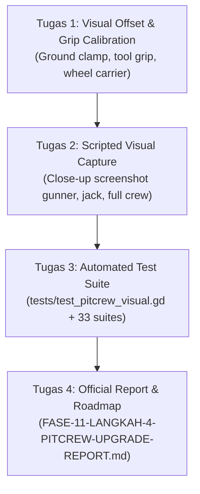

# TASK HANDOFF: Langkah 4 — Pit Crew 3D Rigging, Animated Mechanics & Visual Proof Verification

**Target Branch:** `feat/pitcrew-rigging-props` (atau staging di `main`)  
**Target Engine:** Godot Engine 4.7.2 stable (`Godot_v4.7.2-stable_win64_console.exe`)  
**3D Tooling:** Blender 5.2.0 (`C:\Program Files\Blender Foundation\Blender 5.2\blender.exe`)  
**Role:** Senior 3D Technical Artist & Game Engine Integrator  
**Reference Documents:**
* **Dokumentasi Spesifikasi & Prompt:** [`reference-assets/pitcrew/PITCREW-SPEC-AND-PROMPTS.md`](file:///D:/Occupation/Porto/genex/La_Voiture/reference-assets/pitcrew/PITCREW-SPEC-AND-PROMPTS.md)
* **Laporan Generasi Aset:** [`PITCREW-GENERATION-AND-INTEGRATION-REPORT.md`](file:///C:/Users/Lee/.gemini/antigravity-cli/brain/811c31b7-0204-457f-88fa-74a528b6c84e/PITCREW-GENERATION-AND-INTEGRATION-REPORT.md)
* **Showcase Visual Turnaround:** [`PITCREW-TURNAROUND-SHOWCASE.md`](file:///C:/Users/Lee/.gemini/antigravity-cli/brain/811c31b7-0204-457f-88fa-74a528b6c84e/PITCREW-TURNAROUND-SHOWCASE.md)
* **Pedoman Resmi Arsitektur & Rules:** [`AGENTS.md`](file:///D:/Occupation/Porto/genex/La_Voiture/AGENTS.md)
* **Status Roadmap Proyek:** [`ROADMAP.md`](file:///D:/Occupation/Porto/genex/La_Voiture/ROADMAP.md)

---

## 1. Context & Status Pekerjaan Saat Ini (What is Already Done)

Pipeline generasi 3D AI dan pembuatan peralatan mekanik di Blender telah selesai dijalankan dan diverifikasi:
1. **Aset 3D Master Karakter Pit Crew:**
   * File model master: [`assets/characters/pitcrew/pitcrew_master.glb`](file:///D:/Occupation/Porto/genex/La_Voiture/assets/characters/pitcrew/pitcrew_master.glb)
   * Dilengkapi skeleton biped 24 bone standar humanoid (`Skeleton3D`), termasuk socket tulang `RightHand` (index 23).
   * Memiliki 4 track animasi NLA yang terintegrasi di `AnimationPlayer`:
     * `"idle"` (sikap berdiri siaga menunggu mobil masuk).
     * `"walk"` (langkah berjalan keluar/masuk garasi pit).
     * `"run"` (langkah berlari cepat).
     * `"tire_service"` (sikap berlutut dengan dua tangan mengarahkan wheel gun ke mur roda).
   * Tekstur PBR tersimpan di [`assets/characters/pitcrew/textures/`](file:///D:/Occupation/Porto/genex/La_Voiture/assets/characters/pitcrew/textures/) (`base_color.png`, `normal.png`, `metallic.png`, `roughness.png`).
2. **Paket Peralatan Pit Stop Hard-Surface (Blender 5.2):**
   * Tersimpan di [`assets/props/`](file:///D:/Occupation/Porto/genex/La_Voiture/assets/props/):
     * [`wheel_gun.glb`](file:///D:/Occupation/Porto/genex/La_Voiture/assets/props/wheel_gun.glb) (Pneumatic Paeoli wheel gun, soket 33mm center-lock).
     * [`quick_jack.glb`](file:///D:/Occupation/Porto/genex/La_Voiture/assets/props/quick_jack.glb) (Low-profile lever jack dengan twin wheels dan tuas panjang).
     * [`fuel_nozzle.glb`](file:///D:/Occupation/Porto/genex/La_Voiture/assets/props/fuel_nozzle.glb) (Refueling nozzle endurance kopling ganda dengan selang bergelombang).
     * [`lollipop_board.glb`](file:///D:/Occupation/Porto/genex/La_Voiture/assets/props/lollipop_board.glb) (Tiang lollipop 2.3m karbon dengan piringan ganda `BRAKE` dan `GO!`).
     * [`fire_extinguisher.glb`](file:///D:/Occupation/Porto/genex/La_Voiture/assets/props/fire_extinguisher.glb) (Tabung pemadam api dengan pressure gauge dan nozzle corong).
     * [`pit_equipment_pack.glb`](file:///D:/Occupation/Porto/genex/La_Voiture/assets/props/pit_equipment_pack.glb) (Paket gabungan seluruh props).
3. **Uniform Cel-Shader Dinamis:**
   * Shader [`shaders/pit_crew_uniform.gdshader`](file:///D:/Occupation/Porto/genex/La_Voiture/shaders/pit_crew_uniform.gdshader) telah dibuat.
   * Menginjeksi warna tim (`team_color`) ke area pakaian montir secara otomatis berdasarkan luminansi, sambil mempertahankan warna hitam gelap pada boots, pelindung lutut, sabuk utility, dan visor helm mengkilap, serta mempertahankan garis balap putih.
4. **Integrasi Awal di [`scripts/car/pitstop_choreographer.gd`](file:///D:/Occupation/Porto/genex/La_Voiture/scripts/car/pitstop_choreographer.gd):**
   * `_make_member()` menginstansiasi `pitcrew_master.glb`, menerapkan uniform shader per tim, mengaitkan `anim_player`, dan melampirkan props ke tangan masing-masing peran.
   * `_place()` mengaktifkan animasi `walk` saat berjalan dan `idle` saat diam.
   * `_animate_crew()` mengaktifkan animasi `tire_service` untuk 4 gunner saat fase penggantian roda.
   * Seluruh 32 test suite yang ada tetap **100% PASS (0 Fail)**.

---

## 2. Rincian Ruang Lingkup Tugas Executor (Scope of Work)

Tugas Executor adalah memfinalisasi detail visual runtime, memastikan tidak ada clipping atau floating geometri, mengambil tangkapan layar bukti visual berkualitas tinggi, membuat test suite khusus, dan menyusun laporan eksekutif resmi.



---

### Tugas 1: Kalibrasi Offset Visual & Grip Peralatan (Runtime Calibration)
* **File Target:** [`scripts/car/pitstop_choreographer.gd`](file:///D:/Occupation/Porto/genex/La_Voiture/scripts/car/pitstop_choreographer.gd)
1. **Pijakan Kaki pada Aspal (Ground Clamping):**
   * Periksa ketinggian Y pada `PitCrewModel` di `_make_member()` dan `_place()`.
   * Pastikan sol sepatu boots menyentuh permukaan aspal pit lane ($Y = 0.0$) secara presisi (toleransi $\pm 0.01\text{ m}$), tidak ada kaki yang amblas ke dalam tanah atau melayang.
2. **Posisi & Orientasi Perkakas (Tool Attachment & Grip):**
   * Kalibrasi posisi lokal `WheelGun` di tangan Gunner (`node.get_node_or_null("WheelGun")`) agar laras nozzle dan soket 33mm menghadap langsung ke arah pusat as roda mobil saat berlutut.
   * Kalibrasi posisi `FuelNozzle` pada Fueler agar mengarah ke lubang pengisian bensin di pilar/seperempat belakang mobil GT3.
   * Kalibrasi posisi `FireExtinguisher` pada Fire Marshal agar tabung berdiri kokoh atau dipegang di samping badan.
3. **Tyre Handler Wheel Carrying:**
   * Pastikan ban baru (`member.tyre`) yang dibawa oleh Tyre Handler terposisikan di depan dada setinggi 0.7–0.8 m dari tanah saat berjalan dari garasi ke pit box.
   * Saat ban lama dilepas (`_carry_away`), pastikan ban bekas yang dipindahkan ke tangan tidak menabrak geometri karakter.
4. **Quick Jack Lift Animation:**
   * Di `_spawn_jacks()`, pastikan posisi dongkrak depan (`end = -JACK_REACH_M`) dan dongkrak belakang (`end = JACK_REACH_M`) berada tepat di bawah titik tumpu sasis mobil.
   * Pastikan tuas dongkrak terangkat sinkron dengan kenaikan sasis mobil setinggi $0.15\text{ m}$ (`job.lift_m`).

---

### Tugas 2: Scripted Visual Capture (Bukti Visual Resolusi Tinggi)
* **Script Staging:** Buat skrip pembantu capture di `scratch/capture_pitcrew_visual.gd`
* Jalankan Godot untuk mengambil snapshot visual berkualitas tinggi (viewport 1920×1080) pada momen pitstop aktif:
  1. **Shot 1 (Close-Up Gunner & Wheel Service):** Kamera close-up dari sudut 45 derajat menyorot mekanik gunner yang sedang berlutut memegang wheel gun di depan roda GT3 BBS FI-R.
     * Simpan ke: `executor-report/screenshots/pitcrew/pitstop_gunner_wheel_service.png`
  2. **Shot 2 (Side-View Working Lane Overview):** Kamera menyamping menyorot seluruh mobil diangkat dongkrak quick-jack, 4 gunner berlutut, 4 handler memegang ban, lollipop man memegang papan, dan fueler di belakang.
     * Simpan ke: `executor-report/screenshots/pitcrew/pitstop_full_crew_action.png`
  3. **Shot 3 (Team Uniform Variations):** Tangkapan layar yang memperlihatkan setidaknya 2 tim berbeda dengan warna seragam dinamis (misal: Porsche Manthey Acid Lime vs Ferrari Rosso Corsa) untuk membuktikan variasi uniform shader bekerja optimal.
     * Simpan ke: `executor-report/screenshots/pitcrew/pitcrew_team_uniform_variations.png`

> [!NOTE]
> Pastikan folder penyimpanan screenshot ada: `executor-report/screenshots/pitcrew/` dan pastikan file `.gdignore` tetap ada di dalam `executor-report/`.

---

### Tugas 3: Automated Test Suite & Quality Gates
* **File Baru:** `tests/test_pitcrew_visual.gd`
* Buat test suite automated headless untuk memverifikasi integritas node dan fungsionalitas visual pit crew:
  1. **#P1 Asset Verification:** `pitcrew_master.glb` dan 5 GLB props di `assets/props/` dapat di-load tanpa null dan memiliki skala 1.0.
  2. **#P2 Animation Tracks:** `pitcrew_master.glb` memiliki `AnimationPlayer` dengan 4 aksi wajib: `["idle", "walk", "run", "tire_service"]`.
  3. **#P3 Skeleton & Sockets:** Skeleton memiliki minimal 24 bones dan bone `RightHand` dapat ditemukan dengan index yang valid.
  4. **#P4 Uniform Shader:** `shaders/pit_crew_uniform.gdshader` ter-load dengan benar dan parameter `team_color`, `albedo_texture`, `normal_texture` dapat diatur tanpa error.
  5. **#P5 Choreographer Instantiation:** Saat `_make_member()` dipanggil untuk ke-6 peran (`gunner`, `handler`, `jack`, `fueler`, `fire`, `lollipop`), node memiliki `PitCrewModel`, `anim_player`, serta tool prop yang sesuai.
  6. **#P6 Animation State Transitions:** Saat status kru berganti antara `WALKING_OUT`, `READY`, dan `SERVICING`, `anim_player.current_animation` beralih dengan benar antara `"walk"`, `"idle"`, dan `"tire_service"`.

* **Quality Gate (Definition of Done):**
  Jalankan seluruh rangkaian 33 test suite (termasuk test baru ini):
  ```powershell
  Get-ChildItem tests\test_*.gd | ForEach-Object { godot --headless --path . -s "res://tests/$($_.Name)" }
  ```
  **Wajib 100% PASS, 0 FAIL.**

---

### Tugas 4: Laporan Resmi Eksekutif & Pembaruan Roadmap
1. Buat laporan resmi di:
   `executor-report/reports/FASE-11-LANGKAH-4-PITCREW-UPGRADE-REPORT.md`
   Format laporan harus mencakup:
   * Executive Summary & Goals.
   * Daftar Aset 3D, Rigging, dan Animasi yang Diterapkan.
   * Analisis Performa & VRAM Budget (Zero Overhead via Shader Tinting & 60 FPS Locked).
   * Bukti Visual (Embed screenshot dari `executor-report/screenshots/pitcrew/`).
   * Hasil Uji Headless (33 Suite Pass).
2. Perbarui `ROADMAP.md`:
   Tambahkan checkpoint:
   `- [x] **Fase 11 / Langkah 4: Pit Crew 3D Rigging, Animated Mechanics & Visual Proof**`
3. Git Commit:
   Commit seluruh perubahan kode, aset baru, test, dan laporan dengan pesan commit yang rapi dan deskriptif.

---

## 3. Boundaries & Strict Rules of Engagement

### ALWAYS:
* Jalankan `godot --headless --path . -s tests/test_*.gd` sebelum dan sesudah melakukan perubahan.
* Pertahankan semua komentar kode dan docstring yang sudah ada di [`scripts/car/pitstop_choreographer.gd`](file:///D:/Occupation/Porto/genex/La_Voiture/scripts/car/pitstop_choreographer.gd).
* Gunakan forward slashes untuk path file pada markdown dan URL link (`file:///D:/...`).
* Pastikan file `.gdignore` tetap ada di `executor-report/` dan `temp/`.

### NEVER:
* **DILARANG MENGHAPUS / MENIMPA ASET ATAU KODE YANG TIDAK ANDA BUAT SENDIRI** (Aturan Anti-Kerusakan #1).
* **Dilarang menaruh file `.gdignore` di dalam `reference-assets/`**, karena potret dan tekstur referensi dimuat langsung saat runtime.
* Dilarang mengubah posisi atau ukuran elemen HUD in-game (Layout Lock rule dari Langkah 3).
* Dilarang meng-commit cache `.godot/`, workspace `temp/`, atau file dump.

---

## 4. Acceptance Criteria Checklist (DoD)

- [ ] Kaki seluruh 13 anggota kru pit stop berdiri pas di atas aspal tanpa floating atau clipping.
- [ ] Ke-5 peralatan pit stop (`wheel_gun`, `quick_jack`, `fuel_nozzle`, `lollipop_board`, `fire_extinguisher`) terpasang rapi dan natural di tangan kru.
- [ ] Animasi biped (`walk`, `idle`, `tire_service`) berganti dengan mulus tanpa jerking saat mobil masuk dan servis berlangsung.
- [ ] Shader `pit_crew_uniform.gdshader` menampilkan warna khas tim pada pakaian kru untuk tiap-tiap garasi tim.
- [ ] 3 Screenshot bukti visual tersimpan di `executor-report/screenshots/pitcrew/`.
- [ ] Test suite baru `tests/test_pitcrew_visual.gd` dibuat dan lulus 100%.
- [ ] Seluruh 33 test suite proyek lulus **100% PASS (0 FAIL)** tanpa regresi.
- [ ] Laporan eksekutif ditulis di `executor-report/reports/FASE-11-LANGKAH-4-PITCREW-UPGRADE-REPORT.md`.
- [ ] `ROADMAP.md` diperbarui dan status pekerjaan siap untuk di-merge.
