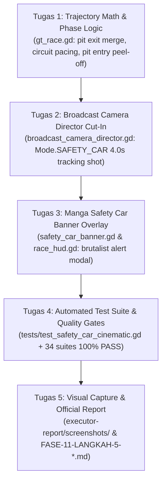

# TASK HANDOFF: Langkah 5 — Prosedur Autentik Safety Car: Pit Exit Deployment, Cinematic Cut-In & Pit Entry Peel-Off

**Target Branch:** `main`  
**Target Engine:** Godot Engine 4.7.2 stable (`godot --headless --path .`)  
**Role:** Senior Gameplay & Graphics Systems Integrator / Technical Game Designer  
**Reference Documents:**
* **Spesifikasi Desain Lengkap:** [`docs/superpowers/specs/2026-10-25-safety-car-pit-trajectory-and-cinematic-design.md`](file:///D:/Occupation/Porto/genex/La_Voiture/docs/superpowers/specs/2026-10-25-safety-car-pit-trajectory-and-cinematic-design.md)
* **Implementation Plan:** [`docs/superpowers/plans/2026-10-25-safety-car-pit-trajectory-and-cinematic-plan.md`](file:///D:/Occupation/Porto/genex/La_Voiture/docs/superpowers/plans/2026-10-25-safety-car-pit-trajectory-and-cinematic-plan.md)
* **Pedoman Resmi Arsitektur & Aturan Eksekusi:** [`AGENTS.md`](file:///D:/Occupation/Porto/genex/La_Voiture/AGENTS.md)
* **Core Simulation Engine PRD:** [`PRD/01-CORE-SIMULATION-ENGINE.md`](file:///D:/Occupation/Porto/genex/La_Voiture/PRD/01-CORE-SIMULATION-ENGINE.md)
* **Status Roadmap Proyek:** [`ROADMAP.md`](file:///D:/Occupation/Porto/genex/La_Voiture/ROADMAP.md)

---

## 1. Context & Status Pekerjaan Saat Ini (What Is Already Done)

1. **Sasis & Livery Safety Car Resmi:**
   * Sasis resmi Official FIA Safety Car telah tersedia di [`scenes/car/safety_car_chassis.tscn`](file:///D:/Occupation/Porto/genex/La_Voiture/scenes/car/safety_car_chassis.tscn) (berbasis sasis Porsche 911 GT3 dengan cat silver metalik, decal "SAFETY CAR" tebal di pintu dan kap mesin, strip hazard kuning, serta 3D Rooftop Lightbar dengan strobo amber 12 Hz dan LED hijau).
   * Script sasis di [`scripts/car/safety_car_chassis.gd`](file:///D:/Occupation/Porto/genex/La_Voiture/scripts/car/safety_car_chassis.gd) mendukung enum `StrobeMode { OFF, AMBER, GREEN }`.
2. **Geometri Pit Lane Terintegrasi:**
   * Sirkuit memiliki kompleks pit lane di [`scripts/world/pit_lane_complex.gd`](file:///D:/Occupation/Porto/genex/La_Voiture/scripts/world/pit_lane_complex.gd):
     * Titik Masuk (*Pit Entry Line*): $\text{ENTRY\_S} = 3900.0\text{ m}$.
     * Titik Keluar (*Pit Exit Line*): $\text{EXIT\_S} = 150.0\text{ m}$.
     * Lebar jalur Fast Lane: $\text{FAST\_LANE\_M} = 11.6\text{ m}$.
     * Batas tepi sirkuit: $\text{EDGE\_LATERAL\_M} = 5.2\text{ m}$.
3. **Audio Transmisi Suara:**
   * Audio squelch radio dan voice lines siap pakai tersedia di [`assets/audio/radio/voice/`](file:///D:/Occupation/Porto/genex/La_Voiture/assets/audio/radio/voice/) (`eng_sc_stopped.wav`, `eng_sc_wall.wav`).
4. **Masalah yang Harus Diselesaikan:**
   * Saat ini di [`scripts/gt/gt_race.gd`](file:///D:/Occupation/Porto/genex/La_Voiture/scripts/gt/gt_race.gd), Safety Car langsung melakukan spawn/teleportasi di depan mobil pemimpin (`leader.s + 18.0`, `lateral = 0.0`) tanpa pernah melaju dari jalur pit, dan langsung menghilang saat balapan kembali hijau tanpa melaju masuk ke pit lane.
   * Belum ada shot kamera pelacak broadcast saat Safety Car meluncur keluar pit.
   * Belum ada banner pop-up manga bergaya neo-brutalis `"SAFETY CAR DEPLOYED"` saat prosedur dimulai.

---

## 2. Rincian Ruang Lingkup Tugas Executor (Scope of Work)



---

### Tugas 1: Trajectory Math & Dynamic Deployment di `GtRace`
* **File Target:** [`scripts/gt/gt_race.gd`](file:///D:/Occupation/Porto/genex/La_Voiture/scripts/gt/gt_race.gd)

1. **Tambahkan Fungsi Trajektori Statis:**
   * Impor referensi PitLaneScript:
     ```gdscript
     const PitLaneScript := preload("res://scripts/world/pit_lane_complex.gd")
     ```
   * Fungsi trajektori keluar pit (*Pit Exit Merge*):
     ```gdscript
     ## Pit Exit trajectory: blends from FAST_LANE_M (11.6m) to EDGE_LATERAL_M (5.2m) at EXIT_S, then to 0.0m on track.
     static func sc_pit_exit_lateral(s_lap: float) -> float:
         var s_rel: float = s_lap - PitLaneScript.EXIT_S
         if s_rel <= -60.0:
             return PitLaneScript.FAST_LANE_M
         elif s_rel <= 0.0:
             var t: float = smoothstep(-60.0, 0.0, s_rel)
             return lerpf(PitLaneScript.FAST_LANE_M, PitLaneScript.EDGE_LATERAL_M, t)
         elif s_rel <= 70.0:
             var t: float = smoothstep(0.0, 70.0, s_rel)
             return lerpf(PitLaneScript.EDGE_LATERAL_M, 0.0, t)
         return 0.0
     ```
   * Fungsi trajektori masuk pit (*Pit Entry Peel-Off*):
     ```gdscript
     ## Pit Entry peel-off trajectory: blends from 0.0m to EDGE_LATERAL_M (5.2m) at ENTRY_S, then to FAST_LANE_M (11.6m).
     static func sc_pit_entry_lateral(s_lap: float) -> float:
         var s_rel: float = s_lap - PitLaneScript.ENTRY_S
         if s_rel <= -80.0:
             return 0.0
         elif s_rel <= 0.0:
             var t: float = smoothstep(-80.0, 0.0, s_rel)
             return lerpf(0.0, PitLaneScript.EDGE_LATERAL_M, t)
         elif s_rel <= 60.0:
             var t: float = smoothstep(0.0, 60.0, s_rel)
             return lerpf(PitLaneScript.EDGE_LATERAL_M, PitLaneScript.FAST_LANE_M, t)
         return PitLaneScript.FAST_LANE_M
     ```

2. **Perbarui Logika Spawn pada `set_flag()` (saat `flag == GtTypes.Flag.SC`):**
   * Cari mobil pemimpin (`leader`).
   * Tentukan koordinat spawn $s$ di tanjakan keluar pit (`EXIT_S - 60.0 m`):
     ```gdscript
     var leader_s: float = leader.s if leader != null else 0.0
     var lap_base: float = floorf(leader_s / track.length) * track.length
     var spawn_s: float = lap_base + PitLaneScript.EXIT_S - 60.0
     if spawn_s <= leader_s:
         if leader_s < lap_base + PitLaneScript.EXIT_S + 70.0:
             spawn_s = leader_s + 18.0
         else:
             spawn_s = lap_base + track.length + PitLaneScript.EXIT_S - 60.0
     var s_lap: float = fposmod(spawn_s, track.length)
     safety_car = {
         "active": true,
         "phase": GtTypes.SafetyCarPhase.DEPLOYED,
         "s": spawn_s,
         "v": 20.0,
         "lateral": sc_pit_exit_lateral(s_lap),
         "lights_on": true,
         "just_deployed": true,
     }
     ```
   * **PENTING UNTUK TEST COMPATIBILITY:** Pastikan `safety_car["s"] > leader_s` agar asersi `ahead` di [`tests/test_car_dynamics_vfx.gd`](file:///D:/Occupation/Porto/genex/La_Voiture/tests/test_car_dynamics_vfx.gd) baris 373 selalu menghasilkan nilai `true`.

3. **Perbarui Logika Pembaruan Lateral pada `_update_race_control(dt)`:**
   * Di dalam blok `if flag == GtTypes.Flag.SC:`
     ```gdscript
     var s_lap: float = fposmod(float(safety_car["s"]), track.length)
     var is_in_lap: bool = int(safety_car["phase"]) == GtTypes.SafetyCarPhase.IN_THIS_LAP
     if is_in_lap and (s_lap >= PitLaneScript.ENTRY_S - 80.0 or s_lap <= PitLaneScript.EXIT_S):
         safety_car["lateral"] = sc_pit_entry_lateral(s_lap)
     elif s_lap >= PitLaneScript.EXIT_S - 60.0 and s_lap <= PitLaneScript.EXIT_S + 70.0:
         safety_car["lateral"] = sc_pit_exit_lateral(s_lap)
     else:
         safety_car["lateral"] = track.ideal_lateral_at(float(safety_car["s"])) * 0.35
     ```
   * Saat `sc_laps_remaining <= 0`, ubah fase ke `IN_THIS_LAP` dan matikan lampu strobo (`lights_on = false`).

---

### Tugas 2: Broadcast Camera Director Safety Car Mode & Cut-In
* **File Target:**
  * [`scripts/world/broadcast_camera_director.gd`](file:///D:/Occupation/Porto/genex/La_Voiture/scripts/world/broadcast_camera_director.gd)
  * [`scripts/world/race_weekend_world.gd`](file:///D:/Occupation/Porto/genex/La_Voiture/scripts/world/race_weekend_world.gd)

1. **Tambahkan Mode Baru di `broadcast_camera_director.gd`:**
   * Perbarui enum Mode:
     ```gdscript
     enum Mode { CHASE, COCKPIT, HELI, TRACKSIDE_TV, PITSTOP, SAFETY_CAR }
     const MODE_NAMES: Array[String] = ["CHASE CAM", "COCKPIT CAM", "HELI CAM", "TRACKSIDE TV", "PIT CLOSE-UP", "SAFETY CAR CAM"]
     ```
   * Tambahkan state cut-in otomatis:
     ```gdscript
     const SC_CAM_FOV: float = 65.0
     var safety_car_actor: Node3D = null
     var safety_car_cut_s: float = 0.0

     func trigger_safety_car_cut(sc_actor: Node3D, duration_s: float = 4.0) -> void:
         safety_car_actor = sc_actor
         safety_car_cut_s = duration_s
         _snap = true

     func active_mode() -> int:
         if safety_car_cut_s > 0.0 and safety_car_actor != null and is_instance_valid(safety_car_actor):
             return Mode.SAFETY_CAR
         if auto_pit_camera and pit_focus != null:
             return Mode.PITSTOP
         return mode
     ```
   * Implementasikan tracking shot pada `update(dt)`:
     ```gdscript
     func _update_safety_car(dt: float) -> void:
         _set_lens(SC_CAM_FOV, 0.1)
         if safety_car_cut_s > 0.0:
             safety_car_cut_s = maxf(0.0, safety_car_cut_s - dt)
         var actor: Node3D = safety_car_actor if (safety_car_actor != null and is_instance_valid(safety_car_actor)) else target
         var pose: Transform3D = actor.global_transform
         # Dynamic low 3/4 front tracking shot (Z forward is -Z)
         var wanted: Vector3 = pose.origin - pose.basis.z * 7.2 + pose.basis.x * 2.6 + Vector3.UP * 1.3
         camera.global_position = camera.global_position.lerp(wanted, 1.0 if _snap else 1.0 - exp(-8.0 * dt))
         camera.look_at(pose.origin + Vector3.UP * 0.75, Vector3.UP)
     ```
2. **Kaitkan ke `race_weekend_world.gd`:**
   * Di dalam `_ready()`, sambungkan signal `race.flag_changed.connect(_on_race_flag_changed)`.
   * Pada method callback `_on_race_flag_changed(flag: int, _message: String)`:
     ```gdscript
     func _on_race_flag_changed(flag: int, _message: String) -> void:
         if flag == Types.Flag.SC:
             if vfx != null and vfx.safety_car_actor != null:
                 camera_director.trigger_safety_car_cut(vfx.safety_car_actor, 4.0)
     ```

---

### Tugas 3: Stylized Manga Safety Car Banner Overlay
* **File Target:**
  * Buat baru: [`scripts/hud/safety_car_banner.gd`](file:///D:/Occupation/Porto/genex/La_Voiture/scripts/hud/safety_car_banner.gd)
  * Modifikasi: [`scripts/hud/race_hud.gd`](file:///D:/Occupation/Porto/genex/La_Voiture/scripts/hud/race_hud.gd)

1. **Buat Node `SafetyCarBanner` (`scripts/hud/safety_car_banner.gd`):**
   * Kelas turunan `Control` dengan minimum size $780 \times 90\text{ px}$.
   * Gambar latar belakang neo-brutalis (`Color(0.06, 0.07, 0.09, 0.95)`), outline ganda, garis chevron hazard beranimasi (marquee offset).
   * Dua label vertikal:
     * `header_label`: Ukuran 26pt bold `"★ SAFETY CAR DEPLOYED ★"`.
     * `sub_label`: Ukuran 12pt semibold `"セーフティーカー出動 // REDUCE SPEED & MAINTAIN DELTA"`.
   * Method `trigger(flag: int, message: String)`:
     * Jika `Flag.SC`: warna kuning cyber (`#D8FF00`), teks "SAFETY CAR DEPLOYED".
     * Jika `IN_THIS_LAP`: warna cyan punk (`#38BDF8`), teks "◆ SAFETY CAR IN THIS LAP ◆", subteks "リスタート準備 // LIGHTS OUT // PREPARE FOR RESTART".
   * Durasi aktif: 3.8 detik, kemudian otomatis menghilang (`visible = false`).
2. **Integrasi ke `race_hud.gd`:**
   * Instansiasi `sc_banner = SafetyCarBanner.new()` di `_build_stage()`.
   * Posisikan di tengah atas: `sc_banner.position = Vector2((1920.0 - 780.0) * 0.5, 90.0)`.
   * Panggil `sc_banner.trigger(flag, message)` di `_on_flag_changed`.
   * Panggil `sc_banner.advance(delta)` di `update(delta)`.
   * Di dalam `_update_safety_car()` atau sinkronisasi HUD, jika `race.safety_car["phase"] == GtTypes.SafetyCarPhase.IN_THIS_LAP` baru saja aktif, pemicu transisi banner in-lap dipanggil.

---

### Tugas 4: Automated Test Suite & Quality Gates
* **File Baru:** [`tests/test_safety_car_cinematic.gd`](file:///D:/Occupation/Porto/genex/La_Voiture/tests/test_safety_car_cinematic.gd)

1. **Tulis Unit & Integration Test Lengkap (minimal 15 asersi):**
   * **#SC1 Pit Exit Deployment:** Memverifikasi lateral SC berada di jalur pit exit ($> 5.0\text{ m}$) saat spawn, dan berkurang secara monoton halus hingga mencapai $< 0.5\text{ m}$ (lintasan sirkuit).
   * **#SC2 Pit Entry Peel-Off:** Memverifikasi saat `phase == IN_THIS_LAP` dan mendekati `ENTRY_S`, lateral SC bergeser ke kanan ($> 1.0\text{ m} \to 11.6\text{ m}$).
   * **#SC3 Lights Out State:** Strobo atap mati dan lampu hijau aktif saat fase `IN_THIS_LAP`.
   * **#SC4 Camera Director Integration:** `trigger_safety_car_cut` mengaktifkan `Mode.SAFETY_CAR`, posisi kamera dalam radius 25m dari aktor SC, dan otomatis kembali ke `Mode.CHASE` setelah durasi cut-in tuntas.
   * **#SC5 Manga Banner Lifecycle:** Banner muncul dengan visibilitas `true`, teks berisi `"SAFETY CAR"`, dan otomatis tersembunyi setelah durasi tayang.
2. **Jalankan Uji Mandiri:**
   ```powershell
   godot --headless --path . -s res://tests/test_safety_car_cinematic.gd
   ```
   * Target: **100% PASS, 0 FAIL**.
3. **Zero Regression Test Matrix:**
   Jalankan seluruh 34 test suite:
   ```powershell
   Get-ChildItem tests\test_*.gd | ForEach-Object { godot --headless --path . -s ("res://tests/" + $_.Name) }
   ```
   * Target: **34/34 SUITES PASS (100% PASS, 0 FAIL)**.

---

### Tugas 5: Visual Capture & Laporan Resmi
1. **Scripted Visual Capture:**
   * Buat skrip tangkapan layar offline di `scratch/capture_safety_car_cinematic.gd`.
   * Ambil 2 tangkapan layar 1080p resolusi tinggi:
     1. `executor-report/screenshots/safety_car/safety_car_pit_exit_cinematic.png`: Tangkapan sudut rendah 3/4 depan Safety Car keluar dari pit exit dengan strobo menyala dan banner manga aktif.
     2. `executor-report/screenshots/safety_car/safety_car_pit_entry_peeloff.png`: Tangkapan Safety Car memisahkan diri berbelok ke kanan masuk pit lane sementara mobil balap tetap lurus.
2. **Laporan Eksekutif Resmi:**
   * Tulis laporan lengkap di [`executor-report/reports/FASE-11-LANGKAH-5-SAFETY-CAR-PROCEDURE-REPORT.md`](file:///D:/Occupation/Porto/genex/La_Voiture/executor-report/reports/FASE-11-LANGKAH-5-SAFETY-CAR-PROCEDURE-REPORT.md) merinci metrik trajektori, hasil pengujian, dan bukti visual.
3. **Perbarui Status Roadmap:**
   * Tandai penyelesaian Langkah 5 pada [`ROADMAP.md`](file:///D:/Occupation/Porto/genex/La_Voiture/ROADMAP.md).

---

## 3. Aturan & Batasan Penting (Rules of Engagement)

* **DILARANG MENGHAPUS / MENIMPA KODE DI LUAR CAKUPAN** (Aturan #1 AGENTS.md).
* **Jaga Kompatibilitas Test `test_car_dynamics_vfx.gd`:** Nilai awal `safety_car["s"]` wajib lebih besar dari `leader.s` saat SC dipanggil, dan strobo harus sesuai enum `SafetyCarChassis.StrobeMode`.
* **Zero Orphan Nodes:** Pastikan seluruh node baru (`SafetyCarBanner`, kamera, dll) dibebaskan dengan `queue_free()` saat scene selesai atau keluar.
* **Gunakan folder `scratch/` atau `temp/`** untuk file skrip pengujian visual sementara.

---

## 4. Definisi Selesai (Definition of Done)

Tugas ini dinyatakan selesai 100% jika:
1. `tests/test_safety_car_cinematic.gd` lulus 100% tanpa error.
2. Seluruh 34 test suite di `tests/test_*.gd` lulus 100% (Zero Regression).
3. 2 screenshot verifikasi tersimpan di `executor-report/screenshots/safety_car/`.
4. Laporan resmi markdown tersimpan di `executor-report/reports/FASE-11-LANGKAH-5-SAFETY-CAR-PROCEDURE-REPORT.md`.
5. `ROADMAP.md` diperbarui dengan status Langkah 5 COMPLETED.
