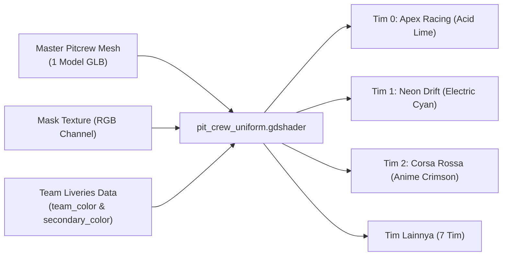

# 🏁 DOKUMENTASI SPESIFIKASI ASET & PROMPT REFERENSI PIT CREW
**Proyek Game:** *La Voiture* (Sim-Cade Motorsport GT3)  
**Art Direction:** Cel-Shaded Anime $\times$ Inverted-Hull Manga Inking $\times$ Streetwear Neo-Brutalism  
**Target Folder:** `reference-assets/pitcrew/`  

---

## 1. Ikhtisar & Kebutuhan Aset Pit Crew

Untuk menggantikan figur balok prosedural lama (`PitCrewFigure.gd`), kita membutuhkan sistem kru pit modular berbasis **1 Master Rigged Character Model** yang mampu melayani seluruh **10 tim balap resmi** dengan kostum seragam tim masing-masing, serta satu set **Pit Equipment Pack** (peralatan pit stop mekanikal presisi).

### Rincian Kebutuhan Aset Produksi:
| Kategori Aset | Nama File Target | Spesifikasi Teknis | Keterangan |
| :--- | :--- | :--- | :--- |
| **Master 3D Mesh** | `assets/characters/pitcrew/pitcrew_master.glb` | 6.000 – 9.000 Triangles, Humanoid Biped Topology | Model dasar mekanik balap GT3 anime dengan racing suit, sarung tangan, sepatu balap, dan helm full-face |
| **Tekstur PBR Cel** | `textures/pitcrew_{albedo, mask, normal, orm}.png` | Resolusi 2048×2048 PNG, Channel-packed Mask | Masker RGB untuk pewarnaan seragam tim dinamis |
| **Skeletal Rig & Clips**| Built-in GLB Animations | 16–22 Humanoid Bones (Godot BoneMap compliant) | 5 Klip Animasi Esensial: `idle_ready`, `run_box`, `gunner_service`, `tyre_carry`, `lollipop_release` |
| **Equipment Pack** | `assets/props/pit_equipment_pack.glb` | Low-poly Hard Surface (< 4.500 tris total pack) | 5 Alat mekanikal dibuat di Blender: Wheel Gun, Quick-Jack, Fuel Nozzle, Fire Extinguisher, Lollipop Board |

---

## 2. Sistem Diferensiasi Seragam Pit Crew per Tim

### Mengapa Cukup 1 Master Mesh untuk 10 Tim?
Membuat 10 model kru pit berbeda akan membebani memori VRAM dan memperlambat pemuatan scene. Kita menggunakan arsitektur **Dynamic Color Masking via Shader** (`pit_crew_uniform.gdshader`):



### Pemetaan Channel Masking Tekstur:
1. **Channel Merah (R):** Area **Warna Primer Seragam** (Racing Suit Overalls & Shell Helm). Diwarnai dinamis oleh `team_color` dari [`scripts/car/team_liveries.gd`](file:///D:/Occupation/Porto/genex/La_Voiture/scripts/car/team_liveries.gd).
2. **Channel Hijau (G):** Area **Garis Aksen / Balap** (Racing Stripes di dada, lengan, dan pelindung helm). Mengikuti warna aksen sekunder / putih kontras.
3. **Channel Biru (B):** Area **Bahan Taktis Netral** (Bantalan lutut kevlar, sabuk, sarung tangan kulit, dan sepatu boot). Mempertahankan warna arang gelap pekat (`#1A1D24`) di semua tim agar karakter tetap membumi dan kokoh.
4. **Channel Alpha (A):** Area **Visor Helm Glossy**. Menggunakan specular tinggi cel-shaded dengan pantulan warna emas/kromium gelap.

### Tabel Palet Seragam 10 Tim Resmi:
| ID | Tim Balap | Mobil GT3 | Warna Utama Seragam | Warna Aksen Garis | Warna Visor Helm |
| :---: | :--- | :--- | :---: | :---: | :---: |
| **0** | **Apex Racing** | Mercedes-AMG GT3 Evo | `#CCFF00` (Acid Lime) | `#05060A` (Deep Ink) | Gold Mirror |
| **1** | **Neon Drift** | Audi R8 LMS GT3 Evo II | `#00F0FF` (Electric Cyan) | `#FFFFFF` (Stark White) | Cyan Chrome |
| **2** | **Corsa Rossa** | Nissan GT-R NISMO GT3 | `#FF1E56` (Anime Crimson) | `#FFFFFF` (Pure White) | Red Tint Glass |
| **3** | **Valkyrie Scuderia** | BMW M4 GT3 | `#FFE600` (Cyber Yellow) | `#0A0D14` (Carbon) | Dark Chrome |
| **4** | **Cyberpunk Syndicate**| Aston Martin Vantage AMR | `#D946EF` (Hot Magenta) | `#00F5D4` (Punk Mint) | Holographic |
| **5** | **Kurogane GT** | Chevrolet Corvette Z06 | `#FF7A00` (Blaze Orange) | `#141722` (Industrial) | Dark Smoke |
| **6** | **Nordic Phantom** | Honda NSX GT3 Evo22 | `#3D7BFF` (Cobalt Blue) | `#F4F5F7` (Ice White) | Blue Mirror |
| **7** | **Tokyo Underground** | Lexus RC F GT3 | `#F4F5F7` (Pure White) | `#FF1E56` (Crimson Ink) | Dark Obsidian |
| **8** | **Veloce Stratos** | McLaren 720S GT3 Evo | `#00E08A` (Racing Mint) | `#05060A` (Black Ink) | Green Tint |
| **9** | **Zephyr Racing** | Lamborghini Huracan EVO2 | `#9B5CFF` (Royal Amethyst)| `#FFE600` (Yellow Gold)| Purple Chrome |

---

## 3. Peralatan Pit Crew: Dibuat di Blender atau Generate 3D?

### 💡 Rekomendasi Resmi: **Dibuat Manual di Blender (Procedural Hard-Surface Modeling)**

Berikut alasan teknis mengapa alat pit crew **jauh lebih baik dibuat langsung di Blender 5.2**:

1. **Bentuk Geometri Mekanikal Presisi (Hard Surface):**
   * Alat pit stop balap (wheel gun pneumatik, dongkrak hidrolik, tabung nozzle bensin, papan lollipop) tersusun dari silinder, pipa, dan kotak siku yang sangat sederhana.
   * AI 3D Generator (Meshy/Tripo) cenderung menghasilkan permukaan yang bergelombang (*lumpy*), tepi tumpul, dan topologi mesh yang tidak simetris pada objek mekanik kecil.
   * Di Blender, kelima alat ini dapat dimodelkan secara bersih dan presisi hanya dalam waktu **15–20 menit**, dengan hasil *sharp edge* yang sempurna untuk cel-shading.
2. **Kesesuaian Ukuran & Sockets (Snap-Fit):**
   * **Wheel Gun:** Moncong silinder pemutar baut roda harus pas dengan mur velg master BBS FI-R ($R = 0.33\text{ m}$).
   * **Quick-Lift Jack:** Lengan pengangkat harus memiliki ketinggian presisi $+0.15\text{ m}$ agar pas mengangkat kolong sasis mobil di titik jack socket.
   * **Origin Pivot:** Titik tumpu (*origin pivot*) harus tepat berada di genggaman tangan karakter (tulang `Hand.R`), sesuatu yang harus ditata manual di Blender.
3. **Efisiensi Anggaran Poligon (Low Poly Budget):**
   * Di Blender, seluruh paket peralatan (5 alat) bisa dioptimasi hingga total **hanya ~3.500 tris** untuk seluruh set, menghemat draw call dan menjaga framerate 60 FPS tetap terkunci.

---

## 4. Prompt Referensi Gambar (AI Image Generation Prompts)

Prompt berikut dirancang untuk menghasilkan gambar konsep karakter kru pit bergaya **Toon Manga $\times$ Anime Cel-Shaded** (4-View Character Turnaround Sheet) menggunakan Midjourney, DALL-E 3, Imagen 3, atau Genex Image tool.

### A. Master Character Concept Turnaround (4-View Sheet)
Gunakan prompt ini untuk menghasilkan lembar referensi tampak Depan, Samping, Belakang, dan 3/4 Aksi:

```text
Full-body character model sheet turnaround, 4 distinct views: front view, side view, back view, and 3/4 dynamic action pose. 
Subject: Modern GT3 motorsport pit crew mechanic, athletic build, professional racing posture.
Outfit: High-tech Japanese motorsport fire suit overalls with reinforced kevlar knee pads, tactical utility belt with holster hooks, aerodynamic racing pit crew helmet with sleek dark glossy tinted visor, heavy-duty padded racing mechanic gloves, high-top racing pit boots.
Art Style: Bold 90s anime aesthetic mixed with modern cel-shaded manga style, thick clean comic ink contour lines, screentone halftone dot shading, flat vibrant cel colors, Redline and Akira anime aesthetic, Studio Trigger character design influence, Need for Speed Unbound streetwear neo-brutalism accents.
Color Palette: Clean neutral grey racing suit with electric cyan and acid lime accent racing stripes, white sponsor stencils, matte black rubber boots and gloves.
Background: Solid clean studio grey background (#2A2D36), high-contrast character concept sheet, crisp outlines, no background clutter, 8k resolution, orthographic blueprint framing.
```

### B. Close-Up Action Pose: Wheel Gunner Mechanic (Servis Roda)
Untuk referensi pose berlutut saat mengganti ban di dekat spakbor mobil GT3:

```text
Dynamic anime action concept illustration, close-up dynamic camera angle.
Subject: GT3 anime racing pit crew gunner kneeling down in front of a wide racing slick wheel, gripping a high-tech pneumatic yellow wheel gun with compressed air coiled hose attached.
Appearance: Full aerodynamic racing pit helmet with black reflective visor showing faint reflections of brake disc glow, sharp anime comic inking lines, stylized motion lines, sparks and air pressure puffs bursting from the wheel nut, high-intensity focused posture.
Style: Bold Japanese cel-shaded anime style, thick inverted-hull manga inking outlines, dramatic rim lighting in neon acid lime, vibrant streetwear decals on racing suit overalls, cinematic 16:9 composition.
```

### C. Close-Up Action Pose: Lollipop Controller (Pit Crew Chief)
Untuk referensi kru yang memegang papan tanda release pitstop di depan hidung mobil:

```text
Full-body anime character concept art.
Subject: GT3 pit crew chief holding a long carbon fiber pit stop lollipop sign paddle displaying a bright illuminated green 'GO' LED graphic.
Appearance: Wearing racing team overalls with team cap and heavy-duty comms radio headset over ears, microphone boom, protective eyewear, confident tactical race director stance, pointing arm forward to signal release.
Style: Cel-shaded anime, crisp manga line art, bold streetwear aesthetics, cel-shaded lighting with subtle comic halftone dots.
```

### D. Equipment Pack Reference Sheet (Peralatan Pit Stop)
Untuk referensi modeling 3D di Blender:

```text
Orthographic prop design sheet, 3D game asset concept, isolated on plain dark background.
Props: Complete GT3 motorsport pitstop equipment pack:
1. High-pressure pneumatic wheel gun with ergonomic dual handles, yellow composite shell, and coiled air hose.
2. Low-profile rapid hydraulic racing jack with long lever handle and dual front roller wheels.
3. Heavy-duty aluminum overhead dry-break fuel rig nozzle with dual grip bars.
4. Red portable pressurized pit-lane fire extinguisher with reinforced rubber hose.
5. Carbon fiber pit stop lollipop paddle with circular LED display board.
Style: Stylized hard-surface game asset, anime cel-shaded texture style, clean bold silhouette, technical bevels, high-contrast mechanical details.
```

---

## 5. Alur Kerja Selanjutnya (Next Steps)

1. **Simpan Referensi Visual:** Hasil generasi gambar dari prompt di atas disimpan ke folder ini (`reference-assets/pitcrew/`).
2. **Modeling Alat di Blender:** Buat `pit_equipment_pack.blend` di folder `scratch/` untuk menghasilkan 5 alat presisi low-poly.
3. **Generate Karakter 3D:** Gunakan gambar turnaround hasil prompt A untuk di-generate menjadi GLB rigged biped via Genex Tools / Meshy AI.
4. **Wiring ke Godot:** Hubungkan model baru ke [`PitstopChoreographer`](file:///D:/Occupation/Porto/genex/La_Voiture/scripts/car/pitstop_choreographer.gd) untuk menggantikan balok kotak lama.
